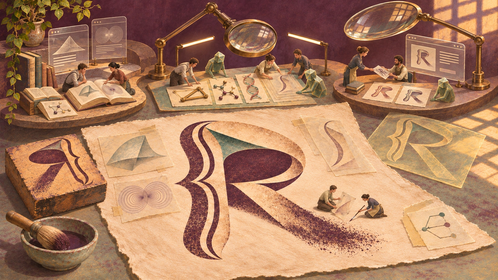
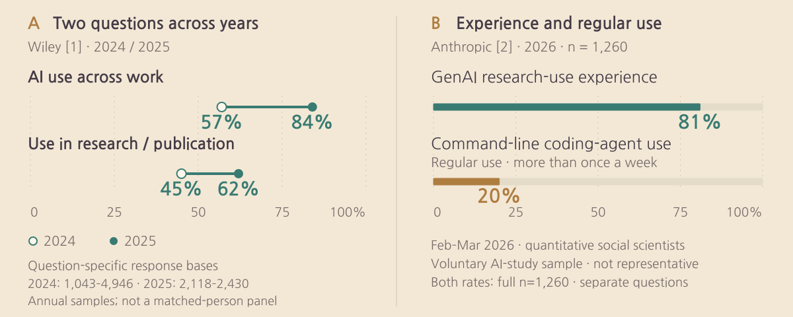
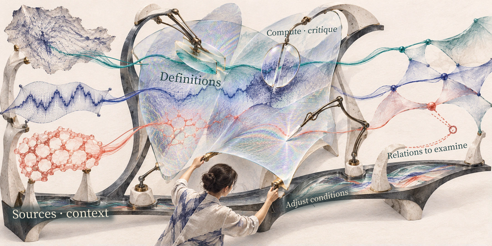
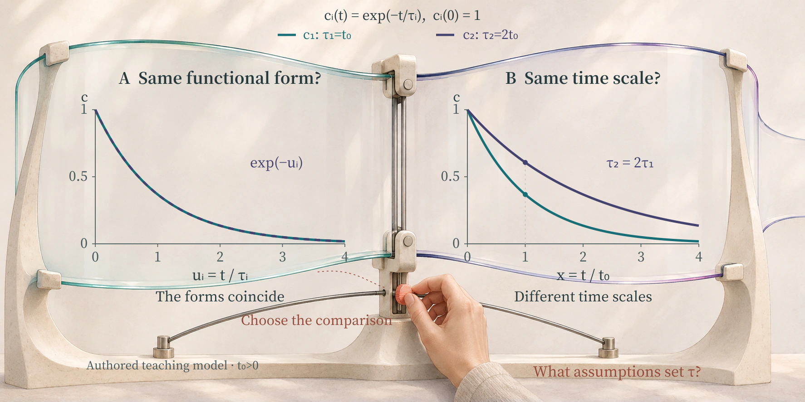
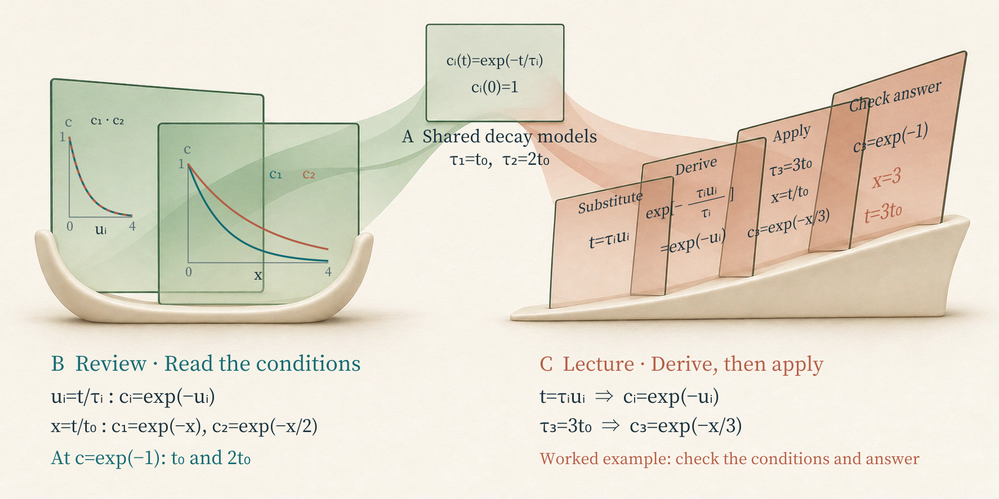
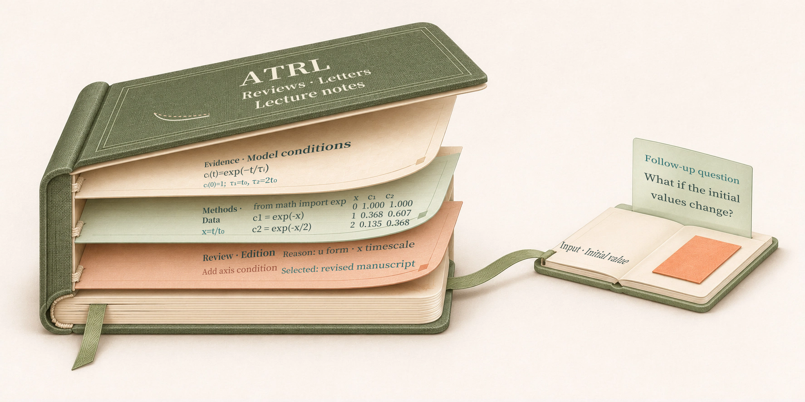

# ATRL: Agentic Atelier for Tech Review Letters

Knowledge Flows in the Agentic Era: The Emergence of a Research Atelier

Responsible editor: Hyun-Jung Kim · AI assistance · Sources checked through 2026-11-12

<figure class="hero"><figcaption>A workshop where people and small AI collaborators read and compare research materials from different fields, shaping them into one review page bearing an R. Reassembly under magnifiers and the overview and operational work on the right evoke an atelier connecting investigation, editing, review and delivery. AI-edited conceptual illustration.</figcaption></figure>

Reopening a paper can bring a new question into view through an equation or figure we passed over before. A curve resembles a result from another field, and we wonder whether its method could apply to the problem we are working on now. Exploring that connection means comparing the studies’ assumptions and changing calculation conditions. A small judgment about what to compare can change the direction of further research or the explanation we offer readers.

The person who shapes and runs the ATRL atelier develops such interests into editorial ideas and research directions, organizing people and agents to pursue them. An agent investigating sources or performing a calculation may return a different interpretation, changing the initial question. A fault in the publishing tools found while delivering a revised argument can bring operations into the work too. Reading materials and developing ideas, writing and reviewing, and repairing the tools that support them meet within one workflow.

**ATRL—Agentic Tech Review Letters—is a research atelier being organized around this flow of knowledge and ideas through collaboration among people, agents and tools.** It interprets research in quantum science, AI, materials and biology through reviews, letters and lecture notes. The title’s Agentic Atelier for Tech Review Letters expresses the character of the workspace that makes the journal. In this essay, the atelier itself comes under examination: how its operator chooses questions and organizes editorial and operational work, and how problems encountered along the way change both manuscripts and the workshop’s structure. Designing and reexamining the environment for reading and explaining research becomes part of inquiry and creation here.

## From the spread of tools to the organization of work

Wiley’s ExplanAItions comparison reports workplace use rising from 57% in 2024 to 84% in 2025, and research/publishing use from 45% to 62%.[1] Figure 1A marks each item’s response percentages for the two years with two points. Respondents, item-level sample sizes and recruitment periods differ between years.

Among 1,260 quantitative social scientists surveyed by Lyttelton, Massenkoff and Wilmers in February–March 2026, 81% had used generative AI to assist research; 20% regularly used command-line coding agents more than once a week.[2] Figure 1B’s two bars represent separate questions about experience and regular tool use. Respondents volunteered for a study offering Claude Max accounts, so the figures describe use in that selected sample.

<figure><picture><source media="(max-width: 640px)" srcset="../figs/research_agent_evidence_mobile_en.svg"></picture><figcaption>Figure 1. AI and agent use in research. A: Wiley’s annual comparisons; item-specific n=1,043–4,946 in 2024 and 2,118–2,430 in 2025, not a longitudinal panel.[1] B: Anthropic’s February–March 2026 survey of quantitative social scientists (n=1,260), a volunteer sample for an AI-workflow study.[2] Recruitment, questions and denominators differ between panels; B’s categories overlap. Replotted by the atelier from institutional reports.</figcaption></figure>

For experience with these tools to develop into work connecting planning, investigation, writing and review, someone must decide which questions to assign to whom and what to change in response to the results. A writer needs the assumptions behind earlier investigation to prepare a draft; a reviewer needs to find its evidence and compare it with the explanation. The person running the atelier gives these relationships form through editorial direction and the arrangement of roles and tools. ATRL examines how the resulting work proceeds and how that arrangement should change when difficulties arise.

## A workshop reconfigured around each question

Planning in the atelier begins by bringing a new paper together with studies, explanations and calculations already examined. Readers’ questions and uncertainties arising during production join the connections that drew the operator’s interest. Checking whether an approximation holds in another study, or what would distinguish similar-looking results, turns an initial interest into a concrete question for comparison. The direction of the next article and the work it needs take shape together.

The **harness** connecting this work is a structure that brings together materials, roles, tools and records. The operator’s motivating question becomes a brief and criteria for investigation; findings support the draft; review comments identify what needs revision. Further investigation or calculation can call for a new division of roles. The structure also establishes who has authority to handle which materials and which results should pass to the next task. As participants work toward an answer, they adjust this arrangement too.

ATRL currently keeps plans, manuscripts and calculation materials in the repository and uses shared records to convey the context another session needs. Conventions connecting editorial and review guidance, publishing tools and operational records form the architecture; routes selected and revisited for each task form the workflow. Common editing and publishing APIs, an administration interface and more consistent management of task states are planned in stages.[3]

<figure><picture><source media="(max-width: 640px)" srcset="../figs/harness_configuration_mobile_en.svg"></picture><figcaption>Figure 2. A harness reconfigured around a question. Participants select comparison objects and conditions and arrange specialist work and tools while preserving the identity of different sources. Human perspectives and evidence, calculations and critiques proposed by agents change the work configuration; the frame connects those choices with sources and shared context. Open connections identify relationships for further review and the next question. Materials and deformation express source identity and comparison choices in a conceptual interpretation of collaboration described in public organization and operations documents.[3] AI conceptual artwork and atelier annotations.</figcaption></figure>

For example, suppose we plan a review asking whether two similarly declining curves change at the same rate. Two imagined signals starting at 1 let us look closely at work moving from a question through calculation and review to a revised explanation. The planner asks the team to distinguish curves overlapping from their losing the same amount over the same time. An investigation role finds the model and axis definitions; a calculation role redraws the signals in the same time unit; a writing role prepares to explain the difference to readers. Following this small educational brief, we can see which judgments change the work of the next role.

When the note on the axis definitions returns, the planner asks what has been aligned in the comparison described as “overlapping.” If each curve uses a time scale suited to its own rate of decay, a plot using the same clock is needed too. The brief becomes more specific: read both representations together and examine what can be said under each condition. The prompt conveys the readers and comparison purpose, together with what to recalculate, which results to read together and what explanation to revise.

The transparent comparison surface moved by a person in Figure 2 draws attention to a choice: which materials and conditions should be read together? The model definition, calculation results and review comments remain distinguishable, like the different materials in the scene. A changed purpose of comparison can call for a new selection of definition checks, recalculation and critique, while the support beneath retains sources and reasons for those choices. The open connection on the right leaves room for relationships and questions still to examine.

Aligning assumptions, reference values and quantities defines the comparison conditions for this task. Editorial criteria shared across tasks include preserving sources and conditions of validity for claims, actual review scope and revision records. The original study’s results, the review’s interpretation and educational calculations should each be identifiable. Records should let the next participant establish who reviewed which materials and versions, how far that review extended and which published edition incorporates a revised explanation.[3]

### Exchanges in planning, responsibilities in the work

The person running the atelier sets its motivating questions and creative and editorial direction, organizing editorial, authoring and development/operations work. This intellectual direction connects with the Human Lead’s responsibilities for priorities, authority and final publication. For an individual article, a user posing a question, a researcher or an article planner can propose the purpose, readers and scope of comparison and receive findings and alternatives. Human Audit records the objects and scope actually examined in planning, evidence, interpretation and expression. The same person can combine atelier operations, article planning, editorial responsibility and review; the role and authority exercised in each task are made explicit. Supplied materials are evaluated as evidence; tool use and publication follow the authority granted.

The atelier organizes editorial and authoring work as the **Agentic Editorial and Authoring Team (AEDAUT)**, and work on shared technical infrastructure as the **Agentic DevOps Team (ADOPT)**. Configuring the roles of people and agents for a task, and connecting tools, permissions, shared records and hand-offs, is also part of designing the harness.

<figure class="architecture-map"><picture><source media="(max-width: 640px)" srcset="../figs/atelier_architecture_mobile_en.svg"></picture><figcaption>Figure 3. A shared working harness and the collaboration graph within it. The outer frame brings human planning and review, both teams, the shared work substrate and publication into one working environment. Connections inside it carry intent and prompting, requirements and reproduction materials, tools and check results, and version references among roles. AEDAUT handles content and publication judgment; ADOPT and its internal Proseeker unit handle technical infrastructure and review of related risks. Team membership, cooperation and record relationships are reconstructed from public organization and operations documents through the harness and graph perspectives.[3] Vector diagram created by the atelier.</figcaption></figure>

The **editorial team** handles topics and arguments, investigation, writing, visual creation, editing, scientific review and content corrections. People and agents exchange drafts, critiques and revisions; within the authority already granted for the task, the editorial team can judge publication and use the posting tools directly. Agent roles and tools are configured for each task.

The **development and operations team** maintains shared tools and publishing routes, together with the technical infrastructure for search, performance, accessibility, storage and recovery. Its **security and reliability part, Proseeker**, examines assets, permissions, data boundaries and related risks in the work, and verifies improvements. Figure 3’s outer frame brings these roles, tools and records together; its internal connections link planning, production, review and handoffs.[3]

In the educational brief, the planner conveys the purpose of comparison, and AEDAUT returns definition-checking notes, redrawn curves and an explanatory draft. The upper exchanges in Figure 3 show that the planner, too, can revise the explanatory order and the request. Task-specific agents use shared records to establish which model, inputs and version were used, and which equations, axes and sentences were reviewed.

Which work receives most attention depends on the question. When examining an algorithm’s performance, the inputs, comparison methods and accounting of computational resources may matter. A study of material properties requires attention to symmetry and model assumptions, together with sample and measurement conditions. A text teaching theory needs scrutiny of omitted derivation steps and examples learners can work through themselves. These needs determine the balance of investigation, calculation and visualization, and the checking methods.

### Choosing a comparison for the same curves

Let us return to the two curves. Asking whether the signals decline in the same shape differs from asking whether the same amount remains after the same elapsed time. Using each signal’s own decay timescale as the unit lets us align their shapes. Using the same clock’s units lets us compare what remains at the same time. That choice of scale determines what “the same” means.

Figure 4 makes the distinction with two imagined signals starting at 1. We choose a simple exponential-decay rule in which the rate of decrease is proportional to the amount remaining, and give the second signal a decay timescale twice that of the first. Writing down the rule and conditions lets us redraw the similar-looking curves and compare an explanatory sentence with the calculation.

In the expression, cᵢ(t) is the signal’s relative magnitude at time t, with subscript i distinguishing the two signals. The decay timescale τᵢ sets how quickly it declines: a longer timescale means slower decay. The notation exp denotes the exponential function. Choose a shared time unit \(t_0>0\) and use the following rule for \(t\geq0\).

$$c_i(t)=\exp(-t/\tau_i),\qquad \tau_1=t_0,\quad \tau_2=2t_0.$$

First compare the shape of the decline, or functional form. Plot time divided by each signal’s own characteristic time \(\tau_i\), using the axis \(u_i=t/\tau_i\). Both functions are then displayed as \(c_i=\exp(-u_i)\) and coincide. The same coordinate value \(u_i=1\) refers to \(t=t_0\) for the first signal and \(t=2t_0\) for the second. Both points mark one characteristic time for their respective signals.

Now ask how much remains after the same time has elapsed for both signals. Read them on the common axis \(x=t/t_0\), dividing both times by the same reference. Their values are then

$$c_1=\exp(-x),\qquad c_2=\exp(-x/2).$$

<figure><picture><source media="(max-width: 640px)" srcset="../figs/editorial_workflow_mobile_en.svg"></picture><figcaption>Figure 4. Different comparison questions lead to different readings of the same two curves. A’s normalized axis shows a shared functional form; B’s common time axis shows different timescales. This illustrative example enlarges a local task in which checking definitions, selecting an axis, redrawing and reviewing change the explanation and next question. Mathematical diagrams by the atelier and AI conceptual artwork.</figcaption></figure>

The second signal takes twice as long as the first to decay to the same value. The overlap in Figure 4A reveals a shared shape when each is read on its own timescale; their separation in B reveals different amounts remaining at the same time. A shared functional form and different timescales can both be established from this pair of signals. The explanatory sentence depends on which comparison the reader wants to understand.

A writer uses this calculation to specify which axis and quantity are meant in the sentence “the two models are the same.” Explaining the amount remaining at the same time requires showing the difference on the common time axis. Asking what causes a decay timescale in an actual study calls for selecting models and observations suited to that problem. Here, choosing a comparison purpose changed the calculation request and explanatory sentence; a new question about causes would change the investigation again. The harness connects definition-checking notes, calculation inputs and results, and revised wording, retaining these changes in judgment within the work.

## Interests and changes in the atelier across 55 reviews

<figure><picture><source media="(max-width: 640px)" srcset="../figs/hub_observation_mobile_en.svg"></picture><figcaption>Figure 5. Topic composition and recurring work across 55 reviews. A: Current primary publisher categories arranged by stated publication month. The top three categories are shown separately; the other seven are combined in one color. B: The 11 tags whose original labels appear in at least three reviews; each review can have multiple tags. C: The changing focus of six OLED inverse-design reviews in chronological order, a subset of the 16 OLED-tagged works. The aggregation uses current titles, categories and tags in the snapshot fixed on 9 November 2026.[4] Recounted from the atelier’s public records. <a href="../artifacts/hub-publication-topics-v15.json">Definitions, categories, series and link evidence (JSON)</a> · <a href="../artifacts/hub-publication-topics-v15.csv">Data for all 55 reviews (CSV)</a>.</figcaption></figure>

The operator’s interests and the work devoted to them leave traces in the published articles. In the public listing fixed on 9 November 2026, the current primary categories of 55 reviews include 21 in Quantum Computing, 13 in AI for Science and 11 in Materials AI, together accounting for 45 works.[4] The remaining 10 include three on Agent Systems, two on AI Hardware, and articles on security, governance, foundation models and other topics. Research objects, computational methods and questions about operating those tools share the publication space. Reading this composition alongside the revision records below brings the range of interests and ways of working on them into view together.

Arranged by their stated publication dates, there are 9 reviews in May–July, 41 in August–October and 5 in 1–9 November. Read alongside the articles behind them, Figure 5A’s colors show publication centered on quantum computing and materials in August, followed in October by work also addressing AI for Science, security and neural-network interpretation.[4]

Keywords reveal interests recurring across categories. Counting each tag once per review, OLED appears in 16 works, VQE and Quantum Chemistry in 9 each, Molecular Inverse Design in 7 and D-Wave in 5. The OLED tag spans nine Materials AI reviews and seven Quantum Computing reviews. Within that group, six OLED inverse-design reviews dated seven days apart from 28 August to 2 October address mechanism-centered labels, multiple excited states, collective excitons, sparse conditions, generation validation and triplet-state control. Across these studies, the series returns to how the task of choosing light-emitting molecules should be expressed through physical properties, and under which conditions candidates should be validated.[4]

Some reviews leave routes for rereading directly in their text. In the fixed snapshot’s Korean authored text, 11 reviews contain 14 directed links to other reviews and two to separate lecture materials. [The 6 September DeMARS review](https://infant83.io/AI_Tech_Review/reviews/2026-09-06_agentic-programs-materials-science/) refers back to [the 23 May review of AI scientists](https://infant83.io/AI_Tech_Review/reviews/2026-05-23_ai-scientist-execution-harness/), narrowing the question from verifying a broad research harness to tasks with bounded responsibility, such as generating atomic models. [The 13 September Avatar review](https://infant83.io/AI_Tech_Review/reviews/2026-09-13_avatar-scientific-workflow-control/) revisits DeMARS and turns to decisions about handling failures during computation, expanding resources and ending a search. Readers can follow how work grouped under the same word “agent” changes in what is delegated and how its results are checked.[4]

As new articles were planned, the way earlier ones were handled changed too. Editorial methods and standards for disclosing review scope were published on 29 August; the initial 49-article revision queue registered on 27 October has completion records for 14 works at the fixed snapshot. [The TabPFN review](https://infant83.io/AI_Tech_Review/reviews/2026-05-07_tabpfn-oled-manufacturing-foundation-model/) also records a further expansion on 29 October. That work distinguishes the May evaluation from new material, adding competing models, changes in evaluation and prospects for use. The category and link counts here describe current editions incorporating such follow-up work.[4] Revising interpretations in light of new material went hand in hand with decisions about how to review and publish those changes.

These same 55 reviews link to 96 language-specific web pages, including actual English text for 41 works. Sources/evidence and disclosures of preparation and review scope were found in every current review.[4] Tools available for such writing and calculation included Claude Code, released as a research preview in February 2025, and the Codex app for parallel agent work, released in February 2026.[5] Alongside choosing tools, the person running the atelier has to organize the shared work of handling different topics, language editions, attachments and revisions. These records show interests developing into a series, new questions referring back to earlier articles and changes in the evidence prompting revisions. Reexamining the resulting work gives the atelier material for its next brief and for changes to review and operations.

## Reviews and lecture notes build different explanatory paths

<figure><picture><source media="(max-width: 640px)" srcset="../figs/explanation_design_mobile_en.svg"></picture><figcaption>Figure 6. Designing explanations for different purposes from the same educational model. A specifies the educational decay function and initial value. B is a review interpreting a shared form on normalized axes and the times t₀ and 2t₀ needed to reach exp(−1) on a common axis; C is a lecture working through substitution and applying it with a characteristic time of 3t₀. The four learning surfaces contain the substitution, simplified exponent, τ₃ application and checkable reaching-time answer. B’s plots and the equations on the surfaces use the same educational model. Existing AI conceptual artwork with exact mathematical plots and worked steps authored as vectors by the atelier.</figcaption></figure>

Editorial direction also becomes visible in the explanations chosen for the same material. A review of the earlier decay model commissioned to “explain the difference between curves overlapping and decaying at the same rate” needs to bring the two plots together. In Figure 6B, the models reach exp(−1) at t₀ and 2t₀ on the common time axis; on axes normalized by their respective characteristic times, they coincide in functional form. The review is organized to help readers judge the conditions for stating those similarities and differences.

If a separate lecture is planned using the same model, the request could be, “Show the intermediate substitution steps, then let learners practice with a third model.” Figure 6A’s model specification gives the function and initial value 1; C’s four surfaces contain the substitution, intermediate calculation, third model and a checkable exercise answer. The lecture first shows how substituting \(t=\tau_i u_i\) into the original expression gives \(c_i=\exp(-u_i)\). A worked example introduces a third model with initial value 1 and characteristic time \(\tau_3=3t_0\), and uses the common axis \(x=t/t_0\) to obtain \(c_3=\exp(-x/3)\). Learners can plot the third function, compare it with the first two and calculate the time needed to decay to exp(−1). They can then compare their solution with the last surface’s check: x=3, hence t=3t₀.

The purpose of the explanation also changes what a reviewer should correct. If the review omits the axis condition, a reviewer compares Figure 6B’s plots and asks for “they share a functional form on axes normalized by their respective characteristic times.” If the lecture solution skips from the substitution to the final expression, the intermediate calculation corresponding to Figure 6C’s derivation surface is added. The planner uses this distinction to change the explanatory order or assign further calculation. Interpreting the same model and enabling learners to work through it call for different editorial decisions.

Once writing and review are complete, content is rendered with tools suited to its format. Reviews currently register each article’s reviewed text, translation and attachments; lectures written in-house package lecture material, problems, solutions and practical exercises with dedicated production tools. Outputs from both formats are assembled into a candidate site before publication. Checks examine the connections among articles, listings, search and preserved materials, and whether existing published editions remain intact.[3] Figure 7B details candidate checks and public-edition comparison; Figure 8 connects them with the shared infrastructure that sustains the work.

## Reviewing drafts and visual proposals together

In the [quantum-circuit review](https://infant83.io/AI_Tech_Review/reviews/2026-11-04_quantum-gates-phase-and-interaction/), a calculation that changed the problem’s pattern of connections prompted another look at the example and its conditions of application. In other tasks, a derivation check or comparison of measurement conditions or literature can serve this role. Choosing how to check an explanation is part of planning too.

How does the quantity a predictive model estimates well relate to the material property a researcher wants to understand? Does reducing numerical error bring us closer to answering the theoretical question? What new observation could distinguish two interpretations? Domain knowledge helps turn these questions into conditions and observables to compare. Literature or unexpected calculation results found by an agent can also change an editor’s initial idea.

Directing visuals means specifying which quantities and relationships to emphasize, at what scale and in what reading order. Reviewers compare the proposal’s objects, directions, counts and scales with the text, revising images or annotations that suggest a different meaning. Making the figure can reveal an unclear basis of comparison and prompt a reconsideration of the argument itself.

In Jiang and colleagues’ Co-STORM, people can add questions and perspectives to discussions among language-model agents, updating the materials and organization of the discussion. The information explored is assembled into a mind map and a report with citations.[6] What ATRL draws from this example is how a participant’s question can change both the gathering of material and the organization of discussion. The atelier’s operator and article planners, too, revise their initial perspective and arrangement of work in response to evidence and critique.

When review calls for further investigation, the editorial team (AEDAUT) adjusts the plan and writing. Human review and agent verification each record the objects, versions and extent of what they actually examined.[3] Feedback on recurring prose habits also entered the shared editorial criteria. A tendency to end a paragraph by denying something it had never claimed became a point to examine in later drafts. Revising one article led to revising how subsequent articles would be reviewed. Guidance produced by the atelier is itself reread against actual writing and feedback.

## Editorial, operations and security cooperation and version management

The public operations record describes an incident in which a reviewed revision was ready, but the public article remained at an earlier version. The publishing route had reused an old output. Operations repaired the linkage between the reviewed version and the hashes of the output to be published, along with the regression checks.[3] Reading Figure 7B’s reviewed inputs together with its publication/comparison stage makes clear what needs checking: whether the reviewed changes entered the output made from those inputs, and whether that output reached readers. In this incident, the publishing route carrying the manuscript became the object of review; its repair remained in the tools and checking criteria for subsequent work.

<figure class="collaboration-map"><picture><source media="(max-width: 640px)" srcset="../figs/collaboration_mechanism_mobile_en.svg"></picture><figcaption>Figure 7. Conditional handoffs and routes for verification, revision and resumption. A: Requirements, evidence and technical support exchanged between the teams, with risk review by Proseeker within ADOPT. B: A candidate passing checks proceeds to publication/comparison; mismatches return to necessary repair and re-verification. Unfinished checks retain version, checking scope and next action for resumption at the same stage. C: Roles responsible for content, technical and authority decisions, and the boundaries between public and private records. Reconstructed from public organization, operations, security and publication rules.[3] Vector diagram created by the atelier.</figcaption></figure>

The operations team (ADOPT) receives such technical problems and improves shared tools and procedures. When support is needed, the editorial team passes on the relevant article, reviewed version, conditions in which the problem arose and expected result. ADOPT reproduces the problem and connects technical repair, independent verification and operational checks, returning matters of content judgment to AEDAUT. Within ADOPT, Proseeker examines assets and responsibility for them, permissions, inputs, tools, dependencies, public/personal data boundaries and recovery risks. Figure 7A shows this exchange of requirements and check results.

A publication request binds content hashes—values identifying the reviewed manuscript and registration information—to record which inputs produced an output. If the inputs change, the candidate is checked again, including whether an existing article’s ID, URL, publication date or PDF links have changed unexpectedly. In Figure 7B, a candidate passing checks proceeds to publication and comparison with the live edition. A mismatch in candidate checks calls for the necessary manuscript or tool repair and re-verification. If checks remain unfinished, the version, checking scope and next action are retained for resumption at that stage in the next session. A technical-support handoff also refers to these publication records in the shared issue, so participants point to the same version and evidence.

AEDAUT handles content corrections; ADOPT and Proseeker handle technical and security repairs, while investigation, repair and verification within existing authority can continue. If a new paid commitment, destructive change or change to public access or authentication architecture exceeds that authority, the team prepares the impact, alternatives and recovery plan and asks the Human Lead or the user who granted authority for the necessary decision. Public records retain summaries of issues, actions and verification; access to sensitive evidence, such as secrets or personal material, is managed separately. Figure 7C marks these boundaries of judgment and records.[3]

How would this version management help with revising the educational review? Suppose the normalized-axis condition has been added to the manuscript, but the candidate still contains the old wording. The editorial team passes on the revised manuscript and figure versions, the condition expected in the candidate and the old wording actually observed. Figure 8’s central handoff note specifies inputs, expectations and observations together.

<figure><picture><source media="(max-width: 640px)" srcset="../figs/coupled_cycles_mobile_en.svg"></picture><figcaption>Figure 8. Two loops connected through the same version and checking scope. The explanation loop on the left revises and reviews definitions, plots and prose. The operations loop proceeds through repair of shared tools and handoffs and the editorial team's checks with subsequent inputs. The central input/expected/observed note and the shared harness of tools, permissions and version records connect the loops. The right-hand check point, x=2, has c₁=0.135 and c₂=0.368 in the same model, rounded to three decimal places.[3] Existing AI conceptual artwork with manuscript, calculation and handoff examples and feedback paths authored as vectors by the atelier.</figcaption></figure>

In this educational scene, AEDAUT’s explanation loop on the left compares definitions, plots and prose, feeding review findings into the next revision. If the candidate shows a mismatch, the central note passes the same version, expectations, observations and checking scope to ADOPT. ADOPT repairs the tools and handoff and returns verification results. The operations loop through the base and handoff checks changed tools with subsequent inputs. On the right-hand surface, the editorial team chooses another check point, x=2 in the same model, and compares it with the CSV and plot. Tool repair and content review refer to the shared harness of tools, permissions and version records; problems found in rechecking return to their respective revisions.

## Designing repetition and the paths of collaboration

Sustaining the revision of explanations and tools requires deciding what the next task inherits. How to organize such repetition has also become an important question in agent development. Geoffrey Huntley’s **Ralph loop** repeatedly runs a coding agent, has it reread specifications and a work plan, and feeds test and static-analysis results into subsequent revisions. Observed failures also inform changes to prompts and working instructions.[7] The design question is what the next execution inherits and what evidence changes its actions.

Recent research has begun organizing these concerns under **loop engineering** and **graph engineering**. A survey preprint by Feng and colleagues proposes a widening design focus: from a harness of tools, memory and execution infrastructure, to iteration with goals, verification and termination conditions, and then to graphs organizing tasks, agents and execution states.[8] A cloud-engineering preprint by Sakhinana and Runkana combines the three as complementary concerns. The harness constrains tool use and authority; loops provide bounded diagnosis, repair and re-verification; graphs specify subsequent stages and recovery routes conditional on verification results.[9] What work is permitted, what needs checking again and who receives the result become joint design questions.

Repetition in ATRL works at several timescales. Within a manuscript, participants compare definitions, revise calculations and explanations, and review that version. In recurring editorial investigation and revision, earlier articles and unresolved questions inform the next brief. Regular development and operations sessions resume from the previous execution, unfinished issues and changes since the last check. The current schedule calls for retaining an issue’s stage, owner, resumption point, dependencies and next review time. A candidate awaiting checks is held from deployment; work that can proceed independently continues while required evidence is pending.[10] A scheduled execution provides an occasion to revisit the work; designing the state and criteria it inherits gives that repetition its structure.

The object of revision can change too. Adding an axis condition to the educational decay example may be a revision confined to that manuscript. A recurring explanatory problem across articles calls for revising shared editorial criteria. When a reviewed version failed to reach the public page, the publishing tools and regression checks were repaired.[3] Figure 8 shows the junction between revising an article and repairing its working environment, then checking that environment with the next inputs. Both the output and the procedure that produces it become objects of improvement.

The relationships connecting these loops can be read as a graph. In Figure 3, human planning and review, the editorial team, development and operations with its internal Proseeker unit, and task-specific agents perform different judgments and actions. Their connections carry different materials: investigation requests, calculated results, revision comments and technical handoffs. Figure 7 shows conditions under which work passes to another role. For example, an incorrect interpretation of a curve calls for the editorial team to reexamine definitions and calculations; a correctly revised sentence missing from the candidate calls for development and operations to reproduce its generation and delivery route. If disclosure of personal material or tool permissions becomes relevant, Proseeker examines the risk within the operations team. Shared records connect each judgment to its version and checking scope.

Human prompting and review change work within these relationships. If the planner changes the question from “Do the curves overlap?” to “Does the same amount remain at the same time?”, the comparison axis, calculation request and acceptance criteria for the explanation all change. Participants also reconsider which results to wait for and which investigations can proceed in parallel. In ATRL today, they adjust these connections by consulting organizational conventions, shared issues, manuscripts and version records. A further design task is to record the relationships more explicitly, so that a changed condition or version leads participants to the calculations, figures and explanations requiring another check.

**In this sense, ATRL can be read as an advanced, integrated harness that jointly organizes the working environment, iterative work and relationships among roles.** In planning the next article, the atelier’s operator also designs which evidence to bring in, whose judgment it should pass through and under which conditions work should return for revision. Testing and revising that design through actual writing and operations becomes part of the atelier’s research and creative practice. The explanations it makes accumulate traces of the collaborative structure that made them possible.

## A route from publication back to planning

Preserving published articles and materials makes a route for this flow to return to planning. Imagine another participant reopening the educational decay example some time later and asking, “Can we make the same comparison when the initial values differ?” Continuing that inquiry requires finding how the earlier model set its initial values, which inputs produced the curve values and why two different axes were used. The retained definitions, calculations and review materials help them choose inputs to change and graphs and explanations to check again. The archive enters the work as a stage at which new planning selects and reuses the context it needs.

<figure><picture><source media="(max-width: 640px)" srcset="../figs/reusable_archive_mobile_en.svg"></picture><figcaption>Figure 9. An archive design example unfolding the working materials behind a finished publication. Three leaves beneath the bound cover bring together the educational model’s definition and conditions, a common-time CSV with calculation code, and the review/version record adding the axis condition. CSV values at x=0, 1 and 2 are rounded to three decimal places from the existing educational calculation. The cover’s curve motif uses the same educational model. The ribbon touches a notebook on the right. Its question, “What if the initial values change?”, calls for selecting and reexamining context from these materials in a new brief. An archive design proposal based on existing ATRL records and FAIR/RO-Crate discussions.[3,11,12] AI conceptual artwork with model, data and review examples authored as vectors by the atelier.</figcaption></figure>

The FAIR principles support finding and reusing materials through identifiers and metadata, access and use conditions, and provenance.[11] RO-Crate describes the context and relationships of data, code and documents.[12] Figure 9’s bound cover represents ATRL’s reviews, letters and lecture notes, in which these materials have been shaped into an explanation. The first leaf beneath the cover holds the educational model’s definition and conditions, with initial value 1 and τ₁=t₀, τ₂=2t₀. The middle holds an extract of the common-time CSV and code computing exp(−x) and exp(−x/2); the bottom retains the revision reason, “add the axis condition,” and the selected revised manuscript. Unfolding the three records reveals the conditions chosen, values calculated and reasons for changing the wording of the finished explanation.

A subsequent participant checks the first leaf beneath the bound cover for the initial-value condition of 1, then compares the middle leaf’s CSV values 0.368 and 0.607 at x=1 with the plot. The review record on the bottom leaf provides grounds for revisiting why the explanation was revised to distinguish the two axes. Reading the three records behind one explanation, they choose which inputs to change and which interpretations to reexamine for the new question in the notebook on the right. Preserving definitions, calculations and revision reasons together provides a checked starting point for preparing calculation and interpretation under changed conditions.

Other tools offer ways to organize parts of this flow. In Elicit’s shared Research Agent sessions for Scale and Enterprise teams, an agent proposes a draft change; the user can accept it into a new version, with a history of changes retained.[13] The point ATRL draws on is a way to examine participants’ revision judgments and their results within the same work.

Reusing an executable method requires keeping track of more connections. Miao and colleagues’ Paper2Agent turns papers and code into agent-callable tools. In the authors’ evaluation of 100 computational-biology papers, tool extraction, execution and automated validation were completed without human intervention for 74. Others faced missing runnable code, data or models, dependency problems and hard-to-generalize scripts.[14] This 74/100 is the tool-conversion completion rate for the evaluated papers. ATRL, too, needs to pass execution routes, assumptions and comparison results along with the text so a method can be used under new conditions.

Readers can use these public materials to check sources, change the conditions of a calculation or work through lecture examples and problems. A subsequent agent can use particular versions of public manuscripts, code and materials as external evidence. Crediting the original authors and stating the terms of use and scope of our explanations and educational calculations also leaves grounds for proposing other interpretations and corrections.

When a reason emerges to apply a method to another problem, we can record which assumptions must remain the same and which conditions change. Evidence supporting or challenging the connection and a way to check it next can be retained too. The person running the atelier can choose its next topic from such candidates and arrange investigation, calculation and critique anew. Unfamiliar connections and unfinished questions become material for reading, writing and operations to take up again.

The external approaches in Table 1 address different layers of organizing research work: conversations that develop questions, shared revision decisions, executable methods and validation of hypotheses. ATRL uses these points of contact as comparisons when examining its own planning, writing, review and operations.

<strong>Table 1.</strong> Where agentic collaboration enters research. Functions and evaluations below are reported by the respective sources; the right-hand column gives design questions for ATRL’s development.

| Point of collaboration | External approach and verified scope | Question for the atelier |
|---|---|---|
| Developing questions while reading literature | Co-STORM lets people add questions and perspectives to agent discussions and updates the organization of materials: a research-system design example.[6] | How can a changed question and the reason for a comparison pass to the next investigation? |
| Passing research candidates to further validation | Co-Scientist connects hypothesis generation, critique, selection and revision, and links selected biomedical cases to laboratory validation.[15] | Which investigation, calculation or experiment could test a connection emerging from an explanation? |
| Preserving revision decisions in shared work | Elicit’s shared Research Agent is a team feature that incorporates changes after user acceptance and retains version history.[13] | How can another participant inherit the reason for a revision and the edition incorporating it? |
| Making a paper’s methods executable again | Paper2Agent: the authors report constructing executable agents from 74 of 100 computational-biology papers.[14] | How should sources, code, environments and review be passed on together for use under new conditions? |

## When the atelier itself becomes a subject of inquiry

While choosing what to research and explain, the person running the atelier also designs who will do the work, with which tools and criteria for judgment. Collectors gathering literature, reviewers comparing claims and assumptions, and creators proposing explanations, diagrams and candidate hypotheses are roles needed within this flow. The **research enabler** ATRL seeks to develop connects those roles to evidence, tools and subsequent action. The collaborative structure that makes reviews and lecture notes is itself a creative work: the operator and agents shape and revise it through the projects they undertake. This essay reads ATRL’s effort to examine its research subjects, explanations and collaborative structure within the same workflow as an emerging form of research and creative practice.

External research also treats the configuration of a working environment as part of conducting research. Where Co-Scientist in the table connects human goals and candidate selection to experimental validation, Station conducted research in an environment with internal literature, automated supervision and periodic reflection, without human intervention during execution. It was evaluated on rediscovery of predefined findings from three existing papers.[16] The questions it was allowed to explore and what counted as discovery are conditions for interpreting its performance.

Automation that changes working procedures is also being studied. Darwin Gödel Machine changed tool, prompt and workflow code while keeping the base model and outer selection process fixed, and was evaluated on coding tasks.[17] ATRL’s current improvements update explanations, criteria and tools in response to the operator’s direction and feedback from tasks. Adding prose-review criteria and repairing the publishing route involved redesigning the work’s structure while carrying out the work. Delegating more of these changes to agents also makes the scope of change and the criteria for judging improvement part of that design.

Reviewers compare original sources, fresh calculations and counterexamples to identify corrections and overlooked assumptions. That work can also uncover another explanation or prepare the next question. The correlations in errors across models reported by Kim and colleagues add a reason for such comparisons even when several agents agree.[18] Human judgments should remain open to evidence and challenge. Delegating part of an audit also calls for deciding which new problems will be used to test its results again.

This observation examined topic composition and publication rhythm, recurring interests, reading routes between articles and recorded revisions. These records provide a point of reference for examining how the operator has turned interests into briefs and organized the work of different roles. Next, we can observe how changing a question or review criterion changes the investigation, calculation and collaboration required. We could also record how long someone encountering the materials for the first time takes to revisit sources and calculations, whether calculations run under changed conditions and how well they locate outputs that need checking after a revision. Following which questions lead to investigation, calculation or experiment, together with the time spent by people and agents, revision burden and remaining uncertainty, would help us understand changes in this working environment.

An atelier examining the validation conditions for light-emitting molecules or the handling of computational failures now also examines how it organizes materials, people and agents. Problems found in manuscripts change tools and review criteria; the changed working environment becomes a condition for addressing the next question. **ATRL’s name atelier expresses a place where research interests and the structure for pursuing them take shape together.** While planning what to read and explain next, the person running the atelier also asks which relationships and procedures should change to examine that question. Work on knowledge and ideas, and the design of the environment organizing their flow, can be examined together within the same agentic workflow.

## References

[1] Wiley, [ExplanAItions: An artificial intelligence study by Wiley](https://www.wiley.com/en-us/about-us/ai/study); Wiley, [AI adoption jumps to 84% among researchers as expectations undergo significant ‘reality check’](https://newsroom.wiley.com/press-releases/press-release-details/2025/AI-Adoption-Jumps-to-84-Among-Researchers-as-Expectations-Undergo-Significant-Reality-Check/default.aspx) (7 October 2025; accessed 9 November 2026).

[2] T. Lyttelton, M. Massenkoff, and N. Wilmers, [Coding agents in the social sciences](https://www.anthropic.com/research/coding-agents-social-sciences) (27 May 2026; accessed 9 November 2026).

[3] Agentic Tech Review Letters, [ATRL 조직도와 아뜰리에의 공동 작업 구조](https://github.com/Infant83/AI_Tech_Review/blob/e5a8ac6f7ee51531f2cf853384742ff8f75c3d2f/ATRL_ORGANIZATION.md); Agentic Tech Review Letters, [ATRL 웹저널의 팀 이름과 역할](https://github.com/Infant83/AI_Tech_Review/blob/e5a8ac6f7ee51531f2cf853384742ff8f75c3d2f/JOURNAL_TEAM_CHARTER.md); Agentic Tech Review Letters, [ATRL 운영팀 ADOPT 개발 운영 정책](https://github.com/Infant83/AI_Tech_Review/blob/e5a8ac6f7ee51531f2cf853384742ff8f75c3d2f/DEVELOPMENT_OPERATIONS_POLICY.md); Agentic Tech Review Letters, [새 검수 원고의 첫 CI 게시가 구판 seed와 baseline 일치로 생략됨](https://github.com/Infant83/AI_Tech_Review/blob/e5a8ac6f7ee51531f2cf853384742ff8f75c3d2f/operations/issues/OPS-58a4237a-48d8-40da-af30-4b0edc80c943.json); Agentic Tech Review Letters, [글 등록과 배포 후보 만들기](https://github.com/Infant83/AI_Tech_Review/blob/e5a8ac6f7ee51531f2cf853384742ff8f75c3d2f/PUBLICATION_WORKFLOW.md); Agentic Tech Review Letters, [ADOPT 프로시커 보안·안정성 운영 기준](https://github.com/Infant83/AI_Tech_Review/blob/e5a8ac6f7ee51531f2cf853384742ff8f75c3d2f/SECURITY_OPERATIONS.md); Agentic Tech Review Letters, [개발 운영 기록](https://github.com/Infant83/AI_Tech_Review/blob/e5a8ac6f7ee51531f2cf853384742ff8f75c3d2f/operations/README.md); Agentic Tech Review Letters, [ADOPT 자산 기록](https://github.com/Infant83/AI_Tech_Review/blob/e5a8ac6f7ee51531f2cf853384742ff8f75c3d2f/operations/assets/README.md) (accessed 9 November 2026).

[4] Agentic Tech Review Letters, [AI_Tech_Review](https://github.com/Infant83/AI_Tech_Review), GitHub ([commit f34783648bdd6b93b7f7b7abb46d9488b84a3045](https://github.com/Infant83/AI_Tech_Review/tree/f34783648bdd6b93b7f7b7abb46d9488b84a3045); accessed 12 November 2026).

[5] Anthropic, [Claude 3.7 Sonnet and Claude Code](https://www.anthropic.com/news/claude-3-7-sonnet) (24 February 2025); OpenAI, [Introducing the Codex app](https://openai.com/index/introducing-the-codex-app/) (2 February 2026; accessed 9 November 2026).

[6] Y. Jiang, Y. Shao, D. Ma, S. J. Semnani, and M. S. Lam, Into the unknown unknowns: Engaged human learning through participation in language model agent conversations, in Proceedings of the 2024 Conference on Empirical Methods in Natural Language Processing (Association for Computational Linguistics, 2024), p. 9917, [doi:10.18653/v1/2024.emnlp-main.554](https://doi.org/10.18653/v1/2024.emnlp-main.554).

[7] G. Huntley, [Ralph Wiggum as a "software engineer"](https://ghuntley.com/ralph/) (14 July 2025; accessed 12 November 2026).

[8] Y. Feng *et al.*, Graph engineering in the era of LLM agents: From individual intelligence to system intelligence, [arXiv:2608.21156v2](https://arxiv.org/abs/2608.21156v2) (2026).

[9] S. S. Sakhinana and V. Runkana, Towards agentic cloud engineering: Graph and loop engineering with a zero-trust agent harness, [arXiv:2609.00050v2](https://arxiv.org/abs/2609.00050v2) (2026).

[10] Agentic Tech Review Letters, [운영팀(ADOPT) 과제 일정표](https://github.com/Infant83/AI_Tech_Review/blob/0f67956caf06c9c96b9f8918a8e3fb8cc0d5d504/operations/SCHEDULE.md); Agentic Tech Review Letters, [ATRL 운영팀 ADOPT 개발 운영 정책](https://github.com/Infant83/AI_Tech_Review/blob/0f67956caf06c9c96b9f8918a8e3fb8cc0d5d504/DEVELOPMENT_OPERATIONS_POLICY.md) (accessed 12 November 2026).

[11] M. D. Wilkinson *et al.*, The FAIR guiding principles for scientific data management and stewardship, [Sci. Data **3**, 160018 (2016)](https://doi.org/10.1038/sdata.2016.18).

[12] S. Soiland-Reyes, P. Sefton, M. Crosas, L. J. Castro, F. Coppens, J. M. Fernández, D. Garijo, B. Grüning, M. La Rosa, S. Leo, E. Ó Carragáin, M. Portier, A. Trisovic, RO-Crate Community, P. Groth, and C. Goble, Packaging research artefacts with RO-Crate, [Data Sci. **5**, 97 (2022)](https://doi.org/10.3233/DS-210053).

[13] Elicit, [Collaborate in a shared Research Agent session](https://support.elicit.com/en/articles/16649941-collaborate-in-a-shared-research-agent-session) (17 September 2026; accessed 9 November 2026).

[14] J. Miao, J. R. Davis, Y. Zhang, J. K. Pritchard, and J. Zou, Reimagining research papers as interactive and reliable AI agents, [Nature **658**, 1272 (2026)](https://doi.org/10.1038/s41586-026-11044-y).

[15] J. Gottweis *et al.*, Accelerating scientific discovery with Co-Scientist, [Nature **655**, 487 (2026)](https://doi.org/10.1038/s41586-026-10644-y).

[16] W. Du and S. Chung, Can AI agents make open-ended scientific discovery? Evidence from Station, [arXiv:2610.08927v1](https://arxiv.org/abs/2610.08927v1) (2026).

[17] J. Zhang, S. Hu, C. Lu, R. Lange, and J. Clune, Darwin Godel Machine: Open-ended evolution of self-improving agents, [arXiv:2505.22954v3](https://arxiv.org/abs/2505.22954v3) (2026).

[18] E. M. Kim, A. Garg, K. Peng, and N. Garg, Correlated errors in large language models, in Proceedings of the 42nd International Conference on Machine Learning, [Proc. Mach. Learn. Res. **267**, 30038 (2025)](https://proceedings.mlr.press/v267/kim25e.html).

## Preparation and verification

- Responsible editor: Hyun-Jung Kim.
- AI system: OpenAI Codex. The exact model identifier was not preserved in this production record.
- Roles: gate_article_editorial revised bilingual prose and captions for Figure 9 and its adjacent explanation. gate_article_physics reviewed the meaning of the publication, three supporting record layers and follow-up question, with the example’s conditions. agent_standards authored exact vector contents and desktop/mobile arrangements and handled web/PDF production and checks. root edited the bare artwork with the built-in image tool and compared prose, sources, outputs and edition records.
- Method: [AI Tech Review Editorial Harness](https://infant83.io/AI_Tech_Review/methods/), base edition 2026.08 with scientific-explanation and prose supplements dated 2026-11-06. Revision 23, produced on 2026-11-10, refines Figure 9 so a finished publication can be read together with the evidence, methods and editorial judgments behind its explanation.
- Scope of evidence: The eight structural/operational sources retain e5a8ac6 and the 55-review observation retains f347836. Fourteen references, mathematical conditions, educational CSV and statistical materials were preserved. Figure 9 unfolds an existing teaching model and records as a design example. No new external study, experiment, performance measurement or scientific numerical calculation was added.
- Human review record: The responsible editor asked for Figure 9’s top to read as a finished book cover and the concrete contents of its supporting layers to form that explanation together. Agents reviewed the new artwork, materials, bilingual explanation and outputs. The responsible editor requested publication on 2026-11-10. Line-by-line human review and a separate human-reader study were not performed.
- Visuals: The earlier text-free Figure 9 artwork was edited once with the built-in image_gen tool. Exact model, code, CSV and review records were authored as vectors on the new bound-book scene. Four desktop/mobile language variants changed; the other thirty-two SVGs, B3 hero and existing data were retained. Encoding-only WebP conversion and SVG presentation are distinguished from creative raster editing.
- Edition: Revision 23, prepared for publication on 2026-11-10. Displayed publication date and evidence cutoff remain 2026-11-09. Figure 9’s bound cover, three content layers and follow-up question were redrawn and its adjacent bilingual explanation aligned. The remaining argument and evidence retain their identities; actual review scope, inputs and final outputs were recorded. The public edition was prepared following the responsible editor’s publication request on 2026-11-10.
- Applied versions and review: The base method and supplements dated 2026-11-06 retain their identities. Current Figure 9 artwork, vectors, surface placement, bilingual explanation and actual-output review are distinguished from earlier manuscript, figure and data review. They are not recorded as a new model experiment or measurement of quality effects across the 55 reviews.

Revision 24, prepared on 2026-11-10, introduces the editorial and development/operations teams by function in the summary and defines their full names and acronyms before Figure 3. It connects the arrangement of people, agents, tools, permissions, shared records and hand-offs to harness design. Existing research evidence, calculations and figures are retained; checks of this wording and its outputs are distinguished from earlier revision reviews.

Revision 25, prepared on 12 November 2026, adds a section after Figure 8 on designing iteration and collaboration paths. It compares Huntley's original Ralph account, two loop/graph-engineering preprints and public recurring-operation records at 0f67956; the original fourteen references retain their contents and versions within a renumbered list of eighteen. Manuscript revision, scheduled resumption, shared criteria/tool improvement and the relationships among people, editorial work, operations and Proseeker are interpreted as the design of an integrated harness. The editor supplied this direction; loop_graph_evidence and loop_graph_sources independently checked operational evidence, literature and bilingual argument. loop_graph_production handled disclosure, bilingual web/PDF production and output review. No new scientific calculation, effect measurement or artwork was added; the existing model, 55-review dataset and thirty-six figure variants remain. Additional sources were checked on 12 November 2026; prior observational/organizational snapshots and the base harness edition retain their identities. The reader-friendly explanation supplement dated 11 November 2026 was applied to this editing.

Revision 26, prepared on 12 November 2026, integrates the harness, loop and graph interpretation into the twelve Korean/English desktop/mobile variants of Figures 3, 7 and 8. The overall working environment, conditional progression/repair/resumption and the coupling of manuscript revision with tool repair are expressed through frames, paths and the shared substrate, with adjacent prose and captions aligned. harness_graph_visuals handled native vector design and visual checks; harness_visual_editorial reviewed roles, path meanings and bilingual explanations; harness_visual_production handled disclosure, bilingual web/PDF production and output review. The responsible editor requested this structural visualization; agents reviewed the structure, manuscript and outputs. Existing artwork, scientific curve geometry, calculations, eighteen references and the other twenty-four figure variants were retained. The revision clarifies an interpretation of work already organized through conventions, shared records and tools.

Revision 27, prepared on 12 November 2026, links AI_Tech_Review in reference [4] to its GitHub repository and retains the existing snapshot commit as a separate link in the same entry. The repository and absence of a recommended citation file were rechecked, and the access date updated. Existing body text, figures, citation numbers and the observation cutoff are retained.

Revision 28, prepared on 12 November 2026, separates the dates of the editorial/checking base method (2026.08), applied supplements (6 and 11 November), November organizational/operational sources and current manuscript edition in the production disclosure. The original issue date and first publication, existing body, references, figures, numerical conditions and earlier authoring history are retained.
