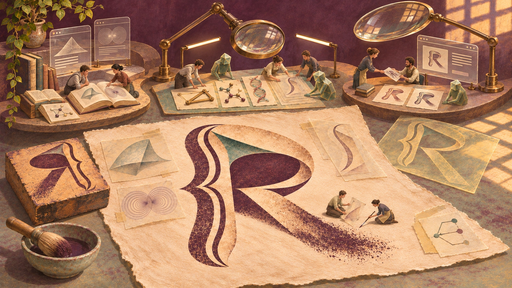
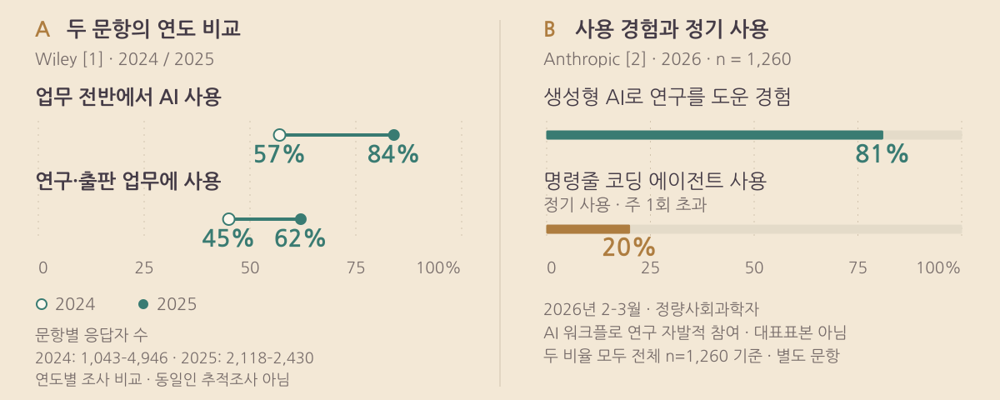
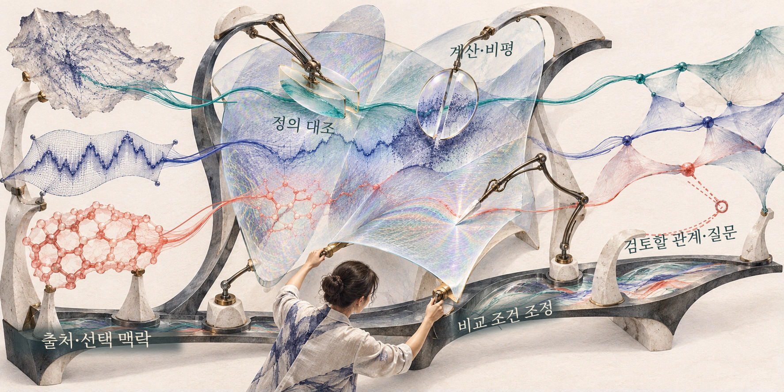
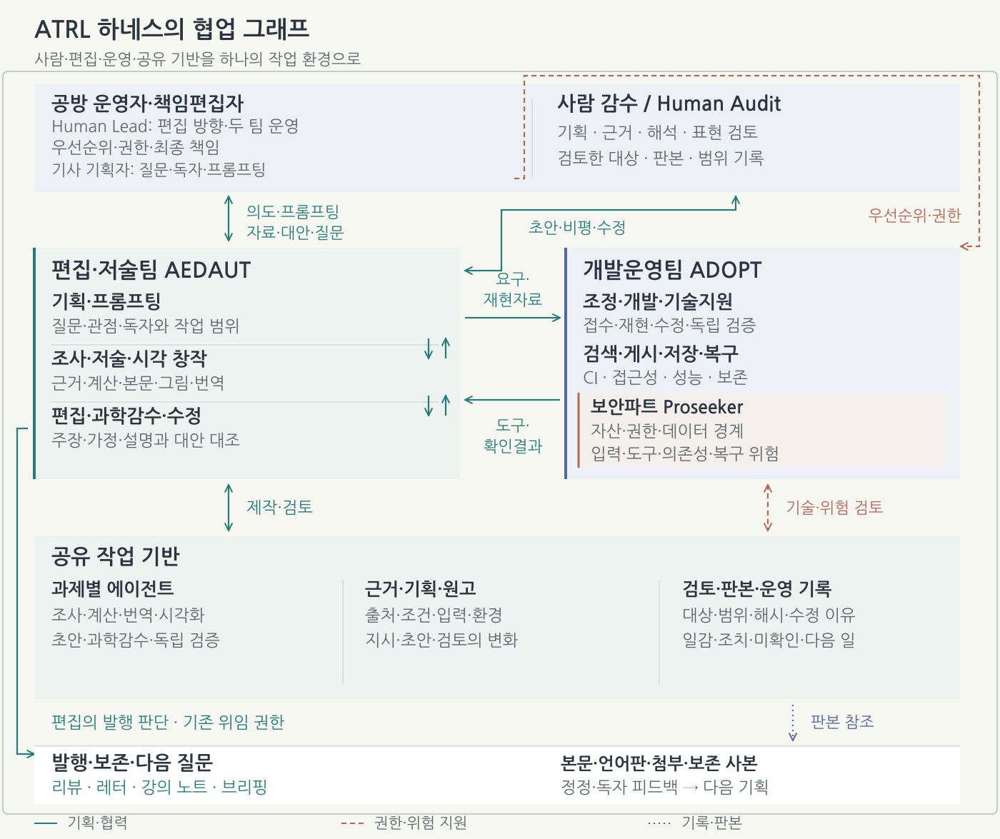
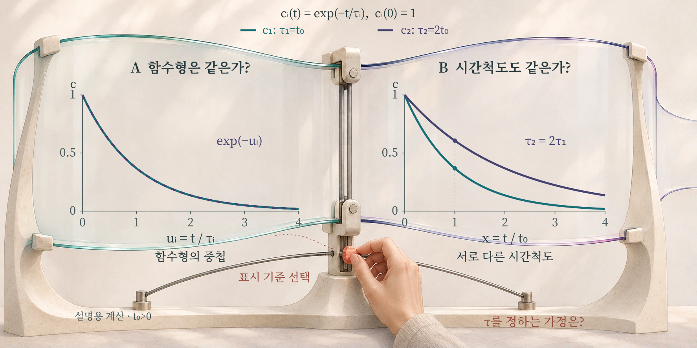
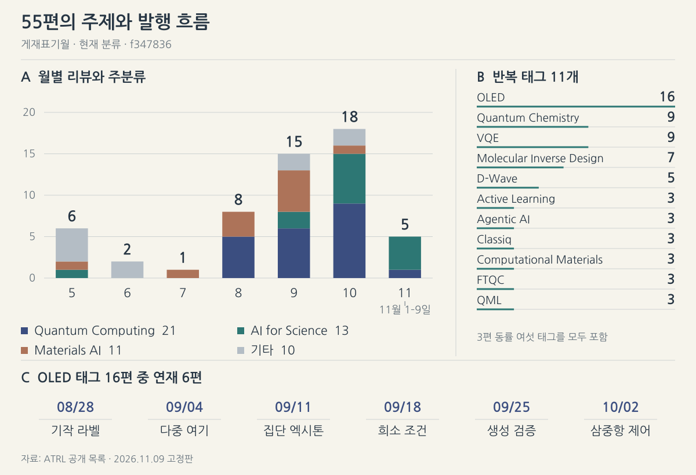
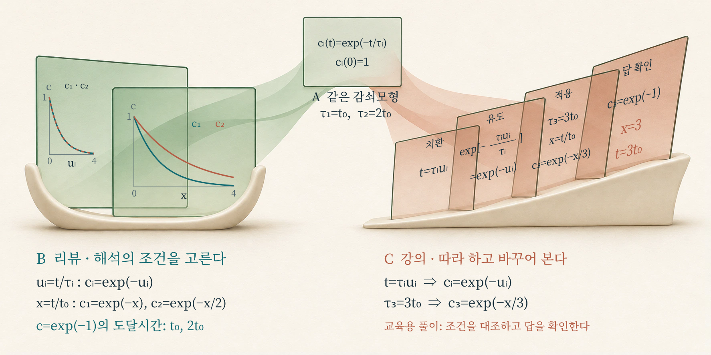
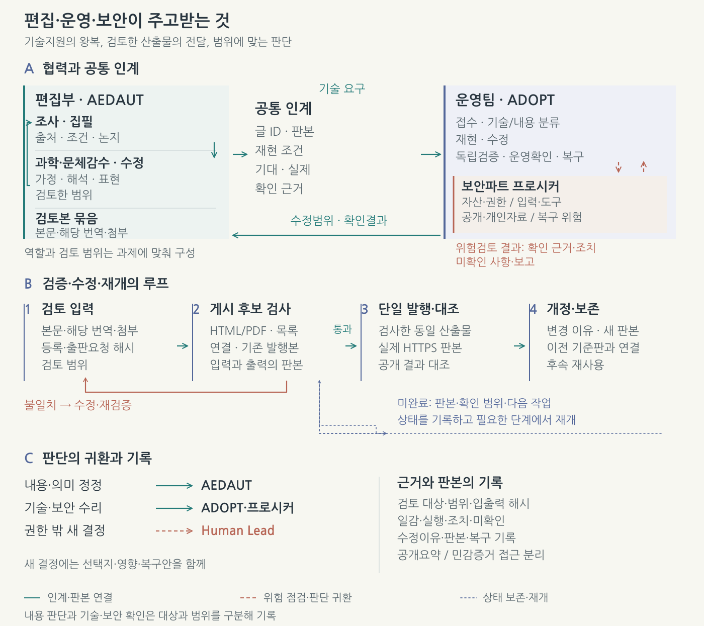
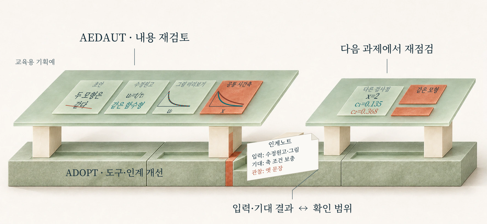
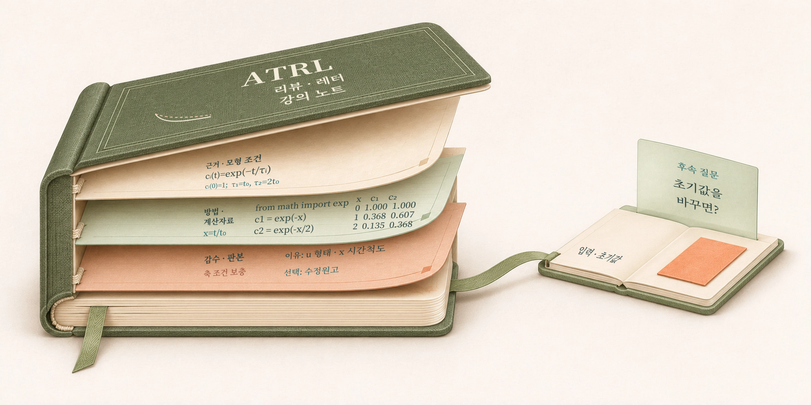

# ATRL: Agentic Atelier for Tech Review Letters

에이전틱 시대의 지식 흐름과 연구 공방의 탄생

책임 편집 김현중 · AI 보조 · 근거 기준일 2026-11-12

<figure class="hero"><figcaption>여러 분야의 연구 재료를 사람과 작은 AI 협업자가 함께 읽고 대조하며 하나의 R 리뷰 지면으로 다듬는 공방. 돋보기 아래의 재조립과 오른쪽의 전체 조망·운영 작업은 조사·편집·감수·전달이 이어지는 아뜰리에를 비유한다. AI로 편집한 개념 일러스트.</figcaption></figure>

읽어 둔 논문을 다시 펼칠 때, 지난번에는 지나쳤던 식이나 그림에서 새로운 질문이 생기기도 한다. 다른 분야에서 본 결과와 닮은 곡선이 눈에 들어오고, 그 방법을 지금 다루는 문제에도 쓸 수 있을지 궁금해진다. 그 연결을 살피려면 두 연구의 가정을 맞춰 읽고 계산 조건을 바꾸어 보아야 한다. 무엇을 비교할지 고르는 작은 판단에서 다음 연구의 방향이나 독자에게 전할 설명이 갈라진다.

ATRL의 공방을 기획하고 운영하는 사람은 이런 관심을 편집 아이디어와 연구 방향으로 구체화하고, 그 일을 맡을 사람과 에이전트를 조직한다. 원전을 조사하고 계산을 수행한 에이전트가 다른 해석을 가져오면 처음의 질문도 달라질 수 있다. 고친 논지를 전달하려다가 게시 도구의 결함을 찾으면 운영 작업까지 이어진다. 자료를 읽고 생각을 다듬는 일, 글을 쓰고 감수하는 일, 그 일을 받치는 도구를 고치는 일이 하나의 작업 흐름 안에서 만나는 것이다.

**ATRL(Agentic Tech Review Letters)은 이 지식과 아이디어의 흐름을 사람·에이전트·도구의 협업으로 조직해 가는 연구 공방이다.** 양자·AI·재료·바이오의 연구를 리뷰·레터·강의 노트로 풀어내며, 제목의 Agentic Atelier for Tech Review Letters는 이 저널을 만드는 작업 공간의 성격을 담는다. 이번 글에서는 그 공방 자체를 살펴본다. 운영자가 어떤 질문을 고르고 편집·운영의 일을 어떻게 나누는지, 작업 중 생긴 문제가 원고와 공방의 구조를 어떻게 함께 바꾸는지가 관찰 대상이다. 연구를 읽고 설명하는 환경을 설계하고 다시 검토하는 일도 여기서는 탐구와 창작의 일부가 된다.

## 도구의 확산에서 일의 조직으로

Wiley의 ExplanAItions 연도별 비교에서 업무에 AI를 쓴다는 응답은 2024년 57%에서 2025년 84%로, 연구·출판 업무에 활용한다는 응답은 45%에서 62%로 늘었다.[1] 그림 1A는 각 문항의 두 연도 응답 비율을 두 점으로 표시한다. 서로 다른 조사 시점의 응답자들을 비교하며, 문항별 응답자 수와 모집 시점도 다르다.

Lyttelton·Massenkoff·Wilmers가 2026년 2~3월 조사한 정량사회과학자 1,260명 중 생성형 AI로 연구를 도운 경험이 있다는 응답은 81%, 명령줄에 통합된 코딩 에이전트를 주 1회 초과해 정기적으로 사용한다는 응답은 20%였다.[2] 그림 1B의 두 막대는 사용 경험과 정기적 도구 사용이라는 별도 문항에 대응한다. Claude Max 계정을 제공하는 연구에 자발적으로 참여한 표본이므로, 이 차이는 그 표본에서 나타난 활용 양상으로 읽어야 한다.

<figure><picture><source media="(max-width: 640px)" srcset="../figs/research_agent_evidence_mobile_ko.svg"></picture><figcaption>그림 1. 연구 현장의 AI 사용과 에이전트 사용. A: Wiley의 연도별 비교. 문항별 응답자 수는 2024년 1,043~4,946명, 2025년 2,118~2,430명이며 같은 사람을 추적한 패널 조사가 아니다.[1] B: Anthropic의 2026년 2~3월 정량사회과학자 조사(n=1,260), AI 워크플로 연구의 자발적 참여 표본이다.[2] 두 패널은 모집·문항·분모가 다르며, B의 범주는 상호 배타적이지 않다. 기관 보고값을 아뜰리에에서 재도표했다.</figcaption></figure>

도구를 쓰는 경험이 기획·조사·집필·검토를 잇는 작업으로 이어지려면, 어떤 질문을 누구에게 맡기고 돌아온 결과로 무엇을 바꿀지 정해야 한다. 작성자는 앞선 조사의 가정을 알아야 초안을 쓸 수 있고, 감수자는 그 근거를 찾아 설명과 대조할 수 있어야 한다. 공방 운영자는 이 관계를 편집 방향과 역할·도구의 구성으로 풀어낸다. ATRL에서는 그렇게 조직한 일이 실제로 어떻게 흘러가는지, 막힌 지점에서 구성을 어떻게 고칠지 함께 살핀다.

## 질문에 따라 다시 구성하는 공방

아뜰리에의 기획은 새 논문과 이미 살핀 연구·설명·계산을 함께 펼치는 데서 시작한다. 공방 운영자가 주목한 연결에 독자의 질문과 제작 중의 의문이 더해진다. 한쪽의 근사가 다른 쪽에서도 성립하는지, 비슷해 보이는 결과를 무엇으로 구별할 수 있는지 살피다 보면 처음의 관심이 비교할 문제로 좁혀진다. 이 과정에서 다음 글의 방향과 필요한 작업의 구성이 함께 정해진다.

이 과정을 잇는 **하네스(harness)**는 자료·역할·도구·기록을 묶는 작업 구조다. 운영자가 제시한 문제의식은 기획안과 조사 기준으로 구체화되고, 조사 결과는 초안의 근거가 되며, 감수 의견은 수정할 대상을 지정한다. 추가 조사나 계산이 필요해지면 역할을 다시 나눈다. 누가 어떤 자료를 다룰 권한을 갖고 어떤 결과를 다음 작업에 넘길지도 함께 정한다. 질문에 대한 답을 찾아가며 이 배치도 조정한다.

현재 ATRL은 기획·원고·계산 자료를 저장소에 두고, 다른 세션이 이어받을 맥락을 공용 기록으로 정리한다. 편집·검토 지침과 출판 도구, 운영 기록을 잇는 규약이 아키텍처를 이루고, 과제마다 선택하고 되돌아가는 경로가 워크플로가 된다. 공통 편집·게시 API와 관리 화면, 더 일관된 작업 상태 관리는 단계별 개발 대상으로 두고 있다.[3]

예를 들어, 비슷하게 줄어드는 두 곡선을 보고 “둘은 같은 속도로 변하는가”를 설명하는 리뷰를 기획한다고 하자. 처음 크기를 1로 둔 가상의 신호 두 개로, 질문에서 계산·감수·설명 수정으로 이어지는 작업을 가까이 들여다보려 한다. 기획자는 곡선이 겹친다는 말과 같은 시간에 같은 양만큼 줄어든다는 말을 구별해 달라고 요청한다. 조사 역할은 모형과 축의 정의를 찾고, 계산 역할은 같은 시간 단위로 다시 표시하며, 집필 역할은 독자에게 그 차이를 설명할 준비를 한다. 이 작은 교육용 기획을 따라가며 어떤 판단이 다음 역할의 일을 바꾸는지 살펴보자.

<figure><picture><source media="(max-width: 640px)" srcset="../figs/harness_configuration_mobile_ko.svg"></picture><figcaption>그림 2. 질문에 맞춰 다시 구성하는 하네스. 서로 다른 근거의 정체를 유지하며 비교할 대상과 조건을 고르고, 필요한 전문 작업과 도구를 배치한다. 사람의 관점과 에이전트가 제안한 근거·계산·비평이 작업 구성을 바꾸며, 구조 프레임은 그 선택을 출처와 공유 맥락에 연결한다. 열린 연결은 더 검토할 관계와 다음 질문을 나타낸다. 자료의 정체와 비교 조건 선택을 재료와 변형으로 표현하고, 공개 조직·운영 문서의 협업 관계를 해석한 개념도다.[3] AI 개념 원화와 아뜰리에 주석.</figcaption></figure>

축의 정의를 조사한 메모가 돌아오면, 기획자는 “겹쳐 보인다”는 말이 무엇을 맞춰 비교한 결과인지 묻는다. 각 곡선이 제 속도에 맞는 시간눈금을 썼다면, 같은 시계로 비교한 그림도 필요해진다. 두 표시를 함께 보며 어느 조건에서 어떤 문장을 쓸 수 있는지 살피자는 요청으로 기획을 구체화한다. 프롬프트에는 독자와 비교 목적에 더해 다시 계산할 양, 나란히 읽을 결과, 고칠 설명이 담긴다.

그림 2에서 사람이 움직이는 투명 비교면은 어느 자료와 조건을 나란히 볼지 고르는 판단을 드러낸다. 모형의 정의와 계산 결과, 감수 의견은 서로 다른 재료처럼 정체를 유지한 채 비교에 참여한다. 비교 목적이 바뀌면 주변의 정의 대조·재계산·비평 작업도 다시 선택하지만, 아래 지지대에 해당하는 출처와 선택 이유는 함께 남긴다. 오른쪽의 열린 연결은 그렇게 새로 검토할 관계와 질문을 위한 자리다.

가정·기준값·비교량을 맞추는 일은 이번 과제의 비교 조건을 정하는 것이다. 모든 과제에 적용할 편집 기준에는 주장의 출처와 성립 조건, 실제 검토 범위와 수정 기록을 남기는 일이 있다. 원 연구의 결과와 리뷰의 해석·교육 계산도 각각의 정체를 밝혀야 한다. 어느 자료와 판본을 누가 어디까지 검토했고 수정한 설명이 어떤 발행본에 들어갔는지 남겨 다음 참여자가 확인할 수 있게 한다.[3]

### 기획의 왕복과 역할의 책임

공방 운영자는 문제의식과 창작·편집 방향을 세우고 편집·저술과 개발운영의 일을 조직한다. 이 지적 기획은 우선순위와 권한·최종 발행 책임을 맡는 책임편집자(Human Lead)의 기능과 연결된다. 개별 글에서는 질문을 낸 사용자나 연구자, 게시글 기획자가 목적·독자·비교 범위를 제안하고 조사와 대안을 되받는다. 사람의 감수(Human Audit)는 실제로 살핀 기획·근거·해석·표현의 대상과 범위를 기록한다. 운영·기사 기획·책임 편집·감수는 같은 사람이 겸할 수 있으며, 각 작업에서는 맡은 역할과 권한을 밝힌다. 첨부한 자료는 근거로 검토하고, 도구 실행과 공개는 위임한 권한을 따른다.

이 공방은 편집·저술의 협업을 **에이전틱 편집·저술팀(Agentic Editorial and Authoring Team, AEDAUT)**으로, 공통 기술 기반의 개발운영을 **에이전틱 개발운영팀(Agentic DevOps Team, ADOPT)**으로 조직했다. 과제에 맞춰 사람과 에이전트의 역할을 구성하고 도구·권한·공유 기록·인계 방식을 연결하는 일도 하네스의 설계에 포함된다.

<figure class="architecture-map"><picture><source media="(max-width: 640px)" srcset="../figs/atelier_architecture_mobile_ko.svg"></picture><figcaption>그림 3. 공동 작업 하네스와 그 안의 협업 그래프. 바깥 프레임은 사람의 기획·감수, 두 팀, 공유 작업 기반과 발행을 하나의 작업 환경으로 묶는다. 안쪽 연결은 의도·프롬프팅, 요구·재현 자료, 도구·확인 결과, 판본 참조가 역할 사이를 오가는 관계다. AEDAUT는 내용과 발행 판단을, ADOPT와 내부 Proseeker는 기술 기반과 관련 위험 검토를 맡는다. 공개 조직·운영 문서의 소속·협력·기록 관계를 하네스와 그래프의 관점으로 재구성했다.[3] 아뜰리에 제작 벡터 도식.</figcaption></figure>

**편집팀**은 주제와 논지, 조사·저술·시각 창작·편집·과학 감수와 내용 정정을 맡는다. 사람과 에이전트가 초안과 비평·수정안을 주고받으며, 편집부는 기존 과제의 권한으로 발행을 판단하고 게시 도구를 직접 사용할 수 있다. 에이전트의 역할과 도구는 과제에 맞춰 구성한다.

**개발운영팀**은 공통 도구와 게시 경로, 검색·성능·접근성·저장·복구의 기술 기반을 맡는다. 그 내부의 **보안·안정성 파트 프로시커(Proseeker)**는 자산·권한·데이터 경계와 작업의 관련 위험을 살피고 개선을 검증한다. 그림 3의 바깥 프레임은 이 역할과 도구·기록을 함께 묶고, 안쪽 선은 기획·제작·감수·인계의 관계를 잇는다.[3]

교육용 기획에서 기획자는 비교 목적을 전하고, AEDAUT는 정의를 대조한 메모와 재표시한 곡선, 설명 초안을 돌려준다. 그림 3의 상단 왕복은 이때 기획자도 설명 순서와 요청을 고칠 수 있음을 보여 준다. 과제별 에이전트는 어느 모형·입력·판본을 썼고 수식·축·문장 중 어디까지 검토했는지 공통 기록을 참조하며 작업을 이어간다.

어떤 작업을 크게 둘지는 질문에 달려 있다. 알고리즘의 성능을 읽을 때에는 입력과 비교 대상, 계산 자원을 어떻게 셌는지가 중요할 수 있다. 물성 연구에서는 대칭성과 모형의 가정, 시료와 측정 조건을 함께 보아야 한다. 이론을 가르치는 글이라면 유도의 빠진 단계와 학습자가 직접 다룰 예제를 검토해야 한다. 조사·계산·시각화의 비중과 확인 방법은 여기서 결정된다.

### 같은 곡선에서 비교를 고르는 일

처음의 두 곡선으로 돌아가 보자. 신호가 줄어드는 모양이 같은지와 같은 시간이 흘렀을 때 남는 크기가 같은지는 서로 다른 질문이다. 각자의 감쇠 시간척도를 눈금으로 쓰면 줄어드는 모양을 맞춰 볼 수 있다. 같은 시계의 눈금을 쓰면 같은 시간에 남은 양을 비교할 수 있다. 어느 눈금을 택했는지가 “같다”는 문장의 뜻을 정한다.

그림 4에서는 이 차이를 처음값이 1인 두 가상의 신호로 확인한다. 시간당 줄어드는 양이 그때 남은 크기에 비례하는 간단한 지수감쇠 규칙을 쓰고, 둘째 신호의 감쇠 시간척도를 첫째의 두 배로 고른다. 이 규칙과 조건을 식으로 남겨 두면, 비슷해 보이던 두 곡선을 다시 그리고 설명 문장을 계산과 대조할 수 있다.

<figure><picture><source media="(max-width: 640px)" srcset="../figs/editorial_workflow_mobile_ko.svg"></picture><figcaption>그림 4. 비교할 질문이 바뀌면 같은 두 곡선을 다르게 읽는다. A의 정규화축은 함수형의 공통성을, B의 공통 시간축은 시간척도의 차이를 보여 준다. 정의 확인·비교축 선택·재표시·감수에 따라 설명과 다음 질문이 달라지는 국소 작업을 펼친 설명용 예제다. 아뜰리에의 수학 도식과 AI 개념 원화.</figcaption></figure>

식의 cᵢ(t)는 시각 t에서의 신호의 상대크기이고, 아래첨자 i는 두 신호를 구별한다. τᵢ는 감쇠의 빠르기를 정하는 시간척도로, 길수록 천천히 줄어든다. exp는 지수함수의 표기다. 두 신호가 공유할 공통 시간 단위 \(t_0>0\)를 정하고, \(t\geq0\)에서 다음 규칙을 사용한다.

$$c_i(t)=\exp(-t/\tau_i),\qquad \tau_1=t_0,\quad \tau_2=2t_0.$$

먼저 두 신호가 줄어드는 모양, 즉 함수형을 비교해 보자. 시간을 각자의 특성시간 \(\tau_i\)로 나눈 축 \(u_i=t/\tau_i\)에서 그리면 두 함수는 모두 \(c_i=\exp(-u_i)\)로 표시되어 겹친다. 같은 좌표값 \(u_i=1\)은 첫 신호에서는 \(t=t_0\), 둘째에서는 \(t=2t_0\)를 가리킨다. 각 신호가 자기 시간척도만큼 지난 지점을 맞춘 결과다.

이번에는 두 신호에 같은 시간이 흘렀을 때 얼마나 남는지 묻자. 두 신호의 시간을 같은 기준으로 나눈 공통 축 \(x=t/t_0\)에서 읽으면 값은 다음과 같다.

$$c_1=\exp(-x),\qquad c_2=\exp(-x/2).$$

두 번째 신호는 첫 번째와 같은 값까지 줄어드는 데 두 배의 시간이 걸린다. 그림 4A의 겹침은 각자의 시간척도에 맞춰 읽은 모양의 공통성을, B의 벌어짐은 같은 시간에 남는 양의 차이를 드러낸다. 같은 함수형이라는 공통점과 서로 다른 시간척도라는 차이를 한 쌍의 신호에서 함께 확인할 수 있다. 설명할 문장은 독자가 어떤 비교를 알고 싶어 하는지에 따라 달라진다.

작성자는 이 계산을 반영해 “두 모형은 같다”는 문장에 어느 축에서 무엇이 같은지 덧붙인다. 같은 시간에 남는 양을 설명하려면 공통 시간축의 차이를 보여 주어야 한다. 실제 연구에서 감쇠 시간척도를 정하는 원인까지 묻는다면 그 문제에 맞는 모형과 관측 자료를 추가로 고르게 된다. 여기서는 비교 목적을 정한 일이 계산 요청과 설명 문장을 바꾸었고, 원인을 묻는 새 질문은 다시 조사의 구성을 바꾼다. 하네스는 정의를 확인한 메모, 계산 입력과 결과, 수정한 문장을 연결해 이 판단의 변화를 작업 안에 남긴다.

## 55편에 남은 관심의 흐름과 공방의 변화

운영자가 고른 관심과 그 관심을 다룬 작업은 공개된 글에도 흔적을 남긴다. 2026년 11월 9일 고정한 공개 목록의 55편을 현재 주분류로 읽으면, 양자컴퓨팅 21편·과학 AI 13편·재료 AI 11편이 45편의 뼈대를 이룬다.[4] 나머지 10편에는 에이전트 시스템 3편과 AI 하드웨어 2편, 보안·거버넌스·기초 모델 등의 글이 있다. 연구의 대상과 계산 방법, 그 도구를 운영하는 문제가 함께 지면에 들어온다. 이 구성을 뒤의 개편 기록과 함께 읽으면, 관심의 범위와 그 관심을 다뤄 온 작업 방식을 나란히 살펴볼 수 있다.

게재표기일로 배열하면 5월부터 7월까지 9편, 8월부터 10월까지 41편이 있고, 11월은 1일부터 9일까지 5편이다. 그림 5A의 색을 함께 읽으면 8월의 양자계산·재료 중심 발행에 이어 10월에는 과학 AI와 보안·신경망 해석이 함께 다뤄지는 모습을 볼 수 있다.[4]

분류를 가로질러 관심이 반복되는 모습은 키워드에서 더 잘 보인다. 한 글에 여러 개 붙은 태그를 편당 한 번씩 세면 OLED는 16편, VQE와 양자화학은 각각 9편, 분자 역설계는 7편, D-Wave는 5편에 나타난다. OLED 태그는 재료 AI 9편과 양자컴퓨팅 7편에 걸쳐 있다. 그 가운데 8월 28일부터 10월 2일까지의 OLED 역설계 연재 6편은 7일 간격으로 기작 중심 라벨, 다중 여기상태, 집단 엑시톤, 희소 조건, 생성 검증, 삼중항 제어를 다뤘다. 발광분자 후보를 고르는 문제를 어떤 물성으로 표현하고 어느 조건에서 검증할지 여러 연구를 통해 다시 살피는 흐름이다.[4]

<figure><picture><source media="(max-width: 640px)" srcset="../figs/hub_observation_mobile_ko.svg"></picture><figcaption>그림 5. 55편의 주제 구성과 반복되는 작업. A: 현재 등록 주분류를 게재표기월에 배치했다. 상위 세 분류를 따로 그리고 나머지 일곱 분류는 한 색으로 합쳤다. B: 한 글에 여러 개 붙을 수 있는 원표기 태그 가운데 3편 이상 등장한 11종. C: OLED 역설계 연재 6편의 시간순 초점 변화. OLED 태그 전체 16편과 이 연재의 단위를 구분한다. 2026년 11월 9일 고정판의 현재 제목·분류·태그를 배열한 집계다.[4] 아뜰리에의 공개 기록 재집계. <a href="../artifacts/hub-publication-topics-v15.json">정의·분류·연재·연결 근거(JSON)</a> · <a href="../artifacts/hub-publication-topics-v15.csv">55편별 데이터(CSV)</a>.</figcaption></figure>

되읽을 경로를 본문에 직접 남긴 글도 있다. 고정판 국문 집필 영역의 11편에서 다른 리뷰로 향하는 14개, 별도 렉처로 향하는 2개의 방향 연결을 확인했다. [9월 6일 DeMARS 리뷰](https://infant83.io/AI_Tech_Review/reviews/2026-09-06_agentic-programs-materials-science/)는 [5월 23일 「AI 과학자, 시작의 끝에서」](https://infant83.io/AI_Tech_Review/reviews/2026-05-23_ai-scientist-execution-harness/)를 참조하며, 넓은 연구 하네스의 검증에서 원자 모델 생성처럼 책임을 좁힌 업무로 질문을 구체화한다. [9월 13일 Avatar 리뷰](https://infant83.io/AI_Tech_Review/reviews/2026-09-13_avatar-scientific-workflow-control/)는 DeMARS를 되짚고 계산 실행 중 실패를 처리하거나 자원을 늘리고 탐색을 끝낼 판단으로 논의를 옮긴다. 독자는 같은 ‘에이전트’라는 말 아래에서도 무엇을 맡길지와 무엇으로 확인할지가 달라지는 과정을 따라갈 수 있다.[4]

새 글을 기획하는 동안 앞선 글을 다루는 방식도 바꾸었다. 8월 29일에는 편집 방법·검토범위 공시 기준이 공개됐고, 10월 27일 등록한 초기 49편의 개편 대기열에는 이 고정판 기준으로 14편의 완료 기록이 있다. [TabPFN 리뷰](https://infant83.io/AI_Tech_Review/reviews/2026-05-07_tabpfn-oled-manufacturing-foundation-model/)에는 10월 29일 추가 확장도 기록되어 있다. 5월의 평가와 새 자료를 구별해 경쟁 모델·평가 변화·활용 전망을 더한 작업이다. 이러한 후속 작업이 반영된 현재 판본을 이번 분류와 연결 집계에서 읽었다.[4] 새 자료에 따라 해석을 갱신하는 일과, 그 개정을 어떻게 검토하고 공개할지 정하는 일이 함께 쌓였다.

같은 55편에는 실제 영문이 있는 41편을 포함해 언어별 웹 지면 96개가 연결되어 있고, 현재 판본 모두에서 출처·근거와 작성·검토범위 공시를 확인했다.[4] 이런 집필·계산에 이용할 수 있던 도구에는 2025년 2월 연구 프리뷰로 공개된 Claude Code와 2026년 2월 공개된 병렬 작업용 Codex 앱이 있다.[5] 도구의 선택과 함께 운영자가 조직해야 할 것은 서로 다른 주제·언어판·첨부·개정을 다루는 공통 작업이다. 이 기록에서는 관심이 연재로 이어지고, 새 질문이 앞선 글을 참조하며, 자료 변화가 개정을 부르는 양상을 읽을 수 있다. 공방은 이렇게 만든 결과물을 다시 살피면서 다음 기획과 검토·운영 방식의 수정에 쓸 단서를 얻는다.

## 리뷰와 강의 노트는 다른 설명 경로를 만든다

<figure><picture><source media="(max-width: 640px)" srcset="../figs/explanation_design_mobile_ko.svg"></picture><figcaption>그림 6. 같은 교육용 모형에서 설명 목적을 달리 설계하기. A는 함수·초기값을 담은 교육모형 명세, B는 정규화축의 함수형 일치와 공통 시간축에서 exp(−1)에 도달하는 시간 t₀·2t₀를 해석하는 리뷰, C는 치환을 풀고 특성시간을 3t₀로 바꿔 적용하는 강의다. 네 학습면은 치환·지수항 정리·τ₃ 적용·도달시간의 확인 답을 담는다. B의 두 도표와 각 면의 식은 같은 교육모형에서 작성했다. 기존 AI 개념 원화에 아뜰리에가 정확한 수학 도표·풀이를 벡터로 구성했다.</figcaption></figure>

공방의 편집 방향은 같은 자료를 어떤 설명으로 만들지에서도 드러난다. 앞선 감쇠모형으로 리뷰를 기획하며 “겹친다는 말과 감쇠속도가 같다는 말을 구별해 설명해 달라”고 요청하면, 두 도표를 함께 읽을 이유가 생긴다. 그림 6B에서 두 모형이 exp(−1)에 도달하는 시간은 공통 시간축에서 각각 t₀와 2t₀이고, 각자의 특성시간으로 나눈 축에서는 같은 함수형으로 겹친다. 리뷰는 공통점과 차이를 말하는 조건을 독자가 판단하도록 구성한다.

같은 모형으로 강의를 별도 기획한다면 “치환의 중간단계를 풀고 세 번째 모형으로 연습하게 해 달라”는 요청을 할 수 있다. 그림 6A의 모형 명세에는 함수와 초기값 1을, C의 네 면에는 실제 치환식·중간 계산·세 번째 모형·연습의 확인 답을 넣었다. \(t=\tau_i u_i\)를 원래 식에 대입하면 \(c_i=\exp(-u_i)\)가 되는 과정을 먼저 풀어 보인다. 이어 초기값이 1인 세 번째 모형의 특성시간을 \(\tau_3=3t_0\)로 두고, 공통 축 \(x=t/t_0\)에서 \(c_3=\exp(-x/3)\)을 얻는 예제를 다룬다. 학습자는 세 번째 함수도 직접 그려 앞선 두 함수와 비교하고 exp(−1)까지 줄어드는 시간을 구한다. 마지막 면의 확인 답 x=3, 즉 t=3t₀와 자신의 풀이를 대조할 수 있다.

감수에서 고치는 대상도 설명 목적에 따라 달라진다. 리뷰가 축의 조건을 빠뜨렸다면, 감수자는 그림 6B를 대조해 “각자의 특성시간으로 나눈 축에서 같은 함수형을 보인다”로 문장을 고치게 한다. 강의 풀이가 치환에서 마지막 식으로 건너뛰었다면, 그림 6C의 유도 면에 해당하는 중간 계산을 보충한다. 기획자는 이 차이를 보고 설명 순서를 바꾸거나 추가 계산을 맡긴다. 같은 모형을 놓고도 리뷰의 해석과 학습자가 따라 할 풀이에는 서로 다른 편집이 필요하다.

집필과 검토를 마친 내용은 형식에 맞는 도구로 출력한다. 현재 리뷰는 글별로 검토한 본문·번역·첨부를 등록하고, 자체 집필 렉처는 강의·문제·풀이·실습을 전용 제작 도구로 묶는다. 두 형식의 결과물은 게시 전 사이트 후보본으로 모인다. 여기서 글·목록·검색·보존 자료의 연결과 기존 발행본이 유지되는지 검사한다.[3] 후보 검사와 공개판 대조의 경로는 그림 7B에, 이 일을 지속시키는 공유 기반은 그림 8에 이어진다.

## 초안과 시안을 함께 검토하는 일

[양자 회로 리뷰](https://infant83.io/AI_Tech_Review/reviews/2026-11-04_quantum-gates-phase-and-interaction/)에서는 문제의 연결 구조를 바꾼 계산 때문에 예제와 적용 조건을 다시 살폈다. 다른 과제에서는 유도 점검이나 측정 조건·문헌의 비교가 이런 역할을 맡는다. 무엇으로 설명을 확인할지 고르는 일도 기획에 포함된다.

예측 모델이 잘 맞춘 양과 연구자가 알고 싶은 물성은 어떻게 관계되는가. 계산 오차를 줄이면 풀려는 이론적 의문에도 가까워지는가. 무엇을 새로 관측하면 두 해석을 구별할 수 있는가. 분야의 지식은 이런 질문을 대조할 조건과 관측량으로 바꾸는 데 쓰인다. 에이전트가 찾아온 문헌이나 예상 밖의 계산 때문에 편집자의 첫 생각도 바뀐다.

시각자료를 디렉팅할 때에는 어떤 양과 관계를 강조할지, 어떤 척도와 순서로 보여 줄지 요청한다. 감수자는 돌아온 시안의 비교 대상·방향·개수·척도를 본문과 대조하고, 다른 뜻으로 읽히는 그림이나 주석을 고친다. 그림을 만드는 동안 비교 기준이 모호하다는 사실을 발견하면 논지부터 다시 정하기도 한다.

Jiang과 공동연구진의 Co-STORM에서는 사람이 여러 언어모델 에이전트의 논의에 질문과 관점을 보태면 자료와 논의의 구성이 갱신된다. 탐색한 정보는 마인드맵과 인용을 갖춘 보고서로 정리된다.[6] 여기서 ATRL이 참고할 부분은 참여자의 질문이 자료를 모으는 방식과 논의를 조직하는 방식을 함께 바꾼다는 점이다. 공방 운영자와 기획자도 돌아온 근거·비평을 보고 처음의 관점과 작업 구성을 조정한다.

편집부(AEDAUT)는 검토 중 새 조사가 필요해지면 기획과 집필을 조정한다. 사람의 감수와 에이전트의 검증은 실제로 살핀 대상·판본·범위를 각각 남긴다.[3] 원고의 반복된 문체를 지적한 의견은 공통 편집 기준에도 반영했다. 한 문단이 주장하지 않은 내용을 말미에 끌어와 부정하는 습관을 다음 원고의 감수 대상으로 남긴 것이다. 이때 한 글을 고치는 작업은 다음 글을 검토하는 방식을 고치는 작업으로 이어졌다. 공방이 작성한 지침도 실제 글과 피드백에 비추어 다시 읽는 대상이 된다.

## 편집·운영·보안의 협력과 판본 관리

공개 운영기록에는 검토한 개정판이 준비됐는데 공개 본문은 이전 판으로 남아 있었던 사건이 있다. 게시 경로가 구판 출력을 재사용한 것이 원인이었다. 운영 담당은 검토본과 게시할 출력의 해시를 연결하는 경로와 재발 검사를 고쳤다.[3] 그림 7B의 검토 입력과 단일 발행·대조를 연결해 보면, 검토한 수정이 그 입력으로 만든 출력에 들어갔는지, 그 출력이 독자에게 전달됐는지를 함께 살펴야 한다. 이 사건에서 다시 검토한 대상은 원고를 전달하는 게시 경로였고, 그 수정은 이후 작업에서 사용할 도구와 확인 기준으로 남았다.

<figure class="collaboration-map"><picture><source media="(max-width: 640px)" srcset="../figs/collaboration_mechanism_mobile_ko.svg"></picture><figcaption>그림 7. 조건에 따른 인계와 검증·수정·재개의 경로. A: 두 팀의 요구·근거와 기술 지원의 왕복, ADOPT 내부 Proseeker의 위험 검토. B: 검사를 통과한 후보는 단일 발행·대조로 진행하고, 불일치는 필요한 수정·재검증으로 되돌아간다. 미완료 검토는 판본·확인 범위·다음 작업을 남겨 해당 단계에서 재개한다. C: 내용·기술·권한의 판단을 맡는 역할과 공개·비공개 기록의 경계. 공개 조직·운영·보안·출판 규약을 바탕으로 재구성했다.[3] 아뜰리에 제작 벡터 도식.</figcaption></figure>

운영팀(ADOPT)은 이런 기술 문제를 받아 공통 도구와 절차를 고친다. 지원이 필요하면 편집부는 관련 글과 검토한 판본, 문제가 나타난 조건과 기대한 결과를 전한다. ADOPT는 문제를 재현하고 기술 수정·독립 검증·운영 확인을 연결하며, 내용 판단이 필요한 부분은 AEDAUT에 돌려준다. Proseeker는 ADOPT 안에서 자산과 담당·권한, 입력·도구·의존성, 공개·개인 데이터의 경계와 복구 위험을 살핀다. 그림 7A는 이 요구와 확인 결과의 왕복이다.

출판 요청은 검토한 원고와 등록정보의 내용을 식별하는 값인 해시를 묶어, 어느 입력에서 결과를 만들었는지 남긴다. 입력이 바뀌면 후보를 다시 확인하고, 기존 글의 ID·주소·발행일·PDF 연결이 예상치 않게 바뀌었는지도 대조한다. 그림 7B에서 검사를 통과한 후보는 발행·공개판 대조로 진행한다. 후보 검사에서 불일치가 남으면 원고나 도구를 필요한 범위에서 고치고 재검증한다. 검토가 아직 끝나지 않았으면 판본과 확인 범위, 다음 작업을 남겨 다음 회차에 해당 단계에서 재개한다. 기술 지원을 인계할 때에도 이 출판 기록을 공용 일감에서 참조해 같은 판본과 근거를 가리키게 한다.

내용 정정은 AEDAUT가, 기술·보안 수리는 ADOPT와 Proseeker가 맡으며, 기존 권한 안의 조사·수정·검증은 계속 진행한다. 새 과금이나 파괴적 변경, 공개 범위·인증 구조 변경 등이 그 권한을 벗어나면 영향·대안·복구안을 준비해 Human Lead나 권한을 위임한 사용자에게 필요한 결정을 요청한다. 공개 기록에는 문제와 조치·검증의 요약을 남기고, 비밀정보나 개인 자료 같은 민감한 증거는 접근 범위를 따로 관리한다. 그림 7C는 이 판단과 기록의 경계를 나타낸다.[3]

이런 판본 관리가 앞선 교육용 리뷰를 고치는 일에는 어떻게 쓰일까. 정규화축의 조건을 원고에 보충했는데 게시 후보에는 옛 문장이 남았다고 가정해 보자. 편집부는 수정 원고와 그림의 판본, 후보에 보여야 할 조건, 실제 남아 있는 문장을 묶어 운영팀에 넘긴다. 그림 8 중앙의 인계 메모는 이렇게 입력·기대·관찰을 함께 지정하는 자료다.

<figure><picture><source media="(max-width: 640px)" srcset="../figs/coupled_cycles_mobile_ko.svg"></picture><figcaption>그림 8. 같은 판본과 확인 범위를 통해 연결되는 두 루프. 왼쪽의 설명 루프는 정의·곡선·문장을 고쳐 다시 감수한다. 운영 루프는 공통 도구·인계를 수리하고 편집부가 다음 입력의 결과를 재점검하면서 이어진다. 중앙의 입력·기대·관찰 메모와 공유 하네스의 도구·권한·판본 기록이 두 반복을 잇는다. 오른쪽 검사점 x=2의 값은 같은 모형의 c₁=0.135, c₂=0.368(소수 셋째 자리 반올림)이다.[3] 기존 AI 개념 원화에 아뜰리에가 원고·계산·인계 예시와 되돌림 경로를 벡터로 작성했다.</figcaption></figure>

이 교육용 장면의 왼쪽 설명 루프에서 AEDAUT는 정의·곡선·문장을 대조하고 감수 결과를 다음 수정에 반영한다. 후보에서 불일치가 보이면 가운데 메모로 같은 판본·기대와 관찰·확인 범위를 ADOPT에 전한다. ADOPT는 그 자료로 도구와 인계를 고쳐 검증 결과를 돌려준다. 기반과 인계를 거치는 운영 루프는 바뀐 도구를 다음 입력으로 다시 확인하는 왕복이다. 오른쪽 작업면에서 편집부는 같은 모형의 다른 검사점 x=2를 골라 CSV·도표와 대조한다. 도구 수리와 내용 검토는 공유 하네스의 도구·권한·판본 기록을 참조하며, 재점검에서 찾은 문제는 각각의 수정으로 되돌아간다.

## 반복과 협업의 경로까지 설계하는 하네스

설명과 도구를 고치는 두 왕복을 지속하려면, 다음 작업이 무엇을 이어받을지 정해야 한다. 이런 반복을 어떻게 조직할지는 에이전트 개발에서도 중요한 문제가 됐다. Geoffrey Huntley가 소개한 **Ralph 루프**는 코딩 에이전트를 반복 실행하며 명세와 작업계획을 다시 읽게 하고, 테스트·정적분석 결과를 다음 수정에 반영하는 방식이다. 관찰한 실패에 따라 프롬프트와 작업 지침도 조정한다.[7] 다음 실행이 앞선 작업에서 무엇을 이어받고 어떤 근거로 행동을 바꿀지 설계하는 발상이다.

최근에는 이 관심을 **루프 엔지니어링(loop engineering)**과 **그래프 엔지니어링(graph engineering)**으로 정리하는 연구도 나왔다. Feng과 공동연구진의 서베이 프리프린트는 도구·기억·실행 환경을 구성하는 하네스에서, 목표·검증·종료 조건을 갖춘 반복으로, 다시 여러 과제·에이전트·실행 상태의 관계를 조직하는 그래프로 설계 관심이 넓어지는 흐름을 제안한다.[8] Sakhinana와 Runkana의 클라우드 엔지니어링 프리프린트는 세 관점을 상보적으로 결합한다. 하네스는 도구 사용과 권한의 실행 경계를, 루프는 범위를 정한 진단·수리·재검증을, 그래프는 검증 결과에 따른 다음 단계와 복구 경로를 맡는다.[9] 무엇을 할 수 있는지, 무엇을 다시 확인할지, 그 결과를 누구에게 넘길지가 함께 설계 대상이 되는 것이다.

ATRL의 반복은 서로 다른 시간 규모에서 작동한다. 한 원고 안에서는 정의를 대조하고 계산·설명을 고친 뒤 해당 판본을 감수한다. 편집부의 정기 조사·개편에서는 앞선 글과 남은 질문을 다시 읽어 다음 기획을 고른다. 개발운영팀의 정기 회차에서는 직전 실행과 미완료 일감, 마지막 확인 이후의 변경을 이어받는다. 현재 일정표는 일감의 단계·담당·재개 지점·선행 조건·다음 검토 시각을 남기도록 한다. 검사가 끝나지 않은 후보는 배포를 멈추고, 필요한 근거를 기다리는 동안 독립적으로 진행할 일을 고른다.[10] 정기 실행은 작업을 다시 살필 기회이고, 그때 이어받을 상태와 판단 기준을 정하는 일이 루프의 설계다.

반복 중 어디를 고칠지도 달라진다. 교육용 감쇠 예제의 축 설명을 보충하는 일은 해당 원고의 수정으로 끝날 수 있다. 여러 글에서 같은 설명의 문제가 나타나면 공통 감수 기준을 고친다. 검토본이 공개판에 반영되지 않은 사건에서는 게시 도구와 재발 검사를 고쳤다.[3] 그림 8은 원고의 수정이 작업 환경의 수리로 이어지고, 바뀐 환경을 다음 입력으로 다시 확인하는 두 반복의 접점을 보여 준다. 이때 개선의 대상에는 결과물과 그 결과물을 만드는 절차가 함께 들어간다.

이 반복들을 잇는 관계는 그래프의 관점에서 읽을 수 있다. 그림 3에서 사람의 기획·감수, 편집부, 개발운영팀과 그 내부 프로시커, 과제별 에이전트는 서로 다른 판단과 작업을 맡는다. 이들을 잇는 선에는 조사 요청, 계산 결과, 수정 의견, 기술 인계처럼 서로 다른 자료가 흐른다. 그림 7은 그중 어떤 조건에서 다음 역할로 일이 넘어가는지를 보여 준다. 예를 들어 곡선의 해석이 틀렸으면 편집부가 정의와 계산을 다시 살피고, 옳게 고친 문장이 후보에 들어가지 않았으면 개발운영팀이 생성·전달 경로를 재현한다. 그 과정에서 개인 자료의 공개나 도구 권한이 관련되면 운영팀 내부 프로시커가 위험을 검토한다. 공유 기록은 각 판단이 가리키는 판본과 확인 범위를 연결한다.

사람의 프롬프팅과 감수도 이 관계 안에서 작업을 바꾼다. 기획자가 “곡선이 겹치는가”에서 “같은 시간에 같은 양이 남는가”로 질문을 바꾸면 비교축과 계산 요청, 설명이 충족해야 할 조건이 달라진다. 어떤 결과를 먼저 기다리고 무엇을 병렬로 조사할지도 다시 정해야 한다. 현재 ATRL에서는 참여자가 조직 규약·공유 일감·원고와 판본 기록을 읽고 이러한 연결을 조정한다. 다음 설계 과제는 그 관계를 더 명시적으로 남겨, 한 조건이나 판본이 바뀔 때 다시 확인할 계산·그림·설명을 찾아낼 수 있게 하는 것이다.

**이런 의미에서 ATRL은 작업 환경과 반복, 역할 사이의 관계를 함께 구성하는 발전된 통합 하네스(advanced harness)로 읽을 수 있다.** 공방 운영자는 다음 글을 기획하면서 어느 근거를 가져오고 누구의 판단을 거치며 어느 조건에서 되돌아올지를 함께 설계한다. 그 설계가 실제 글과 운영에서 시험되고 다시 수정되는 과정까지 공방의 연구·창작 활동에 포함된다. 아뜰리에가 만드는 설명 속에는 그 설명을 가능하게 한 협업 구조도 축적된다.

## 발행한 글이 다음 기획으로 돌아오는 경로

발행한 글과 자료를 보존하는 일은 이 흐름이 다음 기획으로 돌아올 길을 마련한다. 시간이 지나 다른 참여자가 교육용 감쇠예제를 다시 펼쳐 “초기값이 달라도 같은 비교를 할 수 있을까”라고 묻는다고 하자. 앞선 모형이 초기값을 어떻게 정했는지, 곡선값은 어떤 입력으로 계산했는지, 두 축을 나누어 그린 이유는 무엇인지 알아야 이 질문을 이어갈 수 있다. 남겨 둔 정의·계산·감수 자료를 바탕으로 바꿀 입력과 다시 확인할 그래프·설명을 정한다. 아카이브는 이렇게 새 기획이 필요한 맥락을 골라 다시 사용하는 단계로 공방에 참여한다.

FAIR 원칙은 식별자와 메타데이터, 접근·이용조건과 생성 이력을 통해 자료를 찾고 재사용할 수 있게 한다.[11] RO-Crate는 데이터·코드·문서의 맥락과 관계를 함께 기술한다.[12] 그림 9의 제본된 표지는 이렇게 다룬 자료가 하나의 설명으로 정리된 ATRL의 리뷰·레터·강의 노트를 나타낸다. 표지 아래 첫째 층에는 초기값 1, τ₁=t₀·τ₂=2t₀인 교육모형의 정의와 조건을, 가운데에는 공통 시간축의 CSV 발췌와 exp(−x)·exp(−x/2)를 계산하는 코드를 놓았다. 아래층에는 “축 조건 보충”이라는 수정 이유와 선택한 수정 원고를 함께 둔다. 세 기록을 펼쳐 읽으면 완성된 설명에서 고른 조건과 계산한 값, 문장을 고친 이유를 함께 살필 수 있다.

<figure><picture><source media="(max-width: 640px)" srcset="../figs/reusable_archive_mobile_ko.svg"></picture><figcaption>그림 9. 완성된 출판물에서 그 설명을 이루는 작업 자료를 펼쳐 보는 아카이브 설계 예. 제본 표지 아래 세 지면에는 교육모형의 정의·조건, 공통 시간축 CSV와 계산 코드, 축 조건을 보충한 감수·판본 기록이 겹쳐 있다. CSV의 x=0·1·2 값은 기존 교육 계산을 소수 셋째 자리로 반올림했다. 표지의 곡선 문양도 같은 교육모형에서 그렸다. 리본이 닿는 오른쪽 노트의 “초기값을 바꾸면?”은 이 자료에서 필요한 맥락을 골라 다시 검토할 다음 기획의 질문이다. 기존 ATRL 기록과 FAIR·RO-Crate 논의를 바탕으로 한 설계 제안이다.[3,11,12] AI 개념 원화와 아뜰리에의 모형·자료·감수 벡터 예시.</figcaption></figure>

후속 참여자는 제본 표지 아래 첫째 층에서 초기값을 1로 두었다는 조건을 확인하고, 가운데 CSV의 x=1 값 0.368과 0.607을 도표와 대조한다. 아래층의 감수 기록은 왜 두 축을 구별해 설명을 고쳤는지 되짚을 근거가 된다. 한 설명을 이룬 세 기록을 함께 읽은 뒤, 오른쪽 노트의 새 질문에 맞춰 어떤 입력을 고치고 어느 해석을 다시 검토할지 고른다. 정의·계산·수정 이유를 함께 보존하면, 이미 확인한 결과를 발판으로 삼아 바뀐 조건의 계산과 해석을 준비할 수 있다.

이 흐름의 일부를 다른 도구가 어떻게 조직하는지도 참고할 수 있다. Elicit의 Scale·Enterprise 팀용 공유 Research Agent 세션에서는 에이전트가 수정 초안을 제시하고 사용자가 수락하면 새 판본으로 반영하며 변경 이력을 남긴다.[13] ATRL이 참고할 지점은 여러 참여자의 판단과 수정 결과를 같은 작업 안에서 살펴볼 수 있게 하는 방식이다.

실행 방법을 이어받으려면 준비해야 할 관계가 더 늘어난다. Miao와 공동연구진의 Paper2Agent는 논문과 코드를 에이전트가 호출할 도구로 구성한다. 계산생물학 논문 100편에 대한 평가에서 74편은 도구 추출·실행·자동 검증을 사람의 개입 없이 끝냈다. 나머지에서는 실행 코드나 데이터·모델의 부재, 의존성 문제, 일반화하기 어려운 스크립트 등이 걸림돌이었다.[14] 이 74/100은 평가 대상 논문의 도구화 완료 비율이다. ATRL에서도 원문과 함께 실행 경로·적용 가정·대조한 결과를 전해야 새 조건에서 방법을 다시 다룰 수 있다.

독자는 이런 공개 자료로 출처를 확인하고, 계산의 조건을 바꾸거나 강의의 예제와 문제를 따라갈 수 있다. 후속 에이전트는 공개 원고·코드·자료의 판본을 외부 근거로 참조할 수 있다. 원저자의 크레딧과 이용조건, 자체 설명과 교육 계산의 범위를 밝히면 다른 해석과 정정을 제안할 근거도 남는다.

어떤 방법을 다른 문제에 적용할 이유가 떠오르면, 같아야 할 가정과 달라지는 조건을 적어 둘 수 있다. 그 연결을 지지하거나 반박하는 근거와 다음 확인 방법도 남긴다. 운영자는 이런 후보에서 다음 주제를 고르고, 조사·계산·비평을 맡길 구성을 다시 짤 수 있다. 낯선 연결과 미완성 질문은 읽기와 저술·운영을 다시 움직일 재료가 된다.

표 1의 외부 시도는 질문을 발전시키는 대화, 수정 판단의 공유, 실행 방법의 구성, 가설의 검증처럼 연구 작업을 조직하는 서로 다른 층위를 보여 준다. ATRL은 이 접점들을 공방의 기획·저술·감수·운영을 살피는 비교 대상으로 삼는다.

<strong>표 1.</strong> 에이전틱 협업이 연구의 어느 부분에 들어오는가. 아래의 기능·평가는 각 출처의 보고이며, 오른쪽은 ATRL이 발전시킬 설계 질문이다.

| 작업의 접점 | 외부 시도와 확인 범위 | 아뜰리에에서 이어 볼 질문 |
|---|---|---|
| 문헌을 읽으며 질문을 발전시킨다 | Co-STORM: 사람이 에이전트 논의에 질문·관점을 보태고 자료 구조를 갱신한다. 연구 시스템의 설계 사례.[6] | 탐색 중 바뀐 질문과 비교 이유를 다음 조사에 어떻게 전달할까. |
| 연구 후보를 다음 검증에 넘긴다 | Co-Scientist: 가설 생성·비평·선별·수정을 연결하고, 선택된 생의학 사례를 실험실 검증과 연결했다.[15] | 설명에서 나온 연결을 어떤 조사·계산·실험으로 시험할까. |
| 공동 작업의 수정 판단을 남긴다 | Elicit 공유 Research Agent: 사용자 수락 후 새 판본에 반영하고 변경 이력을 남기는 팀용 기능.[13] | 수정 이유와 반영된 판본을 다른 참여자가 어떻게 이어받을까. |
| 논문의 방법을 다시 실행하게 한다 | Paper2Agent: 계산생물학 논문 100편 중 74편을 실행 가능한 에이전트로 구성한 저자 보고 평가.[14] | 원전·코드·환경·검토를 어떤 묶음으로 전해야 새 조건에서도 다룰 수 있을까. |

## 공방 자체가 다음 탐구의 대상이 될 때

공방 운영자는 무엇을 연구하고 설명할지 고르는 동안, 그 일을 누가 어떤 도구와 판단 기준으로 수행할지도 설계한다. 문헌을 모으는 collector, 주장과 가정을 비교하는 reviewer, 설명·도식·가설 후보를 제안하는 creator는 이 흐름에서 필요한 역할들이다. ATRL이 지향하는 **리서치 인에이블러(research enabler)**는 이 역할을 근거·도구·후속 행동에 연결하는 환경이다. 리뷰와 렉처를 만드는 협업 구조도 운영자와 에이전트가 실제 작업 중에 빚고 고치는 창작물이다. 이 글은 연구의 대상과 그것을 설명한 산출물, 산출물을 만드는 협업 구조를 같은 워크플로 안에서 검토하는 일을 ATRL에서 형성되는 연구·창작 방식의 한 모습으로 읽는다.

외부 연구에서도 작업 환경의 구성이 연구 수행의 일부로 다뤄진다. 표의 Co-Scientist가 사람의 목표와 후보 선택을 실험 검증에 연결했다면, Station은 내부 문헌·자동 감독·주기적 성찰을 둔 환경에서 사람의 실행 중 개입 없이 연구를 진행했다. 평가는 기존 논문 세 편에서 미리 정한 발견 항목을 재발견하는 방식이었다.[16] 어떤 질문을 탐색하게 했고 무엇을 발견으로 셌는지가 성과를 읽는 조건이다.

작업 절차를 고치는 자동화도 연구되고 있다. Darwin Gödel Machine은 기반 모델과 바깥 선택 과정을 고정한 채 도구·프롬프트·워크플로 코드를 변경해 코딩 과제로 평가했다.[17] ATRL의 현재 개선은 운영자의 기획과 과제의 피드백을 받아 설명·기준·도구를 갱신하는 형태다. 문체 감수 기준을 보충하고 게시 경로를 고친 사례에서는 작업을 수행하며 그 작업 구조도 다시 설계했다. 이런 변경을 더 많이 에이전트에 맡길 때에는 변경할 범위와 개선을 확인할 기준도 그 설계에 포함된다.

감수자는 원출처·재계산·반례를 대조하며 고칠 대상과 놓친 가정을 찾는다. 그 과정에서 다른 설명이나 다음 질문을 발견할 수도 있다. Kim과 공동연구진이 보인 모델 간 오류 상관은 여러 에이전트가 동의할 때에도 이런 대조가 필요한 이유를 더한다.[18] 사람의 판단도 근거와 이의제기에 열어 두고, 감사 일부를 위임하면 어떤 새 문제에서 그 결과를 다시 시험할지 정해야 한다.

이번 집계는 주제의 구성과 발행 리듬, 반복되는 관심, 글 사이의 읽기 경로와 기록된 개편을 확인했다. 이런 기록은 운영자가 관심을 기획으로 바꾸고 여러 역할의 작업을 조직해 온 흔적을 살펴볼 기준점이다. 다음에는 질문이나 검토 기준을 바꿨을 때 필요한 조사·계산·협력 구성이 어떻게 달라지는지도 관찰할 수 있다. 처음 보는 참여자가 원전과 계산을 다시 다루는 데 걸린 시간, 조건을 바꾼 계산의 실행 여부, 수정에 따라 다시 확인할 결과물을 찾아낸 정도도 기록할 수 있다. 글에서 남긴 질문 가운데 무엇이 실제 조사·계산·실험으로 이어졌는지, 그 과정에서 사람과 에이전트가 쓴 시간과 수정 부담·불확실성이 어떻게 남았는지 함께 살펴야 이 작업 환경의 변화를 읽을 수 있다.

발광분자 후보의 검증 조건이나 계산 실패를 다루던 공방은 이제 자신이 자료와 사람·에이전트를 조직하는 방식도 다시 읽는다. 원고에서 발견한 문제가 도구와 검토 기준을 바꾸고, 바뀐 작업 환경은 다음 질문을 다룰 조건이 된다. **ATRL이 아뜰리에라는 이름에 담으려는 것은 연구의 관심과 그 관심을 탐구할 작업 구조가 함께 형성되는 장소다.** 운영자는 다음에 무엇을 읽고 설명할지 기획하면서, 그 질문을 살피려면 공방의 어떤 관계와 절차를 바꾸어야 할지도 묻게 된다. 지식과 아이디어를 다루는 일과 그 흐름을 조직하는 환경의 설계가 같은 에이전틱 워크플로 안에서 함께 검토되는 것이다.

## 참고문헌

[1] Wiley, [ExplanAItions: An artificial intelligence study by Wiley](https://www.wiley.com/en-us/about-us/ai/study); Wiley, [AI adoption jumps to 84% among researchers as expectations undergo significant ‘reality check’](https://newsroom.wiley.com/press-releases/press-release-details/2025/AI-Adoption-Jumps-to-84-Among-Researchers-as-Expectations-Undergo-Significant-Reality-Check/default.aspx) (7 October 2025; accessed 9 November 2026).

[2] T. Lyttelton, M. Massenkoff, and N. Wilmers, [Coding agents in the social sciences](https://www.anthropic.com/research/coding-agents-social-sciences) (27 May 2026; accessed 9 November 2026).

[3] Agentic Tech Review Letters, [ATRL 조직도와 아뜰리에의 공동 작업 구조](https://github.com/Infant83/AI_Tech_Review/blob/e5a8ac6f7ee51531f2cf853384742ff8f75c3d2f/ATRL_ORGANIZATION.md); Agentic Tech Review Letters, [ATRL 웹저널의 팀 이름과 역할](https://github.com/Infant83/AI_Tech_Review/blob/e5a8ac6f7ee51531f2cf853384742ff8f75c3d2f/JOURNAL_TEAM_CHARTER.md); Agentic Tech Review Letters, [ATRL 운영팀 ADOPT 개발 운영 정책](https://github.com/Infant83/AI_Tech_Review/blob/e5a8ac6f7ee51531f2cf853384742ff8f75c3d2f/DEVELOPMENT_OPERATIONS_POLICY.md); Agentic Tech Review Letters, [새 검수 원고의 첫 CI 게시가 구판 seed와 baseline 일치로 생략됨](https://github.com/Infant83/AI_Tech_Review/blob/e5a8ac6f7ee51531f2cf853384742ff8f75c3d2f/operations/issues/OPS-58a4237a-48d8-40da-af30-4b0edc80c943.json); Agentic Tech Review Letters, [글 등록과 배포 후보 만들기](https://github.com/Infant83/AI_Tech_Review/blob/e5a8ac6f7ee51531f2cf853384742ff8f75c3d2f/PUBLICATION_WORKFLOW.md); Agentic Tech Review Letters, [ADOPT 프로시커 보안·안정성 운영 기준](https://github.com/Infant83/AI_Tech_Review/blob/e5a8ac6f7ee51531f2cf853384742ff8f75c3d2f/SECURITY_OPERATIONS.md); Agentic Tech Review Letters, [개발 운영 기록](https://github.com/Infant83/AI_Tech_Review/blob/e5a8ac6f7ee51531f2cf853384742ff8f75c3d2f/operations/README.md); Agentic Tech Review Letters, [ADOPT 자산 기록](https://github.com/Infant83/AI_Tech_Review/blob/e5a8ac6f7ee51531f2cf853384742ff8f75c3d2f/operations/assets/README.md) (accessed 9 November 2026).

[4] Agentic Tech Review Letters, [AI_Tech_Review](https://github.com/Infant83/AI_Tech_Review/tree/f34783648bdd6b93b7f7b7abb46d9488b84a3045) (commit f34783648bdd6b93b7f7b7abb46d9488b84a3045; accessed 9 November 2026).

[5] Anthropic, [Claude 3.7 Sonnet and Claude Code](https://www.anthropic.com/news/claude-3-7-sonnet) (24 February 2025); OpenAI, [Introducing the Codex app](https://openai.com/index/introducing-the-codex-app/) (2 February 2026; accessed 9 November 2026).

[6] Y. Jiang, Y. Shao, D. Ma, S. J. Semnani, and M. S. Lam, Into the unknown unknowns: Engaged human learning through participation in language model agent conversations, in Proceedings of the 2024 Conference on Empirical Methods in Natural Language Processing (Association for Computational Linguistics, 2024), p. 9917, [doi:10.18653/v1/2024.emnlp-main.554](https://doi.org/10.18653/v1/2024.emnlp-main.554).

[7] G. Huntley, [Ralph Wiggum as a "software engineer"](https://ghuntley.com/ralph/) (14 July 2025; accessed 12 November 2026).

[8] Y. Feng *et al.*, Graph engineering in the era of LLM agents: From individual intelligence to system intelligence, [arXiv:2608.21156v2](https://arxiv.org/abs/2608.21156v2) (2026).

[9] S. S. Sakhinana and V. Runkana, Towards agentic cloud engineering: Graph and loop engineering with a zero-trust agent harness, [arXiv:2609.00050v2](https://arxiv.org/abs/2609.00050v2) (2026).

[10] Agentic Tech Review Letters, [운영팀(ADOPT) 과제 일정표](https://github.com/Infant83/AI_Tech_Review/blob/0f67956caf06c9c96b9f8918a8e3fb8cc0d5d504/operations/SCHEDULE.md); Agentic Tech Review Letters, [ATRL 운영팀 ADOPT 개발 운영 정책](https://github.com/Infant83/AI_Tech_Review/blob/0f67956caf06c9c96b9f8918a8e3fb8cc0d5d504/DEVELOPMENT_OPERATIONS_POLICY.md) (accessed 12 November 2026).

[11] M. D. Wilkinson *et al.*, The FAIR guiding principles for scientific data management and stewardship, [Sci. Data **3**, 160018 (2016)](https://doi.org/10.1038/sdata.2016.18).

[12] S. Soiland-Reyes, P. Sefton, M. Crosas, L. J. Castro, F. Coppens, J. M. Fernández, D. Garijo, B. Grüning, M. La Rosa, S. Leo, E. Ó Carragáin, M. Portier, A. Trisovic, RO-Crate Community, P. Groth, and C. Goble, Packaging research artefacts with RO-Crate, [Data Sci. **5**, 97 (2022)](https://doi.org/10.3233/DS-210053).

[13] Elicit, [Collaborate in a shared Research Agent session](https://support.elicit.com/en/articles/16649941-collaborate-in-a-shared-research-agent-session) (17 September 2026; accessed 9 November 2026).

[14] J. Miao, J. R. Davis, Y. Zhang, J. K. Pritchard, and J. Zou, Reimagining research papers as interactive and reliable AI agents, [Nature **658**, 1272 (2026)](https://doi.org/10.1038/s41586-026-11044-y).

[15] J. Gottweis *et al.*, Accelerating scientific discovery with Co-Scientist, [Nature **655**, 487 (2026)](https://doi.org/10.1038/s41586-026-10644-y).

[16] W. Du and S. Chung, Can AI agents make open-ended scientific discovery? Evidence from Station, [arXiv:2610.08927v1](https://arxiv.org/abs/2610.08927v1) (2026).

[17] J. Zhang, S. Hu, C. Lu, R. Lange, and J. Clune, Darwin Godel Machine: Open-ended evolution of self-improving agents, [arXiv:2505.22954v3](https://arxiv.org/abs/2505.22954v3) (2026).

[18] E. M. Kim, A. Garg, K. Peng, and N. Garg, Correlated errors in large language models, in Proceedings of the 42nd International Conference on Machine Learning, [Proc. Mach. Learn. Res. **267**, 30038 (2025)](https://proceedings.mlr.press/v267/kim25e.html).

## 작성과 검증

- 책임 편집자: 김현중.
- AI 시스템: OpenAI Codex. 정확한 모델 식별자는 이 제작 기록에 보존되지 않음.
- 역할: gate_article_editorial은 그림 9와 인접 설명의 한영 문장·캡션을 개정했다. gate_article_physics는 출판물·세 기록층·후속 질문의 의미와 예제 조건을 감수했다. agent_standards는 그림 9의 정확한 벡터 자료와 한영 PC·모바일 구성, 웹·PDF 제작·검수를 맡았다. root는 내장 이미지 생성 도구로 원화를 편집하고 본문·원본·출력·판본 기록을 대조했다.
- 방법: [AI Tech Review Editorial Harness](https://infant83.io/AI_Tech_Review/methods/) 기본판 2026.08과 2026-11-06 과학 설명·문체 보완을 적용했다. 2026-11-10 개정 23은 완성된 출판물과 그 설명을 이루는 근거·방법·편집 판단을 그림 9에서 함께 읽도록 다듬었다.
- 근거 범위: 구조·운영의 8개 자료는 e5a8ac6, 55편 관찰은 f347836 고정판을 유지했다. 14개 참고문헌·수학 조건·교육용 CSV·통계 자료를 보존했다. 그림 9는 기존 교육모형과 기록을 펼쳐 보는 설계 예다. 새 외부 연구·실험·성능 측정·과학 수치 계산은 추가하지 않았다.
- 사람 검토 기록: 책임 편집자는 그림 9의 위쪽이 완성된 책 표지로 읽히고 아래 기록층의 실제 내용이 그 설명을 함께 이루도록 개정 방향을 제시했다. 에이전트들이 새 원화·자료·한영 설명·출력을 감수했다. 책임 편집자는 2026-11-10 게재를 요청했다. 문장 단위의 사람 감수나 별도 사람 독자 조사는 수행하지 않았다.
- 시각자료: 기존 무문자 그림 9 원화를 내장 image_gen 도구로 1회 편집하고, 새 제본 책 장면에 모형·코드·CSV·감수 기록을 정확한 벡터로 구성했다. 한영 PC·모바일 4종을 바꾸고 다른 32개 SVG·B3 대표 이미지·기존 자료는 보존했다. 단순 WebP 인코딩과 SVG 화면 재배치를 창작적 래스터 편집과 구분했다.
- 판본: 2026-11-10 게재용 개정 23. 발행 표기·근거 기준일은 2026-11-09다. 그림 9의 제본 표지와 세 내용층, 후속 질문을 시각화하고 인접 한영 설명을 맞췄다. 나머지 논지와 근거를 유지하며 실제 검토 범위·입력·최종 출력의 정체를 기록했다. 책임 편집자의 2026-11-10 게재 요청에 따라 공개용 판본을 준비했다.
- 적용 판본과 감수: 기본 방법서와 2026-11-06 보완판의 정체를 유지한다. 이번 그림 9의 원화·벡터·표면 배치·한영 설명과 실제 출력 검토를 앞선 원고·그림·자료 감수와 구분했다. 새로운 모형 실험이나 기존 55편의 품질 효과를 측정한 기록으로 쓰지 않는다.

2026-11-10 개정 24에서는 요약을 에이전틱 편집팀과 개발운영팀의 역할로 소개하고, 본문에서는 정식 팀 이름과 약어를 그림 3 앞에서 정의했다. 사람·에이전트·도구·권한·공유 기록·인계를 구성하는 일을 하네스 설계와 연결했다. 기존 연구 근거와 계산·그림을 유지하며, 이번 문장과 출력의 검토는 앞선 개정의 검수 기록과 구분한다.

2026-11-12 개정 25에서는 그림 8 뒤에 반복·협업 경로의 설계를 다루는 절을 추가했다. Ralph 원문과 루프·그래프 엔지니어링 프리프린트 2편, 0f67956의 정기 운영 기록을 대조했고, 기존 14개 참고문헌은 보존해 총 18개로 인용순을 맞췄다. 한 원고의 수정, 정기 회차의 재개, 공통 기준·도구의 개선과 사람·편집·운영·프로시커의 관계를 통합 하네스의 설계로 해석한다. 편집자는 이 관점을 제안했고, loop_graph_evidence와 loop_graph_sources가 실제 기록·문헌·한영 논지를 독립 대조했다. loop_graph_production은 작성 정보·한영 웹·PDF와 출력 검수를 맡았다. 새 과학 계산·효과 측정·원화 제작은 추가하지 않았으며, 기존 모형·55편 자료·그림 36종을 유지했다. 추가 문헌·운영 기록 확인일은 2026-11-12이고, 기존 관찰·조직 자료의 고정판과 기본 하네스 판본은 보존한다. 이번 편집에는 2026-11-11 독자 친화성 보완을 적용했다.

2026-11-12 개정 26은 기존 그림 3·7·8의 한영 PC·모바일 12종에 하네스·루프·그래프의 구조를 반영했다. 전체 작업 환경의 범위, 조건별 진행·수정·재개, 원고 수정과 도구 수리의 연결을 그림의 경로와 기반에 표현하고 인접 본문·캡션을 맞췄다. harness_graph_visuals가 벡터 구성과 시각 검토를, harness_visual_editorial이 역할·경로의 의미와 한영 설명을 감수했다. harness_visual_production은 작성 정보와 한영 웹·PDF 제작·출력 검수를 맡았다. 책임편집자가 구조의 시각화를 요청했고, 구조·원고·출력의 감수는 에이전트가 수행했다. 기존 원화·과학 곡선·계산·참고문헌 18개·다른 그림 24종을 유지했다. 기존 규약과 공유 기록·도구로 운영하는 구조의 해석을 더 명확히 한 개정이다.
