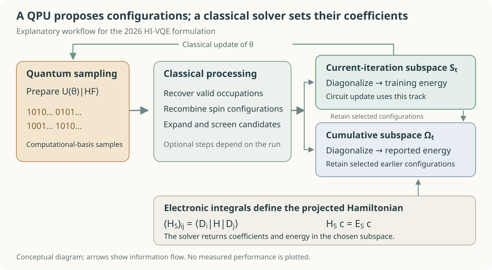
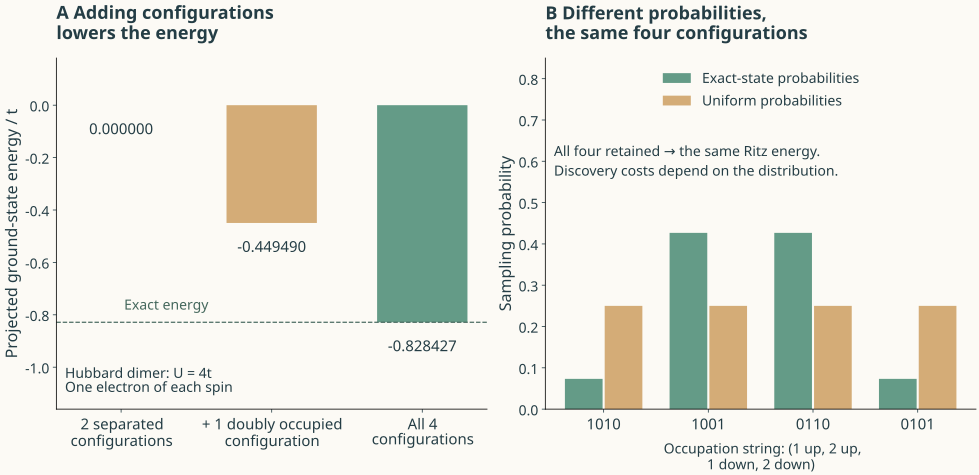

# Two computers for molecular chemistry: where could quantum advantage come from?

How configuration sampling and classical diagonalization shape the prospects for practical quantum advantage

<figure><figcaption>Figure 1. Occupation patterns and colored threads around an iron–sulfur core symbolize information flow between configuration proposal and classical subspace calculation. An AI-edited textile-and-paper concept illustration preserving a reference Fe₄S₄ core geometry; external ligands are omitted. [1]</figcaption></figure>

Designing a catalyst that breaks nitrogen's triple bond requires understanding how electrons rearrange as the bond stretches. Even the dissociation of a nitrogen molecule becomes difficult to describe with a single electronic configuration. Qunova's official nitrogen benchmark considers 14 active electrons in 20 spatial orbitals. At a fixed spin projection, that already permits about six billion electronic configurations. HI-VQE retained roughly nine million of them to calculate the energy. [2]

The benchmark table lists two times: 258 seconds of quantum processor usage and 46,547 seconds in total. That is 4 minutes 18 seconds and approximately 12 hours 56 minutes. The gap reveals how HI-VQE works. The quantum device proposes useful configurations; a classical computer combines them to calculate the wavefunction and energy. The value of the method depends on how much work this division saves.

The official name is Handover Iterative Variational Quantum Eigensolver. HI-VQE, HiVQE, and HIVQE are spellings used for the same algorithm family. The original paper appeared in 2025, and a substantial follow-up was revised in September 2026. The broader research includes QunaSys's quantum-selected configuration interaction (QSCI) and IBM's sample-based quantum diagonalization (SQD), in which quantum devices select configurations and classical computers solve the resulting subspaces. Qunova combines candidate generation, accumulation, screening, and circuit updates in an iterative procedure. [3–5]

## Selecting electronic configurations and solving the wavefunction

A spatial orbital describes a one-electron spatial state. Assigning two spin directions to each of L spatial orbitals usually gives 2L spin orbitals. In direct occupation-number encoding, an empty or occupied spin orbital corresponds to a qubit value of 0 or 1. A bitstring specifies an electronic configuration. The corresponding antisymmetrized many-electron basis function is a Slater determinant.

With Nα electrons in the α spin orbitals and Nβ in the β spin orbitals, the number of determinants is

$$
D=\binom{L}{N_\alpha}\binom{L}{N_\beta},\qquad
|\Psi\rangle=\sum_{i=1}^{D}c_i|D_i\rangle.
$$

For the nitrogen example, L=20 and Nα=Nβ=7, giving D=6,009,350,400. Optimizing every coefficient cᵢ in a complete active space soon becomes expensive. Classical selected configuration interaction (SCI) reduces this burden by choosing determinants important to the energy. QSCI uses quantum samples to help make that selection. [4]

Conventional VQE measures the energy expectation value of a circuit-prepared state and adjusts the circuit parameters θ to lower it. [6]

$$
E(\theta)=\langle\psi(\theta)|H|\psi(\theta)\rangle,
\qquad |\psi(\theta)\rangle=U(\theta)|\mathrm{HF}\rangle.
$$

Here |HF⟩ is a single-determinant Hartree–Fock reference state.

The Hamiltonian H is decomposed into Pauli terms for measurement. Reading the energy with a sufficiently small statistical error can therefore be costly in its own right. HI-VQE repeatedly measures computational-basis bitstrings from the circuit. A classical program constructs a set S of valid configurations and calculates the matrix elements from the input electronic integrals. [3]

$$
(H_S)_{ij}=\langle D_i|H|D_j\rangle,\qquad
H_S\boldsymbol c=E_S\boldsymbol c,
\qquad |\Psi_S\rangle=\sum_{i\in S}c_i|D_i\rangle.
$$

Classical diagonalization determines the magnitudes and signs of the final coefficients. The circuit's measurement frequencies need not exactly reproduce the probabilities in the final wavefunction. Its task is to help discover important configurations efficiently. With an exact projection of the same Hamiltonian and a sufficiently converged diagonalization, the variational bound Eₛ≥E₀ holds. An upper bound alone does not specify how close the result is to the true energy. [4]

<figure><figcaption>Figure 2. An original explanatory diagram of the division of work in HI-VQE. It distinguishes the current and cumulative subspaces in the 2026 revision. Recovery, screening, and classical expansion depend on the implementation and settings. [3,5]</figcaption></figure>

The 2026 implementation uses the current iteration's subspace to train the circuit and an accumulated subspace to calculate the reported energy. Determinants selected in the current iteration join those retained from earlier iterations. Processing also includes recovery of samples with incorrect electron counts, recombination of spin configurations, classical generation of single and double excitations, and coefficient-based screening. The final determinant count consequently includes configurations beyond those directly discovered by the quantum device. [5]

## Why the method tolerates noise and still needs samples

When the classical program constructs Hₛ from accurate electronic integrals, device noise does not enter its energy matrix elements directly. Noise changes which configurations are selected. The variational principle survives in a valid subspace, but missing important configurations or enlarging the space can worsen accuracy or cost. This form of noise resilience differs from quantum error correction. [4]

A configuration occurring with probability p is missed in N independent measurements with probability (1−p)ᴺ. Reducing the measurement to one basis setting and reducing it to one shot are very different operations. If low-probability configurations matter, the shot count and duplicate samples remain a burden. Reinholdt and colleagues' critical study of QSCI identified this redundancy and the competitiveness of classical selection in molecular examples. Controlled comparisons can test how much HI-VQE's learned distributions and additional classical expansion improve the situation. [7]

A small Hubbard model makes the distinction between configurations and probabilities concrete. Consider two sites with one electron of each spin. Let t be the hopping strength and U the repulsion when both electrons occupy the same site. At U=4t, the exact ground-state energy with all four configurations is −0.828427t. Retaining only the two configurations with electrons on different sites gives 0. Adding one doubly occupied configuration lowers it to −0.449490t. The energy depends strongly on which configurations survive.

<figure><figcaption>Figure 3. An explanatory two-site Hubbard model calculated for this review, with t=1, U=4, Nα=Nβ=1, and energies in units of t. Once all four configurations are retained from either distribution on the right, the same projected Hamiltonian is diagonalized. The finite-shot cost of obtaining them differs between distributions. This calculation does not reproduce a company's molecular benchmark. <a href="https://github.com/Infant83/AI_Tech_Review/blob/main/2026-11-10_qunova-hivqe-quantum-chemistry/artifacts/verify_examples.py">Calculation code</a> and <a href="https://github.com/Infant83/AI_Tech_Review/blob/main/2026-11-10_qunova-hivqe-quantum-chemistry/artifacts/example-results.json">numerical JSON</a> are provided.</figcaption></figure>

Once all four configurations are retained, replacing the original sampling frequencies with uniform ones gives the same energy: classical diagonalization determines the coefficients again. In this model, the missing configurations describe virtual hopping through double occupancy. They can lower the energy even when their probabilities are small. A useful sampler must find configurations with necessary energetic contributions as well as repeatedly return those with large probabilities.

Convergence diagnostics must preserve this distinction. An eigenvector can have zero residual within a subspace while the full Hamiltonian still couples it to omitted configurations. Let Pₛ be the orthogonal projector onto the selected determinant space. For a normalized Ritz state,

$$
P_S=\sum_{i\in S}|D_i\rangle\langle D_i|,\qquad
\operatorname{Var}_{\Psi_S}(H)
=\|(1-P_S)H|\Psi_S\rangle\|^2.
$$

The symmetric combination of the two separated configurations in this model has zero projected variance but a full variance of 4t². If a service reports an energy variance or residual, its meaning depends on whether it refers to the full H or the projected Hₛ.

## Accuracy at 40 qubits and computational scale at 72 qubits

Public results must be read against the same system and reference energy. The 40-qubit nitrogen example in IBM's Qunova documentation reports a difference of 1.20 millihartree (mHa) from its active-space reference; 1 mHa is 0.001 hartree. Arithmetic performed for this review puts QPU usage at about 0.55% of the total time as defined by that document. Improvements across configuration selection, matrix construction, diagonalization, and the rest of the workflow therefore matter to practical use. [2]

The September 2026 HI-VQE revision extends the calculation to [4Fe–4S] with 54 active electrons in 36 spatial orbitals. This corresponds to 72 spin orbitals; the physical circuit also uses connector qubits. The reported variational energy is about 64 mHa above the specified density matrix renormalization group (DMRG) reference. That gap is approximately 40 times the conventional chemical-accuracy scale of 1 kcal/mol, or roughly 1.6 mHa. Table 7 reports about 66,000 Fugaku node-hours of classical computation. Running a hybrid calculation in a large multireference space and reaching a target accuracy are distinct achievements. In §4.5, the authors themselves leave genuine advantage over classical selection heuristics as an open question. [5]

| Public example | Calculation target | What the result shows |
| --- | --- | --- |
| HI-VQE in IBM's documentation | N₂, (14e,20o), 40 qubits | A 1.20 mHa difference from the specified active-space reference [2] |
| 2026 HI-VQE extension | [4Fe–4S], (54e,36o), 72 problem qubits | Execution with a large cumulative CI space; a variational energy about 64 mHa above DMRG [5] |
| HSQD follow-up | N₂, (10e,26o) | Sampling half-configurations of one spin reduces circuit width from 52 to 26 qubits [8] |

HSQD further reduces the task assigned to the quantum device. Where spin symmetry can be exploited, a smaller circuit samples configurations for one spin sector, and a classical program constructs the α–β combinations and their coefficients. The authors also propose HCI-HSQD, which selects important combinations using heat-bath configuration interaction (HCI). HCI admits a candidate when the magnitude of a Hamiltonian coupling multiplied by a retained determinant's coefficient exceeds a chosen threshold. Halving the qubit count is a change in how configuration proposals and final correlations are computed. It does not losslessly encode an arbitrary large quantum state in a smaller register. [8]

For nitrogen, combining the half-qubit circuit with classical selection gives reported energy differences below 1 mHa from the study's classical HCI reference. Its Methods section, however, states that differing reference energies prevent a direct comparison with the earlier SQD nitrogen study. Circuit-resource reductions and the accuracy contribution of classical selection should therefore be assessed separately before translating the abstract's measurement-saving percentage into an overall computational advantage. [8]

## What the public review record says about quantum advantage

The Quantum Advantage Tracker includes Qunova–RIKEN HI-VQE results alongside HCI results for the same Hamiltonians. Subtracting the reported \[2Fe–2S\] (30e,20o) values gives an HCI variational energy lower by 0.7429 mHa. This is a difference between two reported values, not an error relative to an exact energy or an uncertainty. The CPU families, core counts, and memory also differ, so runtimes alone cannot establish a speed ranking. The pinned record classifies both this [2Fe–2S] system and the public 3.0Å N₂ submissions as Baseline benchmarks. This records review of submitted benchmark material; it is not a determination of quantum advantage. [9,10]

The disclosed excitation-preserving ansatz (EPA) circuit uses iSWAP, linear connectivity, and two repetitions. When a reviewer asked about classical simulability, the submitter replied in April 2026 that this circuit was, in principle, classically simulable. The choice was explained as an assessment of practical performance under current hardware constraints. The acknowledgement applies to this benchmark's circuit; it does not establish classical simulability of more general ansatzes or of the later 72-qubit local unitary cluster Jastrow (LUCJ) calculation. [9]

Whether the device prepares a state difficult to reproduce classically remains important for subsequent work. Rudolph and Tindall used the structure of a particular large LUCJ circuit to simulate and sample it with classical tensor networks. Worst-case circuit hardness and the difficulty of classically obtaining useful configurations from a chemistry calculation are different claims. The contribution of quantum samples must be tested against the latter task. [11]

## Where other companies are building capability

Even when methods begin with similar equations, product strengths depend on whether the work concentrates on circuit design, recovery of noisy samples, classical linear algebra, chemical-model construction, or error correction. The capabilities below are supported by public material; they are not a performance ranking at matched budgets.

| Company and approach | Capability visible in public technical material | Conditions to examine in an application |
| --- | --- | --- |
| **Qunova — HI-VQE and HSQD** | Iterative candidate accumulation and screening; integration of circuit training with HPC CI calculations; resource reductions through half-qubit circuits [3,5,8] | The additional contribution of quantum samples, classical expansion cost, variation across runs, and the target state and accuracy |
| **QunaSys — QSCI and QURI** | Quantum selection of CI subspaces and tools for development and commercial deployment [4,12,13] | The cost of preparing a useful sampling state and total cost against classical SCI |
| **IBM — SQD, Qiskit, and HPC integration** | Configuration recovery for physically invalid samples and parallel processing of large subspaces [14,15] | Distinguishing scale beyond exact diagonalization from superiority over the best classical approximations |
| **QC Ware — QNP-VQE and SQD for periodic materials** | Reproducible material connecting Wannier/natural-orbital active spaces to quantum solvers, including work with POSCO [16,17] | FCI accuracy within the reduced model and adsorption-energy accuracy for the full material |
| **Quantinuum — InQuanto** | Chemistry software connecting embedding, VQE, and phase estimation with compilation and device execution [18] | The total cost of initial-state preparation, long time-evolution circuits, error correction, and target precision |

QunaSys and Qunova are separate companies. IBM contributes hardware, open-source software, and HPC integration, and also hosts Qunova's HI-VQE as a Function. QunaSys's public QSCI implementation uses QSAL-1.0 and requires a separate license for commercial use. It also offers an official partner program. IBM's public SQD implementation uses Apache-2.0. The Qunova IBM Function specifies that problems exceeding 20 qubits require a license granting a higher limit. The published algorithm, the terms governing public code, and access to a commercial service identify different parts of an adoption decision. These documents do not establish private contractual relationships between vendors. [2,12,13,15]

IBM's early SQD experiment combined Heron with Fugaku. Its largest circuit used 72 problem qubits and five auxiliary qubits, for a total of 77 physical qubits. Going beyond the scale of full state-vector exact diagonalization does not replace an end-to-end comparison with classical DMRG or SCI. [14] QC Ware's Fe–MOF-74 study is a concrete application connecting the reduction of a periodic material to an active space with quantum solvers. Its simulator QNP-VQE results and hardware SQD results have distinct scopes, as do the reduced model and prediction for the actual material. [16,17]

Phase estimation supported by Quantinuum's InQuanto illustrates another long-term route. It infers energy from the phase acquired by an energy eigenstate under time evolution \(e^{-iHt/\hbar}\). This offers a route beyond explicitly listing the important configurations of the final wavefunction in classical memory, while requiring state preparation and deep logical circuits. [18] Quantinuum and collaborating researchers have tested phase estimation with error correction for a small H₂ model. This research route has different hardware demands from proposing useful configurations with short circuits. [19]

## Designing an industrially meaningful comparison

For catalysts and biological metal centers, the problem goes beyond matching one large total-energy number. The ordering of nearby spin states, redox energy differences, and reaction barriers can change the chemical conclusion. If the energy errors for reactant A and product B are eₐ and eᵦ, the reaction-energy error is eᵦ−eₐ. The errors can cancel or become larger. A high percentage of recovered correlation energy consequently does not guarantee the accuracy of a small spin gap or reaction barrier.

The HI-VQE follow-up also states that its present procedure does not enforce a target spin and leaves comparisons of ⟨S²⟩, local spins, and spin correlations for future work. [5] A first comparison proposed here is the energy gap between two specified spin states in an Fe–S system. Fix the geometry, charge, basis, active space, and error target, then use ⟨S²⟩, local spins, and occupancies to check that the calculations describe the same state. Separately converge the active-space solver error and the effects of omitted dynamic correlation and the environment. Well-tuned HCI/SHCI and DMRG are important comparators for nitrogen dissociation and strongly correlated Fe–S systems. CCSD(T) is also useful in regions with strong single-reference character.

Next, feed different candidate generators into the same classical processing. Compare actual QPU samples, a classically simulable circuit, classical SCI candidates, and classical expansion with no QPU. Remove recovery, spin recombination, and classical expansion one at a time to isolate their contributions. Record valid-sample fractions, duplication, newly discovered useful configurations, error at matched subspace size, and error at matched total budget.

The cost measure should include preprocessing, circuit preparation, rejected shots, post-processing, matrix construction, eigensolving, and restarts, together with the success rate across independent runs. What matters is the cost of reliably reaching a specified accuracy as the problem grows, beyond the best single execution. If a smaller subspace saves classical work, a useful regime is one in which that saving exceeds the additional cost of the quantum device.

Qunova's capability worth examining is the repeated discovery of useful configurations and their organization into a tractable classical calculation. Carefully reducing the task assigned to the quantum device can advance hybrid chemistry workflows on current hardware. Concrete evidence for industrial quantum advantage would emerge if a contribution difficult to replace with classical selection persists and enables energy differences for the correct chemical states to be calculated at lower total cost.

## References

[1] RCSB Protein Data Bank, [SF4 Chemical Component Dictionary record](https://files.rcsb.org/ligands/view/SF4.cif) (accessed 10 November 2026).

[2] IBM Quantum, HI-VQE Chemistry — A Qiskit Function by Qunova Computing, [IBM Quantum Documentation](https://quantum.cloud.ibm.com/docs/en/guides/qunova-chemistry) (accessed 10 November 2026).

[3] A. Pellow-Jarman, S. McFarthing, D. H. Kang, P. Yoo, E. E. Elala, R. Pellow-Jarman, P. Nakliang, J. Kim, and J.-K. K. Rhee, HIVQE: Handover iterative variational quantum eigensolver for efficient quantum chemistry calculations, [arXiv:2503.06292v2](https://arxiv.org/abs/2503.06292v2) (2025).

[4] K. Kanno, M. Kohda, R. Imai, S. Koh, K. Mitarai, W. Mizukami, and Y. O. Nakagawa, Quantum-selected configuration interaction: Classical diagonalization of Hamiltonians in subspaces selected by quantum computers, [Phys. Rev. Research **8**, 023268 (2026)](https://doi.org/10.1103/dmn4-snfx).

[5] P. Yoo, K. Kim, E. E. Elala, S. McFarthing, A. Pellow, J. I. Fuks, D. H. Kang, P. Nakliang, J. Kim, H. Pathak, T. Shirakawa, S. Yunoki, and J.-K. K. Rhee, Extending the handover-iterative VQE to challenging strongly correlated systems: N₂ and Fe-S cluster, [arXiv:2601.06935v2](https://arxiv.org/abs/2601.06935v2) (2026).

[6] A. Peruzzo, J. McClean, P. Shadbolt, M.-H. Yung, X.-Q. Zhou, P. J. Love, A. Aspuru-Guzik, and J. L. O’Brien, A variational eigenvalue solver on a photonic quantum processor, [Nat. Commun. **5**, 4213 (2014)](https://doi.org/10.1038/ncomms5213).

[7] P. Reinholdt, K. M. Ziems, E. R. Kjellgren, S. Coriani, S. P. A. Sauer, and J. Kongsted, Critical limitations in quantum-selected configuration interaction methods, [J. Chem. Theory Comput. **21**, 6811–6822 (2025)](https://doi.org/10.1021/acs.jctc.5c00375).

[8] S. McFarthing, A. Pellow-Jarman, and F. Petruccione, Noise-resilient quantum chemistry with half the qubits, [arXiv:2602.01165v3](https://arxiv.org/abs/2602.01165v3) (2026).

[9] Qunova Computing and RIKEN, HI-VQE [2Fe-2S] (30e, 20o), [Quantum Advantage Tracker, Issue 114](https://github.com/quantum-advantage-tracker/quantum-advantage-tracker.github.io/issues/114), including the [21 April 2026 comment](https://github.com/quantum-advantage-tracker/quantum-advantage-tracker.github.io/issues/114#issuecomment-4286413522) (2026).

[10] Quantum Advantage Tracker, [Variational problem submissions](https://github.com/quantum-advantage-tracker/quantum-advantage-tracker.github.io/blob/4d27f882d55028162206c4f12b5b6fc6a63868e7/data/variational-problems/submissions.json); [Hamiltonian metadata](https://github.com/quantum-advantage-tracker/quantum-advantage-tracker.github.io/blob/4d27f882d55028162206c4f12b5b6fc6a63868e7/data/variational-problems/hamiltonians.json), commit 4d27f882d55028162206c4f12b5b6fc6a63868e7 (3 November 2026).

[11] M. S. Rudolph and J. Tindall, Simulating and sampling from quantum circuits with 2D tensor networks, [arXiv:2507.11424v2](https://arxiv.org/abs/2507.11424v2) (2025).

[12] QunaSys, [QURI Parts QSCI LICENSE](https://github.com/QunaSys/quri-parts-qsci/blob/a1d6bf0452276d1eec13a0e6e60bfd5d42bb7755/LICENSE), commit a1d6bf0452276d1eec13a0e6e60bfd5d42bb7755 (18 August 2026).

[13] QunaSys, [QunaSys Launches QSCI Technical Portal and Official Partner Program to Accelerate Global Commercial Deployment](https://qunasys.com/en/news/posts/2026qscipartner_en/) (2 March 2026).

[14] J. Robledo-Moreno, M. Motta, H. Haas, A. Javadi-Abhari, P. Jurcevic, W. Kirby, S. Martiel, K. Sharma, S. Sharma, T. Shirakawa, I. Sitdikov, R.-Y. Sun, K. J. Sung, M. Takita, M. C. Tran, S. Yunoki, and A. Mezzacapo, Chemistry beyond the scale of exact diagonalization on a quantum-centric supercomputer, [Sci. Adv. **11**, eadu9991 (2025)](https://doi.org/10.1126/sciadv.adu9991).

[15] Qiskit, [Qiskit SQD](https://github.com/Qiskit/qiskit-sqd/tree/40fe153b011da2649c63c4fd016a692d8b73add0), commit 40fe153b011da2649c63c4fd016a692d8b73add0 (5 November 2026).

[16] D. Rocca, J. F. Gonthier, J. Levin, T. Schäfer, A. Grüneis, H. W. Lee, and B. Kang, Quantum simulation of carbon capture in periodic metal–organic frameworks, [Digital Discovery **5**, 1388–1400 (2026)](https://doi.org/10.1039/D6DD00023A).

[17] QC Ware, [Quantum simulation of carbon capture in periodic metal–organic frameworks](https://github.com/qcware/quantum_simulation_MOF/tree/ad3c6658f3d32167b6c0462af2451e5b0e062c2a), commit ad3c6658f3d32167b6c0462af2451e5b0e062c2a (16 January 2026).

[18] Quantinuum, [Non-variational and phase estimation algorithms](https://docs.quantinuum.com/inquanto/manual/algorithms/non_variational_overview.html), InQuanto 6.1.1 (accessed 10 November 2026).

[19] K. Yamamoto et al., Quantum error-corrected computation of molecular energies, [PRX Quantum **7**, 020319 (2026)](https://doi.org/10.1103/m7j3-5sk6).

## How this review was made

The evidence cutoff is 10 November 2026. The draft was prepared with OpenAI Codex. The `qunova_mechanism` agent investigated mechanisms, paper versions, and numerical values; `qunova_comparators` examined the comparison companies, public implementations, and terms of use; and `qunova_advantage_audit` examined quantum-advantage claims and baseline benchmarks. The exact model identifier was not preserved. The editorial harness follows EDITORIAL_METHOD 2026.08 and the scientific-explanation, writing-style, and APS reference guidelines.

Reported QPU and HPC results were compared across author and provider material. No QPU or commercial HI-VQE service was executed for this review. Independent calculations cover the explanatory Hubbard model's matrix, analytical solution, variational ordering, full and projected variances, the combinatorial count, and arithmetic on reported values. Three research agents separately reviewed the draft's scientific content, company comparison, and interpretation of quantum advantage. The mechanism reviewer executed the calculation function and compared it with the stored results. The two diagrams were inspected as rendered images for text and relationships. A human proposed the topic and evaluation questions; a sentence-level human review has not been recorded. The English manuscript was prepared by `qunova_english_publication`. Cover, HTML, and PDF production are recorded separately during publication editing.
