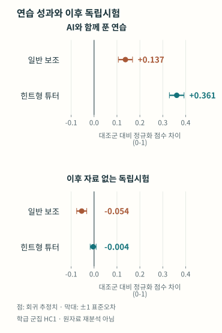

# 생성형 AI의 인지적 증강과 역량 평가의 재설계

인간은 도구를 만들고 다루며 몸과 생각의 경계를 넓혀 왔다. 올림픽의 수영과 카누가 각각의 숙련을 겨루듯, AI로 넓어진 수행을 인정하려면 평가도 변화한 역량과 환경에 맞게 달라져야 한다.

<figure class="hero">

<figcaption>같은 물에서 헤엄치고 노를 젓는 사람들 옆으로, 크기와 모양이 다른 틀이 물가를 따라 열려 있다. 디지털 지도는 AI로 넓어지는 선택지를, 열린 틀은 변화한 역량과 환경에 맞춰 달라지는 평가를 상징한다. 실제 경기·장치·측정자료가 아닌 AI 생성 개념 일러스트.</figcaption>
</figure>

인간의 역사를 기술의 역사로 읽으면, 그 안에는 몸과 생각의 경계를 넓혀 온 긴 여정이 보인다. 손으로 옮기던 짐을 수레에 싣고, 발로 닿기 어려운 곳에 배를 띄우고, 망원경으로 눈이 닿는 거리를 늘려 왔다. 글과 계산 도구는 기억하고 헤아릴 수 있는 범위를 넓혔다. 사람이 만든 도구가 달라질 때마다 사람이 세상과 만나는 방식도 달라졌다.

그 과정에서 사람은 도구를 만드는 일과 능숙하게 쓰는 일을 함께 배웠다. 도구가 열어 준 길을 실제로 가려면 그것을 고르고 다루며 결과를 해석하는 숙련이 필요하다. 그 숙련도 배움을 통해 사람에게 쌓인다. 그래서 인간이 무엇을 할 수 있는지 말할 때에는 스스로 익힌 힘과 지식에 더해, 기술과 함께 일을 해내는 능력까지 바라보게 된다.

능력이 펼쳐지는 환경이 달라지는 만큼, 무엇을 성취로 인정하고 어떻게 평가할지도 달라져야 한다. 이 관계를 올림픽 경기장의 두 장면에 비춰 볼 수 있다.

## 도구를 다루는 능력까지 평가하는 무대

수영 경기에서 한 선수는 팔을 뻗고 호흡을 고르며 물을 가른다. 관중이 지켜보는 기록에는 그가 몸에 익힌 힘과 움직임의 정교함이 담긴다. 카누 경기에서는 선수의 힘이 배와 노를 거쳐 물에 전해진다. 배의 성능과 함께, 노를 젓는 동작과 균형, 힘의 배분을 다듬어 온 숙련이 기록을 만든다.

우리는 이 두 성취를 각각의 종목으로 인정한다. 카누에서는 정해진 장비와 경기 조건 안에서 도구를 다루는 사람의 수행을 겨루고, 수영에서는 몸에 익힌 역량을 계속 갈고닦는다. 도구를 활용하는 숙련을 인간의 능력에 포함하면서 몸으로 기른 역량도 함께 평가하는 모습이다. [1] [2]

AI와 함께 일하는 사람을 평가할 때에도 이 시선을 이어 갈 수 있다. 낯선 자료를 분석하고 코드를 만들며 다른 전문분야의 문제를 풀 때, 기술은 사람이 해낼 수 있는 일의 범위를 바꾼다. 모델이 얼마나 잘 답하는지와 더불어 사람이 그 모델을 활용해 어떤 일을 안정적으로 해내는지 살펴야 한다. 어떤 문제를 정하고, 무엇을 AI에 맡기고, 결과를 어떻게 확인하고 수정하며, 달라진 조건에 어떻게 대응하는지도 능력의 일부가 된다.

**인간의 역량이 도구와 함께 넓어지는 만큼, 평가도 변화한 역량과 환경에 걸맞게 달라져야 한다.** AI를 활용하는 사람의 경우에는 완성한 결과의 품질과 함께, 결과를 만드는 과정에서 사람이 선택하고 검증하고 수정한 일을 살펴야 한다. 스스로 이해하는 힘과 AI를 활용해 해낸 일을 각각 확인하고, 새 문제에서도 그 판단이 이어지는지 살피는 평가다.

시험지 앞의 스마트 안경은 이 질문을 선명하게 만든다. 일부 안경은 눈앞의 장면을 사진으로 보내 AI의 음성 응답을 제공한다. 기능의 존재와 실제 시험에서 얻을 점수는 구분해야 하지만, 답을 만드는 과정의 일부가 이미 사람의 몸 밖으로 옮겨갈 수 있다는 장면이다. [3] 교육부는 2026년 11월 9일 수능 안내에서 AI 스마트 안경을 포함한 전자기기의 반입을 제한했다. 정해진 조건에서 점수를 비교하는 현재의 시험과, 기술을 활용하는 사람에게 필요한 다음 평가 기준은 목적을 밝혀 설계해야 한다. [4]

올림픽의 비유는 무엇을 능력에 포함할지 생각하게 한다. 그 능력을 제대로 측정하는 방법은 학습·선발·자격의 목적에 맞춰 검증해야 한다. 이를 위해 AI가 실제 수행의 범위를 어떻게 넓히며, 도구를 활용하는 과정에서 어떤 학습과 판단이 사람에게 남는지부터 살펴볼 필요가 있다.

## AI는 수행의 기회를 실제로 넓힌다

AI를 활용한 성과는 추상적인 미래 이야기만은 아니다. Brynjolfsson·Li·Raymond가 고객상담원 5,172명의 단계적 AI 도입을 분석한 연구에서는 시간당 성공적으로 해결한 상담 건수가 평균 약 15% 증가했다. 초보자와 기존 성과가 낮은 집단의 이득이 더 컸다. 저자들은 이 결과를 숙련자의 응대 방식 일부가 AI를 통해 전달됐을 가능성으로 해석했다. 전체 인원을 무작위 배정한 실험은 아니며, 최고 숙련 집단에는 일부 품질 하락도 있었다. 이 수치를 전 직종의 효과로 확대할 수는 없다. [5]

다른 분야의 관점을 다루는 데에도 기회가 보인다. P&G의 연구개발·상업 부문 전문가 791명을 분석한 현장실험에서는 개인·2인팀과 AI 허용 여부를 나눠 제품 혁신 제안을 만들게 했다. 조건과 제출자 정보를 모르는 평가자들이 독립적으로 평가했을 때, AI를 쓰는 개인의 제안 품질은 AI 없는 팀과 비슷했고, 기술 또는 상업 쪽으로 치우치던 전문 배경별 차이도 줄었다. [6]

이 결과는 한 분야를 아는 사람이 다른 기능의 관점을 포함한 제안을 만드는 데 AI가 도움을 줄 수 있음을 뜻한다. 무경험자가 다른 전문직의 자격을 얻었다는 결과는 아니다. 참여자는 이미 분야 전문가였고, 하루 동안의 제안 품질은 실제 제품의 시장 성과나 장기적인 전문성까지 측정하지 않았다. 그럼에도 다른 사람의 설명을 오래 기다리거나 외부 솔루션을 구해야만 시작할 수 있던 일의 일부를 직접 시도할 가능성은 중요하다.

여기서 평가도 달라져야 한다. 이미 하던 일을 더 빨리 끝내는지와, 이전에는 못하던 일을 외부 기준에 맞게 수행하는지는 다른 변화다. AI를 통한 능력 확대를 보려면 새 과업의 성공 여부, 검증·수정에 필요한 시간, 다른 상황에서도 이어지는 수행을 관찰해야 한다. 기존 과목의 점수만으로 이 기회를 충분히 설명할 수 있는지는 검증할 질문이다.

이 관점은 AI 이전의 지적 증강 논의와도 이어진다. Engelbart의 1962년 구상은 도구뿐 아니라 언어·방법·훈련이 함께 바뀌는 체계를 다뤘다. 도구가 강력해졌으니 훈련이 필요 없어진다는 설명보다, 강력한 도구를 사용할 때 어떤 훈련과 작업 방식이 필요한가라는 질문에 가깝다. [7]

## 높은 성과가 전문성의 모든 부분을 보여 주지는 않는다

도구의 도움은 과업에 따라 다르다. BCG 컨설턴트 758명이 참여한 연구는 AI가 잘하는 업무 과제에서 속도와 품질이 개선되는 한편, 모델이 취약한 별도의 관리 판단 과제에서는 정답률이 낮아졌다고 보고했다. 후자의 분석 대상은 373명이었으며 두 AI 조건을 합친 정답률 차이는 무AI 조건보다 약 19퍼센트포인트 낮았다. 2026년에 정식 출판됐지만 실험은 2023년 GPT-4 조건이었다. 현재 모든 모델의 성능표로 읽을 결과는 아니다. [8]

이 결과를 평가에 적용한다면, 결과의 품질과 함께 AI의 제안을 언제 받아들이고 언제 추가 확인을 선택하는지도 관찰할 필요가 있다.

사람과 AI의 결합이 사람보다 나아졌다는 말도 비교 대상을 밝혀야 한다. 106개 실험의 370개 효과크기를 모은 메타분석에서는 결합 수행이 평균적으로 사람 단독보다 좋았지만, 사람과 AI 중 더 좋은 단독 수행을 넘어서는 평균적인 상승효과는 나타나지 않았다. 수집 범위가 2020년부터 2023년 상반기까지여서 최신 생성형 AI와 에이전트 전체를 대표하지는 않는다. 그럼에도 사람 단독·AI 단독·사람과 AI를 구분해야 한다는 비교 원칙은 남는다. [9]

전문성을 인정하려면 산출물의 작성 방식만이 아니라 맡길 수 있는 일의 범위가 필요하다. AI로 초안을 만드는 사람, 그 초안의 오류를 고칠 수 있는 사람, 실제 조건에서 결과를 실행하고 실패에 대응할 수 있는 사람에게 같은 권한을 줄 근거가 있는지 물어야 한다. 이는 기존 전문가와 새롭게 일을 할 수 있게 된 사람 모두에게 어떤 일을 맡길 수 있는지 정하는 질문이다.

## 수학 증명이 보여 주는 또 하나의 증강: 검증

이 대목에서 수학의 변화는 시야를 더 넓혀 준다. Quanta Magazine의 2026년 11월 11일자 *Transformation*에서 Konstantin Kakaes는 AI가 긴 수학 증명을 기계가 검사할 수 있는 형태로 옮기는 ‘자동 형식화(autoformalization)’의 진전을 다뤘다. 수학자가 읽는 증명에는 생략된 중간 단계와 공유하는 배경지식이 많다. 이를 명시적인 정의·명제·증명으로 옮기면, 사람이 방대한 논증을 처음부터 끝까지 홀로 따라가는 부담의 일부를 컴퓨터에 맡길 수 있다. [10]

대표 사례가 이미 알려진 페르마의 마지막 정리의 형식화다. Anthropic은 2026년 9월, AI 에이전트들이 기존 증명의 경로를 따라 Lean 코드를 작성한 결과를 공개했다. Lean은 수학 명제와 증명을 표현하고 검사하는 증명 보조기다. 이 성과는 미해결이던 정리를 AI가 처음 발견했다는 뜻이 아니다. 사람이 축적한 수학을 컴퓨터가 확인할 수 있는 증명으로 옮겼다는 데 의미가 있다. 형식화 연구자 Kevin Buzzard는 공개 결과를 직접 컴파일하고, 목표 명제가 Mathlib의 표준적인 정리와 맞는지 비교하는 검사도 실행했다고 보고했다. 이 리뷰는 그 보고와 공개 자료를 대조했으며 전체 코드를 독립 재실행하지 않았다. [11]

여기에는 서로 다른 일이 이어져 있다. AI는 증명 후보를 만들거나 기존 논증을 형식 언어로 옮긴다. Lean의 핵심 검사기는 그 증명이 주어진 정의·공리와 논리 규칙에 따라 명시된 명제를 뒷받침하는지 확인한다. AI에게 다시 “맞는가?”라고 물어 같은 판단을 받는 것과는 검증 방식이 다르다. 검사기의 역할과 신뢰하는 가정까지 분명히 해야 하지만, 생성기의 문장이 그럴듯하다는 이유로 참이라고 인정할 필요는 줄어든다. **도구는 답을 만드는 능력뿐 아니라, 그 답을 확인하는 능력도 확장할 수 있다.** [12]

다만 기계가 확인한 명제가 애초에 풀려던 문제와 같은지는 따로 확인해야 한다. 예를 들어 ‘모든 정수’에 관한 질문을 ‘양의 정수’에 관한 명제로 좁혀 옮겼다면, 그 증명이 옳아도 원래 질문 전체를 해결한 것은 아니다. 증명을 끝내지 않고 빈 부분을 가정으로 남겼는지, 필요한 조건을 몰래 보탰는지도 검사 대상이다. Lean 공식 검증 안내 역시 실행 성공만으로 끝내지 않고 정리의 문장과 공리 의존성을 살피도록 설명한다. 검증을 자동화할수록 ‘무엇을 검증했는가’를 정확히 적는 일이 중요해진다. [12]

또 하나의 차이는 옳음의 확인과 이해의 형성 사이에 있다. 긴 증명이 규칙에 맞는다고 확인해도, 왜 그 결론이 나오는지 배우고 다른 문제에 아이디어를 옮기는 일은 남는다. Buzzard는 자동 형식화의 성과를 인정하면서도 자신이 추구하는 사람이 읽고 이해할 수 있는 수학적 설명과는 구별했다. [11] 학생이 증명의 모든 세부를 설명하지 못하더라도 제출한 결과에는 유효한 증명이 들어 있을 수 있다. 그 산출물의 가치와 학생이 무엇을 배웠는지는 서로 다른 증거로 판단해야 한다. 교육에서는 검사 통과를 인정하면서 핵심 아이디어를 설명하고, 조건을 바꾸면 어디서 논증이 달라지는지 보여 주는 수행도 관찰할 수 있다. AI가 설명과 문제 선택까지 도울 수 있으므로 이를 영원히 인간만의 역할이라고 단정할 필요는 없다. 현재의 교육에서는 그 도움을 통해 학습자에게 어떤 이해가 자랐는지를 확인하는 것이 중요하다.

수학의 사례를 모든 업무에 그대로 옮길 수는 없다. 현실의 자료가 빠졌거나 모형의 가정이 맞지 않으면, 모형 안의 논리가 옳아도 현실에 대한 결론은 달라질 수 있다. 그럼에도 평가를 설계하는 데 주는 통찰은 크다. 모든 답을 맨손으로 다시 푸는 능력에 더해, 과제에 맞는 검사 방법을 고르고 그 보장 범위를 설명하며 다른 사람도 확인할 수 있는 결과를 남기는 능력을 볼 수 있다. 이렇게 보면 AI 시대의 전문성에는 산출물을 만드는 숙련과 함께 신뢰할 수 있는 검증 과정을 구성하는 숙련도 들어간다. 이는 수학 사례에서 확장한 리뷰의 평가 제안이다.

## 지금 잘 풀었다는 것과 배웠다는 것은 다르다

AI로 얻는 즉시 성과와 학습을 같은 점수로 보면 중요한 차이가 사라진다. Bastani 등의 고교 수학 현장실험은 일반적인 GPT-4 보조, 교사가 설계한 힌트 중심 튜터, AI 없음 조건을 비교했다. 약 1,000명의 학생이 참여한 단기 실험에서 두 AI 조건은 연습 성과를 높였다. 그러나 이후 자료 없이 푼 시험에서는 일반 보조군의 성적이 낮았다. 힌트형은 이 하락을 완화했지만 대조군보다 나은 독립시험 성적을 입증하지는 않았다. [13]

그림 1은 같은 논문의 연습과 독립시험을 분리한다. 오른쪽으로 향한 연습의 효과가 뒤이은 시험의 향상을 보장하지 않는다. 일반 보조의 독립시험 차이는 0-1 정규화 점수에서 -0.054였다. 흔히 인용되는 약 17% 하락은 대조군 평균에 대한 상대 변화이며, 17퍼센트포인트 하락이라는 뜻이 아니다. 힌트형과 무AI 대조군의 독립시험 점수 차이는 통계적으로 유의하지 않았지만, 이는 두 조건의 동등성을 입증한 결과와는 다르다.

<figure>

<figcaption>그림 1. Bastani 등 Table 1의 회귀 추정치와 학급 군집 HC1 표준오차를 재도식화했다. 두 패널 모두 대조군 대비 0-1 정규화 점수 차이를 표시한다. 오차막대는 ±1 SE이며 95% 신뢰구간이 아니다. 연습과 시험은 다른 과제이며 원점수의 전후 변화가 아니다. 자체 실험이나 통계 재분석은 수행하지 않았다. [13]</figcaption>
</figure>

반대로 잘 설계한 튜터가 학습을 도울 근거도 있다. Kestin 등의 하버드 기초물리 연구는 분석 대상 194명이 두 차시에 걸쳐 AI 튜터와 교실 능동학습을 경험하게 했다. 교사가 준비한 정답·문항별 안내와 자기 속도 학습 등을 포함한 튜터 조건에서 즉시 사후검사 점수가 높았다. 이 결과는 그 교육 설계의 효과이며, 일반 채팅창을 열어 주는 모든 상황의 효과가 아니다. 장기 기억이나 낯선 문제로의 전이도 별도로 확인해야 한다. [14]

새 기술을 배우는 업무에서도 구분이 필요하다. Shen·Tamkin의 2026년 프리프린트는 개발자 52명이 새 Python 라이브러리를 익히는 과제에서 GPT-4o 채팅 보조 여부를 비교했다. 보조군은 이후 AI 없는 개념·코드 읽기·디버깅 퀴즈에서 낮은 성적을 받았고, 평균 수행시간의 개선은 통계적으로 유의하지 않았다. 짧은 실험 뒤의 퀴즈를 장기적인 전문성 상실로 확대할 수는 없다. [15]

세 연구를 함께 읽으면 ‘AI가 있는가’만으로 학습 결과를 설명하기 어렵다. 답을 받는 방식, 스스로 생각할 기회, 교사가 설계한 피드백, 학습 뒤 무엇을 언제 측정했는지가 달랐다. 교육에서는 좋은 결과를 제출하는 경로와 다음 문제를 해결할 능력이 자라는 경로가 실제로 이어지는지 확인해야 한다.

## 보존할 역량, 증강할 수행, 둘을 연결하는 판단

이 근거에서 다음의 교육 방향을 제안할 수 있다. 세 범주는 리뷰의 설계 제안이며, 이미 검증된 보편적인 능력 척도가 아니다. 무엇을 혼자 해야 하는지의 범위도 분야와 도구의 변화에 따라 다시 정할 필요가 있다.

먼저 **스스로 이해하고 배울 기초 역량**을 길러야 한다. 문장을 읽고 주장을 구별하는 언어 능력, 분모·단위·크기를 이해하는 수리 능력, 증거와 가설을 구별하는 과학적 사고는 AI 답변을 해석하는 데에도 쓰인다. ‘20% 개선’이 무엇에 비해 개선됐는지, 상관관계에서 원인을 말할 수 있는지, 자료가 빠진 질문인지 알아야 다음 확인을 설계할 수 있다. 모르는 부분을 구체적으로 표현하고 주의를 유지하며 자신의 이해를 점검하는 능력도 여기에 포함된다. 모든 지식을 외워 두라는 뜻은 아니다. 후속 학습과 중요한 판단을 가능하게 하는 이해를 확인하자는 것이다.

다음은 **도구를 통해 수행 범위를 넓히는 능력**이다. AI를 사용해 자료를 모으고, 낯선 코드를 실행하며, 여러 가설과 설계안을 비교하고, 다른 전문분야의 용어를 배울 수 있다. 교육은 이러한 시도를 실제로 할 기회를 제공해야 한다. 평가는 최종 결과가 요구를 충족하는지와 함께, 검증 가능한 계산·자료·실행 조건이 남는지, 시간과 비용 안에서 완결하는지를 살펴볼 수 있다. 프롬프트 길이나 호출 횟수 자체가 성취의 기준일 이유는 없다.

두 능력을 연결하는 것은 **무엇을 맡기고 어떻게 확인할지 결정하는 판단**이다. 목표를 정하고, 일을 나누며, AI가 만든 후보를 시험하고, 결과가 달라지면 이유를 찾아 수정하는 능력이다. 수학의 형식화에서 보았듯, 검증에는 도구를 쓸 수 있고 그 도구가 확인한 범위도 알아야 한다. 도구가 중단됐을 때 모든 계산을 손으로 끝내야 한다는 뜻도 아니다. 무엇을 계속할 수 있고 무엇을 보류해야 하는지, 누구에게 넘기고 어떤 자료를 더 얻어야 하는지 판단하는 것이 필요한 경우가 많다.

그림 2에서는 이 관계를 하나의 분석 과제에 연결했다. 기본 이해는 자료를 읽고 검증할 질문을 만드는 데 참여하고, AI는 탐색·계산의 범위를 넓히며, 판단은 두 과정의 결과를 실제 선택으로 연결한다. 셋 중 하나의 점수만 높다고 나머지를 관찰한 것으로 볼 수는 없다.

<figure>

<figcaption>그림 2. ‘새 방법이 기존 방법보다 낫다는 주장을 판단하기’를 이용한 리뷰의 교육 설계 제안. 서로 관련된 세 관찰 대상을 나타내며, 능력의 보편적인 분류나 세 점수의 자동 합산을 제안하는 검증된 모형은 아니다.</figcaption>
</figure>

올림픽의 장면으로 돌아가면, 몸으로 익힌 감각과 배·노를 다루는 숙련은 함께 인간의 성취를 이룬다. AI를 쓰는 사람 역시 도구로 결과를 만드는 능력과 그 의미를 이해하는 능력을 함께 기를 수 있다. 평가는 도구가 낸 결과와 사람이 이해하고 판단한 범위를 구별하면서, 둘이 결합해 해낸 수행도 관찰해야 한다. 어떤 기초 이해가 어떤 도구 활용을 돕는지는 실제 과제 속에서 확인하며 교육을 다듬어야 한다.

## 시험을 바꾸려면 먼저 점수의 용도를 정해야 한다

같은 수학 점수라도 다음 수업을 정할 때, 대학 입학 순위를 정할 때, 졸업 수준을 확인할 때의 의미는 다르다. 교육측정의 타당도는 특정 목적으로 점수를 해석할 근거가 얼마나 있는가에 관한 개념이다. 시험에 AI를 허용했는지보다 먼저, 그 점수로 무엇을 말하려는지 밝혀야 한다. [16]

학습 진단이라면 학생이 다음에 어떤 설명과 연습을 필요로 하는지 알아야 한다. 선발이라면 제한된 기회를 배분하는 기준으로 적절한지와 이후 학습·수행과의 관계를 확인해야 한다. 자격이라면 해당 활동을 안전하고 효과적으로 맡길 최소 기준이 필요하다. 자격시험을 모두 상위 몇 명을 고르는 경쟁으로 묶을 수는 없다. [16]

이 목적에 맞춰 관찰 방식을 조합할 수 있다. 다음 표는 ‘새 방법 A가 기존 방법 B보다 성과를 높였다는 주장을 판단하기’라는 하나의 수업 과제를 발전시킨 제안이다. 특정 연구의 데이터나 실제 자격시험을 재현한 예시는 아니다.

| 관찰할 수행 | 학생이 할 일 | 평가자가 확인할 증거 |
|---|---|---|
| 기초 이해 | 짧은 표의 분모·단위·비교 조건을 설명하고 부족한 정보 찾기 | 개념·수치의 정확성, 판단을 보류할 이유 |
| AI를 활용한 분석 | 더 큰 자료를 분석해 재실행 가능한 계산과 판단문 작성 | 결과 품질, 출처·조건, 다른 사람의 재검사 가능성, 시간·비용 |
| 검증과 수정 | 교사가 제시한 답변의 잘못된 분모·인용·인과 결론 확인하고 적절한 검사 도구로 수정 | 오류와 오탐의 구별, 검사한 대상과 보장 범위, 수정의 근거와 결과 |
| 조건 변경과 전이 | 자료·목표를 바꾸고 결론을 조정하기, 이후 새 과제 수행 | 적용 범위 이해, 유지된 학습, 추가 확인의 선택 |

기초 이해를 확인할 때에는 과제 목적에 따라 AI의 도움을 제한할 수 있으며, 접근성·의사소통을 위한 지원까지 일괄 제거할 이유는 없다. AI 허용 과제에는 공통 도구와 연습 기회를 제공할지, 일정 예산 안에서 도구 선택까지 평가할지 정해야 한다. 교사가 오류를 섞어 만든 답변은 검증 과제의 재료이며 실제 AI의 오류 발생률을 보여 주는 표본이 아니다.

수학 수업에서는 같은 원리를 정리의 조건을 읽기, AI로 증명 후보 만들기, 형식화된 명제가 원래 질문과 맞는지 확인하기, 핵심 아이디어와 조건 변경의 영향을 설명하기로 옮길 수 있다. 모든 학생에게 거대한 Lean 증명을 작성시키자는 뜻은 아니다. 수업 수준에 맞는 작은 명제에서 무엇을 도구에 맡겼고 어떤 근거로 결론을 받아들였는지 드러내게 하는 제안이다. 분석 수업에서는 재현 가능한 계산과 자료 대조가 비슷한 역할을 할 수 있지만, 코드가 실행된다는 사실만으로 자료의 대표성이나 인과 해석까지 검증되지는 않는다.

설명과 수정은 짧은 구술, 실시간 수행, 서면 응답 등으로 확인할 수 있다. 공학 계산 수업 58명의 실시간 코딩과 설명을 평가한 구현 사례도 있다. 그러나 해당 사례는 대조군이 없는 구현 보고이며 새 평가의 우월성을 입증하지 않았다. 구술에서는 전공 이해에 말하기 유창성·긴장·언어 배경이 섞일 수 있다. 채점자 간 일치, 대체 응답 방식과 추가 시간, 준비·채점 인력까지 검토해야 한다. [17]

이 결과들을 곧바로 임의의 비율로 합칠 필요는 없다. AI 허용 수행은 뛰어나지만 핵심 오류를 찾지 못하는 경우와, 독립 이해는 좋지만 실제 분석을 완결하지 못하는 경우는 다음 교육이 달라야 한다. 자격의 필수 기준을 정한다면 높은 다른 점수로 그 결함을 보완해도 되는지까지 근거를 마련해야 한다. 새로운 평가가 더 낫다는 판단에는 이후 수행·지연 학습·집단별 불이익·운영비를 기존 방식과 비교한 자료가 필요하다.

## 기본기와 증강을 함께 기르는 제도로

국내 교육도 하나의 금지 규칙으로만 움직이지 않는다. 교육부의 2025년 12월 수행평가 AI 관리 방안은 수업 연계 수행평가에서 일률적인 금지보다 과목별 허용 범위, 활용 과정의 표시, 사전교육과 수행 과정의 직접 관찰을 제시했다. 경희대학교의 교수자 가이드에는 AI를 이용한 데이터 해석과 타당성 검증을 함께 평가하는 설계 예시가 있다. 이들은 정책과 설계 지침이며, 시행 결과나 학습 효과를 입증한 연구는 아니다. 수능의 제한과 다른 목적의 AI 활용 평가는 이미 제도상 구분해서 논의할 수 있다. [18]

호주 TEQSA의 개혁 지침도 학생의 학습을 확인하는 일과 AI가 보편적인 사회를 준비하는 일을 함께 다룬다. 모든 과목에서 각각 확인할지, 학위 전체의 중요한 시점에 확인할지, 둘을 섞을지에 따라 자원과 운영의 부담이 달라진다. 단일 시험 하나를 바꾸는 문제를 넘어 교육과정 전체에서 어떤 경험과 증거를 쌓을지 설계할 필요가 있다. [19]

공정성에는 도구의 허용 여부뿐 아니라 접근 기회가 들어간다. 카누 스프린트의 장비 혁신 규정이 이용 가능성과 합리적인 비용, 동등한 기회를 함께 다루듯, AI 평가도 성능 조건과 접근 조건을 함께 정할 수 있다. 다만 규정의 존재가 실제 격차의 해소를 보장하지는 않는다. [2] 더 좋은 모델의 구매력, 연결 상태, 익숙해질 시간의 차이가 학생의 능력 차이로 해석되지 않도록 설계하고 점검해야 한다.

평가 방식이 바뀌어도 입학 정원과 채용 자리의 희소성은 남을 수 있다. 어떤 배분 기준이 정당한가는 측정 정확성만으로 끝나지 않는 사회적 선택이다. 동시에 AI로 학습·제작 비용이 낮아지면, 이전에는 시작하지 못했던 사람이 배우고 결과를 제시할 기회가 넓어질 수 있다. 제도는 그 성과를 확인할 경로도 마련해야 한다. 새 수행을 인정할 기준과 기초를 다시 배울 지원을 함께 갖추는 방향이다.

개인의 증강이 공동의 지식으로 남으려면 다른 사람이 결과를 시험하고 수정하며 재사용할 수 있어야 한다. 수학의 형식화는 이 관계를 구체적으로 보여 준다. 이미 증명된 정리를 공동 라이브러리에서 가져와 다음 증명의 재료로 쓰면, 앞선 사람들의 성취가 새 작업을 떠받치는 기반이 된다. Anthropic의 형식화도 기존 Mathlib과 중간 정리의 검색·재사용에 기대었다. [11] 능력의 확대는 개인에게 더 많은 답을 주는 데서, 공동으로 확인하고 이어 쓸 수 있는 지식을 늘리는 방향으로 나아갈 수 있다.

이 관점에서 교육은 좋은 답안을 제출하는 일과 함께, 다음 사람이 이해하고 검토하고 고쳐 쓸 수 있는 산출물을 남기는 경험도 제공할 수 있다. 설명, 출처, 실행 조건과 실패 범위를 평가에 포함할 이유다. 더 많은 답안이나 제안서가 곧 더 신뢰할 수 있는 지식은 아니다. 근거와 조건을 남기고, 오류를 고치며, 후속 문제를 해결하는 과정이 이어져야 한다. 앞의 단기 실험들만으로 장기적인 전문성 형성이나 문명의 변화를 확정할 수는 없지만, 무엇을 더 관찰해야 하는지는 분명히 할 수 있다.

기술의 역사를 능력 확장의 역사로 읽는다면, 평가도 변화한 역량과 환경에 걸맞게 발전해야 한다. 올림픽에서 수영과 카누를 각각의 성취로 인정하듯, AI 시대에도 스스로 이해하는 역량과 기술을 활용해 성과를 내는 역량을 함께 살펴야 한다. 수학 증명의 사례는 여기에 검사 도구를 활용하고, 그 보장의 범위를 읽으며, 다른 사람이 이어 쓸 수 있는 근거를 남기는 능력까지 더한다. **사람이 무엇을 알고 있는가, AI와 함께 무엇을 할 수 있는가, 그 결과를 어떻게 믿을 것인가**를 구분해 관찰하고, 그 답이 다음 학습과 업무를 얼마나 잘 보여 주는지 확인하는 것이 새로운 평가 기준을 만드는 일이다.

## 참고문헌

1. World Athletics, [Athletic Shoe Regulations](https://worldathletics.org/download/download?filename=83826de9-1bbb-498d-9fc4-7c171c71df49.pdf&urlslug=C2.1A%20%E2%80%93%20Athletic%20Shoe%20Regulations%20%28effective%20from%2020%20April%202026%29), Book C–C2.1A, effective 20 April 2026; World Aquatics, [World Aquatics Competition Regulations](https://resources.fina.org/fina/document/2026/02/18/e6815ecc-06d9-4f0b-98e9-4c441cf5e6a3/2026-02-18_World-Aquatics_CR-Final.pdf), February 2026 (2026년 11월 15일 확인).
2. International Canoe Federation, [Canoe Sprint Competition Rules 2025](https://cdn.paddleworldwide.com/media/2025_icf_canoe_sprint_competition_rules_progression_system_review_2026.pdf), effective 1 January 2025, progression-system review approved 13 March 2026 (2026년 11월 15일 확인).
3. Ray-Ban, [Ray-Ban Meta FAQ](https://www.ray-ban.com/usa/c/frequently-asked-questions-ray-ban-meta-smart-glasses) (2026년 11월 15일 확인).
4. 교육부, [수능 당일 '스마트안경' 착용하면 내년까지 시험자격 박탈](https://www.korea.kr/news/policyNewsView.do?newsId=148975290), 대한민국 정책브리핑, 2026년 11월 9일 (2026년 11월 15일 확인).
5. E. Brynjolfsson, D. Li, and L. Raymond, [Generative AI at work](https://doi.org/10.1093/qje/qjae044), Q. J. Econ. **140**, 889–942 (2025).
6. F. Dell’Acqua, C. Ayoubi, H. Lifshitz, R. Sadun, E. Mollick, L. Mollick, Y. Han, J. Goldman, H. Nair, S. Taub, and K. R. Lakhani, [The cybernetic teammate: A field experiment on generative AI and teamwork](https://doi.org/10.1287/orsc.2025.20702), Organ. Sci. **37**, 1217–1242 (2026).
7. D. C. Engelbart, [Augmenting human intellect: A conceptual framework](https://dougengelbart.org/pubs/augment-3906.html), SRI Summary Report AFOSR-3223 (Stanford Research Institute, 1962).
8. F. Dell’Acqua, E. McFowland III, E. Mollick, H. Lifshitz, K. C. Kellogg, S. Rajendran, L. Krayer, F. Candelon, and K. R. Lakhani, [Navigating the jagged technological frontier: Field experimental evidence of the effects of artificial intelligence on knowledge worker productivity and quality](https://doi.org/10.1287/orsc.2025.21838), Organ. Sci. **37**, 403–423 (2026).
9. M. Vaccaro, A. Almaatouq, and T. Malone, [When combinations of humans and AI are useful: A systematic review and meta-analysis](https://doi.org/10.1038/s41562-024-02024-1), Nat. Hum. Behav. **8**, 2293–2303 (2024).
10. K. Kakaes, [AI’s ability to ‘autoformalize’ proofs is changing math](https://www.quantamagazine.org/update/169054/), Transformation, Quanta Magazine, 11 November 2026 (2026년 11월 15일 확인).
11. Anthropic, [Formalizing Fermat’s Last Theorem](https://www.anthropic.com/research/formalizing-fermats-last-theorem), 4 September 2026; Anthropic, [Fermat’s Last Theorem in Lean 4](https://github.com/anthropics/fermats-last-theorem/blob/6e837e75355538c7f80bab5b956861e86c4eacc2/README.md), commit 6e837e75355538c7f80bab5b956861e86c4eacc2; K. Buzzard, [FLT: Anthropic has beaten me to it](https://xenaproject.wordpress.com/2026/09/04/flt-anthropic-has-beaten-me-to-it/), Xena, 4 September 2026 (2026년 11월 15일 확인).
12. J. Avigad, L. de Moura, S. Kong, and S. Ullrich, [Introduction](https://lean-lang.org/theorem_proving_in_lean4/Introduction/), in *Theorem Proving in Lean 4*, version 4.33.0, Sec. 1.1; Lean project, [Elaboration and Compilation](https://lean-lang.org/doc/reference/latest/Elaboration-and-Compilation/), in *The Lean Language Reference*; Lean project, [Validating a Lean Proof](https://lean-lang.org/doc/reference/latest/ValidatingProofs/), in *The Lean Language Reference* (2026년 11월 15일 확인).
13. H. Bastani, O. Bastani, A. Sungu, H. Ge, Ö. Kabakcı, and R. Mariman, [Generative AI without guardrails can harm learning: Evidence from high school mathematics](https://doi.org/10.1073/pnas.2422633122), Proc. Natl. Acad. Sci. U.S.A. **122**, e2422633122 (2025); [Correction for Bastani et al., Generative AI without guardrails can harm learning: Evidence from high school mathematics](https://doi.org/10.1073/pnas.2518204122), Proc. Natl. Acad. Sci. U.S.A. **122**, e2518204122 (2025).
14. G. Kestin, K. Miller, A. Klales, T. Milbourne, and G. Ponti, [AI tutoring outperforms in-class active learning: An RCT introducing a novel research-based design in an authentic educational setting](https://doi.org/10.1038/s41598-025-97652-6), Sci. Rep. **15**, 17458 (2025).
15. J. H. Shen and A. Tamkin, How AI impacts skill formation, [arXiv:2601.20245v2](https://arxiv.org/abs/2601.20245v2) (2026).
16. American Educational Research Association, American Psychological Association, and National Council on Measurement in Education, [*Standards for Educational and Psychological Testing*](https://www.testingstandards.net/uploads/7/6/6/4/76643089/standards_2014edition.pdf) (American Educational Research Association, Washington, DC, 2014).
17. L. A. Barba and L. Stegner, [The conversational exam: A scalable assessment design for the AI era](https://doi.org/10.1109/MC.2026.3676461), Computer **59**(6), 132–139 (2026).
18. 교육부, [교육부와 교육청이 함께 ‘수행평가 시, 인공지능(AI) 활용 관리 방안’을 마련하였습니다](https://www.moe.go.kr/boardCnts/viewRenew.do?boardID=294&boardSeq=104984&lev=0), 2025년 12월 23일; 경희대학교 도서관, [AI 활용 교육 가이드라인: 교수자 가이드](https://libguides.khu.ac.kr/ai/guideline/instructors), updated 22 September 2026 (2026년 11월 15일 확인).
19. J. M. Lodge, M. Bearman, P. Dawson, H. Gniel, R. Harper, D. Liu, J. McLean, and L. Ucnik, [*Enacting assessment reform in a time of artificial intelligence*](https://www.teqsa.gov.au/sites/default/files/2025-09/enacting-assessment-reform-in-a-time-of-artificial-intelligence.pdf) (Tertiary Education Quality and Standards Agency, 2025).

## 작성·검증 공개

책임 편집자는 김현중이다. OpenAI Codex가 원문 조사·대조, 원고·번역, 도식과 출력 제작을 보조했다. 편집 기준은 AI Tech Review Editorial Harness 2026.08 및 과학 설명 준칙 1.0이다. 정확한 실행 모델 식별자는 미보존이다.

`root`는 기획 통합·집필·시각자료·출력을, `augmentation_evidence`는 업무·학습 연구의 설계·수치·출판 상태, 실제 도식과 AI 수학 형식화 원자료 대조를, `assessment_research`는 평가 기준·국내외 지침·평가 제안 검토와 전체 영어판 작성을, `conceptual_review`는 올림픽 역사·장비 규칙·비유의 경계와 본문의 논리, 수학 사례의 통합 및 개정 표지의 의미·썸네일·흑백 검토를 맡았다. 원 논문의 실험·개인별 통계 분석과 대규모 형식 증명은 독립 재실행하지 않았다. 그림 1은 보고된 계수와 표준오차를 코드로 재도식화했고, 그림 2는 리뷰의 설계 제안이다. 표지는 built-in ImageGen으로 생성한 개념 그림이다.

책임 편집자가 주제·문체·표지의 편집 방향을 검토하고 게시를 승인했다. 서지와 출판 정보는 2026년 11월 15일 재확인했다. Barba·Stegner 사례의 설계는 공개 원고 v1에서 확인했으며, 정식 출판 정보와 구별한다. 전체 문장에 대한 사람 감수나 독자 이해도 평가는 수행하지 않았다. [공개 작성·검증 원칙](https://infant83.io/AI_Tech_Review/methods/).
