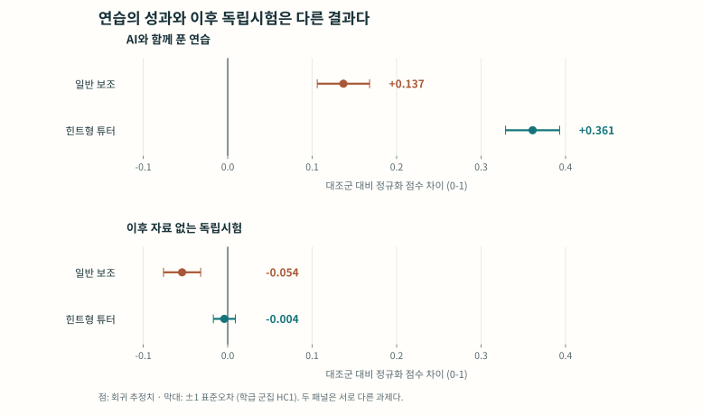
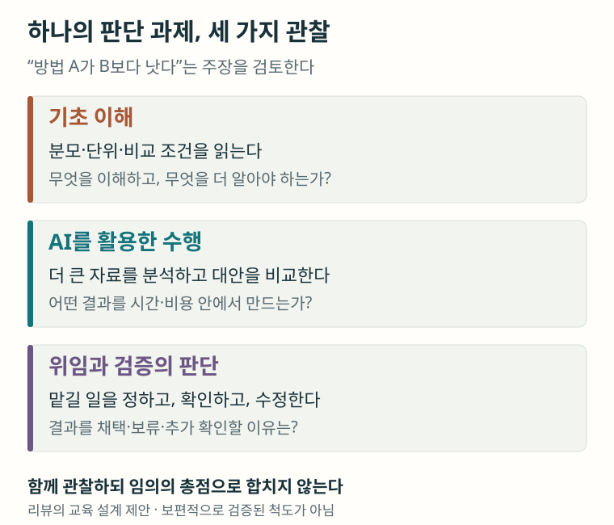

# 생성형 AI의 인지적 증강과 역량 평가의 재설계

인간은 도구를 만들고 다루며 몸과 생각의 경계를 넓혀 왔다. 올림픽의 수영과 카누가 각각의 숙련을 겨루듯, AI로 넓어진 수행을 인정하려면 평가도 변화한 역량과 환경에 맞게 달라져야 한다.

<figure class="hero">

<figcaption>같은 물에서 헤엄치고 노를 젓는 사람들 옆으로, 크기와 모양이 다른 틀이 물가를 따라 열려 있다. 디지털 지도는 AI로 넓어지는 선택지를, 열린 틀은 변화한 역량과 환경에 맞춰 달라지는 평가를 상징한다. AI 생성 개념 일러스트.</figcaption>
</figure>

인간의 역사는 도구를 만들어 몸과 생각의 한계를 넓혀 온 역사이기도 하다. 손으로 옮기던 짐을 수레에 싣고, 발로 닿기 어려운 곳에 배를 띄우고, 망원경으로 눈이 닿는 거리를 늘려 왔다. 글은 기억을 오래 남게 했고, 계산 도구는 머릿속에서만 헤아리기 어려운 수를 다루게 했다. 새로운 도구를 손에 쥘 때마다 사람이 살아갈 수 있는 세계도 조금씩 커졌다.

그 길을 가는 동안 사람도 배워야 했다. 배를 저어 물길을 따라가려면 물살을 읽고 노를 다룰 줄 알아야 했고, 망원경으로 본 것을 이해하려면 관측과 해석을 익혀야 했다. 도구를 쓰는 숙련 역시 사람에게 쌓이는 능력이다. 인간이 무엇을 할 수 있는지 헤아릴 때에는 몸으로 익힌 힘과 머릿속의 지식에 더해, 기술을 다루며 해내는 일까지 보게 된다.

사람들이 어떤 능력을 기르고 서로의 성취를 어떻게 인정해 왔는지, 올림픽에서도 그 모습을 찾을 수 있다.

## 도구를 다루는 능력까지 평가하는 무대

수영 경기에서 한 선수는 팔을 뻗고 호흡을 고르며 물을 가른다. 관중이 지켜보는 기록에는 그가 몸에 익힌 힘과 움직임의 정교함이 담긴다. 카누 경기에서는 선수의 힘이 배와 노를 거쳐 물에 전해진다. 배의 성능과 함께, 노를 젓는 동작과 균형, 힘의 배분을 다듬어 온 숙련이 기록을 만든다.

우리는 이 두 성취를 각각의 종목으로 인정한다. 카누에서는 정해진 장비와 경기 조건 안에서 배와 노를 다루는 기량을 겨룬다. 수영에서는 몸으로 물을 헤쳐 나가는 기량을 갈고닦는다. 도구를 쓰는 선수의 성취를 인정하면서, 몸에 익힌 능력을 겨루는 종목도 이어 가는 것이다. [1] [2]

AI를 활용하는 사람의 능력도 이처럼 생각해 볼 수 있다. 낯선 자료를 분석하고, 코드를 만들고, 다른 전문분야의 문제에 도전할 때 AI는 혼자서는 엄두를 내기 어려웠던 일을 가능하게 한다. 그런 일을 꾸준히 해내는 사람에게는 도구를 다루는 숙련이 있다. 문제를 정하고, AI에 맡길 일을 고르고, 답을 확인하고 고치는 과정에서 쌓인 능력이다.

평가에서도 그 성취를 인정할 수 있어야 한다. 완성한 결과가 얼마나 좋은지, 사람이 그 내용을 얼마나 이해하는지, 조건이 달라져도 적절히 판단할 수 있는지를 함께 볼 필요가 있다. 몸의 기량과 도구를 다루는 기량을 모두 인정하는 올림픽처럼, **평가도 변화한 역량과 환경에 걸맞게 달라져야 한다.**

시험지 앞의 스마트 안경을 떠올려 보자. 일부 안경은 눈앞의 장면을 사진으로 보내 AI의 음성 응답을 들려준다. 실제 시험에서 얼마나 정확한 답을 얻을 수 있는지는 별개의 문제지만, 답을 구하는 데 눈앞의 도구가 개입할 수 있는 환경은 이미 와 있다. [3] 교육부는 2026년 11월 9일 수능 안내에서 AI 스마트 안경을 포함한 전자기기의 반입을 제한했다. 현재 시험의 조건을 지키는 일은 필요하다. 그와 함께, AI를 활용할 수 있는 환경에서는 어떤 능력을 평가할지 논의해야 한다. [4]

교육에서 학생의 이해를 확인할 때와, 채용이나 자격 심사에서 맡길 수 있는 일을 판단할 때에는 필요한 증거가 다를 것이다. AI가 업무와 배움에 가져온 변화를 살펴보면 이 차이를 좀 더 구체적으로 생각할 수 있다.

## AI로 해낼 수 있는 일들

고객상담 업무에서는 AI가 초보자의 일을 돕는 효과가 관찰됐다. Brynjolfsson·Li·Raymond가 고객상담원 5,172명의 자료로 AI의 단계적 도입 효과를 분석한 연구에서는 시간당 성공적으로 해결한 상담 건수가 평균 약 15% 증가했다. 초보자와 기존 성과가 낮은 집단의 이득이 더 컸다. 저자들은 이 결과를 숙련자의 응대 방식 일부가 AI를 통해 전달됐을 가능성으로 해석했다. 무작위 배정 대신 단계적 도입을 분석한 결과이고 최고 숙련 집단에서는 일부 품질 하락도 있어, 다른 직종에서도 같은 효과가 나타날지는 따로 확인해야 한다. [5]

자신의 전문분야 밖으로 일을 넓혀 가는 데에도 AI가 도움을 줄 수 있다. P&G의 연구개발·상업 부문 전문가 791명을 분석한 현장실험에서는 개인·2인팀과 AI 허용 여부를 나눠 제품 혁신 제안을 만들게 했다. 조건과 제출자 정보를 모르는 평가자들이 독립적으로 평가했을 때, AI를 쓰는 개인의 제안 품질은 AI 없는 팀과 비슷했고, 기술 또는 상업 쪽으로 치우치던 전문 배경별 차이도 줄었다. [6]

참여자들은 이미 자신의 분야를 아는 전문가였다. AI는 이들이 다른 부문의 관점까지 고려한 제안을 내놓도록 도왔다. 하루 동안 만든 제안을 평가한 연구이므로 실제 제품의 시장 성과나 장기적인 전문성, 무경험자의 전문직 수행 능력까지 확인한 것은 아니다. 다만 다른 사람의 설명을 기다리거나 외부 솔루션을 구해야 시작할 수 있던 일을 직접 시도할 여지는 보여 준다.

하던 일을 더 빨리 끝내는 것에 더해, 전에 할 수 없던 일을 해내게 된다면 평가할 내용도 늘어난다. 낯선 과업을 끝냈는지, 요구한 수준에 도달했는지, 검토와 수정에 얼마나 시간이 들었는지 등을 볼 수 있다. 기존 과목의 점수가 이런 변화를 얼마나 잘 드러내는지도 다시 살펴야 한다.

Engelbart는 1962년 지적 증강을 구상할 때부터 도구와 함께 언어·방법·훈련이 바뀌는 체계를 생각했다. 도구를 손에 넣은 뒤 그것을 어떻게 익히고 함께 일하는 방식을 바꿀 것인지까지가 그의 관심사였다. [7]

## 어디까지 일을 맡길 수 있는가

도구의 도움은 과업에 따라 다르다. BCG 컨설턴트 758명이 참여한 연구는 AI가 잘하는 업무 과제에서 속도와 품질이 개선되는 한편, 모델이 취약한 별도의 관리 판단 과제에서는 정답률이 낮아졌다고 보고했다. 후자의 분석 대상은 373명이었으며 두 AI 조건을 합친 정답률 차이는 무AI 조건보다 약 19퍼센트포인트 낮았다. 2026년에 정식 출판된 논문이지만 실험에는 2023년의 GPT-4가 쓰였으므로, 모델이 바뀐 뒤의 효과는 새로 확인해야 한다. [8]

AI가 잘하는 일과 취약한 일을 가려내지 못하면, 도움을 받으면서도 판단을 그르칠 수 있다. 그래서 AI의 제안을 받아들이기 전에 무엇을 확인했는지도 평가할 만하다.

사람과 AI의 결합이 사람보다 나아졌다는 말도 비교 대상을 밝혀야 한다. 106개 실험의 370개 효과크기를 모은 메타분석에서는 결합 수행이 평균적으로 사람 단독보다 좋았지만, 사람과 AI 중 더 좋은 단독 수행을 넘어서는 평균적인 상승효과는 나타나지 않았다. 수집 범위가 2020년부터 2023년 상반기까지여서 최신 생성형 AI와 에이전트 전체를 대표하지는 않는다. 사람과 AI가 함께한 결과를 평가하려면 각각 혼자 수행했을 때의 결과와도 비교해야 한다. [9]

전문가에게 일을 맡길 때에는 어느 단계까지 책임질 수 있는지가 중요하다. AI로 초안을 만드는 일, 초안의 오류를 고치는 일, 실제로 실행한 뒤 실패에 대응하는 일에는 서로 다른 숙련이 필요하다. 기존 전문가든 AI로 새 분야에 진입한 사람이든, 맡길 일에 맞는 능력을 확인해야 한다.

## AI가 옮긴 증명은 어떻게 확인하는가

수학에서는 답을 확인하는 일 자체에도 변화가 생기고 있다. Quanta Magazine의 2026년 11월 11일자 *Transformation*에서 Konstantin Kakaes는 AI가 긴 수학 증명을 기계가 검사할 수 있는 형태로 옮기는 ‘자동 형식화(autoformalization)’의 진전을 다뤘다. 수학자가 읽는 증명에는 생략된 중간 단계와 공유하는 배경지식이 많다. 이를 명시적인 정의·명제·증명으로 옮기면, 사람이 방대한 논증을 처음부터 끝까지 홀로 따라가는 부담의 일부를 컴퓨터에 맡길 수 있다. [10]

대표 사례가 이미 알려진 페르마의 마지막 정리의 형식화다. Anthropic은 2026년 9월, AI 에이전트들이 기존 증명의 경로를 따라 Lean 코드를 작성한 결과를 공개했다. Lean은 수학 명제와 증명을 표현하고 검사하는 증명 보조기다. 이는 이미 증명된 정리를 컴퓨터가 확인할 수 있는 형식으로 옮긴 성과다. 형식화 연구자 Kevin Buzzard는 공개 결과를 직접 컴파일하고, 목표 명제가 Mathlib의 표준적인 정리와 맞는지 비교하는 검사도 실행했다고 보고했다. 이 리뷰는 그 보고와 공개 자료를 대조했으며 전체 코드를 독립 재실행하지 않았다. [11]

AI가 증명 후보를 만들거나 기존 논증을 형식 언어로 옮기면, Lean의 핵심 검사기는 그 증명이 주어진 정의·공리와 논리 규칙에 따라 명시된 명제를 뒷받침하는지 확인한다. 같은 AI에게 “맞는가?”라고 되묻는 대신, 명시된 규칙에 따라 증명을 검사하는 것이다. 검사기가 무엇을 신뢰하고 어디까지 확인하는지 알면, 문장의 그럴듯함에 기대던 판단의 일부를 더 엄밀한 검사로 바꿀 수 있다. **도구는 답을 만드는 능력뿐 아니라, 그 답을 확인하는 능력도 확장할 수 있다.** [12]

다만 기계가 확인한 명제가 애초에 풀려던 문제와 같은지는 따로 확인해야 한다. 예를 들어 ‘모든 정수’에 관한 질문을 ‘양의 정수’에 관한 명제로 좁혀 옮겼다면, 그 증명이 옳아도 원래 질문 전체를 해결한 것은 아니다. 증명을 끝내지 않고 빈 부분을 가정으로 남겼는지, 필요한 조건을 몰래 보탰는지도 검사 대상이다. Lean 공식 검증 안내 역시 실행 성공만으로 끝내지 않고 정리의 문장과 공리 의존성을 살피도록 설명한다. 검증을 자동화하더라도 검사할 명제와 그 가정을 정확히 정하는 일은 남는다. [12]

이렇게 확인한 증명을 학생이 제출했다고 해 보자. 검사를 통과한 증명만으로는 학생이 핵심 아이디어를 이해했는지, 다른 문제에도 응용할 수 있는지까지 판단할 수 없다. Buzzard는 자동 형식화의 성과를 인정하면서도 자신이 추구하는 사람이 읽고 이해할 수 있는 수학적 설명과는 구별했다. [11] 교육에서는 제출된 증명의 유효성을 인정하면서, 학생에게 핵심 아이디어를 설명하고 조건이 바뀌면 논증이 어디서 달라지는지 보여 달라고 할 수 있다. 증명의 가치와 학생의 이해를 각각 확인하는 것이다. AI는 설명을 돕거나 다음에 풀 문제를 고르는 데에도 쓰일 수 있다. 교육에서는 그 도움을 받은 학생에게 어떤 이해가 자랐는지를 확인해야 한다.

현실의 업무에서는 자료가 빠지거나 모형의 가정이 맞지 않는 일도 생긴다. 이때는 모형 안의 논리가 옳다는 것만으로 결론을 믿기 어렵다. 수학의 사례를 참고해 평가를 설계한다면, 과제에 맞는 검사 방법을 고르고 그 방법으로 어디까지 확인했는지 설명하게 할 수 있다. 다른 사람도 확인할 수 있도록 결과와 근거를 남기는 일도 포함된다. 산출물을 만드는 숙련과 함께 검증 과정을 구성하는 숙련을 평가하자는 제안이다.

## 지금 잘 풀었다는 것과 배웠다는 것은 다르다

AI로 얻는 즉시 성과와 학습을 같은 점수로 보면 중요한 차이가 사라진다. Bastani 등의 고교 수학 현장실험은 일반적인 GPT-4 보조, 교사가 설계한 힌트 중심 튜터, AI 없음 조건을 비교했다. 약 1,000명의 학생이 참여한 단기 실험에서 두 AI 조건은 연습 성과를 높였다. 그러나 이후 자료 없이 푼 시험에서는 일반 보조군의 성적이 낮았다. 힌트형은 이 하락을 완화했지만 대조군보다 나은 독립시험 성적을 입증하지는 않았다. [13]

그림 1에서 두 AI 조건의 연습 성과는 모두 높아지지만, 뒤이은 독립시험의 결과는 다르다. 일반 보조의 독립시험 차이는 0-1 정규화 점수에서 -0.054였다. 흔히 인용되는 약 17% 하락은 대조군 평균에 대한 상대 변화이며, 17퍼센트포인트 하락이라는 뜻이 아니다. 힌트형과 무AI 대조군의 독립시험 점수 차이는 통계적으로 유의하지 않았지만, 이는 두 조건의 동등성을 입증한 결과와는 다르다.

<figure>

<figcaption>그림 1. Bastani 등 Table 1의 회귀 추정치와 학급 군집 HC1 표준오차를 재도식화했다. 두 패널 모두 대조군 대비 0-1 정규화 점수 차이를 표시한다. 오차막대는 ±1 SE이며 95% 신뢰구간이 아니다. 연습과 시험은 다른 과제이며 원점수의 전후 변화가 아니다. 자체 실험이나 통계 재분석은 수행하지 않았다. [13]</figcaption>
</figure>

학습을 돕도록 설계한 AI 튜터에서는 다른 결과도 나왔다. Kestin 등의 하버드 기초물리 연구는 분석 대상 194명이 두 차시에 걸쳐 AI 튜터와 교실 능동학습을 경험하게 했다. 교사가 준비한 정답·문항별 안내와 자기 속도 학습 등을 포함한 튜터 조건에서 즉시 사후검사 점수가 높았다. 정답과 안내를 미리 준비한 이 튜터의 효과가 일반 채팅창에서도 나타날지는 알 수 없다. 장기 기억이나 낯선 문제로의 전이 역시 이 즉시 사후검사에서 확인한 범위 밖이다. [14]

업무에 필요한 새 기술을 배울 때에도 당장의 과제와 이후의 이해가 엇갈릴 수 있다. Shen·Tamkin의 2026년 프리프린트는 개발자 52명이 새 Python 라이브러리를 익히는 과제에서 GPT-4o 채팅 보조 여부를 비교했다. 보조군은 이후 AI 없는 개념·코드 읽기·디버깅 퀴즈에서 낮은 성적을 받았고, 평균 수행시간의 개선은 통계적으로 유의하지 않았다. 짧은 실험 뒤의 퀴즈를 장기적인 전문성 상실로 확대할 수는 없다. [15]

세 연구에서는 답을 받는 방식, 스스로 생각할 기회, 교사가 준비한 피드백, 학습 뒤 무엇을 언제 측정했는지가 달랐다. AI를 허용했는지만으로 학습 효과를 설명하기 어려운 이유다. 좋은 답안을 완성하는 동안 다음 문제를 풀 힘도 함께 자라고 있는지, 수업과 평가에서 확인해야 한다.

## 보존할 역량, 증강할 수행, 둘을 연결하는 판단

이 연구들을 바탕으로 교육에서 함께 길러야 할 능력을 세 갈래로 생각해 볼 수 있다. 아래의 구분은 평가를 설계하기 위한 제안이다. 무엇을 혼자 할 수 있어야 하는지는 분야와 도구의 변화에 따라 달라질 것이다.

먼저 **스스로 이해하고 배울 기초 역량**을 길러야 한다. 문장을 읽고 주장을 구별하는 언어 능력, 분모·단위·크기를 이해하는 수리 능력, 증거와 가설을 구별하는 과학적 사고는 AI 답변을 해석하는 데에도 쓰인다. ‘20% 개선’이 무엇에 비해 개선됐는지, 상관관계에서 원인을 말할 수 있는지, 자료가 빠진 질문인지 알아야 다음 확인을 설계할 수 있다. 모르는 부분을 구체적으로 표현하고 주의를 유지하며 자신의 이해를 점검하는 능력도 여기에 포함된다. 이런 이해가 있어야 필요한 지식을 더 배우고 중요한 판단을 이어 갈 수 있다.

다음은 **도구를 통해 수행 범위를 넓히는 능력**이다. AI를 사용해 자료를 모으고, 낯선 코드를 실행하며, 여러 가설과 설계안을 비교하고, 다른 전문분야의 용어를 배울 수 있다. 교육은 이러한 시도를 실제로 할 기회를 제공해야 한다. 평가는 최종 결과가 요구를 충족하는지와 함께, 검증 가능한 계산·자료·실행 조건이 남는지, 시간과 비용 안에서 완결하는지를 살펴볼 수 있다.

두 능력을 연결하는 것은 **무엇을 맡기고 어떻게 확인할지 결정하는 판단**이다. 목표를 정하고, 일을 나누며, AI가 만든 후보를 시험하고, 결과가 달라지면 이유를 찾아 수정하는 능력이다. 수학의 형식화에서 보았듯, 검증에는 도구를 쓸 수 있고 그 도구가 확인한 범위도 알아야 한다. 도구가 멈췄다면 계속할 수 있는 일과 보류해야 할 일을 가려야 한다. 누구에게 넘기고 어떤 자료를 더 구할지 결정하는 것도 이런 판단에 속한다.

그림 2의 분석 과제에서는 자료를 읽고 필요한 질문을 찾는 데 기본 이해가 쓰인다. AI로 더 많은 자료를 탐색하고 계산한 뒤에는 그 결과를 받아들일지, 더 확인할지 판단해야 한다. 학생이 어느 단계에서 잘하고 어디서 어려움을 겪는지를 각각 관찰할 수 있다.

<figure>

<figcaption>그림 2. ‘새 방법이 기존 방법보다 낫다는 주장을 판단하기’를 이용한 교육 설계 제안. 기초 이해, AI를 활용한 분석, 검증과 수정을 한 과제에서 각각 관찰하도록 구성했다. 제안한 분류와 평가 효과는 실증 검증이 필요하다.</figcaption>
</figure>

수영 선수가 몸으로 익힌 감각을 다듬고 카누 선수가 배와 노를 다루는 기량을 기르듯, AI를 쓰는 사람도 이해하는 힘과 도구로 일을 해내는 힘을 함께 기를 수 있다. 어떤 기초가 어떤 도구 활용을 돕는지는 실제 과제에서 확인해야 한다. 그 경험이 쌓여야 가르칠 내용과 평가할 내용도 구체화될 것이다.

## 시험을 바꾸려면 먼저 점수의 용도를 정해야 한다

같은 수학 점수라도 다음 수업을 정할 때, 대학 입학 순위를 정할 때, 졸업 수준을 확인할 때의 의미는 다르다. 교육측정의 타당도는 특정 목적으로 점수를 해석할 근거가 얼마나 있는가에 관한 개념이다. 시험에 AI를 허용했는지보다 먼저, 그 점수로 무엇을 말하려는지 밝혀야 한다. [16]

학습 진단이라면 학생이 다음에 어떤 설명과 연습을 필요로 하는지 알아야 한다. 선발이라면 제한된 기회를 배분하는 기준으로 적절한지와 이후 학습·수행과의 관계를 확인해야 한다. 자격이라면 해당 활동을 안전하고 효과적으로 맡길 최소 기준이 필요하다. 따라서 자격시험에서는 상위 몇 명을 골랐는지보다 자격을 갖춘 사람이 그 일을 해낼 수 있는지가 중요하다. [16]

이 목적에 맞춰 관찰 방식을 조합할 수 있다. 다음 표는 ‘새 방법 A가 기존 방법 B보다 성과를 높였다는 주장을 판단하기’라는 하나의 수업 과제를 발전시킨 제안이다. 수업에 적용할 때에는 과목 수준과 학습 목표에 맞는 자료를 골라야 한다.

| 관찰할 수행 | 학생이 할 일 | 평가자가 확인할 증거 |
|---|---|---|
| 기초 이해 | 짧은 표의 분모·단위·비교 조건을 설명하고 부족한 정보 찾기 | 개념·수치의 정확성, 판단을 보류할 이유 |
| AI를 활용한 분석 | 더 큰 자료를 분석해 재실행 가능한 계산과 판단문 작성 | 결과 품질, 출처·조건, 다른 사람의 재검사 가능성, 시간·비용 |
| 검증과 수정 | 교사가 제시한 답변의 잘못된 분모·인용·인과 결론 확인하고 적절한 검사 도구로 수정 | 오류와 오탐의 구별, 검사한 대상과 보장 범위, 수정의 근거와 결과 |
| 조건 변경과 전이 | 자료·목표를 바꾸고 결론을 조정하기, 이후 새 과제 수행 | 적용 범위 이해, 유지된 학습, 추가 확인의 선택 |

기초 이해를 확인하는 과제에서는 목적에 따라 AI의 도움을 제한하되, 접근성과 의사소통에 필요한 지원은 제공해야 한다. AI 허용 과제에는 공통 도구와 연습 기회를 제공할지, 일정 예산 안에서 도구 선택까지 평가할지 정해야 한다. 교사가 오류를 섞어 만든 답변은 검증 과제의 재료이며 실제 AI의 오류 발생률을 보여 주는 표본이 아니다.

수학 수업이라면 수준에 맞는 작은 명제를 놓고 정리의 조건을 읽게 할 수 있다. AI로 증명 후보를 만든 뒤에는 형식화된 명제가 원래 질문과 맞는지 확인하고, 증명의 아이디어와 조건을 바꿨을 때의 영향을 설명하게 한다. 학생이 무엇을 도구에 맡겼고 어떤 근거로 결론을 받아들였는지가 드러나는 과제다. 분석 수업에서는 재현 가능한 계산과 자료 대조가 비슷한 역할을 할 수 있지만, 코드가 실행된다는 사실만으로 자료의 대표성이나 인과 해석까지 검증되지는 않는다.

설명과 수정은 짧은 구술, 실시간 수행, 서면 응답 등으로 확인할 수 있다. 공학 계산 수업 58명의 실시간 코딩과 설명을 평가한 구현 사례도 있다. 대조군 없이 시행한 보고여서 기존 평가보다 나은지는 아직 비교할 수 없다. 구술에서는 전공 이해에 말하기 유창성·긴장·언어 배경이 섞일 수 있다. 채점자 간 일치, 대체 응답 방식과 추가 시간, 준비·채점 인력까지 검토해야 한다. [17]

각 과제에서 드러난 차이는 다음 수업을 정하는 데 쓸 수 있다. AI 허용 수행은 뛰어나지만 핵심 오류를 찾지 못하는 경우와, 독립 이해는 좋지만 실제 분석을 완결하지 못하는 경우는 다음 교육이 달라야 한다. 자격 평가에서는 반드시 갖춰야 할 능력과 다른 강점으로 보완할 수 있는 능력을 정할 근거도 필요하다. 새로운 평가가 더 낫다는 판단에는 이후 수행·지연 학습·집단별 불이익·운영비를 기존 방식과 비교한 자료가 필요하다.

## 기본기와 증강을 함께 기르는 제도로

국내 교육 지침에도 평가 목적에 따라 AI 활용 범위를 달리 정하려는 시도가 담겨 있다. 교육부의 2025년 12월 수행평가 AI 관리 방안은 수업 연계 수행평가에서 일률적인 금지보다 과목별 허용 범위, 활용 과정의 표시, 사전교육과 수행 과정의 직접 관찰을 제시했다. 경희대학교의 교수자 가이드에는 AI를 이용한 데이터 해석과 타당성 검증을 함께 평가하는 설계 예시가 있다. 이 지침들이 실제 수업에서 어떤 효과를 내는지는 후속 연구로 확인할 일이다. 수능에서의 제한과 수업에서의 활용을 서로 다른 목적에 맞춰 논의할 제도적 여지는 마련돼 있다. [18]

호주 TEQSA의 개혁 지침도 학생의 학습을 확인하는 일과 AI가 보편적인 사회를 준비하는 일을 함께 다룬다. 학생이 스스로 해낼 수 있는 일을 매 과목에서 확인할지, 학위 과정의 중요한 시점에 모아 확인할지, 두 방식을 섞을지에 따라 자원과 운영의 부담이 달라진다. 시험 한 번에 모든 것을 확인하려 하기보다 교육과정 동안 어떤 경험을 제공하고 언제 학습을 확인할지 정하는 접근이다. [19]

학생마다 쓸 수 있는 모델과 연습 시간이 다르면, 같은 AI 허용 과제에서도 조건의 차이가 성적에 섞일 수 있다. 카누 스프린트의 장비 혁신 규정이 이용 가능성과 합리적인 비용, 동등한 기회를 함께 다루듯, AI 평가도 성능 조건과 접근 조건을 함께 정할 수 있다. [2] 실제 평가에서도 더 좋은 모델을 살 여력, 연결 상태, 도구에 익숙해질 시간의 차이가 학생의 능력 차이로 해석되고 있지는 않은지 점검해야 한다.

평가 방식이 바뀌어도 입학 정원과 채용 자리의 희소성은 남을 수 있다. 어떤 배분 기준이 정당한가는 측정 정확성만으로 끝나지 않는 사회적 선택이다. 동시에 AI로 학습·제작 비용이 낮아지면, 이전에는 시작하지 못했던 사람이 배우고 결과를 제시할 기회가 넓어질 수 있다. 이들이 해낸 일을 인정받을 경로와 부족한 기초를 다시 배울 기회가 함께 필요하다.

개인의 증강이 공동의 지식으로 남으려면 다른 사람이 결과를 시험하고 수정하며 재사용할 수 있어야 한다. 수학에서는 이미 증명된 정리를 공동 라이브러리에서 가져와 다음 증명의 재료로 쓴다. 앞선 사람들의 성취가 새 작업을 떠받치는 기반이 된다. Anthropic의 형식화도 기존 Mathlib과 중간 정리의 검색·재사용에 기대었다. [11] 한 사람이 도구로 해낸 일이 다음 사람의 출발점이 될 때, 능력의 확대는 공동의 지식 축적으로 이어진다.

수업에서도 다음 사람이 이해하고 검토하고 고쳐 쓸 수 있는 결과를 남기는 경험을 제공할 수 있다. 답안에 설명과 출처, 실행 조건, 실패한 경우를 함께 적게 하는 것이다. 서로의 결과를 확인하고 고치는 경험이 장기적인 전문성이나 공동 지식의 형성에 얼마나 기여하는지는 앞서 본 단기 실험들을 넘어 오래 관찰해야 할 문제다.

올림픽은 수영의 기량을 지키면서 카누의 성취도 인정한다. AI와 함께 일하고 배우는 사회에서도 스스로 이해하는 힘을 기르는 일과 도구로 새로운 일을 해내는 경험이 함께 갈 수 있다. 학생이 무엇을 알고, AI와 무엇을 해냈으며, 어떤 근거로 그 결과를 받아들였는지 차근차근 확인해 보자. 그 기록이 다음 배움과 실제 업무를 얼마나 잘 설명하는지 살펴 가는 데서, 달라진 시대에 맞는 평가도 만들어질 것이다.

## 참고문헌

1. World Athletics, [Athletic Shoe Regulations](https://worldathletics.org/download/download?filename=83826de9-1bbb-498d-9fc4-7c171c71df49.pdf&urlslug=C2.1A%20%E2%80%93%20Athletic%20Shoe%20Regulations%20%28effective%20from%2020%20April%202026%29), Book C–C2.1A, effective 20 April 2026; World Aquatics, [World Aquatics Competition Regulations](https://resources.fina.org/fina/document/2026/02/18/e6815ecc-06d9-4f0b-98e9-4c441cf5e6a3/2026-02-18_World-Aquatics_CR-Final.pdf), February 2026 (2026년 11월 15일 확인).
2. International Canoe Federation, [Canoe Sprint Competition Rules 2025](https://cdn.paddleworldwide.com/media/2025_icf_canoe_sprint_competition_rules_progression_system_review_2026.pdf), effective 1 January 2025, progression-system review approved 13 March 2026 (2026년 11월 15일 확인).
3. Ray-Ban, [Ray-Ban Meta FAQ](https://www.ray-ban.com/usa/c/frequently-asked-questions-ray-ban-meta-smart-glasses) (2026년 11월 15일 확인).
4. 교육부, [수능 당일 '스마트안경' 착용하면 내년까지 시험자격 박탈](https://www.korea.kr/news/policyNewsView.do?newsId=148975290), 대한민국 정책브리핑, 2026년 11월 9일 (2026년 11월 15일 확인).
5. E. Brynjolfsson, D. Li, and L. Raymond, [Generative AI at work](https://doi.org/10.1093/qje/qjae044), Q. J. Econ. **140**, 889–942 (2025).
6. F. Dell’Acqua, C. Ayoubi, H. Lifshitz, R. Sadun, E. Mollick, L. Mollick, Y. Han, J. Goldman, H. Nair, S. Taub, and K. R. Lakhani, [The cybernetic teammate: A field experiment on generative AI and teamwork](https://doi.org/10.1287/orsc.2025.20702), Organ. Sci. **37**, 1217–1242 (2026).
7. D. C. Engelbart, [Augmenting human intellect: A conceptual framework](https://dougengelbart.org/pubs/augment-3906.html), SRI Summary Report AFOSR-3223 (Stanford Research Institute, 1962).
8. F. Dell’Acqua, E. McFowland III, E. Mollick, H. Lifshitz, K. C. Kellogg, S. Rajendran, L. Krayer, F. Candelon, and K. R. Lakhani, [Navigating the jagged technological frontier: Field experimental evidence of the effects of artificial intelligence on knowledge worker productivity and quality](https://doi.org/10.1287/orsc.2025.21838), Organ. Sci. **37**, 403–423 (2026).
9. M. Vaccaro, A. Almaatouq, and T. Malone, [When combinations of humans and AI are useful: A systematic review and meta-analysis](https://doi.org/10.1038/s41562-024-02024-1), Nat. Hum. Behav. **8**, 2293–2303 (2024).
10. K. Kakaes, [AI’s ability to ‘autoformalize’ proofs is changing math](https://www.quantamagazine.org/update/169054/), Transformation, Quanta Magazine, 11 November 2026 (2026년 11월 15일 확인).
11. Anthropic, [Formalizing Fermat’s Last Theorem](https://www.anthropic.com/research/formalizing-fermats-last-theorem), 4 September 2026; Anthropic, [Fermat’s Last Theorem in Lean 4](https://github.com/anthropics/fermats-last-theorem/blob/6e837e75355538c7f80bab5b956861e86c4eacc2/README.md), commit 6e837e75355538c7f80bab5b956861e86c4eacc2; K. Buzzard, [FLT: Anthropic has beaten me to it](https://xenaproject.wordpress.com/2026/09/04/flt-anthropic-has-beaten-me-to-it/), Xena, 4 September 2026 (2026년 11월 15일 확인).
12. J. Avigad, L. de Moura, S. Kong, and S. Ullrich, [Introduction](https://lean-lang.org/theorem_proving_in_lean4/Introduction/), in *Theorem Proving in Lean 4*, version 4.33.0, Sec. 1.1; Lean project, [Elaboration and Compilation](https://lean-lang.org/doc/reference/latest/Elaboration-and-Compilation/), in *The Lean Language Reference*; Lean project, [Validating a Lean Proof](https://lean-lang.org/doc/reference/latest/ValidatingProofs/), in *The Lean Language Reference* (2026년 11월 15일 확인).
13. H. Bastani, O. Bastani, A. Sungu, H. Ge, Ö. Kabakcı, and R. Mariman, [Generative AI without guardrails can harm learning: Evidence from high school mathematics](https://doi.org/10.1073/pnas.2422633122), Proc. Natl. Acad. Sci. U.S.A. **122**, e2422633122 (2025); [Correction for Bastani et al., Generative AI without guardrails can harm learning: Evidence from high school mathematics](https://doi.org/10.1073/pnas.2518204122), Proc. Natl. Acad. Sci. U.S.A. **122**, e2518204122 (2025).
14. G. Kestin, K. Miller, A. Klales, T. Milbourne, and G. Ponti, [AI tutoring outperforms in-class active learning: An RCT introducing a novel research-based design in an authentic educational setting](https://doi.org/10.1038/s41598-025-97652-6), Sci. Rep. **15**, 17458 (2025).
15. J. H. Shen and A. Tamkin, How AI impacts skill formation, [arXiv:2601.20245v2](https://arxiv.org/abs/2601.20245v2) (2026).
16. American Educational Research Association, American Psychological Association, and National Council on Measurement in Education, [*Standards for Educational and Psychological Testing*](https://www.testingstandards.net/uploads/7/6/6/4/76643089/standards_2014edition.pdf) (American Educational Research Association, Washington, DC, 2014).
17. L. A. Barba and L. Stegner, [The conversational exam: A scalable assessment design for the AI era](https://doi.org/10.1109/MC.2026.3676461), Computer **59**(6), 132–139 (2026).
18. 교육부, [교육부와 교육청이 함께 ‘수행평가 시, 인공지능(AI) 활용 관리 방안’을 마련하였습니다](https://www.moe.go.kr/boardCnts/viewRenew.do?boardID=294&boardSeq=104984&lev=0), 2025년 12월 23일; 경희대학교 도서관, [AI 활용 교육 가이드라인: 교수자 가이드](https://libguides.khu.ac.kr/ai/guideline/instructors), updated 22 September 2026 (2026년 11월 15일 확인).
19. J. M. Lodge, M. Bearman, P. Dawson, H. Gniel, R. Harper, D. Liu, J. McLean, and L. Ucnik, [*Enacting assessment reform in a time of artificial intelligence*](https://www.teqsa.gov.au/sites/default/files/2025-09/enacting-assessment-reform-in-a-time-of-artificial-intelligence.pdf) (Tertiary Education Quality and Standards Agency, 2025).

## 작성·검증 공개

책임 편집자는 김현중이다. OpenAI Codex가 원문 조사·대조, 원고·번역, 도식과 출력 제작을 보조했다. 편집 기준은 AI Tech Review Editorial Harness 2026.08 및 과학 설명 준칙 1.0이다. 정확한 실행 모델 식별자는 미보존이다.

`root`는 기획 통합·집필·시각자료·출력을, `augmentation_evidence`는 업무·학습 연구의 설계·수치·출판 상태, 실제 도식과 AI 수학 형식화 원자료 대조를, `assessment_research`는 평가 기준·국내외 지침·평가 제안 검토와 전체 영어판 작성을, `conceptual_review`는 올림픽 역사·장비 규칙·비유의 경계와 본문의 논리, 수학 사례의 통합 및 개정 표지의 의미·썸네일·흑백 검토를 맡았다. 원 논문의 실험·개인별 통계 분석과 대규모 형식 증명은 독립 재실행하지 않았다. 그림 1은 보고된 계수와 표준오차를 코드로 재도식화했고, 그림 2는 리뷰의 설계 제안이다. 표지는 built-in ImageGen으로 생성한 개념 그림이다.

책임 편집자가 주제·문체·표지의 편집 방향을 검토하고 게시를 승인했다. 서지와 출판 정보는 2026년 11월 15일 재확인했다. Barba·Stegner 사례의 설계는 공개 원고 v1에서 확인했으며, 정식 출판 정보와 구별한다. 2026년 11월 16일 문체 개정에서는 에이전트가 한영 전문의 반복·번역투·문단 연결을 감수하고 교정했다. 전체 문장에 대한 사람 감수나 독자 이해도 평가는 수행하지 않았다. [공개 작성·검증 원칙](https://infant83.io/AI_Tech_Review/methods/).
