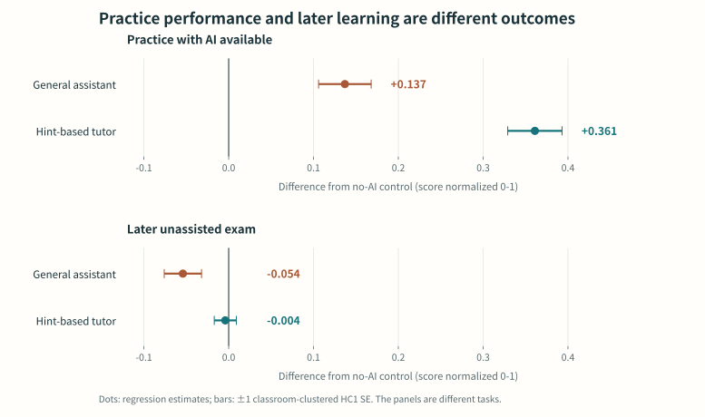
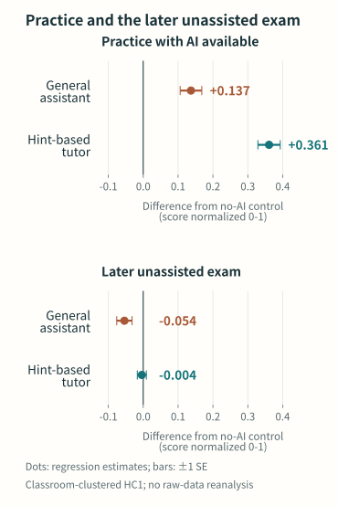
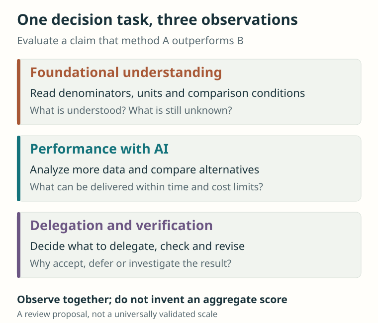

# Assessing Human Competence in an Age of AI Augmentation

By making and using tools, people have extended the reach of body and mind. Just as Olympic swimming and canoeing test distinct skills, recognizing performance expanded by AI calls for assessment suited to changing capabilities and conditions.

<figure class="hero">

<figcaption>Open frames of varied shapes and sizes line the bank beside people swimming and paddling on the same water. The digital map represents choices expanded by AI; the open frames represent assessment adapting to changing capabilities and conditions. AI-generated conceptual illustration.</figcaption>
</figure>

Human history is also a history of making tools to extend the reach of body and mind. People loaded onto carts what they once carried by hand, launched boats toward places difficult to reach on foot, and used telescopes to see farther than their eyes could alone. Writing preserved memories; calculating tools made it possible to work with numbers that were difficult to handle mentally. Each new tool enlarged the world people could inhabit.

People had to learn along the way. Paddling a boat along a waterway required skill in reading currents and handling a paddle; understanding what a telescope revealed required learning to observe and interpret. Skill with tools becomes part of a person’s abilities. To understand what people can do, we need to consider what they accomplish with technology alongside their physical strength and knowledge.

The Olympics offers a familiar example of how people develop different abilities and recognize one another’s achievements.

## A stage for assessing skill with tools

In a swimming event, an athlete reaches forward, regulates their breathing, and cuts through the water. The recorded time reflects practiced strength and precision of movement. In a canoeing event, the athlete’s effort passes through boat and paddle into the water. The result reflects the boat’s performance as well as the athlete’s accumulated skill in paddling, maintaining balance, and distributing effort.

We recognize these achievements in their respective sports. Canoeists compete in handling boat and paddle under defined equipment and competition conditions. Swimmers hone their ability to move through the water. The Olympics recognizes achievement with tools while continuing to test practiced physical skills. [1] [2]

People using AI develop skills in much the same way. Analyzing unfamiliar material, writing code, and tackling problems in another specialty can bring work within reach that once seemed beyond a person working alone. Doing that work reliably takes practice: defining the problem, choosing what to delegate, checking answers, and revising them.

Assessment should recognize those achievements. It needs to examine the quality of the result, how well the person understands it, and whether they can exercise sound judgment when conditions change. As in sports that recognize both physical skill and skill with equipment, **assessment must adapt to changing capabilities and conditions.**

Consider smart glasses facing an examination paper. Some glasses send a photograph of the scene ahead for AI processing and return an audio response. How accurately they could answer actual examination questions requires separate testing, but tools can already participate in producing an answer in this way. [3] In guidance issued on November 9, 2026, South Korea’s Ministry of Education restricted electronic devices, including AI smart glasses, during the examination. Existing examination conditions need to be respected. We also need to discuss which abilities to assess when AI use is permitted. [4]

Evidence of a student’s understanding serves a different purpose from evidence that someone can be entrusted with work in hiring or qualification decisions. Research on AI in work and learning makes that distinction more concrete.

## What people can accomplish with AI

Customer support provides evidence that AI can help novices at work. Brynjolfsson, Li, and Raymond analyzed data from 5,172 customer support agents to study a phased AI rollout and found an average increase of about 15% in issues successfully resolved per hour. The agents who benefited most were novices and those with lower previous performance. The authors interpreted this pattern as suggesting that AI may have passed on some experienced agents’ practices to these workers. [5]

A field experiment at P&G examined how AI could help people incorporate perspectives from another specialty. Over one day, 791 professionals from R&D and commercial functions developed product innovation proposals, working individually or in two-person teams, with or without AI. Evaluators rated the proposals independently without knowing the conditions or information about their authors. Proposals from individuals using AI were rated as comparable in quality to those from teams without AI. Differences in the proposals’ technical or commercial emphasis associated with the participants’ professional backgrounds also narrowed. [6]

The participants knew their own fields, but developing a product also required another function’s perspective. With AI, they could draw on that perspective alongside their own expertise. This opens up opportunities to attempt work that previously required waiting for someone else’s explanation or obtaining an external solution before they could begin.

AI can thus help people finish familiar tasks faster and attempt work that was previously out of reach. Assessment needs to take account of what they can now accomplish. Completing an unfamiliar task to the required standard, and the time spent checking and revising it, can reveal skill in working with tools. Such tasks may show abilities that conventional subject scores capture poorly.

Engelbart’s 1962 framework for intellectual augmentation already treated tools, language, methods, and training as parts of a changing system. He was concerned with how people would learn to use their tools and change the ways they worked with them. [7]

## What work can we entrust to someone?

Yet the same tool can produce different results depending on the work assigned to it. A study involving 758 BCG consultants used GPT-4 in 2023 across a range of business tasks. Speed and quality improved on tasks within the AI’s capabilities, while accuracy fell on a separate management judgment task where the model struggled. The latter analysis included 373 participants; pooling the two AI conditions, accuracy was about 19 percentage points below the condition without AI. [8]

The contrast between these tasks shows why someone using AI needs to judge when to accept its suggestions. Assessment can examine what a person checked before accepting an answer, alongside the answer they ultimately produced.

Interpreting performance by people working with AI also requires choosing the comparison. A meta-analysis combining 370 effect sizes from 106 experiments, drawing on studies from 2020 through the first half of 2023, found that combined performance was, on average, better than human performance alone. When the benchmark was the better of the human and AI working separately, however, there was no average synergistic gain beyond that benchmark. Improving a person’s result with assistance and surpassing the better of the person and AI working alone are different comparisons. [9]

Entrusting work to a professional means deciding how much of it they can take responsibility for. Producing a draft with AI, correcting its errors, and putting it into practice while responding to failures require different skills. Established experts and people entering a new field with AI both need to demonstrate the abilities the work demands.

## Checking proofs formalized by AI

In mathematics, AI is changing the work of checking answers as well. In the November 11, 2026 installment of Quanta Magazine’s *Transformation*, Konstantin Kakaes discussed progress in autoformalization: translating long mathematical proofs into a form that a machine can check. Proofs written for mathematicians leave many intermediate steps and much shared background knowledge implicit. Expressing them as explicit definitions, propositions, and proofs allows computers to take on part of the burden of following an extensive argument from beginning to end. [10]

One prominent example is the formalization of Fermat’s Last Theorem, an already established result. In September 2026, Anthropic released work in which AI agents wrote Lean code following the route of the existing proof. Lean is a proof assistant for expressing and checking mathematical propositions and proofs. The achievement was to translate a theorem already proved into a form a computer could verify. Formalization researcher Kevin Buzzard reported that he compiled the released result himself and also ran checks comparing the target statement with the standard theorem in Mathlib. [11]

AI generates candidate proofs or translates existing arguments into a formal language. Lean’s kernel then checks whether a proof supports the stated proposition under the given definitions, axioms, and logical rules. The proof is tested against explicit rules rather than by asking the same AI whether it is correct. Knowing what the checker trusts and what it checks allows a more rigorous test to replace some judgments based on how convincing an answer sounds. **Tools can expand the ability to check answers as well as produce them.** [12]

The checked proposition must also match the intended problem. If a question about all integers is translated into a proposition restricted to positive integers, a valid proof leaves part of the original question unresolved. Checks must establish whether gaps have been left as assumptions and whether extra conditions have been introduced without acknowledgment. Lean’s official validation guidance calls for examining the theorem statement and its dependence on axioms as well as successful execution. Even with automated verification, the proposition and its assumptions need to be specified accurately. [12]

Suppose a student submits a proof checked in this way. Passing the check alone does not establish whether the student understands the central idea or can apply it to another problem. Buzzard acknowledged the achievement in autoformalization while distinguishing it from the mathematical explanations he seeks, which people can read and understand. [11] A teacher can recognize the validity of the submitted proof and ask the student to explain its central idea or show how the argument changes under different conditions. The proof’s value and the student’s understanding are assessed separately. AI can also help explain proofs or choose the next problem. Education needs to establish what the student has learned through that assistance.

Work outside mathematics often involves missing data or assumptions that do not fit the situation. Correct logic within a model then gives limited grounds for trusting its conclusions. Drawing on the mathematical example, assessors could ask people to choose checks appropriate to a task and explain what those checks establish. Leaving results and evidence that others can verify would also count. The proposal is to assess skill in constructing a verification process alongside skill in producing the work.

## Solving a problem now is different from learning

The distinction between understanding and performance also appears as students learn. Bastani and colleagues conducted a high school mathematics field experiment involving approximately 1,000 students, comparing general GPT-4 assistance, a teacher-designed tutor focused on hints, and no AI. Both AI conditions improved practice performance, but on a subsequent examination completed without reference materials, the general-assistance group scored lower. The hint-based tutor mitigated this decline, and its independent examination scores did not differ significantly from those of the control group. [13]

Figure 1 shows the differences in practice and independent examination performance separately. The general-assistance group scored 0.054 below the control group on the independent examination, on a scale normalized to 0-1. Expressing this difference relative to the control-group mean gives the often-cited decline of about 17%. Reading that as a fall of 17 percentage points would give a different impression of the size of the decline.

<figure>

<figcaption>Figure 1. Regression estimates and classroom-clustered HC1 standard errors from Table 1 of Bastani et al., redrawn for this review. Both panels show differences from the control group on scores normalized to a 0-1 scale. Error bars are ±1 SE, not 95% confidence intervals. Practice and examination involve different tasks and do not represent a before-and-after change in raw scores. [13]</figcaption>
</figure>

Could the way AI is used also change what students learn? In Kestin and colleagues’ introductory physics study at Harvard, the analyzed sample of 194 students experienced AI tutoring and classroom active learning across two lessons. The tutor included teacher-prepared correct answers and guidance for individual questions, and students could study at their own pace. Tests immediately after each lesson showed higher scores under the tutoring condition. [14]

The same questions arise when AI helps people learn new skills for work. In a 2026 preprint by Shen and Tamkin, 52 developers worked with or without GPT-4o chat assistance as they learned a new Python library. After completing the task, they took an AI-free quiz covering concepts, code reading, and debugging. The assisted group scored lower. Their average task completion time was shorter, but the difference was not statistically significant. [15]

Students and developers in these studies had access to AI assistance, but the ways they obtained answers and their opportunities for independent thought differed. How answers and hints were prepared, and which tasks participants then had to complete alone, also help us interpret the results. When AI is permitted in class, teachers need to examine whether students are developing the ability to solve the next problem as they complete a good answer to the current one.

## Foundations to preserve, performance to augment, and judgment to connect them

Education needs to attend both to the experience of accomplishing tasks and to the understanding developed along the way. To do so, we can consider foundations learned independently, performance expanded through tools, and the judgment connecting them. What people need to do alone should be determined as fields and tools change; the proposal here is to develop the following abilities together.

First is **foundational competence for understanding and learning independently**. Reading a statement and identifying its claims, understanding denominators, units, and magnitudes, and distinguishing evidence from hypotheses all help people interpret AI answers. Planning a useful check requires knowing what a “20% improvement” is relative to, whether a correlation supports a causal claim, or whether essential information is missing. Students also need to articulate gaps in knowledge, sustain attention, and check their own understanding. These abilities support further learning and consequential judgments.

Second is **the ability to expand the range of work through tools**. AI can help gather material, run unfamiliar code, compare hypotheses and designs, and learn the terminology of another specialty. Education should provide opportunities to attempt such work. Assessment can examine whether the result meets its requirements, whether calculations, data, and execution conditions remain available for checking, and whether the work is completed within time and cost limits.

Connecting the two is **judgment about what to delegate and how to check it**. This involves setting goals, dividing work, testing candidates generated by AI, and investigating and correcting unexpected results. Mathematical formalization shows that tools can help with verification, provided the user understands what they establish. If a tool stops working, a person needs to distinguish what can continue from what should be suspended. Deciding whom to involve and what further information to obtain is also part of that judgment.

In the analytical task in Figure 2, foundational understanding helps students read the material and identify useful questions. After using AI to explore more data and perform calculations, they must decide whether to accept the result or investigate further. An assessor can observe where a student succeeds and where they struggle at each stage.

<figure>

<figcaption>Figure 2. A proposed educational design for judging a claim that a new method is better than an existing one. Students read the same material, analyze it with AI, and verify and revise the result, allowing foundational understanding, skill with tools, and judgment to be observed separately.</figcaption>
</figure>

Just as swimmers refine a practiced feel for the water and canoeists develop skill with boat and paddle, people using AI can develop both understanding and the ability to accomplish work with tools. Actual tasks can reveal which foundations support which uses of tools. Experience with those tasks can then help specify what to teach and assess.

## Changing an examination starts with the intended use of its scores

The same mathematics score means different things when it determines the next lesson, ranks university applicants, or confirms graduation standards. In educational measurement, validity concerns the evidence supporting a score interpretation for a particular purpose. Before deciding whether an examination should permit AI, we need to state what its scores are intended to tell us. [16]

Learning diagnosis needs to identify the explanations and exercises a student needs next. Selection requires evidence that a score is an appropriate basis for allocating limited opportunities and relates to subsequent learning and performance. A qualification needs a minimum standard for entrusting work to someone safely and effectively. What matters is whether those who qualify can do the work, rather than how many top scorers have been selected. [16]

Methods of observation can be combined for these purposes. The following table develops a classroom task: judging the claim that a new method A improves outcomes over an existing method B. Teachers would need to choose materials suited to the course level and learning objectives.

| Performance to observe | What the student does | Evidence the assessor examines |
|---|---|---|
| Foundational understanding | Explain the denominators, units, and comparison conditions in a short table, and identify missing information | Conceptual and numerical accuracy; reasons for withholding judgment |
| Analysis with AI | Analyze a larger dataset and produce reproducible calculations and a written judgment | Result quality, sources and conditions, the ability of others to check the work again, time and cost |
| Verification and revision | Check incorrect denominators, citations, and causal conclusions in an answer supplied by the teacher, and revise it with appropriate checking tools | Distinguishing errors from false alarms; what was checked and the scope of the guarantee; the basis and consequences of revisions |
| Changed conditions and transfer | Adjust the conclusion when data or goals change, then perform a new task later | Understanding the limits of application, retained learning, and the choice of further checks |

A task checking foundational understanding can restrict AI assistance according to its purpose while providing necessary accessibility and communication support. AI-permitted tasks should specify whether everyone receives common tools and practice opportunities or whether choosing tools within a budget is itself part of the assessment. For a verification task, a teacher can provide an answer with deliberately introduced errors and observe which errors students find and how they correct them.

In a mathematics class, students could start by reading the conditions of a small proposition suited to their level. After generating a candidate proof with AI, they could check whether the formalized statement matches the original question, explain the proof’s idea, and show what changes when its conditions change. The task reveals what they delegated and the grounds on which they accepted the conclusion. In an analysis course, students could reproduce calculations and compare them with the source data. Alongside checking the calculations, they could examine whether the data adequately represent the population of interest and whether they support a causal explanation.

Short oral discussions, live performance, and written responses can show how students explain and revise their work. One report describes the experience of assessing live coding and explanation among 58 students in an engineering computation course. [17] When introducing oral assessment, teachers also need to consider how fluency, anxiety, and language background affect the expression of disciplinary understanding. They can offer other ways to explain the same understanding, check whether assessors make similar judgments, and consider the staff needed for preparation and marking.

Differences across tasks can guide subsequent teaching. A student who produces good results with AI but misses a critical error may need different practice from one who understands the concepts but struggles to complete an actual analysis. Qualification assessment also needs to distinguish indispensable abilities from shortcomings that other strengths can compensate for. After introducing such assessments, educators can follow what students accomplish later and how much they retain, compare disadvantages across groups and operating costs with existing methods, and use that evidence to refine the system.

## Institutions that develop foundations and augmentation together

Similar designs appear in South Korean education guidance. The Ministry of Education’s December 2025 measures for AI in performance assessment proposed subject-specific permissions, disclosure of how AI was used, advance instruction, and direct observation of students’ work in assessment linked to classroom teaching. Kyung Hee University’s instructor guide includes an example that assesses AI-assisted interpretation of data together with verification of its validity. While electronic devices remain restricted in the national university entrance examination, educators are also seeking ways to use AI in class according to the purpose of the work. [18]

Australia’s TEQSA reform guidance also addresses both confirming student learning and preparing students for a society in which AI is widespread. Checking what students can do independently in every subject, at key points across a degree, or through a combination of the two places different demands on resources and administration. This approach plans the experiences students should have across a curriculum and when their learning should be checked, instead of expecting one examination to establish everything. [19]

When students have access to different models and different amounts of practice, those conditions can affect scores even on the same AI-permitted task. Canoe sprint rules on equipment innovation address availability, reasonable cost, and equal opportunity; AI assessments can similarly define performance and access conditions. [2] Assessors need to check whether the ability to pay for better models, connectivity, and time to become familiar with tools are being mistaken for differences in student ability.

University places and jobs may remain scarce even as assessment changes. Choosing a legitimate basis for allocation is a social decision that measurement accuracy alone cannot settle. If AI reduces the costs of learning and making things, people previously unable to begin may gain opportunities to learn and present results. They need ways to have their work recognized and opportunities to rebuild missing foundations.

For individual augmentation to become shared knowledge, other people must be able to test, revise, and reuse the results. In mathematics, theorems already proved in a shared library become material for subsequent proofs. Earlier achievements provide a foundation for new work. Anthropic’s formalization also relied on the existing Mathlib library and on searching for and reusing intermediate theorems. [11] When one person’s work with a tool becomes another’s starting point, expanded ability contributes to a shared accumulation of knowledge.

Students can have this experience in class as well. They can include explanations, sources, execution conditions, and failed cases with their answers so that other students can inspect, revise, and reuse them. Leaving an answer that others can understand makes explaining evidence and correcting errors part of learning, alongside producing the result.

The Olympics preserves swimming while recognizing achievement in canoeing. In a society where people work and learn with AI, developing independent understanding can go together with doing new work through tools. We can examine what a student knows, what they accomplished with AI, and their reasons for accepting the result. Following how well that record explains subsequent learning and actual work will help develop assessment suited to these changing conditions.

## References

1. World Athletics, [Athletic Shoe Regulations](https://worldathletics.org/download/download?filename=83826de9-1bbb-498d-9fc4-7c171c71df49.pdf&urlslug=C2.1A%20%E2%80%93%20Athletic%20Shoe%20Regulations%20%28effective%20from%2020%20April%202026%29), Book C–C2.1A, effective 20 April 2026; World Aquatics, [World Aquatics Competition Regulations](https://resources.fina.org/fina/document/2026/02/18/e6815ecc-06d9-4f0b-98e9-4c441cf5e6a3/2026-02-18_World-Aquatics_CR-Final.pdf), February 2026 (accessed 15 November 2026).
2. International Canoe Federation, [Canoe Sprint Competition Rules 2025](https://cdn.paddleworldwide.com/media/2025_icf_canoe_sprint_competition_rules_progression_system_review_2026.pdf), effective 1 January 2025, progression-system review approved 13 March 2026 (accessed 15 November 2026).
3. Ray-Ban, [Ray-Ban Meta FAQ](https://www.ray-ban.com/usa/c/frequently-asked-questions-ray-ban-meta-smart-glasses) (accessed 15 November 2026).
4. 교육부, [수능 당일 '스마트안경' 착용하면 내년까지 시험자격 박탈](https://www.korea.kr/news/policyNewsView.do?newsId=148975290), 대한민국 정책브리핑, 2026년 11월 9일 (accessed 15 November 2026).
5. E. Brynjolfsson, D. Li, and L. Raymond, [Generative AI at work](https://doi.org/10.1093/qje/qjae044), Q. J. Econ. **140**, 889–942 (2025).
6. F. Dell’Acqua, C. Ayoubi, H. Lifshitz, R. Sadun, E. Mollick, L. Mollick, Y. Han, J. Goldman, H. Nair, S. Taub, and K. R. Lakhani, [The cybernetic teammate: A field experiment on generative AI and teamwork](https://doi.org/10.1287/orsc.2025.20702), Organ. Sci. **37**, 1217–1242 (2026).
7. D. C. Engelbart, [Augmenting human intellect: A conceptual framework](https://dougengelbart.org/pubs/augment-3906.html), SRI Summary Report AFOSR-3223 (Stanford Research Institute, 1962).
8. F. Dell’Acqua, E. McFowland III, E. Mollick, H. Lifshitz, K. C. Kellogg, S. Rajendran, L. Krayer, F. Candelon, and K. R. Lakhani, [Navigating the jagged technological frontier: Field experimental evidence of the effects of artificial intelligence on knowledge worker productivity and quality](https://doi.org/10.1287/orsc.2025.21838), Organ. Sci. **37**, 403–423 (2026).
9. M. Vaccaro, A. Almaatouq, and T. Malone, [When combinations of humans and AI are useful: A systematic review and meta-analysis](https://doi.org/10.1038/s41562-024-02024-1), Nat. Hum. Behav. **8**, 2293–2303 (2024).
10. K. Kakaes, [AI’s ability to ‘autoformalize’ proofs is changing math](https://www.quantamagazine.org/update/169054/), Transformation, Quanta Magazine, 11 November 2026 (accessed 15 November 2026).
11. Anthropic, [Formalizing Fermat’s Last Theorem](https://www.anthropic.com/research/formalizing-fermats-last-theorem), 4 September 2026; Anthropic, [Fermat’s Last Theorem in Lean 4](https://github.com/anthropics/fermats-last-theorem/blob/6e837e75355538c7f80bab5b956861e86c4eacc2/README.md), commit 6e837e75355538c7f80bab5b956861e86c4eacc2; K. Buzzard, [FLT: Anthropic has beaten me to it](https://xenaproject.wordpress.com/2026/09/04/flt-anthropic-has-beaten-me-to-it/), Xena, 4 September 2026 (accessed 15 November 2026).
12. J. Avigad, L. de Moura, S. Kong, and S. Ullrich, [Introduction](https://lean-lang.org/theorem_proving_in_lean4/Introduction/), in *Theorem Proving in Lean 4*, version 4.33.0, Sec. 1.1; Lean project, [Elaboration and Compilation](https://lean-lang.org/doc/reference/latest/Elaboration-and-Compilation/), in *The Lean Language Reference*; Lean project, [Validating a Lean Proof](https://lean-lang.org/doc/reference/latest/ValidatingProofs/), in *The Lean Language Reference* (accessed 15 November 2026).
13. H. Bastani, O. Bastani, A. Sungu, H. Ge, Ö. Kabakcı, and R. Mariman, [Generative AI without guardrails can harm learning: Evidence from high school mathematics](https://doi.org/10.1073/pnas.2422633122), Proc. Natl. Acad. Sci. U.S.A. **122**, e2422633122 (2025); [Correction for Bastani et al., Generative AI without guardrails can harm learning: Evidence from high school mathematics](https://doi.org/10.1073/pnas.2518204122), Proc. Natl. Acad. Sci. U.S.A. **122**, e2518204122 (2025).
14. G. Kestin, K. Miller, A. Klales, T. Milbourne, and G. Ponti, [AI tutoring outperforms in-class active learning: An RCT introducing a novel research-based design in an authentic educational setting](https://doi.org/10.1038/s41598-025-97652-6), Sci. Rep. **15**, 17458 (2025).
15. J. H. Shen and A. Tamkin, How AI impacts skill formation, [arXiv:2601.20245v2](https://arxiv.org/abs/2601.20245v2) (2026).
16. American Educational Research Association, American Psychological Association, and National Council on Measurement in Education, [*Standards for Educational and Psychological Testing*](https://www.testingstandards.net/uploads/7/6/6/4/76643089/standards_2014edition.pdf) (American Educational Research Association, Washington, DC, 2014).
17. L. A. Barba and L. Stegner, [The conversational exam: A scalable assessment design for the AI era](https://doi.org/10.1109/MC.2026.3676461), Computer **59**(6), 132–139 (2026).
18. 교육부, [교육부와 교육청이 함께 ‘수행평가 시, 인공지능(AI) 활용 관리 방안’을 마련하였습니다](https://www.moe.go.kr/boardCnts/viewRenew.do?boardID=294&boardSeq=104984&lev=0), 2025년 12월 23일; 경희대학교 도서관, [AI 활용 교육 가이드라인: 교수자 가이드](https://libguides.khu.ac.kr/ai/guideline/instructors), updated 22 September 2026 (accessed 15 November 2026).
19. J. M. Lodge, M. Bearman, P. Dawson, H. Gniel, R. Harper, D. Liu, J. McLean, and L. Ucnik, [*Enacting assessment reform in a time of artificial intelligence*](https://www.teqsa.gov.au/sites/default/files/2025-09/enacting-assessment-reform-in-a-time-of-artificial-intelligence.pdf) (Tertiary Education Quality and Standards Agency, 2025).

## Authorship and verification disclosure

Hyun-Jung Kim is the responsible editor. OpenAI Codex assisted with source research and comparison, drafting and translation, diagrams, and output production. The editorial standards are AI Tech Review Editorial Harness 2026.08 and Scientific Explanation Guidelines 1.0. The exact runtime model identifier was not retained.

`root` handled planning integration, writing, visuals, and outputs; `augmentation_evidence` checked study designs, numerical results, publication status, the rendered diagrams, and primary materials on AI mathematical formalization; `assessment_research` reviewed assessment standards, Korean and international guidance, and the assessment proposals, and wrote the full English version; and `conceptual_review` examined Olympic history, equipment rules, the limits of the analogy, the article’s argument, and the integration of the mathematical example, and reviewed the revised cover’s meaning, thumbnail, and grayscale rendering. The original experiments, participant-level statistical analyses, and large formal proofs were not independently rerun. Figure 1 redraws reported coefficients and standard errors using code; Figure 2 is this review’s design proposal. The cover is a conceptual illustration generated with built-in ImageGen.

The responsible editor reviewed the direction of the topic, prose and cover and approved publication. Bibliographic and publication details were rechecked on 15 November 2026. The design of the Barba–Stegner case was checked in its public v1 manuscript, separately from its formal publication metadata. On 16 November 2026, agents reviewed study descriptions and sentence connections throughout both manuscripts. They integrated conditions needed to interpret the results into the relevant explanations, removed generic caveats, and refined translated phrasing. Neither sentence-by-sentence human review of the full text nor reader-comprehension testing has been performed. [Public authorship and verification principles](https://infant83.io/AI_Tech_Review/methods/).
