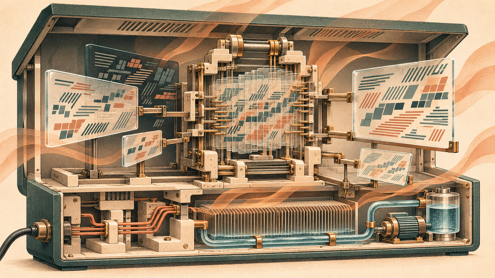
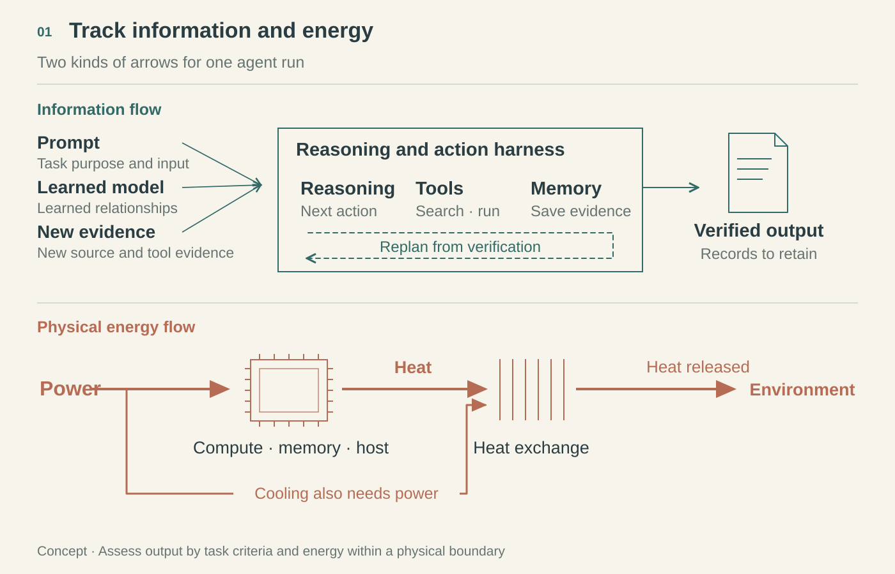
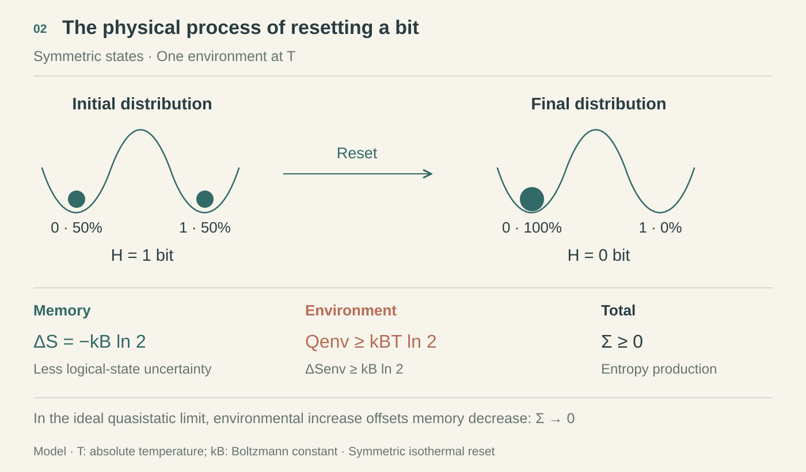
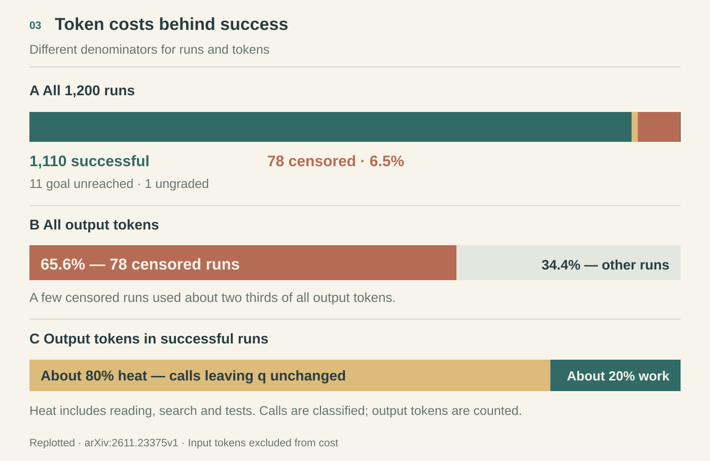
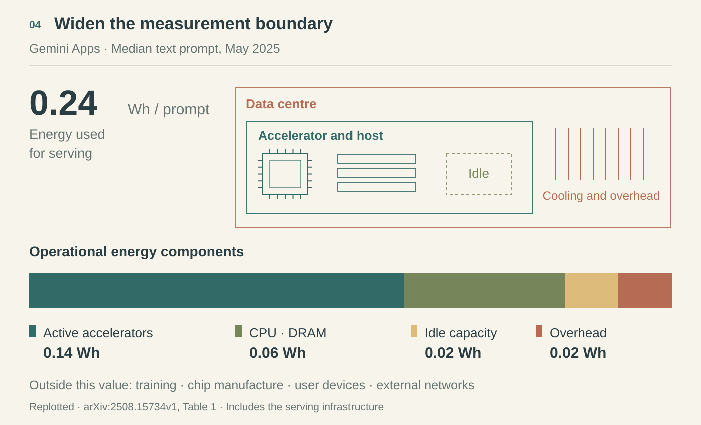
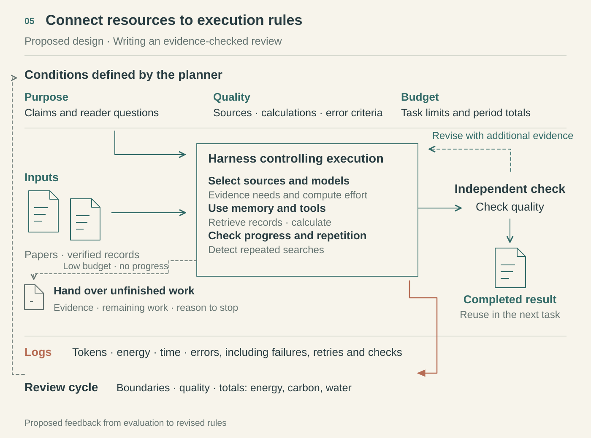

# Where does the energy go while AI produces an answer?

*Following information, entropy and environmental costs from a prompt to a verified result*

A short AI answer can conceal a long computation. Following what that computation discovers, and where it repeats itself, reveals ways to obtain reliable results with fewer resources. Starting with a thermodynamic account of coding agents, this review examines the physical cost of information processing and the choices needed to govern it.

<figure class="hero" id="cover">

<figcaption>An imagined instrument compares input, memory and evidence to assemble an output pattern. Its drive and heat-exchange components make the physical support for processing visible. AI-generated conceptual illustration.</figcaption>
</figure>

Ask an AI to rename a source file. The job may sound finished once its name changes, but code and tests that import it must also be found and updated. The agent reads files and investigates their connections. It attempts edits, checks execution results and repairs what failed. The final screen shows a few changed lines.

There is a gap between the result we obtain and the computation performed to obtain it. Even reading the same file again can serve different purposes. The agent may be checking whether an earlier edit took effect, or repeating a search because it failed to use an answer already found. Recognising that difference helps determine where an agent needs support and when it should stop.

In a recent preprint, Alán Aspuru-Guzik and Varinia Bernales read these execution records through the language of thermodynamics.[1] They count tokens, distinguish progress on a requested change from other activity, and repeat the process of making and undoing a change. How much does a desired transformation cost, and along which paths does its cost grow? Questions long used to investigate physical machines enter a coding workflow.

Following the question to a power meter reveals another problem. An AI answer carries information, while the devices producing it consume electricity. What entropy changes occur along the way, and what results are we spending resources to achieve? Choices that determine efficiency extend from a user's decision to ask again to the conditions under which a system automatically starts its next call.

## What enters a prompt-to-result workflow, and what remains?

A researcher asks why calculations for two materials disagree. The prompt contains some conditions and numerical results. The model can draw on relationships formed during training to produce an explanation. If an agent retrieves the original papers and runs code, further evidence enters the computation. Scattered conditions and values become a comparison that the researcher can use.

The upper part of Figure 1 follows this information flow. The prompt, learned relationships, stored records and newly retrieved evidence jointly constrain the computation. Tool execution and verification change the next action; a result with evidence and conditions eventually remains. Where the “new information” came from depends partly on what we include among the inputs.

<figure id="fig-1">
<picture><source media="(max-width: 640px)" srcset="../artifacts/figures/fig1_mobile_en.svg"></picture>
<figcaption>Figure 1. Information flow and energy flow in the same computation. The upper layer relates usable inputs to results; the lower layer describes the physical exchanges of the devices implementing it. Cooling also needs power. Conceptual diagram constructed for this review.</figcaption>
</figure>

Information theory begins by specifying possible outcomes and their probabilities. A choice with two equally probable outcomes is more uncertain than one whose outcome is almost certain. Shannon entropy H measures that uncertainty in bits. Whether a sentence is long and unexpected, and whether it helps solve a research problem, require different assessments.[2]

A model might invent a long, unfamiliar explanation, increasing the diversity of its output while leaving the evidence for a material's stability inadequate. A short answer that converts two supplied energies to the same unit and calculates their difference may be far more useful. Even without another observation, computation can make implications already present in the inputs accessible to a person.

To observe this workflow, we therefore need a record of what was asked, what evidence was added and what was checked. Token counts capture part of that process. Accuracy and the uncertainty resolved by a result need a separate judgement appropriate to the task.

## What happens physically while information is organised?

The lower part of Figure 1 shows the same task in another way. A power supply operates processing circuits, memory and communication devices. Device states change and heat passes to the surroundings. Cooling and storage can continue to require resources after the document is complete.

A simple physical model makes the relation explicit. Consider a closed model in which electrical work enters and only heat leaves for one environment at temperature T₀. Communication signals and other energy exchanges are omitted from this model. Write the incoming electrical work as Wₑₗ and the outgoing heat as Qₒᵤₜ. Conservation of energy gives:[3]

ΔU = Wₑₗ − Qₒᵤₜ

Here ΔU is the change in internal energy. Over sufficiently long steady operation, when storage and other energy exports are small, almost all incoming electrical energy leaves as heat. Circuits performing accurate, useful computations participate in that process too. Observing physical heat and assessing computational usefulness are two complementary tasks.

An entropy balance adds a condition beyond energy conservation. The previous section considered probabilities of outcomes; here we consider physical states of the devices carrying and processing the information and of their environment. If ΔSdevice is the device's physical entropy change, entropy production Σ for device and environment together satisfies:[3]

Σ = ΔSdevice + Qₒᵤₜ / T₀ ≥ 0

Even if the device's internal state becomes more constrained, heat transferred to the environment enters the total balance. Real data centres exchange air and cooling water at several temperatures, requiring the corresponding heat and matter flows to be included at the boundary. Cooling equipment also consumes energy as it moves heat. The simple equation is a starting model for understanding this more complex facility.

Energy can be conserved while the conditions for making it do work change. As electrical energy spreads into heat close to the environmental temperature T₀ of this model, the same total energy remains, but less can be recovered as electrical work. Counting energy and entropy together distinguishes total quantity from the state in which energy remains available for use.[3]

The thought experiment of resetting one bit makes the relation especially clear. Consider a memory with two symmetric logical states, initially equally probable, reset to one specified state. In the standard isothermal model at environmental temperature T, the lower bound on heat released to the environment is kBT ln 2, where kB is Boltzmann's constant.[3,4]

The memory and environment in Figure 2 must be read together. The decrease in logical entropy, heat transferred to the environment and total entropy production are connected but distinct quantities. In an ideal, sufficiently slow manipulation, heat can be released while total entropy production approaches zero. Fixing an allowed duration and control method also changes the required cost; finite-time thermodynamics studies these questions.[3,5]

<figure id="fig-2">
<picture><source media="(max-width: 640px)" srcset="../artifacts/figures/fig2_mobile_en.svg"></picture>
<figcaption>Figure 2. The entropy balance of standard one-bit reset, assuming symmetric logical states and an environment at one temperature. In the quasistatic reversible limit, the environmental increase compensates for the memory decrease and total entropy production approaches zero.[3,4] Educational model constructed for this review.</figcaption>
</figure>

Connecting such bounds to AI requires knowing which physical states represent information and which operations were performed. Circuit switching, data movement, standby and cooling in today's GPU systems can be measured at the device and system levels. Physical bounds raise questions about design principles; measurements reveal the size of the costs available for improvement now.

## Where were the tokens spent?

Aspuru-Guzik and Bernales define q as the fraction of requested edit blocks completed. One can picture a goal divided into two groups, such as renaming and updating references: completing one would give q = 1/2. They classify output tokens from calls that change q as work, and those from calls leaving q unchanged as heat. Across 1,200 runs of two module-renaming tasks with one model, about 80% of the output tokens in the 1,110 successful runs were heat. Input tokens were excluded from this cost.[1]

Figure 3 separates the denominators. Alongside activity within successful runs, it shows that 78 runs stopped at a 300-turn limit consumed 65.6% of all output tokens. A few long failures dominate the overall cost. This is a reason to distinguish productive searching and checking from repetition that never finishes.[1]

The same change can cost different amounts on different runs. The researchers compare distributions for making and undoing changes to estimate a temperature and free energy for this workflow. Tests of how well physical relations carry over to coding gave different results on the two tasks.[1] The framework can be assessed as a way to diagnose execution paths and failure costs. Measuring power is the next step toward connecting it to physical heat.

<figure id="fig-3">
<picture><source media="(max-width: 640px)" srcset="../artifacts/figures/fig3_mobile_en.svg"></picture>
<figcaption>Figure 3. Run counts and output tokens have different denominators. The 78 runs stopped at the limit, out of 1,200, consumed 65.6% of all output tokens. In successful runs, approximately 80% heat refers to calls leaving q unchanged.[1] Replotted from author-reported values.</figcaption>
</figure>

Further reading · Software temperature and free energy

The paper's software temperature is estimated from run distributions in tokens/nat, distinct from the API's dimensionless sampling temperature. A nat is an information unit using natural logarithms. Free energy is measured in tokens and estimated by analogy with Jarzynski's relation. The coding protocol does not establish the equilibrium initial state and heat-bath conditions required for the physical relation. The Crooks test of forward and reverse work distributions was inconsistent with the predicted relation on Task A and consistent on Task B.[1] The estimates should be read with the model, task and harness conditions.

## What should be remembered to make the next computation lighter?

Consider a research workshop that reuses shared documents and calculations. If an earlier task checked units, model assumptions and numerical convergence, the next can begin with that record. It can check whether a new paper uses the same conditions and calculate what changed. This is a concrete design to compare with repeatedly starting from scratch.

More records also increase retrieval and context-processing demands. What matters is whether the conditions and evidence needed for the next judgement can be found. Records must retain how to check old values and which changes trigger new verification. Such an archive can be evaluated as an environment for reusing earlier searching and checking.

Physics offers a related investigation. Still and colleagues derived a relation between dissipation and the part of memory about the past that does not help predict the future, in a stochastically driven physical system.[6] Their result applies to a specified model, including contact with one heat bath and no feedback to the external driving signal. It asks us to consider both how much a system remembers and how useful that memory is for what comes next.

For agents, the question can become a comparison experiment. On the same tasks, compare starting without records, retrieving verified records, and adding repetition detection and rechecking conditions. Count initial record creation, storage, retrieval and updates, then examine the break-even point as reuse grows. This would test when useful memory actually saves energy.

## Measure consumption at the device and service levels

Integrating power P(t) over time gives consumed energy E. The same number of tokens can require different energy depending on the model, input length, memory use, hardware and batching. Which devices lie inside the measurement boundary also changes the result.

Yang and Armour compared 86 open-weight checkpoints on seven benchmarks and six hardware platforms. Ranking energy by generated-token counts misordered 18–24% of configuration pairs.[7] Their primary boundary was accelerator energy under saturated continuous batching. Alternatives achieving at least the same mean benchmark score with less energy were observed. Among configurations with such alternatives, dividing the higher-consumption configuration's energy by its at-least-as-capable alternative's energy gave a median ratio of 2.6–4.8 across the paper's three comparison groups. The measurements show room to improve current model and serving choices.

Extending the service boundary includes hosts and provisioned idle capacity. Google reported 0.24 Wh for the median Gemini Apps text prompt in May 2025. Figure 4 adds 0.06 Wh for CPU and DRAM, and 0.02 Wh each for idle capacity and data-centre overhead, to 0.14 Wh for active accelerators.[8] This measurement covers that service while excluding training, user devices and external networks.

<figure id="fig-4">
<picture><source media="(max-width: 640px)" srcset="../artifacts/figures/fig4_mobile_en.svg"></picture>
<figcaption>Figure 4. The system boundary for serving a response. Rounded components of Google's comprehensive measurement are replotted.[8, Table I] This is a median at a specified time; a complete agent task must separately include calls, tools, failures and verification.</figcaption>
</figure>

For agent efficiency, the denominator of interest is the number of completed tasks whose adequacy has been confirmed. The numerator includes energy spent searching, failing, retrying and verifying across all attempts. Operational gate acceptance should be distinguished from independently confirmed success, with success rate, the consequences of errors and latency reported alongside. This enables a fair comparison between cheap, low-quality output and properly completed work.

Expectations may reverse. A smaller model that keeps failing and retrying can increase total cost; a stronger model completing the job in one attempt may cost less. Allocating more verification to a risky change may reduce later rework. Which configuration is efficient is a question for comparison under the same success criterion and measurement boundary.

## What happens to total consumption as efficiency improves?

Converting electricity use to carbon emissions requires information about the power supply. The same energy use can yield different emissions by time and location. Water consumption depends on cooling, local conditions and whether electricity generation is included. Hardware manufacturing also needs a separate allocation. Moving from an entropy balance to environmental impacts introduces these technological, regional and temporal conditions.

The IEA's 2026 report estimates 485 TWh of electricity for all data centres in 2025 and projects about 950 TWh for 2030 in its central outlook.[9] Efficiency per task improves while users, usage and more demanding reasoning, video and agent workloads expand. Both unit efficiency and total demand over a period matter.

If energy per task halves but the number of tasks triples, total consumption becomes 1.5 times its initial value. This is an arithmetic illustration. Actual demand responds to prices, benefits and newly possible applications. We need to observe which uses become more common as efficiency improves and what value those uses create.

The work displaced by AI can also enter the comparison. Avoiding unnecessary large calculations or experiments for the same research objective can provide a benefit. The quality and scope of the alternative, together with newly added work, must be specified to discuss the net effect. The charge visible to an individual user and the electricity, water and infrastructure costs borne by communities belong in the same discussion.

## Governance that treats resources and quality together

If these decisions depend on users noticing every step, automatic calls can continue without review. System planning can specify purpose, minimum quality, acceptable latency and a resource budget together. During execution, it can check for new evidence and progress, change course or stop when repetition occurs, and preserve records for the next design decision.

Criteria already connect software's environmental efficiency to design. The Green Software Foundation's SCI specification relates operational energy E, regional electricity carbon intensity I and allocated embodied hardware emissions M to a functional unit R.[10]

SCI = (E × I + M) / R

E is measured in kWh, I in gCO₂eq/kWh and M in gCO₂eq; R is a functional unit counted over the same period and boundary. The Wh measurements above are converted to kWh. The approach compares the same boundary and functional unit while disclosing assumptions and methods. SCI uses location-based factors and does not subtract market-based electricity procurement claims or carbon offsets. Water and local water stress need separate indicators. An international standard addressing SCI, ISO/IEC 21031:2024, has also been published.[10,11]

For agents, one possible application is to define R as a task whose adequacy has been independently verified. Recording total energy and emissions over a period also reveals growth in use. The OECD AI Principles include environmental sustainability among the values of responsible AI.[12] The MLCommons MLPerf Agent working group lists measurement of full runs and energy per verified task among its development goals.[13] Values, measurement specifications and emerging agent evaluation practices together make design choices concrete.

<figure id="fig-5">
<picture><source media="(max-width: 640px)" srcset="../artifacts/figures/fig5_mobile_en.svg"></picture>
<figcaption>Figure 5. A proposed agent workflow treating quality and resources together. Investigation, tools and verification form the inner process; purpose, budgets and records of outcomes and consumption shape the next policy. This review's design applies the intent of SCI and task-level evaluation.[10,12,13]</figcaption>
</figure>

The example in Figure 5 is writing a review with checked evidence. The planner defines the question and the claims requiring confirmation. Editing compares sources and calculation conditions, while operations manage models, tools, repetition and resource records. Claims lacking evidence return to investigation with a reason. If the same search repeats or the budget is insufficient, the unfinished state and collected evidence are handed over to decide the next run. Accepted results retain sources, conditions and revision history for reuse.

A resource budget in this design does more than demand the smallest expenditure. Sensitive scientific judgements receive adequate verification; checks on unchanged material can be reused. Record-keeping costs can be compared with expected reuse. Operators examine what was spent at each stage and what was completed, then change the next allocation.

Even an automated system retains decisions about which work is worth doing and which errors are acceptable. Researchers and planners are responsible for purposes and judgement criteria. Operators should explain whether those criteria are reflected in actual execution and resource use. Greater agent autonomy increases the need for structures that make these choices traceable.

The explanation remains on a screen and in a record; the physical traces of the computation remain in devices and their environment. How well can the next investigation inherit earlier searching and checking? Decisions about what to calculate next, what to remember and when to stop shape both the results and costs of AI use.

## References

[1] A. Aspuru-Guzik and V. Bernales, Where the tokens go: Heat, entropy and error in agentic coding, [arXiv:2611.23375v1](https://arxiv.org/abs/2611.23375v1) (2026).

[2] D. H. Wolpert, The stochastic thermodynamics of computation, [J. Phys. A: Math. Theor. **52**, 193001 (2019)](https://doi.org/10.1088/1751-8121/ab0850).

[3] T. Sagawa, Thermodynamic and logical reversibilities revisited, [J. Stat. Mech. P03025 (2014)](https://doi.org/10.1088/1742-5468/2014/03/P03025).

[4] R. Landauer, Irreversibility and heat generation in the computing process, [IBM J. Res. Dev. **5**, 183 (1961)](https://doi.org/10.1147/rd.53.0183).

[5] K. Proesmans, J. Ehrich, and J. Bechhoefer, Finite-time Landauer principle, [Phys. Rev. Lett. **125**, 100602 (2020)](https://doi.org/10.1103/PhysRevLett.125.100602).

[6] S. Still, D. A. Sivak, A. J. Bell, and G. E. Crooks, Thermodynamics of prediction, [Phys. Rev. Lett. **109**, 120604 (2012)](https://doi.org/10.1103/PhysRevLett.109.120604).

[7] Z. Yang and W. Armour, Measuring the inference energy efficiency of open-weight LLMs across benchmarks, reasoning modes, and hardware, [arXiv:2610.14389v1](https://arxiv.org/abs/2610.14389v1) (2026).

[8] C. Elsworth, K. Huang, D. Patterson, I. Schneider, R. Sedivy, S. Goodman, B. Townsend, P. Ranganathan, J. Dean, A. Vahdat, B. Gomes, and J. Manyika, Measuring the environmental impact of delivering AI at Google scale, [arXiv:2508.15734v1](https://arxiv.org/abs/2508.15734v1) (2025).

[9] International Energy Agency, [Key Questions on Energy and AI](https://www.iea.org/reports/key-questions-on-energy-and-ai) (IEA, Paris, 2026).

[10] Green Software Foundation, [Software Carbon Intensity (SCI) specification](https://sci.greensoftware.foundation/), version 1.1.0 (accessed November 20, 2026).

[11] ISO/IEC, [Information technology — Software Carbon Intensity (SCI) specification](https://www.iso.org/standard/86612.html), ISO/IEC 21031:2024 (2024).

[12] OECD, [Inclusive growth, sustainable development and well-being (Principle 1.1)](https://oecd.ai/en/dashboards/ai-principles/P5) (accessed November 20, 2026).

[13] MLCommons, [MLPerf Agent](https://mlcommons.org/working-groups/benchmarks/mlperf-agent/) (accessed November 20, 2026).
