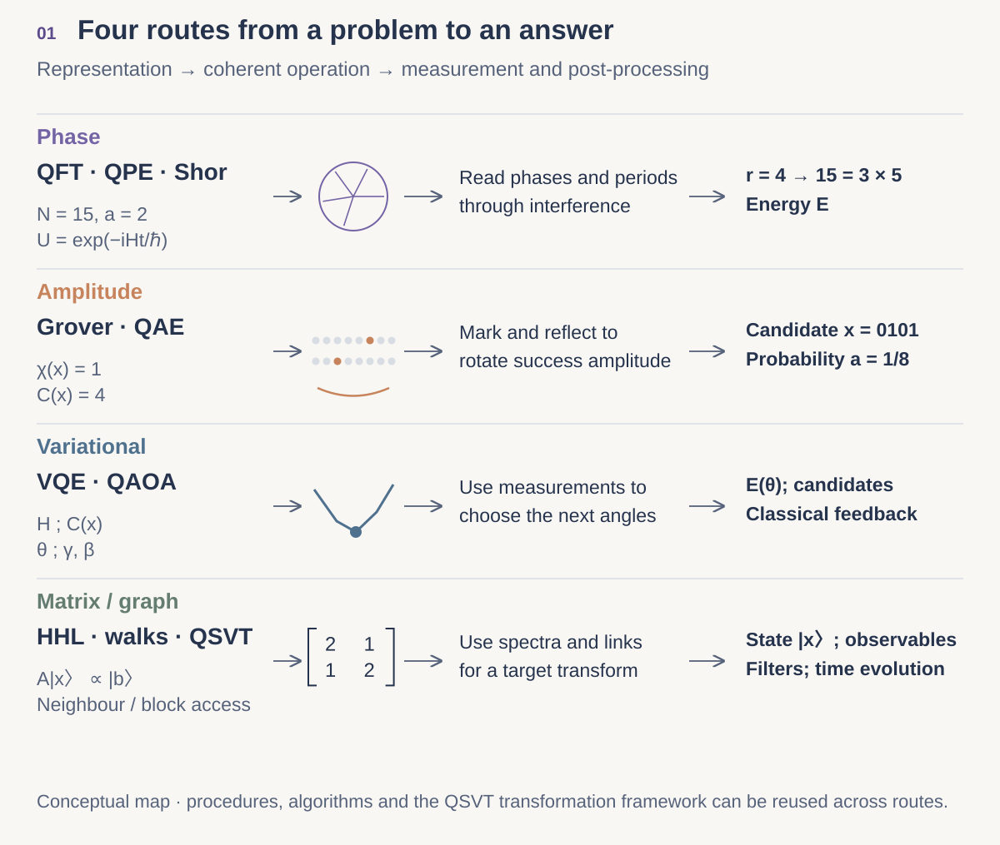
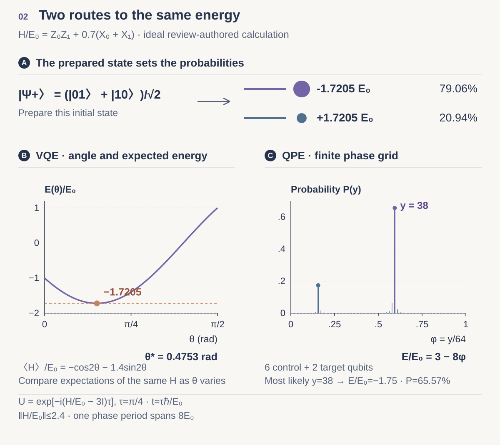
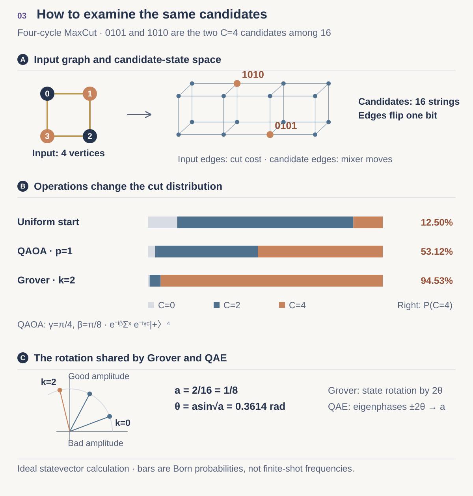

# How Quantum Algorithms Reframe a Problem

**From Shor to QSVT: how rotations and interference become answers, and what ten algorithms still need for practical use**

A molecular energy, a good configuration and the probability of a rare event are different answers. Quantum algorithms design ways to encode and read them through phases, amplitudes and observables. Calculations on small spin and graph models connect ten algorithms, revealing what recent research has improved and what remains between a circuit and a useful application.

<figure class="hero"><figcaption>A spatial sculpture in which paths overlap after a sequence of operations and form an observable pattern. AI-generated conceptual illustration of representation, operation and measurement.</figcaption></figure>

Imagine sitting down at a quantum computer to calculate the energy of a molecule. The circuit contains gates that rotate individual qubits and gates that couple them. Running it produces bits. Where did the energy enter this sequence, and how can those bits reveal it?

Even the same energy can be approached in several ways. A variational quantum eigensolver (VQE) measures the energy of a prepared state and adjusts rotation angles to lower it.[1] Quantum phase estimation (QPE) evolves a state in time and converts the accumulated phase into energy.[2] The target is the same, but the state transformations and readout differ. Those choices determine circuit length, repeated measurements and how long the computation must withstand errors.

Understanding an algorithm begins with specifying the answer. An integer factor, a molecular energy difference, a configuration satisfying a constraint and the probability of finding that configuration are different outputs. After encoding the input in quantum states and operations, we arrange interference so that the desired output appears in a measurement. Rotations are concrete tools for building that connection.

## Ten algorithms, four organizing principles

Write a single-qubit state as α|0⟩+β|1⟩. The states |0⟩ and |1⟩ are the two basis states distinguished by measurement, with probabilities |α|² and |β|². The amplitudes α and β are complex numbers with both magnitude and phase. Rotation gates change these amplitudes; interactions between two qubits change amplitudes and relative phases in their joint state. When paths meet again, we add their amplitudes before squaring the magnitude. Designing this interference changes the probabilities of the results we want.

Figure 1 connects algorithm names to these operations. QFT, QPE and Shor belong to the phase-reading family; Grover and QAE use the geometry of amplifying successful outcomes. VQE and QAOA adjust state-preparation parameters together with classical computation. HHL, quantum walks and QSVT use matrix and graph structure to assemble these components into larger calculations. QFT changes a representation, QPE reads an eigenphase, and QSVT provides a framework for constructing transformations used by many algorithms.

<figure id="fig-1"><picture><source media="(max-width: 760px)" srcset="../artifacts/figures/fig1_mobile_en.svg"></picture><figcaption>Figure 1. From a problem representation to a measured answer. The map connects reusable components while distinguishing the outputs sought by different algorithms. Conceptual diagram for this review, including inputs and outputs of the examples below.[2–9]</figcaption></figure>

| Algorithm | What it changes | What is read out | Applications |
|---|---|---|---|
| QFT · quantum Fourier transform | Changes to a representation with structured relative phases. | Period or phase information read with other procedures | A component of period finding and phase estimation.[2] |
| QPE · quantum phase estimation | Transfers an eigenphase into relative phases of a control register. | An eigenphase and its corresponding energy | Molecular and materials energies and spectra.[2] |
| Shor | Converts an integer problem into the period of modular exponentiation. | Factors or discrete logarithms obtained by classical postprocessing | Cryptanalysis and resource assessment for cryptographic migration.[3] |
| Grover | Amplifies a subspace satisfying a predicate. | A candidate satisfying a condition | Structured search and success amplification within other algorithms.[4] |
| QAE · quantum amplitude estimation | Expresses a success amplitude as a rotation angle. | A probability or normalized expectation, with an error interval | Integration, risk and uncertainty quantification, Monte Carlo-type computation.[5] |
| VQE | Adjusts parameters of a prepared state. | Approximate energies, states and observables | Electronic structure, spin models and material properties.[1] |
| QAOA | Alternates cost-dependent phases with operations mixing candidates. | A distribution of good candidates and their costs | Combinatorial optimization such as MaxCut.[6] |
| HHL · quantum linear systems | Rescales component amplitudes by inverse eigenvalues. | A quantum state proportional to a linear-system solution | Observables needed for response and differential-equation problems.[7] |
| Quantum walks | Propagates and interferes amplitudes through graph connections. | Search outcomes, samples or dynamical observables | Structured search, sampling and simulation.[8] |
| QSVT · quantum singular value transformation | Applies a polynomial transformation to matrix singular values. | A transformed operator and observables obtained with it | Inverse functions, spectral filters and state preparation.[9] |

Choosing a name is followed by making the input and output concrete again. Cost depends on how we implement matrix access or a condition-checking circuit, and on whether we need one number or a whole vector. Small examples make these differences visible.

## Two ways to read the energy of the same two spins

To follow a calculation to its end, consider two spins. With a positive energy unit E₀, let H/E₀=Z₀Z₁+0.7(X₀+X₁). The Pauli operator Z assigns +1 and −1 to |0⟩ and |1⟩, while X flips the states. The first term lowers the energy of opposite spin orientations; the second mixes each spin's states. We seek the lowest-energy state under both actions.

VQE begins by choosing which states the circuit can prepare. Using this model's symmetry, consider a one-parameter mixture of |Ψ⁺⟩=(|01⟩+|10⟩)/√2 and |Φ⁺⟩=(|00⟩+|11⟩)/√2.

|ψ(θ)⟩ = cosθ |Ψ⁺⟩ − sinθ |Φ⁺⟩ ⟨H⟩/E₀ = −cos(2θ) − 1.4 sin(2θ)

The angle θ is our control knob. After preparing the state, we measure the expectations of ZZ, X₀ and X₁ and combine them into the energy. To measure ZZ, record +1 for equal bits and −1 for different bits, then average. For each X term, rotate the measurement basis and average the spin’s +1 and −1 outcomes. Combining these averages with the Hamiltonian coefficients gives the state’s energy; a classical optimizer uses it to choose the next θ. Following the energy curve in Figure 2B reaches −1.720465E₀ at θ≈0.47527 rad. Direct diagonalization of this four-dimensional model gives the same value. Here the chosen small state space contains the exact ground state.

The angle has a direct physical meaning. Changing θ changes the relative weights of the two Bell states, altering both interaction and transverse-field energies. This state can be prepared as exp(−iθY₀Z₁)|Ψ⁺⟩. In the standard Pauli-rotation convention, the rotation angle is 2θ. An operation acting jointly on two qubits is needed because the object we are changing is their coupled state.

<figure id="fig-2"><picture><source media="(max-width: 760px)" srcset="../artifacts/figures/fig2_mobile_en.svg"></picture><figcaption>Figure 2. Two routes through the same H/E₀=ZZ+0.7(XI+IX). VQE varies a state angle to minimize expected energy; QPE reads eigencomponents of a prepared state through a phase distribution. QPE uses the shift 3I, τ=π/4, six control qubits and input |Ψ⁺⟩. Ideal state-vector educational calculation for this review.</figcaption></figure>

QPE places energy in the state's time evolution. Evolving an eigenstate |E⟩ for time t introduces the phase exp(−iEt/ℏ). A control qubit creates an evolved path and an unevolved path, making the phase readable as their relative phase. Combining evolutions of different durations records that phase; interference then yields a bit string.[2]

A phase repeats every full turn, so we must choose the energy interval and time unit together. The coefficients alone bound this model's spectrum by |E/E₀|≤2.4. Shifting the energy reference by 3E₀ and choosing τ=E₀t/ℏ=π/4 puts all possible energies within one phase period:

U = exp[−i(H/E₀ − 3I)τ] φ = (3 − E/E₀)/8, &nbsp; E/E₀ = 3 − 8φ

Figure 2C shows the exact probability distribution of ideal QPE with input |Ψ⁺⟩. Its ground-state overlap is about 79.1%. Six control qubits resolve phase into 64 bins. The most frequent result, y=38, corresponds to φ=38/64 and energy −1.75E₀; its probability is about 65.6%. The remaining probability includes nearby phase bins and the excited-state component. More control bits provide a finer grid and require longer evolution.

The repetitions also differ. During optimization, VQE repeatedly prepares states and measures several observables. QPE performs a controlled evolution long enough for the required precision and samples energies according to the input's eigencomponents. If the ground-state component is small, preparation or filtering becomes important. Alongside the qubit count, we therefore count state preparation, the longest circuit and the number of repetitions.

## Reading a phase period leads to Shor

The quantum Fourier transform (QFT) changes the representation so that components with different phases meet in a structured way. In our QPE example, this structure turns phases accumulated in the control register into bit strings. In Shor's algorithm, it reveals repetition generated by integer arithmetic.[2,3]

Consider factoring 15. Powers of 2 modulo 15 cycle through 1, 2, 4, 8, 1, giving period 4. Once the period r is known, classical arithmetic gives gcd(2^(r/2)−1,15)=3 and gcd(2^(r/2)+1,15)=5. For large integers, quantum computation finds the period: modular exponentiation is implemented reversibly, period-dependent interference is read out, and classical number theory processes the result.[3]

Here QFT is designed to expose the period of a modular function. Applications needing an array of Fourier coefficients from a classical file must also count loading the data into a state and reading the coefficients. Shor's resources include modular arithmetic and its uncomputation, rotation synthesis and error correction. Changing arithmetic and hardware architecture together changes the cost of the same algorithm.

## Finding a candidate and knowing its probability

Now consider a graph whose four vertices form a cycle. MaxCut assigns each vertex to one of two groups, maximizing the number of edges joining different groups. Four bits give 16 candidates; the two optimal candidates, 0101 and 1010, cut all four edges. Figure 3 compares three roles for quantum operations on this same small problem.

QAOA alternates exp(−iγC), which converts a candidate's cut value C(z) into a phase, with exp(−iβΣX), which mixes candidates differing in their bits.[6] The angle γ converts cost differences into phase differences, while β mixes them so that interference turns phase differences into probability differences. Starting from a uniform superposition, one layer with γ=π/4 and β=π/8 increases the mean cut from 2 to 3 and the probability of an optimal candidate from 12.5% to 53.125%.

<figure id="fig-3"><picture><source media="(max-width: 760px)" srcset="../artifacts/figures/fig3_mobile_en.svg"></picture><figcaption>Figure 3. Different operations serve different objectives on the same 16 candidates. QAOA uses cost phases and a mixer; Grover uses the C=4 predicate and reflections; QAE uses a prepared state's success amplitude and rotation angle. Probabilities are exact ideal state-vector values. The input four-cycle is distinguished from the state-space graph connecting candidates that differ in one bit. Educational calculation for this review.[4–6]</figcaption></figure>

Grover uses the predicate “is the cut value 4?” Flipping the phase of good candidates and reflecting about the initial state produces a rotation in the plane spanned by the good and remaining subspaces.[4] Initially the good fraction is a=2/16. Writing θ=arcsin√a, the success probability after k iterations is sin²[(2k+1)θ]. Two iterations give 94.53125% in this example.

QAE changes the objective to estimating a from the same rotation. Its inputs include the state preparation A that creates the success amplitude, its inverse A† and a predicate marking good results.[5] Reading the Grover operator's eigenphases ±2θ, or fitting success probabilities at several depths, estimates θ and thus a=sin²θ. Producing one good candidate and precisely learning how likely such candidates are become connected tasks.

The values 53.125% and 94.53125% describe distributions after different operations. QAOA uses phases from the full cost function, while Grover checks whether a threshold is satisfied. In applications, comparison includes the arithmetic, memory access and uncomputation required for that predicate, along with circuit depth. Too many Grover iterations lower the success probability again, making the iteration count part of the design.

QAE uses this connection in finance, integration and uncertainty calculations that need probabilities or expectations. Converting the ideal quadratic improvement in queries with respect to error ε into a runtime advantage requires efficient distribution preparation and payoff arithmetic, as well as the ability to run long circuits that preserve phase relationships, along with repeated executions.[5,10] The data and the state used to encode it link theoretical acceleration to practical use.

## What it means to solve a matrix problem

The linear system Ax=b is easier to understand by specifying the output first. For A=((2,1),(1,2)) and b=(1,0), the classical solution is x=(2/3,−1/3). A normalized quantum state proportional to it is |x⟩=(2|0⟩−|1⟩)/√5. Measuring Z in this state gives expectation 3/5. Writing all components of a solution and obtaining one such observable have different output sizes and readout costs.

HHL introduced a way to prepare a solution state by obtaining matrix eigenvalue information and scaling component amplitudes by inverse eigenvalues.[7] Our small matrix has eigenvalues 1 and 3, with condition number κ=3. For large problems, important resources include matrix access, preparation of the right-hand-side state, conditioning and preconditioning, accuracy and success probability. Modern quantum linear-system algorithms compare which of these resources they improve, and by how much.

Quantum walks turn graph connections into amplitude propagation and interference.[8] A classical walk adds path probabilities; a quantum walk adds complex amplitudes before obtaining probabilities. Search or sampling advantages depend on the graph and the access operations available. In Hamiltonian simulation, qubitization uses a related walk operator to construct time evolution efficiently.[11]

QSVT encodes a matrix as one block of a larger unitary, then combines rotations and reflections so that an admissible polynomial p(σ) acts on its singular values σ.[9] For the positive 2×2 matrix above, inversion requires amplitude weights proportional to 1 and 1/3 on components with eigenvalues 1 and 3. QSVT normalizes the matrix and output and provides a way to approximate this inverse function by a polynomial over the required eigenvalue interval. The same language constructs spectral filters that retain components in a selected energy range. Polynomial degree, parity and magnitude constraints, together with matrix normalization, determine the actual circuit. A filter retaining components near the ground state can help prepare a useful input, connecting matrix transformations back to QPE.

The ten names now appear as methods that borrow from one another. Reading energy as a phase requires time evolution; walks and polynomial transformations can build that evolution efficiently. Success amplification enters both search and probability estimation. Choosing an application means assembling the components and specifying what each stage prepares and reads.

## Which bottlenecks is recent research changing?

Comparing recent work requires identifying the resource changed under each algorithm's name. A circuit-fidelity experiment, a theorem reducing state-preparation queries and an estimate of physical qubits and runtime represent different advances. The table connects representative work checked on November 24, 2026 to the role of each algorithm.

| Algorithm | Representative researchers, organizations and approaches | Progress and next challenges |
|---|---|---|
| QFT | Aumann, Fellner, Lechner and colleagues at ParityQC; Parity Twine | Compared interaction layouts on IBM and Rigetti QPUs. The roughly 10⁻² value at 50 qubits is process fidelity. Connecting hardware connectivity and gates to application success remains a task.[12] |
| QPE | Kristjuhan and Berry; Molecular Quantum Solutions and Macquarie | Designs the control-state distribution and reuses three control qubits. Circuit construction and numerical work; system-state and evolution resources are needed separately.[13] |
| Shor | Pappalardo and colleagues; Alice & Bob, Inria and collaborators | Compiles arithmetic, codes, layout and runtime into a cat-qubit resource estimate. Physical devices must meet the assumed noise bias and feedback speed.[14] |
| Grover | Reeves, Sopkin and Searles | Optimizes a reversible predicate for a particular seed-recovery problem and executes reduced circuits. Large searches must reduce arithmetic, uncomputation and all repetitions together.[15] |
| QAE | Labib | Theoretical and numerical design of depth schedules and maximum-likelihood estimation. State preparation, intervals, parallelism and device noise must be balanced.[16] |
| VQE | Nogueira, Piquemal and colleagues; Sorbonne and Qubit Pharmaceuticals | VULCAN combines circuit growth, compression and classical perturbative correction. Large comparisons use emulation; measurement proxies, depth and GPU postprocessing require separate assessment.[17] |
| QAOA | Perlin, Shaydulin and colleagues; JPMorganChase and Quantinuum | Executes small error-corrected algorithms on H2 and Helios. Rotation-synthesis precision, accumulated errors and parameter learning for larger problems interact.[18] |
| HHL and modern linear systems | The error-corrected experiment above; Low and Su's query optimization | Small Poisson-HHL execution coexists with theory reducing initial-state-preparation queries. Full costs include input access, preconditioning and observables.[18,19] |
| Quantum walks | Incudini and Mazzola; Rong and colleagues | Fault-tolerant sampling resource analysis and physical graph-search experiments progress along distinct routes. Graph access, mixing and reduced state spaces matter.[20,21] |
| QSVT | Bierman, Poudel and Liu; Lu, Liu and Lin | Randomized block encoding and polynomials, and extensions of the transformation framework. Error bounds, depth and sampling costs are tested against specific Hamiltonians.[22,23] |

VULCAN illustrates how VQE resources can be divided. It grows a circuit to find a state, compresses it, then corrects remaining correlations through classical perturbation theory. The reported 5–20% of the reference method's cost in noiseless comparisons refers to cumulative Pauli-term evaluations, a proxy for measurement cost. Reducing that quantity can deepen a circuit, so measurement, depth and classical postprocessing must be read together.[17]

Recent error-corrected QAOA experiments show what happens when the angles adjusted in Figure 3 must become physical gates. The experiment builds rotations from Clifford gates, basic operations performed within error correction, and T gates, which change a relative phase by π/4. Approximating arbitrary angles more precisely increases the T count and opportunities for error. Perlin and colleagues improved performance with more T gates on small five- and six-variable problems, but depth two performed worse than depth one on a selected 12-variable problem. Logical expressiveness and execution accuracy must be optimized together.[18]

That 12-variable case used 97 physical qubits, with instances and angles chosen classically for a small T-gate budget. The paper's near-breakeven compares encoded and unencoded quantum execution. The next consequential comparison is the total cost of obtaining answers of the same quality as strong classical solvers across larger problem distributions.[18]

## Reading the time remaining to practical adoption

The first clock concerns tools available now: cloud execution of small circuits, collaborative VQE and QAOA research, and circuit development for QAE and QSVT. The second measures the time to demonstrate an application at the needed scale and precision on physical hardware. The third concerns sustained advantages in time, cost and reliability over strong classical alternatives. These clocks move differently for each algorithm.

Error correction spreads information over several physical qubits to form a protected logical qubit. Physical-qubit requirements include this protection and auxiliary operations. Resource estimates make the second clock's conditions concrete. In a QPE scenario for a 31-spatial-orbital P450 model, Kanasugi and colleagues estimate about 141,000 physical qubits per QPU and 37.4 days in total. Assumptions include an initial ground-state overlap above 99%, target precision 1.6 mHa and physical error rate 10⁻³. A millihartree (mHa) is one thousandth of the Hartree energy unit used in electronic-structure calculations. The longest individual circuit lasts 33.9 seconds. The total duration schedules repeated execution of individual circuits. Reading the longest circuit and the overall duration separately reveals both what error correction must sustain in one computation and the conditions of repeated device operation.[24]

For Shor, circuit and hardware assumptions also determine the date. A cat-qubit resource study estimates 22,593 cat qubits and 3.14 days for RSA-2048. It assumes a 1 μs error-correction cycle, 10 μs reaction time, phase-flip probability 5×10⁻⁴ and a bit-flip time of about 100 years. Setting the bit-flip time to about one hour and adding protection changes the count to about 45,000. Noise assumptions, protection layers, layout and scheduling jointly change physical resources and execution duration.[14]

| Family | Uses available now | Next conditions for adoption |
|---|---|---|
| QFT and QPE | Phase circuits, small energy calculations and application-specific resource estimates | Molecular or materials demonstrations meeting preparation-overlap, controlled-evolution, precision, repetition and error budgets |
| Shor | Educational calculations and detailed cryptographic-scale resource assessment | Integration of general reversible arithmetic, logical gates, factories, feedback and long-running error correction |
| Grover and QAE | Predicate circuits, state preparation, depth schedules and small executions | Cost comparison with classical search or Monte Carlo at equal accuracy, including loading, reversible arithmetic and coherent depth |
| VQE and QAOA | Cloud experiments and collaborative application research | Better total cost at the same physical accuracy or solution quality, including optimization, measurements, error handling and classical postprocessing |
| HHL, walks and QSVT | Structured-problem circuit design, small executions and query/resource improvements | Integrated application validation of matrix/graph access, preparation, preconditioning, filtering and readout |

Corporate schedules are timelines for devices on which these conditions can be tested. Quantinuum targets Sol in 2027 and Apollo in 2029; IBM plans 200 qubits and 100 million operations for Starling in 2029. IonQ's roadmap targets an increase from 800 logical qubits in 2027 to 80,000 in 2030.[25–27] If the targets are met and devices satisfy the gate, error-rate and operating-time requirements of the circuits, 2027–2029 becomes an important interval for watching early error-corrected algorithms develop toward deeper application demonstrations. Economic adoption must be assessed problem by problem against the conditions in the table.

## Choosing an algorithm for your problem

Move the first research question from “which algorithm is fastest?” to “what must be read, and with what error?” For one energy, preparation and eigenphase are central; for the probability of a risk event, distribution preparation and amplitude estimation matter; for a response observable, the focus shifts to matrix access and measurement on a solution state. Specifying the answer lets us choose its representation and readout.

Then choose a classical baseline producing the same output at the same accuracy. Match active spaces and electronic-structure approximations in chemistry, instance distributions and solution quality in optimization, and preconditioning and observables in linear systems. On the quantum side, include input preparation, the algorithm, error correction, repetitions and classical postprocessing. Comparing this whole calculation reveals which structures can benefit from quantum operations.[10]

In Figure 2, a rotation angle became a state's energy; in Figure 3, cost phases and mixing became candidate probabilities. Understanding that middle ground makes a circuit intelligible. It becomes a tool for placing physical quantities and computational problems in a representation, then designing interference to read them. Future progress will appear in how accurately, and with how few resources, we can carry that connection through to the end.

## References

[1] A. Peruzzo, J. McClean, P. Shadbolt, M.-H. Yung, X.-Q. Zhou, P. J. Love, A. Aspuru-Guzik, and J. L. O’Brien, A variational eigenvalue solver on a quantum processor, [Nat. Commun. **5**, 4213 (2014)](https://doi.org/10.1038/ncomms5213).

[2] R. Cleve, A. Ekert, C. Macchiavello, and M. Mosca, Quantum algorithms revisited, [Proc. R. Soc. Lond. A **454**, 339 (1998)](https://doi.org/10.1098/rspa.1998.0164).

[3] P. W. Shor, Polynomial-time algorithms for prime factorization and discrete logarithms on a quantum computer, [SIAM J. Comput. **26**, 1484 (1997)](https://doi.org/10.1137/S0097539795293172).

[4] L. K. Grover, A fast quantum mechanical algorithm for database search, [in Proceedings of the Twenty-Eighth Annual ACM Symposium on Theory of Computing (ACM, New York, 1996), p. 212](https://doi.org/10.1145/237814.237866).

[5] G. Brassard, P. Høyer, M. Mosca, and A. Tapp, Quantum amplitude amplification and estimation, [Contemp. Math. **305**, 53 (2002)](https://doi.org/10.1090/conm/305/05215).

[6] E. Farhi, J. Goldstone, and S. Gutmann, A quantum approximate optimization algorithm, [arXiv:1411.4028v1](https://arxiv.org/abs/1411.4028v1) (2014).

[7] A. W. Harrow, A. Hassidim, and S. Lloyd, Quantum algorithm for linear systems of equations, [Phys. Rev. Lett. **103**, 150502 (2009)](https://doi.org/10.1103/PhysRevLett.103.150502).

[8] A. M. Childs, R. Cleve, E. Deotto, E. Farhi, S. Gutmann, and D. A. Spielman, Exponential algorithmic speedup by quantum walk, [in Proceedings of the Thirty-Fifth Annual ACM Symposium on Theory of Computing (ACM, New York, 2003), p. 59](https://doi.org/10.1145/780542.780552).

[9] A. Gilyén, Y. Su, G. H. Low, and N. Wiebe, Quantum singular value transformation and beyond: Exponential improvements for quantum matrix arithmetics, [in Proceedings of the Fifty-First Annual ACM SIGACT Symposium on Theory of Computing (ACM, New York, 2019), p. 193](https://doi.org/10.1145/3313276.3316366).

[10] R. Babbush, J. McClean, M. Newman, C. Gidney, S. Boixo, and H. Neven, Focus beyond quadratic speedups for error-corrected quantum advantage, [PRX Quantum **2**, 010103 (2021)](https://doi.org/10.1103/PRXQuantum.2.010103).

[11] G. H. Low and I. L. Chuang, Hamiltonian simulation by qubitization, [Quantum **3**, 163 (2019)](https://doi.org/10.22331/q-2019-07-12-163).

[12] P. Aumann, M. Fellner, D. Alber, M. Cykiert, C. Fleckenstein, R. ter Hoeven, L. Stenzel, R. J. Valencia-Tortora, and W. Lechner, Demonstrating record fidelity for the quantum Fourier transform, [arXiv:2604.12465v3](https://arxiv.org/abs/2604.12465v3) (2026).

[13] K. Kristjuhan and D. W. Berry, Quantum phase estimation with optimal confidence interval using three control qubits, [Quantum **10**, 2193 (2026)](https://doi.org/10.22331/q-2026-08-19-2193).

[14] A. Pappalardo, D. Goudarzi, V. Hertz, H. Jacinto, L. Kroell, A. Schrottenloher, P. Shanahan, É. Gouzien, R. de la Vieuville, and V. Londe, Shor’s algorithm compiled on cat qubits: 22 593 qubits for RSA-2048 in 3.14 days, [arXiv:2610.37839v2](https://arxiv.org/abs/2610.37839v2) (2026).

[15] E. M. Reeves, E. Sopkin, and T. A. Searles, The cost of a real Grover oracle: Minecraft seed search from software to quantum hardware, [arXiv:2610.33139v1](https://arxiv.org/abs/2610.33139v1) (2026).

[16] F. Labib, Quantum amplitude estimation beyond power-of-two schedules, [arXiv:2609.02715v1](https://arxiv.org/abs/2609.02715v1) (2026).

[17] H. D. Nogueira, S. Badreddine, O. Adjoua, D. Traore, G. Michel, and J.-P. Piquemal, Grow, compress, and perturb: A hybrid quantum-classical pathway to scalable quantum chemistry on quantum computers, [arXiv:2610.40561v3](https://arxiv.org/abs/2610.40561v3) (2026).

[18] M. A. Perlin, Z. He, A. Alexiades Armenakas, P. Andres-Martinez, T. Hao, D. A. Herman, Y. Jin, K. Mayer, C. N. Self, D. Amaro, C. Ryan-Anderson, and R. Shaydulin, Fault-tolerant execution of error-corrected quantum algorithms, [Phys. Rev. X **16**, 041048 (2026)](https://doi.org/10.1103/gnq3-c2df).

[19] G. H. Low and Y. Su, Quantum linear system algorithm with optimal queries to initial state preparation, [Quantum **10**, 2041 (2026)](https://doi.org/10.22331/q-2026-03-23-2041).

[20] M. Incudini and G. Mazzola, Practical advantage beyond the quadratic speedup limit with fully-quantum walks, [arXiv:2607.22818v1](https://arxiv.org/abs/2607.22818v1) (2026).

[21] T. Rong, M. Li, X. Tong, J. Cai, Y. Li, N. Zhou, S. Li, S. Cao, Y. Li, Y. Xu, F. Chen, M. Gong, X. Sun, and C. Zha, Hardware-aware realization of deterministic quantum-walk search on complete bipartite graphs, [arXiv:2611.20053v1](https://arxiv.org/abs/2611.20053v1) (2026).

[22] J. Bierman, P. Poudel, and Y. Liu, Double-randomized quantum singular value transformations for early fault-tolerant quantum computers, [arXiv:2611.18881v1](https://arxiv.org/abs/2611.18881v1) (2026).

[23] X. Lu, Y. Liu, and H. Lin, Quantum signal processing and quantum singular value transformation on U(N), [Quantum **10**, 2048 (2026)](https://doi.org/10.22331/q-2026-03-27-2048).

[24] S. Kanasugi, R. Toshio, K. Maruyama, and H. Oshima, Enabling chemically accurate quantum phase estimation in the early fault-tolerant regime via unitary weight concentration, [arXiv:2603.22778v3](https://arxiv.org/abs/2603.22778v3) (2026).

[25] Quantinuum, [Roadmaps](https://www.quantinuum.com/company/roadmaps) (accessed November 24, 2026).

[26] M. Steffen and M. Marwick, [Tracking progress on the path to IBM Quantum Starling](https://www.ibm.com/quantum/blog/path-to-ibm-quantum-starling) (November 11, 2026).

[27] IonQ, [Roadmap](https://www.ionq.com/roadmap) (accessed November 24, 2026).
