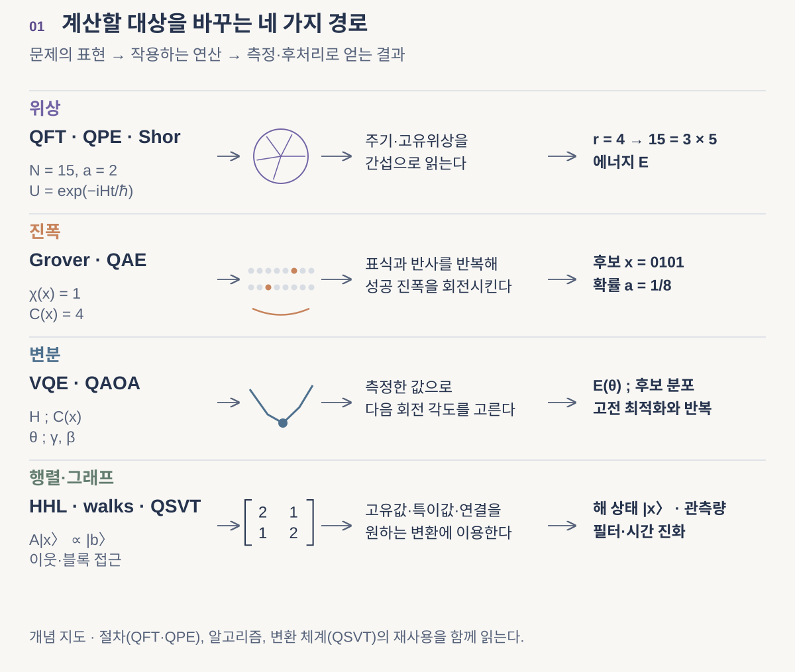
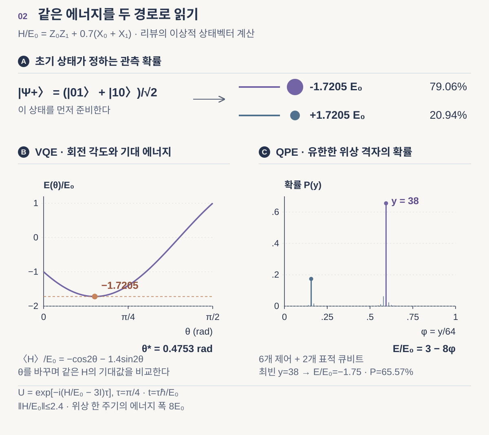
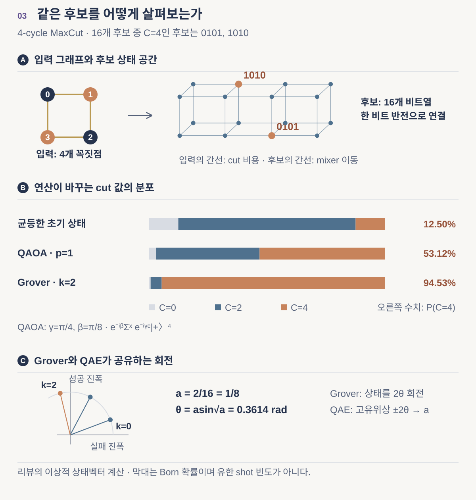

# 양자 알고리즘은 어떻게 문제를 바꾸는가

**Shor에서 QSVT까지 회전과 간섭을 답으로 연결하는 열 가지 계산의 원리와 실용화 조건**

분자의 에너지, 좋은 배치 하나, 드문 사건의 확률은 서로 다른 답이다. 양자 알고리즘은 이 답들을 위상·진폭·관측량으로 표현하고 읽는 절차를 설계한다. 작은 스핀과 그래프를 직접 계산하며 열 가지 알고리즘을 연결하고, 최근 연구에서 무엇이 개선됐으며 실제 활용까지 어떤 계산이 더 필요한지 살핀다.

<figure class="hero"><figcaption>여러 연산을 거친 경로가 겹쳐 관측 무늬로 나타나는 공간 조각. 표현·연산·관측의 연결을 그린 AI 생성 개념 일러스트.</figcaption></figure>

한 분자의 에너지를 계산하려고 양자컴퓨터 앞에 앉았다고 생각해 보자. 회로에는 한 큐비트를 돌리는 게이트와 큐비트들을 연결하는 게이트가 이어진다. 회로를 실행하면 비트들이 나온다. 우리가 원한 에너지는 그 사이 어디에 들어갔으며, 그 비트에서 어떻게 꺼내야 할까.

같은 에너지를 얻는 길도 여럿이다. 변분 양자 고유값 계산(VQE)은 준비한 상태의 에너지를 재고, 더 낮은 값이 나오도록 회전각을 고친다.[1] 양자 위상 추정(QPE)은 상태를 시간에 따라 진화시키고, 그동안 쌓인 위상을 에너지로 환산한다.[2] 목표는 같아도 상태를 바꾸는 방식과 정보를 읽는 방식이 달라진다. 이 차이가 회로의 길이, 반복 측정, 오류에 견뎌야 하는 시간을 결정한다.

양자 알고리즘을 이해하는 출발점은 자신이 구하려는 답을 정하는 일이다. 정수의 인수 하나와 분자의 에너지 차이, 조건을 만족하는 배치와 그 배치가 나올 확률은 다른 출력이다. 입력을 양자 상태와 연산으로 옮긴 뒤, 원하는 출력이 관측에서 드러나도록 간섭을 구성한다. 회전은 그 연결을 만드는 구체적인 도구가 된다.

## 열 가지 알고리즘을 네 가지 원리로 읽기

한 큐비트의 상태를 α|0⟩+β|1⟩로 쓰자. |0⟩과 |1⟩은 측정에서 구별하는 두 기준 상태이며, 각각 나올 확률은 |α|²와 |β|²다. α와 β는 크기와 위상을 가진 복소수다. 회전 게이트는 이 진폭들을 바꾸며, 두 큐비트의 상호작용은 함께 표현된 상태의 진폭과 상대위상을 조절한다. 여러 경로가 다시 만날 때에는 진폭을 먼저 더하고 그 크기를 제곱한다. 이 간섭을 설계해야 원하는 결과의 측정 확률이 달라진다.

그림 1은 알고리즘의 이름을 이 작용에 연결한다. 위상을 읽는 계열에는 QFT·QPE와 Shor가, 좋은 결과의 진폭을 키우는 계열에는 Grover와 QAE가 놓인다. VQE·QAOA는 상태를 만드는 매개변수를 고전 계산과 함께 조절한다. 행렬과 그래프의 구조를 이용하는 HHL·양자 보행·QSVT는 이런 부품을 더 큰 계산의 언어로 묶는다. QFT는 표현을 바꾸는 절차이고 QPE는 고유위상을 읽는 절차이며, QSVT는 여러 알고리즘을 구성하는 변환 체계다.

<figure id="fig-1"><picture><source media="(max-width: 760px)" srcset="../artifacts/figures/fig1_mobile.svg"></picture><figcaption>그림 1. 문제의 표현에서 관측까지의 연결. 같은 부품이 여러 계산에 재사용되는 관계와 알고리즘마다 원하는 출력의 차이를 함께 배치했다. 리뷰의 개념도이며 아래 계산 예제의 입력과 출력을 포함한다.[2–9]</figcaption></figure>

| 알고리즘 | 바꾸는 것 | 읽는 답 | 활용하는 문제 |
|---|---|---|---|
| QFT · 양자 Fourier 변환 | 규칙적인 상대위상을 가진 표현으로 바꾼다. | 다른 절차와 결합해 읽는 주기·위상 정보 | 주기 찾기와 위상 추정의 구성 요소.[2] |
| QPE · 양자 위상 추정 | 고유위상을 제어 레지스터의 상대위상에 옮긴다. | 고유위상과 그에 대응하는 에너지 | 분자·재료의 에너지와 스펙트럼.[2] |
| Shor | 정수 문제를 모듈러 거듭제곱의 주기로 옮긴다. | 주기 후보를 고전 처리해 얻는 인수·이산로그 | 암호 분석과 암호 전환의 자원 평가.[3] |
| Grover | 판정에 맞는 부분공간의 진폭을 키운다. | 조건을 만족하는 후보 | 구조적 탐색, 다른 알고리즘의 성공 확률 증폭.[4] |
| QAE · 양자 진폭 추정 | 성공 진폭을 회전각으로 표현한다. | 확률·정규화한 기대값과 오차 구간 | 적분, 위험·불확실성 정량화, Monte Carlo형 계산.[5] |
| VQE | 준비 상태의 매개변수를 바꾼다. | 근사 에너지·상태·관측량 | 전자구조, 스핀 모형과 물성 계산.[1] |
| QAOA | 비용에 따른 위상과 후보를 섞는 연산을 번갈아 적용한다. | 좋은 후보의 분포와 비용 | MaxCut 등 조합 최적화.[6] |
| HHL · 양자 선형계 | 고유값의 역수에 따라 성분의 진폭을 바꾼다. | 선형계의 해에 비례하는 양자 상태 | 응답·미분방정식 등에서 필요한 관측량 계산.[7] |
| Quantum walks · 양자 보행 | 그래프의 연결을 따라 진폭이 전파·간섭하게 한다. | 탐색 결과·표본·진화의 관측량 | 구조적 검색, 표본화, 시뮬레이션.[8] |
| QSVT · 양자 특이값 변환 | 행렬의 특이값에 다항식 변환을 적용한다. | 변환된 연산과 이를 이용한 관측량 | 역함수, 스펙트럼 필터와 상태 준비.[9] |

이름을 선택한 다음에는 입력과 출력을 다시 구체화해야 한다. 행렬을 읽는 연산과 조건을 검사하는 회로를 어떻게 만들지, 최종적으로 숫자 하나가 필요한지 벡터 전체가 필요한지에 따라 계산의 비용이 달라진다. 이 차이를 작은 예제에서 먼저 보자.

## 같은 두 스핀의 에너지를 두 방법으로 읽는다

계산을 끝까지 따라가기 위해 두 스핀의 모형을 고른다. 양의 에너지 단위를 E₀로 정하고 H/E₀=Z₀Z₁+0.7(X₀+X₁)로 둔다. Z는 |0⟩·|1⟩에 각각 +1·−1을 주고, X는 두 상태를 뒤집는 Pauli 연산자다. 첫 항은 두 스핀이 반대 방향일 때 에너지를 낮추며, 두 번째 항은 각 스핀의 상태를 섞는다. 두 작용이 함께 있을 때 가장 낮은 에너지를 갖는 상태를 찾는다.

VQE에서는 어떤 상태를 만들 수 있게 할지 먼저 정한다. 이 모형의 대칭을 이용해 |Ψ⁺⟩=(|01⟩+|10⟩)/√2와 |Φ⁺⟩=(|00⟩+|11⟩)/√2를 섞는 한 매개변수 상태를 준비하자.

|ψ(θ)⟩ = cosθ |Ψ⁺⟩ − sinθ |Φ⁺⟩ ⟨H⟩/E₀ = −cos(2θ) − 1.4 sin(2θ)

θ가 회전의 조절 손잡이다. 상태를 준비한 뒤 ZZ·X₀·X₁의 기대값을 각각 측정해 에너지를 합친다. ZZ를 잴 때에는 두 비트가 같으면 +1, 다르면 −1을 기록해 평균한다. X항은 측정축을 돌려 각 스핀의 +1·−1 결과를 평균한다. 이 값들을 해밀토니안의 계수대로 더하면 그 상태의 에너지가 되고, 고전 최적화기는 이 에너지를 보고 다음 θ를 정한다. 그림 2B에서 에너지 곡선을 따라 내려가면 θ≈0.47527rad에서 −1.720465E₀에 도달한다. 이 네 차원 모형의 직접 대각화와 같은 값이다. 이 예제에서는 선택한 작은 상태 공간이 정확한 바닥상태를 포함한다.

여기서 각도와 물리가 직접 연결된다. θ를 바꾸면 두 Bell 상태의 상대적인 크기가 달라지고, 상호작용 에너지와 가로장 에너지가 함께 달라진다. 위 상태는 exp(−iθY₀Z₁)|Ψ⁺⟩로 만들 수 있다. 표준 Pauli 회전의 각도로는 2θ다. 두 큐비트에 함께 작용하는 회전이 필요한 까닭은 우리가 바꾸려는 대상이 두 스핀의 결합 상태이기 때문이다.

<figure id="fig-2"><picture><source media="(max-width: 760px)" srcset="../artifacts/figures/fig2_mobile.svg"></picture><figcaption>그림 2. 같은 H/E₀=ZZ+0.7(XI+IX)를 읽는 두 경로. VQE는 상태의 각도를 바꾸어 기대 에너지를 최소화하고, QPE는 준비 상태의 고유성분을 위상 분포로 읽는다. QPE는 기준 이동3I·τ=π/4·제어6큐비트, 입력 |Ψ⁺⟩를 사용했다. 리뷰의 이상적 상태벡터 교육 계산.</figcaption></figure>

QPE에서는 에너지를 상태의 시간 변화에 넣는다. 고유상태 |E⟩를 시간 t 동안 진화시키면 exp(−iEt/ℏ)라는 위상이 붙는다. 제어 큐비트가 ‘진화시킨 경로’와 ‘진화시키지 않은 경로’를 함께 만들면 이 위상을 두 경로 사이의 상대위상으로 읽을 수 있다. 길이가 다른 진화를 조합해 상대위상을 기록하고, 간섭으로 비트열을 얻는다.[2]

위상은 한 바퀴마다 같은 값으로 돌아오므로 에너지 구간과 시간 단위를 함께 정해야 한다. 이 모형은 계수만으로 |E/E₀|≤2.4임을 알 수 있다. 에너지 기준을 3E₀만큼 옮기고 τ=E₀t/ℏ=π/4를 쓰면 다음과 같이 모든 가능한 에너지가 한 주기 안에 들어간다.

U = exp[−i(H/E₀ − 3I)τ] φ = (3 − E/E₀)/8, &nbsp; E/E₀ = 3 − 8φ

그림 2C는 |Ψ⁺⟩를 입력한 이상적 QPE의 정확한 확률 분포다. 이 입력의 바닥상태 겹침은 약79.1%다. 제어 큐비트 여섯 개는 위상을 64칸으로 읽으며, 가장 자주 나오는 y=38은 φ=38/64, 에너지 −1.75E₀에 대응한다. 이 비트열의 확률은 약65.6%다. 나머지 확률에는 위상 격자 주변으로 퍼진 값과 들뜬 상태의 성분이 들어간다. 제어 비트를 늘리면 격자는 촘촘해지고 필요한 진화는 길어진다.

두 방법이 요구하는 반복도 다르다. VQE는 상태를 만들고 여러 관측량을 재는 일을 최적화 중 되풀이한다. QPE는 필요한 정밀도를 담을 만큼 긴 제어 진화를 수행하고, 초기 상태의 고유성분에 따라 에너지를 표본으로 얻는다. 바닥상태 성분이 작다면 상태 준비나 필터링이 중요해진다. ‘몇 큐비트를 썼는가’에 더해 상태 준비, 가장 긴 회로, 반복 횟수를 함께 세어야 하는 이유다.

## 위상의 주기를 읽으면 Shor로 이어진다

양자 Fourier 변환(QFT)은 서로 다른 위상을 가진 성분이 규칙적으로 만나도록 표현을 바꾼다. 위 예제의 QPE에서는 제어 레지스터에 쌓인 위상을 비트열로 읽는 데 이 구조가 쓰인다. Shor 알고리즘에서는 정수 연산이 만든 반복을 읽는 데 쓰인다.[2,3]

15를 인수분해하는 작은 예를 보자. 2의 거듭제곱을15로 나눈 나머지는1,2,4,8,1로 되풀이되며 주기는4다. 주기 r을 얻고 나면 고전 계산으로 gcd(2^(r/2)−1,15)=3과 gcd(2^(r/2)+1,15)=5를 얻는다. 큰 정수에서는 이 주기를 찾는 과정에 양자 계산을 사용한다. 모듈러 거듭제곱을 가역 회로로 구현하고, 주기에 따른 간섭 무늬를 읽고, 결과를 고전 수론으로 처리한다.[3]

이 흐름에서 QFT가 관측에 드러내도록 설계한 것은 모듈러 함수의 주기다. 고전 파일의 Fourier 계수 배열이 필요한 응용에서는 자료를 상태로 넣고 계수를 읽는 비용도 함께 센다. Shor의 자원은 모듈러 산술과 그 역계산, 회전 합성, 오류정정까지 이어진다. 같은 알고리즘의 비용도 산술과 장치 구조를 함께 바꾸면 달라진다.

## 후보를 찾는 일과 그 확률을 아는 일

이번에는 네 꼭짓점이 고리로 연결된 그래프를 보자. 각 꼭짓점을 두 집단 중 하나에 넣어, 서로 다른 집단을 잇는 변의 수를 최대화하는 MaxCut 문제다. 네 비트의 후보는16개이며, 모든 네 변을 가르는 최적 후보는0101과1010 두 개다. 그림 3은 이 같은 작은 문제에서 세 가지 연산의 역할을 비교한다.

QAOA에서는 후보 z의 cut 값 C(z)를 위상으로 바꾸는 exp(−iγC)와, 비트가 다른 후보 사이를 섞는 exp(−iβΣX)를 번갈아 적용한다.[6] γ는 후보의 비용 차이를 위상 차이로 바꾸고, β는 그 위상 차이가 간섭을 거쳐 확률 차이가 되도록 섞는다. 균일한 중첩에서 한 층을 실행해 γ=π/4, β=π/8로 두면 평균 cut 값은2에서3으로, 최적 후보가 나올 확률은12.5%에서53.125%로 바뀐다.

<figure id="fig-3"><picture><source media="(max-width: 760px)" srcset="../artifacts/figures/fig3_mobile.svg"></picture><figcaption>그림 3. 같은16개 후보에서 목적에 맞게 다른 연산을 설계한다. QAOA는 cut 값의 위상과 mixer를, Grover는 C=4 판정과 반사를, QAE는 준비 상태의 성공 진폭과 회전각을 이용한다. 확률은 정확한 이상적 상태벡터 값이다. 입력의4-cycle과 비트 하나가 다른 후보들을 잇는 상태공간 그래프를 구별했다. 리뷰의 교육 계산.[4–6]</figcaption></figure>

Grover에서는 ‘cut 값이4인가’라는 판정을 사용한다. 좋은 후보의 위상을 뒤집고 초기 상태를 기준으로 반사하는 두 연산이, 좋은 부분공간과 나머지 부분공간이 만드는 평면에서 회전을 이룬다.[4] 처음의 좋은 후보 비율 a는2/16이다. θ=arcsin√a라고 쓰면 k회 뒤의 성공 확률은 sin²[(2k+1)θ]다. 이 예에서 두 번 반복하면94.53125%가 된다.

QAE는 같은 회전에서 a를 추정하는 쪽으로 목적을 바꾼다. 성공 진폭을 만든 상태 준비 A, 그 역연산 A†, 좋은 결과의 판정이 입력이다.[5] Grover 연산의 고유위상 ±2θ를 읽거나 여러 깊이의 성공 확률을 맞추어 θ를 추정하면 a=sin²θ를 얻는다. 어느 한 좋은 후보를 출력하는 일과, 그런 후보가 나올 확률을 정밀하게 아는 일이 이렇게 연결된다.

이 비교에서53.125%와94.53125%가 설명하는 것은 서로 다른 연산 뒤의 분포다. QAOA는 비용함수 전체의 위상을 쓰고, Grover는 임계값을 만족하는지 판정한다. 실제 문제에서는 그 판정을 만드는 산술·메모리 접근·역계산과 회로 깊이를 함께 비교한다. 반복을 지나치게 늘리면 Grover의 성공 확률은 다시 낮아지므로, 반복 횟수 역시 설계의 일부다.

확률이나 기대값이 필요한 금융·적분·불확실성 계산에서는 QAE가 이 연결을 활용한다. 오차 ε에 대한 이상적 질의 수의 이차 개선을 실제 시간의 이점으로 만들려면, 분포 준비와 payoff 연산을 효율적으로 구현하고 위상 관계를 유지하는 긴 회로와 반복 실행을 감당해야 한다.[5,10] 어떤 데이터를 어떤 상태로 넣는지가 이론의 가속과 실제 활용을 잇는 핵심 과제가 된다.

## 행렬의 해를 구한다는 말의 뜻

선형계 Ax=b도 원하는 출력부터 살펴보면 이해하기 쉽다. A=((2,1),(1,2)), b=(1,0)이라면 고전 계산의 해는 x=(2/3,−1/3)이다. 해에 비례하는 정규화 양자 상태는 |x⟩=(2|0⟩−|1⟩)/√5다. 이 상태에서 Z를 읽은 기대값은3/5다. 해의 전체 성분을 쓰는 작업과 이런 관측량 하나를 구하는 작업은 출력의 양과 읽기 비용이 다르다.

HHL은 행렬의 고유값 정보를 얻고 그 역수에 따라 성분의 진폭을 조절해 해 상태를 만드는 원형을 제시했다.[7] 위 작은 행렬의 고유값은1과3이며 조건수 κ는3이다. 큰 문제에서는 행렬 접근, 우변 상태 준비, 조건수와 전처리, 정확도와 성공 확률이 중요한 자원이다. 현대 양자 선형계 알고리즘은 이 자원들 중 무엇을 얼마나 개선하는지 비교한다.

양자 보행은 그래프의 연결을 진폭의 이동과 간섭으로 구현한다.[8] 고전 보행이 경로의 확률을 더한다면, 양자 보행에서는 복소 진폭을 더한 뒤 확률을 얻는다. 어떤 그래프에 어떤 접근 연산이 주어지는지에 따라 탐색이나 표본화의 이점이 달라진다. 해밀토니안 시뮬레이션에서는 관련 보행 연산을 이용하는 qubitization이 시간 진화를 구성하는 정교한 방법이 된다.[11]

QSVT는 행렬을 큰 유니터리의 한 블록에 넣고, 그 특이값 σ에 허용 조건을 만족하는 다항식 p(σ)가 작용하도록 회전과 반사를 합성한다.[9] 앞의 양의 2×2 행렬에서는 고유값 1·3의 성분에 역수 1·1/3에 비례하는 진폭 가중치를 주는 작용이 필요하다. QSVT는 행렬과 출력의 크기를 정규화하고, 필요한 고유값 구간에서 이런 역함수를 다항식으로 근사하는 방법을 제공한다. 특정 에너지 구간의 성분을 남기는 스펙트럼 필터도 같은 언어로 구성한다. 다항식의 차수·짝홀성·크기 범위와 행렬의 정규화 계수를 정해야 실제 회로가 된다. 바닥상태 근처의 성분을 남기는 필터가 좋은 초기 상태를 만드는 데 기여할 수 있다는 점에서, 행렬 변환은 앞의 QPE와도 다시 만난다.

이제 열 가지 이름은 서로 빌려 쓰는 방법으로 보인다. 에너지를 위상으로 읽으려면 시간 진화가 필요하고, 그 진화를 효율적으로 만드는 데 보행과 다항식 변환이 쓰인다. 성공 진폭을 키우는 연산은 검색과 확률 추정에 함께 들어간다. 응용을 고르는 일은 필요한 부품을 조합하고 각 단계에서 무엇을 준비하고 읽을지 정하는 일이 된다.

## 최근 연구는 어느 병목을 바꾸고 있는가

최근 연구를 비교할 때에는 같은 이름 아래 어떤 자원을 바꿨는지 살펴봐야 한다. 회로의 충실도를 높인 실험과 상태 준비의 질의 수를 줄인 정리, 물리 큐비트와 실행시간을 추정한 논문은 서로 다른 진전을 보여준다. 아래 표는2026년11월24일 확인한 대표 연구를 알고리즘의 역할에 연결한다.

| 알고리즘 | 대표 연구자·기업과 접근 | 확인한 진전과 다음 과제 |
|---|---|---|
| QFT | Aumann·Fellner·Lechner 등의 ParityQC, Parity Twine | 실제 IBM·Rigetti QPU에서 상호작용 배치를 비교했다. 50큐비트의 약10⁻²는 과정 충실도다. 장치 연결과 게이트를 최종 응용의 성공 확률에 연결하는 과제가 남는다.[12] |
| QPE | Kristjuhan·Berry, Molecular Quantum Solutions·Macquarie | 제어 상태의 분포를 설계하고 세 제어 큐비트를 재사용한다. 회로 구성·수치 연구이며 시스템 상태와 시간 진화용 자원은 따로 필요하다.[13] |
| Shor | Pappalardo와 공동연구진, Alice & Bob·Inria 등 | cat-qubit 구조의 산술·부호·배치·실행시간을 끝까지 컴파일한 자원 추정이다. 잡음 비대칭과 피드백 속도를 실제 장치가 충족해야 한다.[14] |
| Grover | Reeves·Sopkin·Searles | 특정 seed 복원 문제의 가역 판정기를 최적화하고 축소 회로를 실제 실행했다. 큰 탐색에서는 산술·역계산·전체 반복을 함께 줄여야 한다.[15] |
| QAE | Labib | 깊이 사다리와 최대우도 추정의 이론·수치 설계다. 상태 준비·오차 구간·병렬성과 실제 잡음의 균형이 핵심이다.[16] |
| VQE | Nogueira·Piquemal 등, Sorbonne·Qubit Pharmaceuticals | VULCAN이 회로 성장·압축·고전 섭동 보정을 결합한다. 큰 비교는 에뮬레이션이며 측정 대리지표와 회로 깊이·GPU 후처리를 각각 평가한다.[17] |
| QAOA | Perlin·Shaydulin 등, JPMorganChase·Quantinuum | H2·Helios에서 작은 오류정정 알고리즘을 실제 실행했다. 회전 합성의 정확도와 오류 누적, 더 큰 문제의 파라미터 학습이 맞물린다.[18] |
| HHL·현대 선형계 | 위 오류정정 실험과 Low·Su의 질의 최적화 | 작은 Poisson-HHL 실행과 초기 상태 준비 질의 수를 줄인 이론이 공존한다. 입력 접근·전처리·관측량의 전체 비용을 비교해야 한다.[18,19] |
| Quantum walks | Incudini·Mazzola, Rong과 공동연구진 | FT 표본화 자원 분석과 실제 그래프 검색이 각각 발전한다. 그래프 접근·혼합·축소 상태공간의 역할을 구체화한다.[20,21] |
| QSVT | Bierman·Poudel·Liu, Lu·Liu·Lin | 무작위화한 블록 인코딩·다항식과 변환 체계의 확장이 연구된다. 오차 상한·회로 깊이·표본 비용을 실제 Hamiltonian에 대조한다.[22,23] |

VULCAN은 VQE의 자원 분업을 보여준다. 회로를 성장시키며 상태를 찾고, 회로를 압축하고, 남은 상관을 고전 섭동 계산으로 보정한다. 잡음 없는 비교에서 보고한 기준 방법 대비5–20%는 누적 Pauli 항 평가 횟수라는 측정 비용 대리지표다. 이 지표를 줄이는 선택이 회로를 더 깊게 만들 수 있어, 측정·깊이·고전 후처리를 함께 읽어야 한다.[17]

QAOA의 최근 오류정정 실험은 그림 3에서 조절했던 회전각을 실제 게이트로 만들 때의 문제를 보여준다. 이 실험은 오류정정 안에서 수행하는 기본 연산인 Clifford 게이트와, 상대위상을 π/4 바꾸는 T 게이트를 조합해 회전을 만든다. 임의 각도를 더 정밀하게 근사하면 T 게이트가 늘고 오류의 기회도 늘어난다. Perlin 등은 작은5·6변수 문제에서 더 많은 T 게이트로 성능을 개선했지만, 선택한12변수 문제에서는 깊이2 회로가 깊이1보다 나빴다. 논리 회로의 표현력과 실제 실행의 정확도를 함께 최적화해야 하는 장면이다.[18]

이 연구의12변수 사례는97개 물리 큐비트를 사용했고, 작은 T 게이트 예산에 맞춰 사례와 각도를 고전적으로 선택했다. 논문의 near-breakeven은 부호화한 양자 실행과 비부호화한 양자 실행 사이의 비교다. 다음의 중요한 비교는 더 큰 문제 분포에서 강한 고전 해법과 같은 품질의 답을 얻는 전체 비용이다.[18]

## 상용화까지 남은 시간을 어떻게 읽을까

첫 시계는 지금 쓸 수 있는 도구다. 작은 회로의 클라우드 실행, VQE·QAOA 공동 연구, QAE·QSVT의 회로 개발은 이미 가능한 활동이다. 두 번째 시계는 필요한 규모와 정확도의 응용을 실제 장치에서 검증하는 시간이다. 세 번째는 강한 고전 대안과 비교해 시간·비용·신뢰도에서 지속적인 이점을 확보하는 시간이다. 이 세 시계가 알고리즘별로 다르게 움직인다.

오류정정은 여러 물리 큐비트에 정보를 분산해 보호된 논리 큐비트를 만든다. 실제 장치에서 필요한 물리 큐비트에는 이 보호와 보조 연산을 위한 자원이 함께 들어간다. 자원 추정을 읽으면 두 번째 시계의 조건이 구체적으로 드러난다. Kanasugi 등은31공간궤도의 P450 모형을 QPE로 계산하는 시나리오에서 QPU당 약14.1만 물리 큐비트와 총37.4일을 추정했다. 초기 바닥상태 겹침이99%를 넘고 목표 정밀도가 1.6mHa, 물리 오류율이 10⁻³이라는 조건이다. mHa는 전자구조 계산에 쓰는 Hartree 에너지 단위의 천분의 일이다. 이때 가장 긴 개별 회로는33.9초다. 총기간은 개별 회로를 반복 실행하는 계산 일정이다. 최장 회로와 전체 기간을 따로 읽으면 오류정정이 지탱할 한 번의 계산과 장치의 반복 운용 조건을 함께 살필 수 있다.[24]

Shor에서도 회로와 장치 가정이 날짜를 좌우한다. cat-qubit 자원 연구는 RSA-2048에 cat 큐비트 22,593개와 총 3.14일을 추정했다. 오류정정 주기1μs·반응시간10μs·phase-flip 확률5×10⁻⁴와 약 100년의 bit-flip 시간을 가정한 구성이다. bit-flip 시간을 약 1시간으로 두고 보호층을 더한 구성에서는 필요한 수가 약4.5만으로 달라진다. 잡음 가정과 보호층·배치·스케줄이 바뀌면 필요한 물리 자원과 실행 기간이 함께 달라진다.[14]

| 계열 | 현재 가능한 활용 | 실제 채택으로 가기 위한 다음 조건 |
|---|---|---|
| QFT·QPE | 위상 회로와 작은 에너지 계산, 응용별 자원 추정 | 준비 상태의 겹침, 긴 제어 진화, 정밀도·반복·오류 예산을 충족한 분자·재료 문제의 실증 |
| Shor | 교육 계산과 암호 크기의 상세 자원 평가 | 일반 가역 산술, 필요한 논리 게이트·공장·피드백과 장시간 오류정정의 통합 |
| Grover·QAE | 판정 회로·상태 준비·깊이 스케줄의 개발과 작은 실행 | 입력 로딩·가역 산술·coherent 깊이까지 포함해 같은 정확도의 고전 탐색·Monte Carlo와 비용 비교 |
| VQE·QAOA | 클라우드 실험과 공동 응용 연구 | 최적화·측정·오류 대응·고전 후처리를 포함해 같은 물리량·해 품질을 더 좋은 전체 비용으로 확보 |
| HHL·walks·QSVT | 구조적 문제의 회로 설계, 작은 실행과 질의·자원 개선 | 행렬·그래프 접근, 상태 준비·전처리·필터·판독을 실제 응용 안에서 통합 검증 |

기업 일정은 이 조건들을 시험할 장치의 시간표다. Quantinuum은 Sol을2027년, Apollo를2029년 목표로 제시하고, IBM은2029년 Starling에서200큐비트·1억 연산을 계획한다. IonQ의 로드맵은2027년800개에서2030년8만 개로 논리 큐비트를 확대하는 목표를 둔다.[25–27] 목표가 실현되고 대상 회로의 게이트·오류율·운전시간 요구를 충족한다면, 2027–2029년은 초기 오류정정 알고리즘에서 더 깊은 응용을 검증할 중요한 관찰 구간이 된다. 경제적 채택 시점은 앞 표의 조건을 문제별로 맞춰 판단해야 한다.

## 자신의 문제에서 알고리즘을 선택하려면

연구의 첫 질문을 ‘어떤 알고리즘이 가장 빠른가’에서 ‘무엇을 어떤 오차로 읽어야 하는가’로 옮겨 보자. 에너지 하나라면 준비 상태와 고유위상이, 위험 사건의 확률이라면 분포 준비와 진폭 추정이, 응답량이라면 행렬 접근과 해 상태의 관측이 중심이 된다. 원하는 답을 정하면 그 답을 담을 표현과 읽기 절차를 고를 수 있다.

다음으로 같은 출력과 정확도를 주는 고전 기준법을 정한다. 분자에서는 활성공간과 전자구조 근사, 최적화에서는 문제 분포와 해의 품질, 선형계에서는 전처리와 필요한 관측량을 맞춘다. 양자 쪽에는 입력 준비·알고리즘·오류정정·반복·고전 후처리를 넣는다. 이 전체 계산을 비교해야 어떤 구조에서 양자 연산이 도움이 되는지 알 수 있다.[10]

그림 2의 회전각은 상태의 에너지로, 그림 3의 비용 위상과 혼합은 후보의 확률로 이어졌다. 그 중간을 이해하면 회로는 정체를 알 수 없는 게이트의 목록에서 벗어난다. 물리량과 계산 문제를 어떤 표현에 넣고 어떤 간섭으로 읽어 낼 것인지 설계하는 도구가 된다. 앞으로의 진전도 그 연결을 얼마나 정확하고 적은 자원으로 끝까지 수행하는가에서 드러날 것이다.

## 참고문헌

[1] A. Peruzzo, J. McClean, P. Shadbolt, M.-H. Yung, X.-Q. Zhou, P. J. Love, A. Aspuru-Guzik, and J. L. O’Brien, A variational eigenvalue solver on a quantum processor, [Nat. Commun. **5**, 4213 (2014)](https://doi.org/10.1038/ncomms5213).

[2] R. Cleve, A. Ekert, C. Macchiavello, and M. Mosca, Quantum algorithms revisited, [Proc. R. Soc. Lond. A **454**, 339 (1998)](https://doi.org/10.1098/rspa.1998.0164).

[3] P. W. Shor, Polynomial-time algorithms for prime factorization and discrete logarithms on a quantum computer, [SIAM J. Comput. **26**, 1484 (1997)](https://doi.org/10.1137/S0097539795293172).

[4] L. K. Grover, A fast quantum mechanical algorithm for database search, [in Proceedings of the Twenty-Eighth Annual ACM Symposium on Theory of Computing (ACM, New York, 1996), p. 212](https://doi.org/10.1145/237814.237866).

[5] G. Brassard, P. Høyer, M. Mosca, and A. Tapp, Quantum amplitude amplification and estimation, [Contemp. Math. **305**, 53 (2002)](https://doi.org/10.1090/conm/305/05215).

[6] E. Farhi, J. Goldstone, and S. Gutmann, A quantum approximate optimization algorithm, [arXiv:1411.4028v1](https://arxiv.org/abs/1411.4028v1) (2014).

[7] A. W. Harrow, A. Hassidim, and S. Lloyd, Quantum algorithm for linear systems of equations, [Phys. Rev. Lett. **103**, 150502 (2009)](https://doi.org/10.1103/PhysRevLett.103.150502).

[8] A. M. Childs, R. Cleve, E. Deotto, E. Farhi, S. Gutmann, and D. A. Spielman, Exponential algorithmic speedup by quantum walk, [in Proceedings of the Thirty-Fifth Annual ACM Symposium on Theory of Computing (ACM, New York, 2003), p. 59](https://doi.org/10.1145/780542.780552).

[9] A. Gilyén, Y. Su, G. H. Low, and N. Wiebe, Quantum singular value transformation and beyond: Exponential improvements for quantum matrix arithmetics, [in Proceedings of the Fifty-First Annual ACM SIGACT Symposium on Theory of Computing (ACM, New York, 2019), p. 193](https://doi.org/10.1145/3313276.3316366).

[10] R. Babbush, J. McClean, M. Newman, C. Gidney, S. Boixo, and H. Neven, Focus beyond quadratic speedups for error-corrected quantum advantage, [PRX Quantum **2**, 010103 (2021)](https://doi.org/10.1103/PRXQuantum.2.010103).

[11] G. H. Low and I. L. Chuang, Hamiltonian simulation by qubitization, [Quantum **3**, 163 (2019)](https://doi.org/10.22331/q-2019-07-12-163).

[12] P. Aumann, M. Fellner, D. Alber, M. Cykiert, C. Fleckenstein, R. ter Hoeven, L. Stenzel, R. J. Valencia-Tortora, and W. Lechner, Demonstrating record fidelity for the quantum Fourier transform, [arXiv:2604.12465v3](https://arxiv.org/abs/2604.12465v3) (2026).

[13] K. Kristjuhan and D. W. Berry, Quantum phase estimation with optimal confidence interval using three control qubits, [Quantum **10**, 2193 (2026)](https://doi.org/10.22331/q-2026-08-19-2193).

[14] A. Pappalardo, D. Goudarzi, V. Hertz, H. Jacinto, L. Kroell, A. Schrottenloher, P. Shanahan, É. Gouzien, R. de la Vieuville, and V. Londe, Shor’s algorithm compiled on cat qubits: 22 593 qubits for RSA-2048 in 3.14 days, [arXiv:2610.37839v2](https://arxiv.org/abs/2610.37839v2) (2026).

[15] E. M. Reeves, E. Sopkin, and T. A. Searles, The cost of a real Grover oracle: Minecraft seed search from software to quantum hardware, [arXiv:2610.33139v1](https://arxiv.org/abs/2610.33139v1) (2026).

[16] F. Labib, Quantum amplitude estimation beyond power-of-two schedules, [arXiv:2609.02715v1](https://arxiv.org/abs/2609.02715v1) (2026).

[17] H. D. Nogueira, S. Badreddine, O. Adjoua, D. Traore, G. Michel, and J.-P. Piquemal, Grow, compress, and perturb: A hybrid quantum-classical pathway to scalable quantum chemistry on quantum computers, [arXiv:2610.40561v3](https://arxiv.org/abs/2610.40561v3) (2026).

[18] M. A. Perlin, Z. He, A. Alexiades Armenakas, P. Andres-Martinez, T. Hao, D. A. Herman, Y. Jin, K. Mayer, C. N. Self, D. Amaro, C. Ryan-Anderson, and R. Shaydulin, Fault-tolerant execution of error-corrected quantum algorithms, [Phys. Rev. X **16**, 041048 (2026)](https://doi.org/10.1103/gnq3-c2df).

[19] G. H. Low and Y. Su, Quantum linear system algorithm with optimal queries to initial state preparation, [Quantum **10**, 2041 (2026)](https://doi.org/10.22331/q-2026-03-23-2041).

[20] M. Incudini and G. Mazzola, Practical advantage beyond the quadratic speedup limit with fully-quantum walks, [arXiv:2607.22818v1](https://arxiv.org/abs/2607.22818v1) (2026).

[21] T. Rong, M. Li, X. Tong, J. Cai, Y. Li, N. Zhou, S. Li, S. Cao, Y. Li, Y. Xu, F. Chen, M. Gong, X. Sun, and C. Zha, Hardware-aware realization of deterministic quantum-walk search on complete bipartite graphs, [arXiv:2611.20053v1](https://arxiv.org/abs/2611.20053v1) (2026).

[22] J. Bierman, P. Poudel, and Y. Liu, Double-randomized quantum singular value transformations for early fault-tolerant quantum computers, [arXiv:2611.18881v1](https://arxiv.org/abs/2611.18881v1) (2026).

[23] X. Lu, Y. Liu, and H. Lin, Quantum signal processing and quantum singular value transformation on U(N), [Quantum **10**, 2048 (2026)](https://doi.org/10.22331/q-2026-03-27-2048).

[24] S. Kanasugi, R. Toshio, K. Maruyama, and H. Oshima, Enabling chemically accurate quantum phase estimation in the early fault-tolerant regime via unitary weight concentration, [arXiv:2603.22778v3](https://arxiv.org/abs/2603.22778v3) (2026).

[25] Quantinuum, [Roadmaps](https://www.quantinuum.com/company/roadmaps) (accessed November 24, 2026).

[26] M. Steffen and M. Marwick, [Tracking progress on the path to IBM Quantum Starling](https://www.ibm.com/quantum/blog/path-to-ibm-quantum-starling) (November 11, 2026).

[27] IonQ, [Roadmap](https://www.ionq.com/roadmap) (accessed November 24, 2026).
