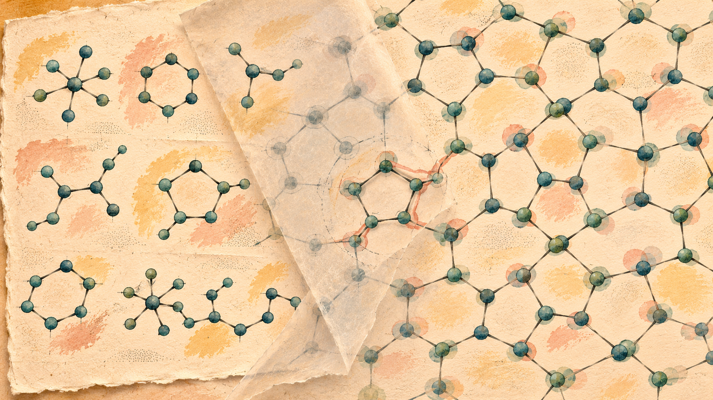
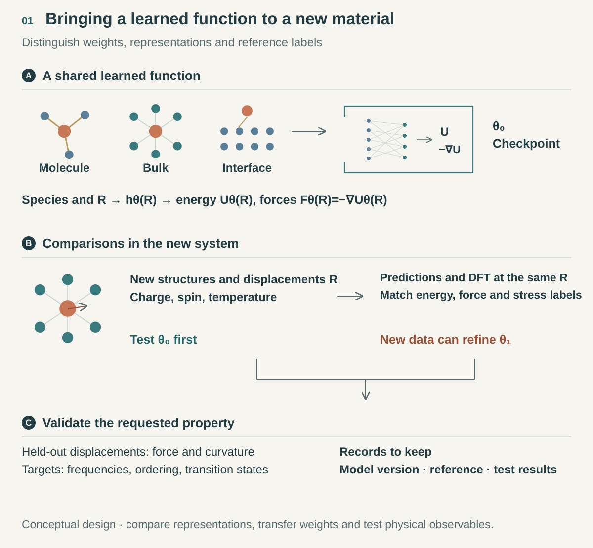
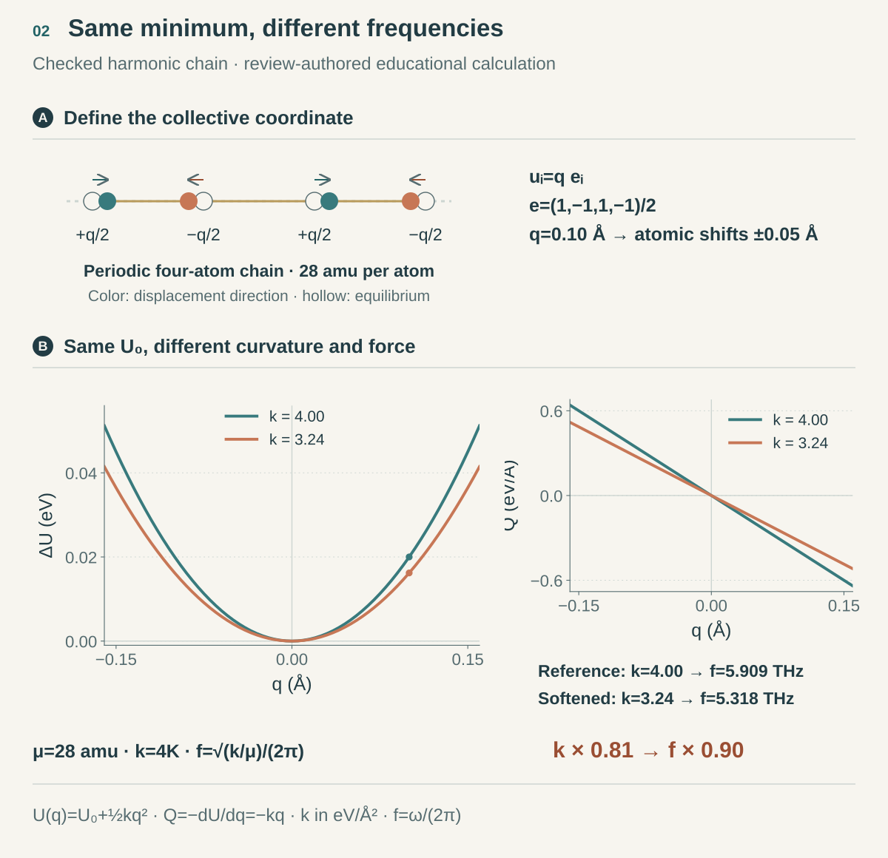
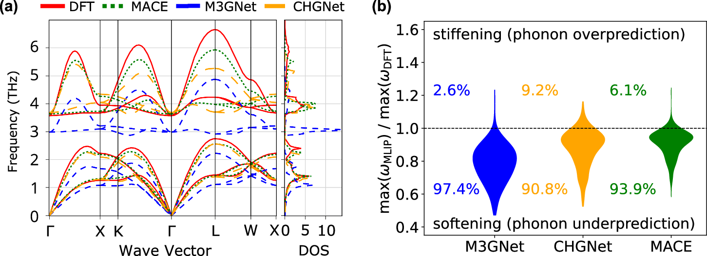
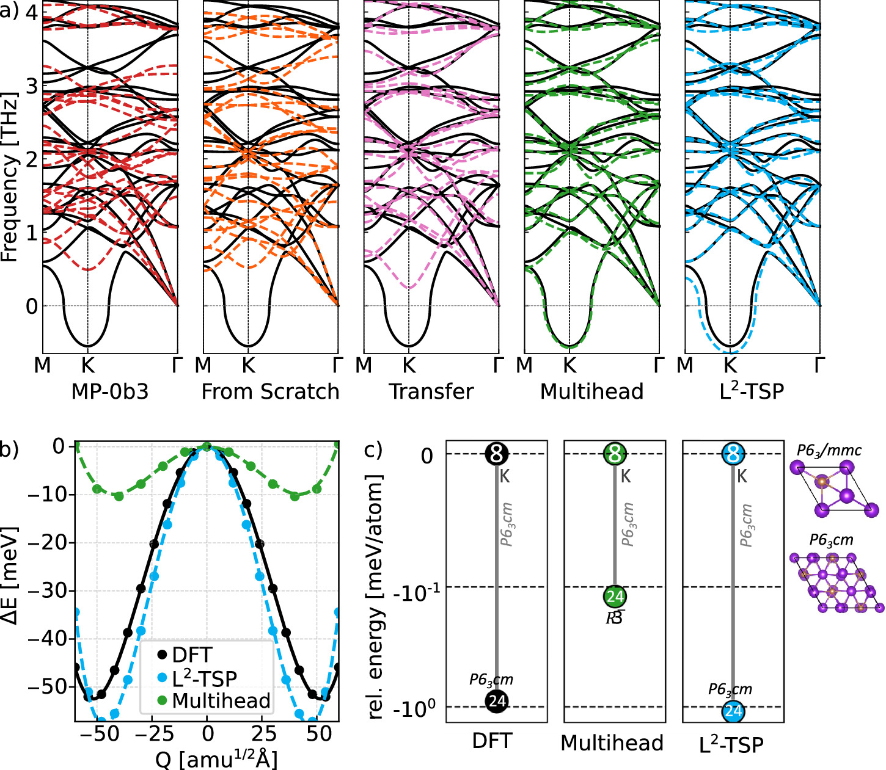
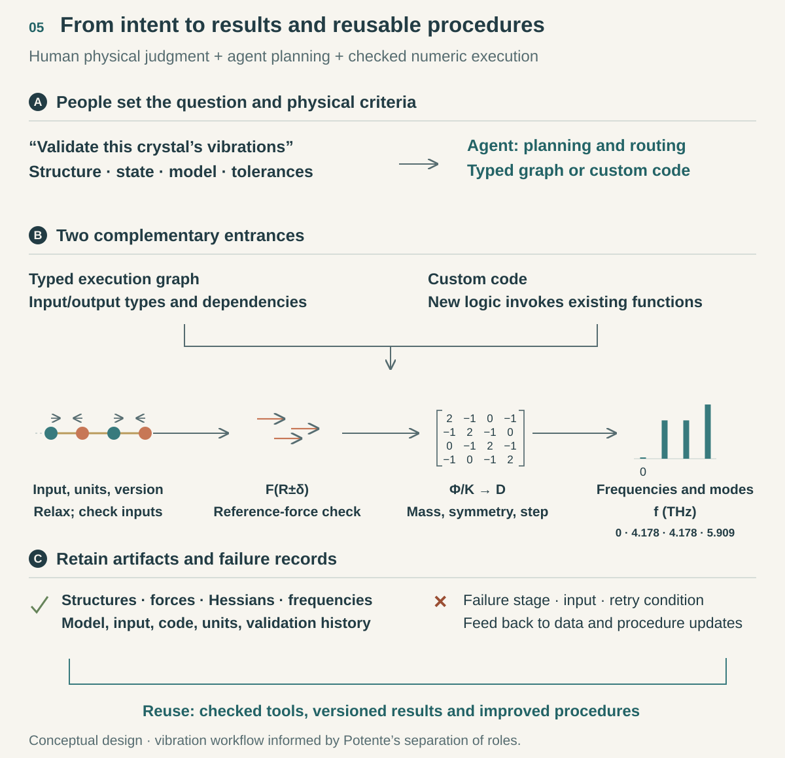

# Sharing Atomic Energy Functions

**A research workflow for applying pretrained potentials to new materials and reusing validated calculations**

Downloading an interatomic potential trained on many materials lets calculations on a new crystal begin. Predicting how that crystal vibrates or which structure it may become requires examining where the learned energy function is reliable. Starting with a small vibration calculation, we follow recent fine-tuning studies and agentic simulations to explore how reuse extends from model weights to validated computational procedures.

<figure class="hero"><figcaption>Records of diverse atomic neighbourhoods are overlaid on a new crystal pattern and adjusted. AI-generated conceptual illustration connecting the reuse of learned interactions with physical-property calculations.</figcaption></figure>

A researcher wants to calculate the vibrations of a new crystal. They prepare an atomic structure and load a trained model to obtain energies and forces. Moving the atoms slightly and calculating again reveals how the restoring forces change, allowing vibration frequencies to be determined. Replacing repeated electronic-structure calculations with a fast model creates room to examine more structures and longer periods of change.

Faster calculations make the next questions more specific. Which atomic environments in this crystal does the downloaded model know? If it predicts the equilibrium energy accurately, does it also predict the forces when atoms move? The answers affect thermal properties and structural transformations. A shared model developed by another team now enters a research process that previously involved generating reference data, training a potential and calculating properties.

This change is central to recent discussions of foundation interatomic potentials spanning molecules and materials.[1] Models such as MACE-MP-0 demonstrate an approach in which broad pretraining is followed by application to a new system or adaptation using additional data.[2] Alongside atomic structures and calculation settings, researchers must now consider the version and domain of an already learned function.

AI agents are also entering this process, translating research intentions into computational steps. Tools for choosing models and calculating forces can be assembled in new combinations. Following one crystal-vibration calculation to its end shows what can be shared and which judgments must be made afresh, in both physics and software.

## Starting from a learned function

A machine-learning interatomic potential (MLIP) estimates an energy U from atomic species and positions. In models that derive forces from energy, the force is the negative gradient with respect to atomic coordinates, Fᵢ=−∂U/∂Rᵢ. Reference electronic-structure calculations provide total energies for given atomic configurations; the model approximates this relationship with a function that can be evaluated rapidly.

<figure id="fig-1"><picture><source media="(max-width: 760px)" srcset="../artifacts/figures/fig1_mobile_en.svg"></picture><figcaption>Figure 1. Reusing learned interactions in a new system. Weights, representations and reference-calculation standards are distinguished, while application of the selected version and adaptation with additional data are checked through independent property tests. Conceptual diagram for this review.[2,3]</figcaption></figure>

Many MLIPs represent the neighbourhood of each atom and combine this information into a total energy. Distances, angles and combinations of chemical species provide the ingredients of the representation. Similar neighbourhoods occur in different crystals, allowing relationships learned from broad datasets to be used in new structures. What is reused is a set of learned parameters, or weights, together with the model architecture that interprets them.[2]

Figure 1 connects this relationship to a calculation on a new crystal. It separates direct application of a model, adaptation using additional reference calculations and the data used to test the result. Even for the same atomic positions, changing charge, spin, electronic-structure approximations or the energy reference can change the relationship to be learned. Choosing the density functional theory (DFT) exchange-correlation approximation, corrections and calculation settings appropriate to the new material gives the comparison a clear meaning.

Researchers are also comparing representations learned by different models. Li and Walsh expressed the internal atomic-environment representations of seven MLIPs through their similarities to the same reference atomic environments.[3] Each model has internal coordinates with different dimensions and orientations, so shared atomic environments provide anchors for comparison. In this construction, the MACE family showed similar global organization while differing in how nearby environments were distinguished locally.

This result offers a way to examine what broad pretraining has learned. Researchers can test whether operations combining representations of reactions or materials remain meaningful across models, and identify environments where representations diverge. The vibration frequencies we seek require a further step: converting the representation into energies and forces. We can follow the derivatives and property calculations for the same crystal.

## The same energy minimum can give different vibration frequencies

Consider a vibration in which the atoms of a crystal move together by small amounts. A vibration mode specifies the direction and relative displacement of each atom. If q describes how far the atoms move along that mode, the energy near equilibrium can be written as

U(q) ≈ U₀ + ½kq² Q = −dU/dq = −kq, &nbsp; ω = √(k/μ)

Here q has units of length, k is the force constant describing the curvature of the energy curve, and μ is the mode's effective mass. Q is the generalized force obtained by projecting the atomic forces onto the mode. The angular frequency is ω; the number of cycles per second is f=ω/(2π). Even when the energy minimum occurs at the same position, different curvature produces different restoring forces and frequencies.

The teaching calculation in Figure 2 uses four identical atoms connected to their neighbours by springs in a periodic chain. The last atom is connected back to the first. Each atom has mass 28 amu and each spring has stiffness K=1 eV/Ų. For the alternating mode, neighbouring atoms move in opposite directions with displacements (+q/2,−q/2,+q/2,−q/2). The effective mass is then 28 amu and the mode force constant is k=4K. The atomic mass unit is abbreviated amu, and one ångström (Å) is 10⁻¹⁰ m.

At q=0.1 Å, each atom moves 0.05 Å and the energy rises 0.020 eV above its minimum. A second model with spring stiffness reduced to 0.81K has the same equilibrium structure and minimum energy, but its energy at this displacement rises by 0.0162 eV. The shallower energy curve lowers the frequency from about 5.909 THz to 5.318 THz, exactly a factor of 0.9. One terahertz is 10¹² cycles per second.

<figure id="fig-2"><picture><source media="(max-width: 760px)" srcset="../artifacts/figures/fig2_mobile_en.svg"></picture><figcaption>Figure 2. The depth and curvature of an energy function provide different information. The periodic chain's alternating mode defines q and the atomic displacements, allowing energies, forces and frequencies for K and 0.81K to be calculated directly. Classical harmonic teaching calculation for this review, distinguished from results for a particular material or MLIP in the cited studies.</figcaption></figure>

The validation illustrated by this calculation is also needed for real potentials. Deng and colleagues compared M3GNet, CHGNet and MACE-MP-0 to investigate systematic softening as atoms move from equilibrium.[4] They compared vibrations in 229 non-magnetic materials without Hubbard-U corrections against PBEsol DFT reference data.

Figure 3(a) shows one example, CsF. The horizontal axis follows wave-vector points describing the vibration's spatial repetition in the crystal; the vertical axis gives frequency. Compare the red DFT curves with the models' dashed and dotted curves: the overall dispersion shapes are similar, yet many branches move downward. The high-frequency branches of M3GNet, in blue, show a particularly large difference. Panel (b) asks how widespread this behavior is. For each material, the ratio of the model's maximum frequency to DFT's maximum frequency is below one when the model underpredicts it. All three models produced ratios below one in more than 90% of the 229 materials. The curvature comparison in Figure 2 thus leads to a concrete test of real models.[4]

<figure id="fig-3" class="source-result"><figcaption>Figure 3. Vibrational softening observed in real models. (a) Phonon dispersion and density of states (DOS) for CsF (mp-1784); (b) distributions of maximum-frequency ratios across 229 materials. The fractions of materials below the dashed reference at one are 97.4% for M3GNet, 90.8% for CHGNet and 93.9% for MACE-MP-0. PBEsol DFT comparison for non-magnetic materials without Hubbard-U corrections; non-analytical corrections excluded. Source: Deng et al.[4], <a href="https://www.nature.com/articles/s41524-024-01500-6/figures/4">Fig. 4</a>. © The Author(s) 2025. Reproduced in full, without modification, under <a href="https://creativecommons.org/licenses/by/4.0/">CC BY 4.0</a>.</figcaption></figure>

The paper's phonon comparison excluded non-analytical corrections arising from long-range electric fields. In long-wavelength vibrations of a polar crystal, the electric field produced by atomic displacements also contributes to the frequencies. Research in this regime requires deciding how to include that contribution in the model and property calculation. These conditions help specify which observables and atomic environments should be tested again.

When using a new potential for vibrations, researchers examine displacement-dependent forces, force constants and mode frequencies alongside energy errors. They also vary the displacement used for numerical differentiation. Very small displacements can expose numerical noise, while large ones introduce anharmonicity into the force constants. Comparisons at the same structure, masses and convergence settings help determine whether a curvature difference comes from the model or the computational procedure.

## From small vibrations to structural transformations

What happens when atoms move farther? A function that has learned the curvature near equilibrium can also be tested on a transformation pathway and its final crystal phase. A recent study by Grandel, Benner and George makes this question concrete by comparing fine-tuning methods.[5]

The researchers selected 53 materials, mainly phase-change materials and chalcogenides, and fine-tuned MACE-MP-0b3 with ten structures per material. They compared a method called L²-TSP, which constrains changes away from pretrained weights while adapting selected representation-building layers. With large-supercell training data, the median phonon-frequency mean absolute error across materials fell from 0.27 THz for the foundation model to 0.05 THz.[5]

Their K₃Sb example shows the next physical question. In Figure 4(a), black curves give DFT results; colored dashed curves show the foundation model and different training approaches. Branches drawn below zero near the K point mark imaginary frequencies of unstable modes. The energy curvature is negative in this direction, allowing a small displacement to grow. The two rightmost methods, multihead and L²-TSP, capture this instability, but the energy scans in panel (b) reveal different well depths and positions. L²-TSP also makes the wells deeper than DFT, while multihead makes them much shallower. The original horizontal-axis symbol Q denotes a mass-weighted displacement coordinate, in √amu·Å. Its definition differs from the teaching model's length q, in Å, and generalized force Q, in eV/Å.[5]

Figure 4(c) follows the atoms to the structure reached after relaxation. L²-TSP reaches the P6₃cm structure found by DFT, while multihead reaches R−3. The numbers 8 and 24 inside the circles count atoms in each phase's primitive unit cell. Comparing final phases reveals a difference that would be missed by stopping at the successful identification of the K-point instability.[5]

<figure id="fig-4" class="source-result"><figcaption>Figure 4. Validation from small vibrations to the final crystal phase. (a) Part of the K₃Sb phonon dispersion; (b) anharmonic energy along the mass-weighted displacement Q of the unstable K mode; (c) relaxed phases and relative energies. Energy units are meV in (b) and meV/atom in (c). Numbers inside circles count atoms in primitive unit cells. Structures at right show the initial phase and DFT reference final phase. Source: Grandel, Benner and George[5], <a href="https://www.nature.com/articles/s41524-026-02338-w/figures/4">Fig. 4</a>. © The Author(s) 2026. Reproduced in full, without modification, under <a href="https://creativecommons.org/licenses/by/4.0/">CC BY 4.0</a>.</figcaption></figure>

Curvature, displacement pathways and final structures therefore provide distinct validation targets. In this study, the F1 score for recovering new phases changed from 0.63 for the foundation model to 0.66 for L²-TSP. F1 combines the fraction of predicted phases that are correct with the fraction of reference phases recovered. The large improvement in small-vibration errors and the change in phase recovery had different magnitudes. Phase recovery was tested over the unstable modes and reciprocal-space wave-vector points accessible to the DFT reference calculations.[5]

The energy ordering of the structures found must also be checked. Tahmasbi and colleagues compared equilibrium properties and searches for energy minima in elemental systems.[6] They separately evaluated how efficiently known structures were found and how accurately pairs of structures were ordered in relative energy. For very small energy differences, uncertainty in the reference calculation matters too; their ordering metric excluded pairs differing by less than 5 meV/atom in DFT.

The quantities to validate grow with the prediction being sought. Vibrations require forces and curvature near the initial position; structural transitions require pathways and final relaxed phases; stability requires the energy order of competing structures. Selecting a broadly pretrained function goes together with choosing the tests needed for a particular research question.

## Choosing atomic configurations for new reference calculations

The missing data for a new system need not all be generated in advance. Reference calculations can be added for configurations actually visited in a simulation, updating the model as it proceeds. Rensmeyer and colleagues studied this on-the-fly fine-tuning using Bayesian neural networks to estimate predictive uncertainty.[7,8]

The procedure is explicit. The current models predict the energy of a new configuration. If the calibrated error distribution assigns more than 5% probability to an energy error exceeding a chosen threshold, the workflow calls DFT. It adds the reference result to the training data and samples models again from the updated probability distribution over weights, the posterior distribution. Calibrating the relationship between uncertainty and actual error is part of this decision.[8]

The public LaMnO₃ example used a 40-atom supercell in a 150 ps simulation that started at 300 K, heated to 800 K and then cooled again. Its reference was PBE+U with U=3.9 eV on Mn, and the first configuration's DFT value aligned the energy zero. The updated model recovered the three distinct Mn–O bond lengths at low temperature and the structural changes during heating and cooling.[8] This structure involves a Jahn–Teller distortion linked to the electronic state. Orbital occupation and the surrounding atomic arrangement affect one another, so researchers must specify which state their reference electronic-structure calculation describes.

To examine the loop, the researchers recalculated 1,800 configurations with DFT and compared actual errors with predicted uncertainties. Some configurations retained large errors despite low predicted uncertainty.[8] While selected new data are being learned, forces, energies and the requested properties must therefore also be tested on configurations kept separately. Checking whether rare transition configurations enter the test, and whether previously well-described regions remain accurate after updating, helps decide where the next reference calculations should be spent.

Expertise appears in these choices: the charge, spin, temperature and states to investigate; the DFT reference; and the acceptable error in a frequency or phase-stability result. An agent can assemble data and calculations and compose their execution according to those standards.

## Turning a research intention into an executable calculation

Return to the initial request: “calculate this crystal's vibrations and thermal properties.” Execution requires checking the elements, units, periodic boundaries and model version. The structure is relaxed, atoms are displaced slightly and forces are calculated. Their changes form the force-constant matrix. Including masses gives a dynamical matrix whose eigenvalues determine frequencies; imaginary modes and convergence failures must also be recorded.

<figure id="fig-5"><picture><source media="(max-width: 760px)" srcset="../artifacts/figures/fig5_mobile_en.svg"></picture><figcaption>Figure 5. A procedure that can be assembled again for the same vibration calculation. One concrete example connects inputs, units and model versions with numerical execution, checks and preservation of results and failures. The Φ/K matrix and the four mode-frequency bars use the teaching chain from Figure 2. Generalized design for this review inspired by Potente's two execution modes, distinguished from both our harmonic teaching calculation and execution of the source system.[9]</figcaption></figure>

For displacement along one direction, the force-constant matrix is Φᵢⱼ=−∂Fᵢ/∂uⱼ. It measures how the force on atom i changes when atom j moves. The eigenvalues of the mass-weighted dynamical matrix Dᵢⱼ=Φᵢⱼ/√(mᵢmⱼ) are ω². The chain in Figure 2 also has a zero-frequency mode in which all four atoms translate together without changing their separations. Units, masses and symmetry must be preserved for the modes to retain their physical meaning.

Figure 5 is a generalized design for turning this request into a calculation. Standard procedures use an execution graph with explicit input and output types. New procedures can use customized code that invokes already validated numerical functions. For example, “forces” must be an array with three components per atom and specified units before it passes to the next step. A structure-file path alone cannot preserve which model and boundary conditions produced those forces.

El Agente Potente studies this division of work in agentic atomistic simulation.[9] An LLM interprets objectives, plans procedures and routes work, while Python numerical tools perform the scientific calculations. Typed execution graphs coexist with a coding mode that uses existing functions to construct customized procedures. The design connects reliable repetition of established calculations with the flexibility to assemble procedures for new research.

The authors calculated elastic properties and harmonic heat capacities for 500 Materials Project structures using the same MACE-OMAT model and settings. Agentic execution and manually written scripts were each run five times to compare their numerical consistency.[9] The comparison asks whether values are preserved when the same physical model is executed through the same procedure. Applying such an execution comparison to models and procedures already tested against DFT frequencies and phases would allow both physical accuracy and execution reproducibility to be examined.

Failures provide another useful example. One YbZn₂P₂ structure occasionally failed near a boundary of Niggli reduction, a procedure for standardizing a unit cell. Potente retained a typed failure and continued the other calculations.[9] When structures without results remain visible in the record, researchers can identify which inputs and steps need inspection. The next execution reuses the history of failure as well as successful values.

## A broader unit of shared research

Scientific software such as ASE has developed common interfaces connecting atomic structures and calculators.[10] AiiDA has built workflow machinery for dependencies, execution states and provenance.[11] Functions that accept natural-language objectives and change tool combinations are being added on this foundation. Linking pretrained models, scientific tools and execution records can reduce repeated preparation for the next question.

The records to preserve become specific: atomic structures and model checkpoints; training and reference-calculation standards; units and convergence settings; successful results and reasons for failure. Models with the same name can produce different calculations when versions or settings differ. When a new structure's vibrations are calculated, those records must be available to interpret the effect of changing only the relevant parts.

| What to examine | What to retain for the crystal-vibration example | What the next calculation can establish |
|---|---|---|
| Physical reference | Structure, charge, electronic state, DFT approximation and convergence settings | Whether the same physical problem is being calculated |
| Model application | Checkpoint, added configurations, fine-tuning settings, independent force and frequency tests | Whether to use the model directly and which environments need more reference data |
| Execution procedure | Versions, units and checks for displacement, force constants, masses and eigenvalue calculations | Whether a changed result arose from the model or its execution |
| Results and failures | Frequencies, imaginary modes, relaxed states and failed stages | Where to restart and what to check in the next attempt |
| Total cost | Reference calculations, training, production calculations, retries, validation and agent calls | Which reuse gives an answer of the same quality at lower cost |

Costs can be compared at this level too. Match the target property accuracy before comparing training from scratch with adapting a foundation model, then count the resources spent on additional DFT, training, repetitions and validation. Agent token costs cover planning and tool calls within that broader calculation. Evaluating electricity use and carbon emissions requires combining these records with device, operating-time and power measurements.

If an imaginary mode appears in the next crystal, a researcher can calculate additional configurations displaced along that direction, then repeat the same relaxation and phase-recovery tests. Previously tested models and force calculations, displacement sizes and convergence settings provide a starting point for changing the relevant parts. The retained history of successes and failures helps decide where new electronic-structure calculations are needed and which results should be checked again.

## References

[1] T. W. Ko, V. Bernales, and A. Aspuru-Guzik, Foundational potentials for molecules and materials: A game changer in atomistic simulations?, [AI for Science (2026)](https://doi.org/10.1088/3050-287X/aec468).

[2] I. Batatia et al., A foundation model for atomistic materials chemistry, [J. Chem. Phys. **163**, 184110 (2025)](https://doi.org/10.1063/5.0297006).

[3] Z. Li and A. Walsh, Platonic representation of foundation machine learning interatomic potentials, [Nat. Mach. Intell. **8**, 830 (2026)](https://doi.org/10.1038/s42256-026-01235-7).

[4] B. Deng, Y. Choi, P. Zhong, J. Riebesell, S. Anand, Z. Li, K. Jun, K. A. Persson, and G. Ceder, Systematic softening in universal machine learning interatomic potentials, [npj Comput. Mater. **11**, 9 (2025)](https://doi.org/10.1038/s41524-024-01500-6).

[5] J. Grandel, P. Benner, and J. George, Targeted fine-tuning of machine-learning interatomic potentials for phonons and phase transitions, [npj Comput. Mater. **12**, 354 (2026)](https://doi.org/10.1038/s41524-026-02338-w).

[6] H. Tahmasbi, A. Knüpfer, T. D. Kühne, and H. Mirhosseini, Benchmarking universal machine learning interatomic potentials on elemental systems, [npj Comput. Mater. **12**, 251 (2026)](https://doi.org/10.1038/s41524-026-02251-2).

[7] T. Rensmeyer, D. Kramer, and O. Niggemann, On-the-fly fine-tuning of foundational neural network potentials: A Bayesian neural network approach, [Digital Discovery **5**, 1845 (2026)](https://doi.org/10.1039/D5DD00392J).

[8] T. Rensmeyer, D. Kramer, and O. Niggemann, On-the-fly fine-tuning of foundational neural network potentials: A Bayesian neural network approach, [arXiv:2507.13805v1](https://arxiv.org/abs/2507.13805v1) (2025).

[9] T. W. Ko, J. Bai, T. Swanick, Y. Kang, C. Choi, A. Q. Jiang, A. Yin, V. Bernales, and A. Aspuru-Guzik, El Agente Potente: High-throughput agentic atomistic simulations, [arXiv:2609.14840v1](https://arxiv.org/abs/2609.14840v1) (2026).

[10] A. H. Larsen et al., The atomic simulation environment—a Python library for working with atoms, [J. Phys.: Condens. Matter **29**, 273002 (2017)](https://doi.org/10.1088/1361-648X/aa680e).

[11] M. Uhrin, S. P. Huber, J. Yu, N. Marzari, and G. Pizzi, Workflows in AiiDA: Engineering a high-throughput, event-based engine for robust and modular computational workflows, [Comput. Mater. Sci. **187**, 110086 (2021)](https://doi.org/10.1016/j.commatsci.2020.110086).
