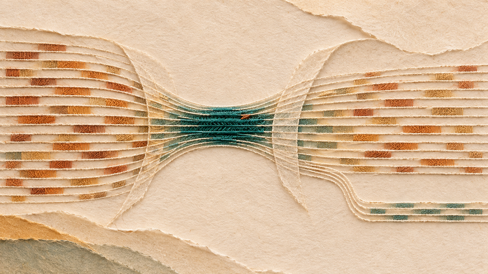
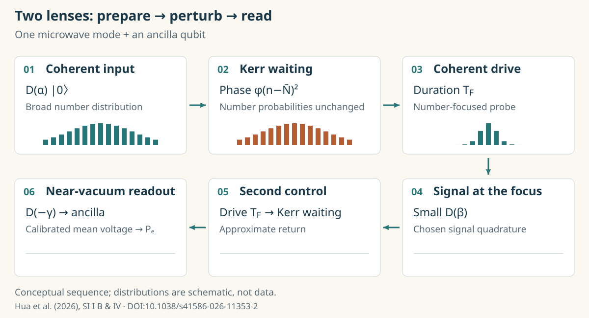
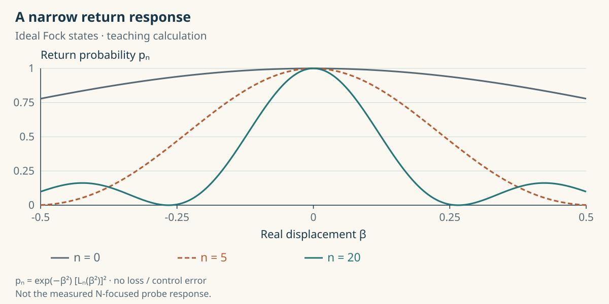
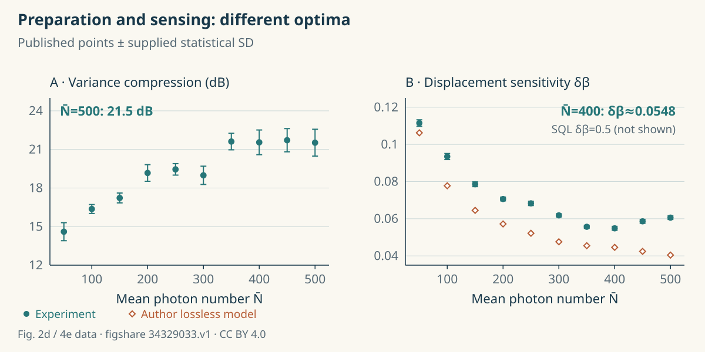

# Focusing Photon Number to Read a Small Displacement

*Two Fock-space lenses connect state preparation with quantum sensing*

<figure class="hero"><figcaption>An AI-generated conceptual illustration uses textile bands to represent quantum amplitudes across photon number. It brings the central focus and the subsequent readout path into the same scene. It does not depict actual photon trajectories, the cavity structure or measured data. Figures 1–3 provide the scientific diagrams and data separately.</figcaption></figure>

A weak signal applied to a microwave cavity slightly changes the amplitude and phase of the oscillation stored inside it. How precisely we can read that change depends both on the quantum state prepared before the signal arrives and on what we measure afterwards. Sensitivity to a small perturbation becomes useful in a sensor when the detector can resolve the difference it leaves behind.

Ziyue Hua and colleagues connected **preparation that concentrates a photon-number distribution with readout that maps displacement information into an accessible state**. They prepared nonclassical states containing up to 500 photons on average in a superconducting cavity. At a mean photon number of 400, they reported a displacement-sensing gain of 19.20±0.20 dB relative to a coherent-state reference. The first number describes the size of a prepared state; the second describes the precision with which a small displacement along a particular direction can be read.[1]

Two lenses in Fock space connect these results in a confocal arrangement, sharing one focal point. The first reduces photon-number uncertainty. After the signal changes the state, the second turns its imprint into a measurement signal near the vacuum. These lenses are controls applied to a quantum state in the cavity.

## Using photon number as a coordinate

The many photons in this experiment occupy one microwave storage mode. They are not 500 individually controlled qubits. We can expand the state of this mode in Fock states |n〉, each with an exact photon number n. A complex amplitude cn accompanies each component.

|ψ〉 = Σn cn|n〉, &nbsp; Pn = |cn|²

Pn is the probability of obtaining n when photon number is measured. The magnitude of cn determines this probability; its phase helps determine interference with other components. **Fock space** represents the state in these photon-number components. Plotting n along a horizontal axis lets us inspect their amplitudes and phases. That axis does not show where photons sit inside the cavity.

The experiment starts with an easily prepared coherent state |α〉. Applying a displacement D(α) to the vacuum gives a mean photon number N̄=|α|². Its Poisson distribution has photon-number variance N̄ as well. At N̄=500, the standard deviation is therefore about √500=22.4 photons. The distribution broadens as its mean increases. The researchers concentrated this broad distribution into a few photon-number components around the mean.[1,2]

The resulting state is not an exact |500〉 with only one photon number present. It is an **N-focused state**, retaining neighbouring photon-number components. A narrow photon-number histogram alone also cannot establish quantum coherence between those components. For sensing, what matters is how their amplitudes retain relative phases and respond to a small signal.

## Curving the phase, then focusing the distribution

Fock-space optics begins with two different operations: one changes the phase of each photon-number component, while the other redistributes amplitude between components. Earlier work by Yifang Xu and colleagues combined these operations to implement lens-like behaviour and manipulate quantum states containing up to 180 photons.[2]

The first operation is a wait under **Kerr nonlinearity**. Because the cavity energy depends quadratically on photon number, each component accumulates a phase proportional to φ(n−N̄)². Components acquire different phases according to their distance from the mean. This operation alone leaves Pn unchanged.

A weak coherent drive follows. Writing the creation and annihilation operators as a† and a, its Hamiltonian has the form ℏε(a+a†). The drive couples neighbouring components |n〉 and |n+1〉. Although the coupling strength is proportional to √(n+1), it can be approximated as nearly constant across a relatively narrow region around a large N̄. Interference between amplitudes carrying the curved phase then narrows the photon-number distribution. As a lens combines wavefront curvature with propagation, **the phase operation and the subsequent drive produce the focus together**.[1,2]

<figure><picture><source media="(max-width:760px)" srcset="../artifacts/figures/fig1_mobile_en.svg"></picture><figcaption><strong>Figure 1. Two lenses connect preparation with readout.</strong> The first half proceeds through a Kerr phase wait followed by a drive; after the signal, the second half applies a drive followed by a Kerr phase wait. The final D(−γ) is calibrated to move the output near the vacuum. The distributions are conceptual representations of these relationships, not measured probabilities or exact relative durations. Constructed for this review from Hua et al., published Supplementary Information, Sec. I B, Eqs. S10–S29, and Sec. IV. DOI:10.1038/s41586-026-11353-2.</figcaption></figure>

The new study extends this focusing sequence through to readout. After a small signal displacement D(β) is applied at the focus, the drive continues and a second Kerr wait follows. In the idealized account, Kerr evolution with the same sign cancels the phase curvature that has reversed during the drive. The output approaches a coherent state again, and a final displacement places it near the vacuum |0〉. A signal changes the size of the final vacuum component.[1]

Implementing this return without reversing the sign of the entire Hamiltonian is useful. The operation applies to the relevant family of states within the large-photon-number, narrow-distribution approximation. The ideal two-lens transformation also includes a reflection of the distribution, making symmetry important. It does not implement a perfect inverse of the first operation for every possible cavity state.

This approach belongs to a broader idea: **interaction-based readout**. In 2016, Emily Davis, Gregory Bentsen and Monika Schleier-Smith proposed using a further interaction to amplify a small phase change encoded in a non-Gaussian collective-spin state, allowing it to be read without precisely resolving individual particles. Their protocol reverses the sign of the interaction. The Fock lenses use a different implementation, but address the same problem of moving information from a complex state into an observable that is easier to detect.[3]

## A steep response to a small displacement

The displacement β is a dimensionless amplitude describing a shift in the phase-space coordinates of the cavity oscillation. Once a direction along one of its two quadratures is chosen, β can be treated as real. The maximum gain in this experiment was obtained with the signal direction aligned to the prepared state.

An ideal Fock state gives a first view of why a nonclassical state can be sensitive to a small displacement. After applying D(β) to |n〉, the probability of returning to the original state is given below. Ln is the Laguerre polynomial of order n.

pn(β) = |〈n|D(β)|n〉|² = e−β²[Ln(β²)]² &nbsp; (β ∈ ℝ)

As n increases, the return probability changes over a narrower interval around the origin. Placing the operating point on a sufficiently steep part of the response turns a small displacement change into a larger probability difference. The expression has the same value at +β and −β, so a single probability cannot determine the displacement's sign. Estimation concerns a small change around a known bias. Figure 2 illustrates this relationship with an educational calculation. The actual focused state contains several |n〉 components, and the return through the two lenses is approximate, so these curves cannot substitute for the experimental response.[1,4]

<figure><picture><source media="(max-width:760px)" srcset="../artifacts/figures/fig2_mobile_en.svg"></picture><figcaption><strong>Figure 2. The narrowing return response of larger Fock states.</strong> Educational calculation for this review using the expression above for ideal |n〉 states. There is no loss or control error, and n=0,5,20 were selected for illustration. Both β and probability are dimensionless. The response is symmetric between +β and −β and contains multiple lobes, so it is not a global detector of displacement sign. The displacement convention follows Hua et al. and Deng et al.; these are neither measured N-focused-state responses nor reconstructions of the paper's lossless model. The expression was cross-checked against an independent matrix-exponential calculation.[1,4]</figcaption></figure>

In the experiment, a vacuum-selective operation on an auxiliary transmon read out the final vacuum component. According to the Supplementary Information, the apparatus had no Josephson parametric amplifier for single-shot readout. Instead, the researchers **calibrated the mean voltage from repeated measurements to estimate the auxiliary qubit's excitation probability**. They alternated signal and background acquisition, took the difference, normalized it by a reference voltage, and fitted the resulting Pe(β) with a Gaussian. The slope of this response supplied the classical Fisher information available in the measurement.[1]

I(β) = [∂Pe(β)/∂β]² / {Pe(β)[1−Pe(β)]}, &nbsp; δβ = 1/√I

Fisher information I quantifies how distinguishably a small change in displacement alters the measurement probabilities. A steep slope is only part of the expression; statistical fluctuations in the probability enter as well. Here δβ is the normalized, per-probe sensitivity metric used by the paper. For M independent repetitions, the local estimation-variance bound contains 1/(MI). The error of an actual estimator and the acquisition time require further information. The result should therefore not be read as an implemented single-shot binary measurement or a sensitivity per unit time.

## Focusing 500 photons, reaching the best sensitivity at 400

The published source data let us compare two results from mean photon numbers of 50 to 500. For state preparation, the metric is **the reduction in photon-number variance relative to a coherent state with the same mean**. The reported 21.5±1.1 dB at N̄=500 corresponds to a variance ratio of about 142. In standard-deviation terms, the scale narrows from roughly 22.4 photons to 1.9 photons. This arithmetic comparison explains the distinction between variance and standard deviation.[1,5]

For sensing, the metric is the displacement uncertainty δβ. Under this paper's convention for displacement along one quadrature, the coherent-state standard quantum limit (SQL) is I=4 and δβ=0.5. The source data at N̄=400 give δβ≈0.0548. Including uncertainty in displacement calibration, the final paper reports a gain of 19.20±0.20 dB. This is an information or variance ratio of about 83, or **a standard-deviation ratio of about 9.1**. It concerns a different quantity from the 21.5 dB photon-number variance compression.[1,5]

<figure><picture><source media="(max-width:760px)" srcset="../artifacts/figures/fig3_mobile_en.svg"></picture><figcaption><strong>Figure 3. Prepared-state size and the best sensing condition.</strong> Replotted from the source data for Hua et al., published Figs. 2d and 4e. Left: photon-number variance compression relative to a coherent state. Right: normalized displacement sensitivity δβ, for which lower values are better. Points and error bars reproduce the reported values and standard deviations in the source columns; no new fitting or curve interpolation was performed. Open diamonds on the right are the authors' lossless-model values. Experimental error bars show the table's statistical SD, whereas the 19.20±0.20 dB quoted in the text also includes a separate displacement-calibration uncertainty. Data: Z. Hua et al., DOI:10.6084/m9.figshare.34329033.v1, <a href="https://creativecommons.org/licenses/by/4.0/">CC BY 4.0</a>; Fig2_datatable.xlsx, Fig2d A2:C11, and Fig4_datatable.xlsx, Fig4e A2:D11. The original panels' layout and artwork were not used.[5]</figcaption></figure>

Photon-number variance compression remains large at high photon numbers, but experimental sensitivity worsens above 400 photons. At 500, the source data give δβ≈0.0606. Increasing photon number can make the state more sensitive, while photon loss and an imperfect return blur the sensing signal. The authors' final error analysis treats cavity photon loss and distortion in the lens circuit as major factors. The difference between the two series in the figure does not independently determine each noise contribution.[1]

Connecting preparation with readout makes this difference interpretable. A setting optimized for a narrow photon-number distribution need not be the setting that retains enough contrast and slope after sensing. **The distribution that shows what was prepared and the response that shows what can be learned must be read together.**

## What changed from earlier Fock-state sensing?

In 2024, Xiaowei Deng and colleagues prepared Fock states containing up to 100 photons in a superconducting cavity and demonstrated sensing through their parity. Parity distinguishes even photon number from odd photon number. A small displacement changes the parity probabilities, which can then be used to estimate that displacement. Their largest displacement-sensing gain, 14.8±0.2 dB, was obtained at **n=40**, separately from the 100-photon preparation result.[4]

That earlier experiment selected the desired photon-number component of a coherent input through measurement. Its sensitivity for a successfully prepared probe must be considered alongside the cost of failed preparation attempts. The two-lens protocol instead deterministically prepares a nonclassical distribution with finite width, then uses further control for readout. Both the preparation success probability and the final observable have changed.

| Study | What was demonstrated | Connection developed here |
|---|---|---|
| Davis et al., 2016 [3] | Theory of interaction-based readout in collective spins | Transfer phase information in a complex state into an accessible detection signal |
| Deng et al., 2024 [4] | Conditional Fock-state preparation and parity sensing; 14.8 dB displacement gain at n=40 | Assess sensitivity together with preparation success probability |
| Xu et al., 2026 [2] | Fock-space optics and manipulation up to 180 photons | Combine Kerr phase evolution with a drive to focus the distribution |
| Hua et al., 2026 [1] | Focused-state preparation up to a mean of 500; 19.20 dB displacement gain at a mean of 400 | Connect preparation with actual readout through the second lens |

Deng's 14.8 dB and the present 19.20 dB can be considered under the same displacement-SQL convention. A comparison matching preparation probability, repetitions, measurement time and drive energy across the experiments is not available. Deng's 12.3 dB for phase sensing estimates a different parameter, while the 19.7 dB in Xu's public author manuscript is a predicted potential gain from the prepared state. These numbers cannot form a single ranking of experimental performance.[1,2,4,6]

## Designing bosonic states and readout together

Circuit QED couples a cavity to an auxiliary qubit and uses the large state space of a bosonic mode for information storage and manipulation.[7] The direct result here is an experiment using a nonclassical state prepared in that space for displacement sensing. It does not establish an improvement in large-scale quantum computation or error correction.

The control strategy is nevertheless clear. Instead of adding photons one by one, it designs the phases across a broad amplitude distribution, then uses further interactions to read the distribution's response. The O(1) emphasized by the researchers refers to the **number of control stages**, which does not grow with photon number. It is not a claim that calibration, physical pulse durations or experimental repetitions remain constant.[1]

Developing the protocol as a sensor requires considering these costs alongside the signal conditions. Its maximum gain concerns one aligned displacement component and a local operating point. The Supplementary Information treats short signals with known arrival times, and proposes a separate procedure for finding an unknown but fixed direction. These results do not give simultaneous sensitivity to both quadratures of a signal arriving at an arbitrary time. Some comparisons of sensitivity under photon loss are also model calculations.[1]

A useful next comparison would go beyond recording another high photon number. With signal direction, repetitions and total time matched, how much of the benefit remains after accounting for preparation, return control and readout calibration? This is an editorial proposal for follow-up evaluation, not a validation completed in the paper. The two lenses make the sensitivity of a large quantum state a concrete control problem extending from preparation all the way to readout.

Versions read: the public final abstract, figure captions, Supplementary Information and source tables were checked against the public author-manuscript main text.[8] The final journal main text remained subscription-restricted and was not read. The optimum quoted here is the final 400-mean-photon result, kept separate from the February preprint’s 350-photon optimum.

## References

[1] Z. Hua, C. Ma, Y. Zhou, Y. Xu, Z.-J. Chen, W. Cai, J. Chen, L. Xiao, H. Huang, W. Wang, H. Li, H. Wang, M. Li, C.-L. Zou, and L. Sun, Quantum-enhanced sensing with 500 photons via Fock-space confocal focusing, Nature (2026), [doi:10.1038/s41586-026-11353-2](https://doi.org/10.1038/s41586-026-11353-2).

[2] Y. Xu, Y. Zhou, Z. Hua, L. Sun, J. Zhou, W. Wang, W. Cai, H. Huang, L. Xiao, G. Xue, H. Yu, M. Li, C.-L. Zou, and L. Sun, Principles of optics in Fock space for the scalable manipulation of large quantum states, Nat. Phys. **22**, 1498 (2026), [doi:10.1038/s41567-026-03370-9](https://doi.org/10.1038/s41567-026-03370-9).

[3] E. Davis, G. Bentsen, and M. Schleier-Smith, Approaching the Heisenberg limit without single-particle detection, Phys. Rev. Lett. **116**, 053601 (2016), [doi:10.1103/PhysRevLett.116.053601](https://doi.org/10.1103/PhysRevLett.116.053601).

[4] X. Deng, S. Li, Z.-J. Chen, Z. Ni, Y. Cai, J. Mai, L. Zhang, P. Zheng, H. Yu, C.-L. Zou, S. Liu, F. Yan, Y. Xu, and D. Yu, Quantum-enhanced metrology with large Fock states, Nat. Phys. **20**, 1874 (2024), [doi:10.1038/s41567-024-02619-5](https://doi.org/10.1038/s41567-024-02619-5).

[5] Z. Hua, C. Ma, Y. Zhou, Y. Xu, Z.-J. Chen, W. Cai, J. Chen, L. Xiao, H. Huang, W. Wang, H. Li, H. Wang, M. Li, C.-L. Zou, and L. Sun, Quantum-enhanced sensing with 500 photons via Fock-space confocal focusing, figshare (2026), [doi:10.6084/m9.figshare.34329033.v1](https://doi.org/10.6084/m9.figshare.34329033.v1).

[6] Y. Xu, Y. Zhou, Z. Hua, L. Sun, J. Zhou, W. Wang, W. Cai, H. Huang, L. Xiao, G. Xue, H. Yu, M. Li, C.-L. Zou, and L. Sun, Principles of optics in the Fock space: Scalable manipulation of giant quantum states, [arXiv:2601.10325v1](https://arxiv.org/abs/2601.10325v1) (2026).

[7] A. Blais, A. L. Grimsmo, S. M. Girvin, and A. Wallraff, Circuit quantum electrodynamics, Rev. Mod. Phys. **93**, 025005 (2021), [doi:10.1103/RevModPhys.93.025005](https://doi.org/10.1103/RevModPhys.93.025005).

[8] Z. Hua, C. Ma, Y. Zhou, Y. Xu, Z.-J. Chen, W. Cai, J. Chen, L. Xiao, H. Huang, W. Wang, H. Li, H. Wang, M. Li, C.-L. Zou, and L. Sun, Quantum confocal microscopy in Fock space with a 19 dB metrological gain, [arXiv:2602.23254v1](https://arxiv.org/abs/2602.23254v1) (2026).
