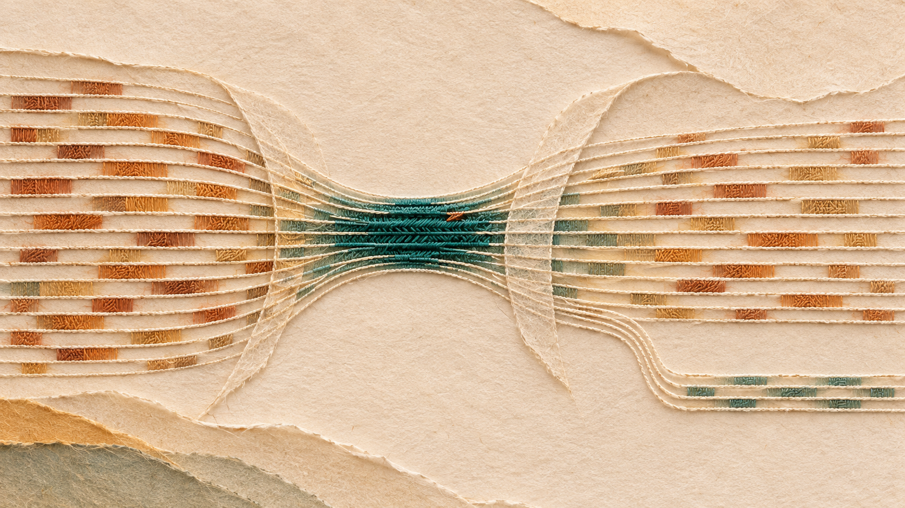
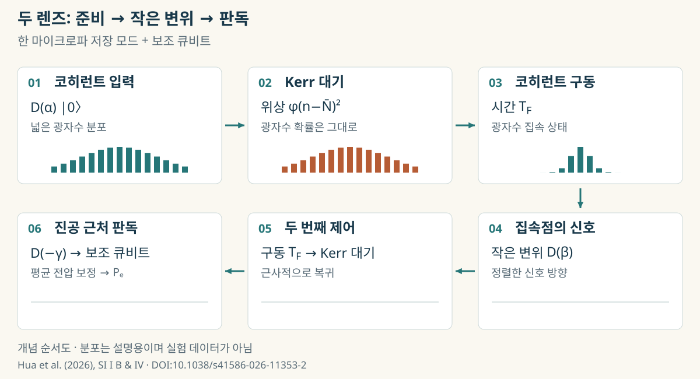
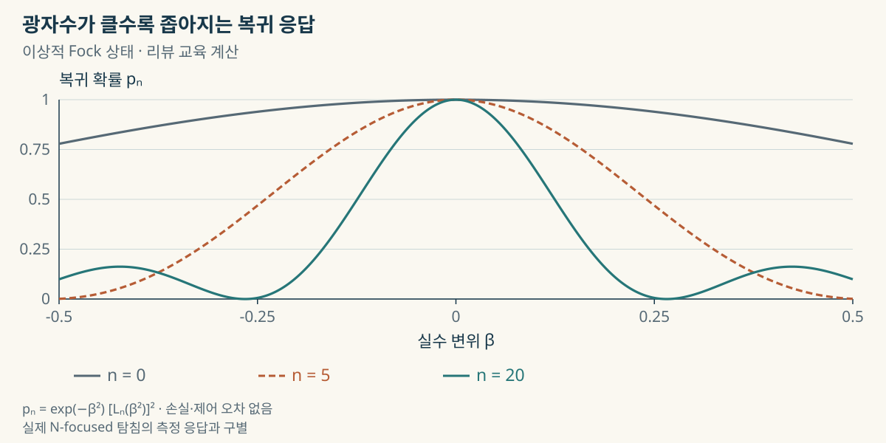
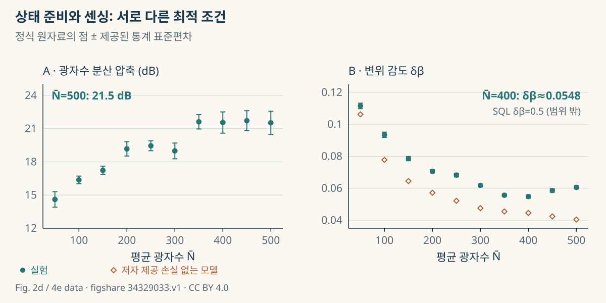

# 광자 수를 모아 작은 변위를 읽다

*Fock 공간의 두 렌즈가 연결한 상태 준비와 양자 센싱*

<figure class="hero"><figcaption>광자수에 따른 양자 진폭의 분포를 직물의 띠로 표현한 AI 생성 개념 일러스트. 가운데 집속과 뒤의 판독 경로를 함께 강조했다. 실제 광자의 이동 경로·공진기 구조·측정 데이터는 그림 1–3과 구별한다.</figcaption></figure>

마이크로파 공진기에 약한 신호를 가하면 안에 저장된 진동의 진폭과 위상이 조금 달라진다. 이 변화를 얼마나 정확하게 읽을 수 있는지는 신호를 받기 전에 만든 양자 상태와, 신호를 받은 뒤 측정하는 양에 함께 달려 있다. 상태가 작은 교란에 민감해도 그 차이가 검출기의 신호로 이어져야 정밀한 센서가 된다.

Ziyue Hua와 동료들은 **광자수 분포를 모으는 준비와, 변위 정보를 읽기 쉬운 상태로 옮기는 판독**을 하나의 제어 순서로 연결했다. 초전도 공진기에 평균 광자수 500까지의 비고전 상태를 만들었고, 평균 광자수 400에서는 코히런트 상태를 기준으로 19.20±0.20dB의 변위 센싱 이득을 보고했다. 앞의 숫자는 준비한 상태의 규모, 뒤의 숫자는 특정 방향의 작은 변위를 읽는 정밀도에 관한 결과다.[1]

이를 잇는 장치는 Fock 공간의 두 렌즈다. 두 렌즈가 하나의 집속점을 공유하는 공초점(confocal) 구성이다. 첫 렌즈가 광자수의 불확실성을 줄이고, 신호가 그 상태를 바꾼 뒤 두 번째 렌즈가 그 흔적을 진공 근처의 측정 신호로 바꾼다. 여기서 렌즈는 빛을 굴절시키는 유리 부품이 아니라 공진기의 양자 상태에 가하는 제어다.

## 한 공진기의 광자수를 좌표로 삼다

이 실험의 많은 광자는 한 마이크로파 저장 모드에 들어 있다. 서로 따로 제어하는 500개의 큐비트를 뜻하지 않는다. 이 모드의 상태를 광자수가 정확히 n인 Fock 상태 |n〉들로 펼쳐 쓰면, 각 광자수에 대응하는 복소수 진폭 cn을 얻는다.

|ψ〉 = Σn cn|n〉, &nbsp; Pn = |cn|²

Pn은 광자수를 측정했을 때 n을 얻을 확률이다. cn에는 이 확률을 정하는 크기와 다른 성분과의 간섭을 정하는 위상이 함께 들어 있다. 광자수 n을 가로 좌표로 놓고 진폭과 위상을 살펴보는 표현이 **Fock 공간**이다. 실제 공진기 안에서 광자가 놓인 위치를 그린 공간과는 다르다.

처음에는 만들기 쉬운 코히런트 상태 |α〉를 쓴다. 진공에 변위 연산 D(α)를 가해 준비하며, 평균 광자수는 N̄=|α|²이다. 광자수의 분산도 N̄인 푸아송 분포를 가지므로 N̄=500이면 표준편차가 약 √500=22.4광자다. 평균값을 늘릴수록 분포가 넓어진다. 연구진은 이 넓은 분포를 평균값 근처 몇 개의 광자수 성분에 집중시켰다.[1,2]

그 결과가 광자수 500 하나만 남은 정확한 |500〉은 아니다. 이웃한 광자수 성분을 포함하는 **N-focused 상태**, 즉 광자수 집속 상태다. 또한 좁은 광자수 히스토그램만으로 성분 사이의 양자적 결맞음까지 확인할 수는 없다. 센싱에서 중요한 것은 이 분포를 이루는 진폭들이 위상을 유지하며 작은 신호에 반응하는 방식이다.

## 위상을 휘게 한 뒤, 분포를 모은다

Fock 공간 광학의 출발점은 서로 다른 두 조작을 구별하는 데 있다. 하나는 각 광자수 성분의 위상을 바꾸고, 다른 하나는 광자수 성분들 사이의 진폭을 바꾼다. Yifang Xu와 동료들의 선행 연구는 이 조합으로 렌즈와 같은 작용을 구현하고 최대 180광자 규모에서 양자 상태를 조작했다.[2]

첫 조작은 **Kerr 비선형성**을 이용한 대기다. 공진기의 에너지가 광자수에 대해 이차적으로 달라지는 성질을 이용해, 광자수 n인 성분마다 φ(n−N̄)²에 해당하는 위상을 쌓는다. 전체 상태에 같은 위상을 붙이는 것이 아니라 평균값에서 얼마나 떨어졌는지에 따라 위상을 다르게 바꾼다. 이 조작만으로는 Pn이 변하지 않는다.

다음으로 약한 코히런트 구동을 가한다. 생성·소멸 연산자를 a†와 a라 쓰면 구동의 해밀토니안은 ℏε(a+a†) 꼴이다. 이 구동은 이웃한 |n〉과 |n+1〉 성분을 연결한다. 연결 세기는 √(n+1)에 비례하지만, 큰 N̄ 주위의 비교적 좁은 영역에서는 거의 일정하다고 근사할 수 있다. 그때 위상 곡률을 가진 진폭이 간섭하며 광자수 분포가 좁아진다. 파면의 곡률과 전파를 결합해 빛을 모으는 렌즈처럼, **위상 형성과 뒤이은 구동이 함께 집속을 만든다**.[1,2]

<figure><picture><source media="(max-width:760px)" srcset="../artifacts/figures/fig1_mobile.svg"></picture><figcaption><strong>그림 1. 준비에서 판독까지 이어지는 두 렌즈.</strong> 첫 절반은 Kerr 위상 대기→구동, 신호 뒤의 두 번째 절반은 구동→Kerr 위상 대기다. 마지막 D(−γ)는 출력을 진공 근처로 옮기도록 보정한다. 각 단계의 분포는 관계를 보이는 개념도이며 측정값·확률 곡선·정확한 시간비를 재현하지 않았다. Hua 등의 정식 보충자료 Sec. I B, Eqs. S10–S29와 Sec. IV를 바탕으로 편집부가 제작했다. DOI:10.1038/s41586-026-11353-2.</figcaption></figure>

이번 연구는 이 집속을 판독까지 이어 붙였다. 집속점에 작은 신호 변위 D(β)를 가한 다음, 구동을 더 진행하고 두 번째 Kerr 대기를 거친다. 이상화한 설명에서는 구동 도중 뒤집힌 위상 곡률을 같은 부호의 Kerr 진화가 상쇄한다. 출력은 다시 코히런트 상태에 가까워지고, 마지막 변위로 진공 |0〉 부근에 놓을 수 있다. 신호가 있으면 최종 진공 성분의 크기가 달라진다.[1]

전체 해밀토니안의 부호를 뒤집지 않고 이런 복귀를 구현한다는 점이 유용하다. 다만 이는 관련된 상태족과 큰 광자수·좁은 분포 근사에서 성립하는 동작이다. 두 렌즈의 이상적 변환에는 분포의 반사도 포함되므로 대칭성이 중요하다. 임의의 공진기 상태에 대해 첫 연산의 완벽한 역연산을 구현했다는 뜻은 아니다.

이 접근의 배경에는 **상호작용을 이용한 판독**이라는 생각이 있다. Emily Davis, Gregory Bentsen, Monika Schleier-Smith는 2016년 집단 스핀의 비가우스 상태에 담긴 작은 위상 변화를 후속 상호작용으로 증폭해, 단일 입자를 정밀하게 구별하지 않고도 읽는 이론을 제시했다. 그 프로토콜은 상호작용의 부호를 반전한다. 이번 Fock 렌즈와 구현 방식은 다르지만, 복잡한 상태의 정보를 검출하기 쉬운 관측량으로 옮긴다는 문제가 이어진다.[3]

## 작은 변위가 남기는 가파른 응답

변위 β는 공진기 진동의 위상공간 좌표를 얼마나 옮겼는지 나타내는 무차원 진폭이다. 진동의 두 직교 성분 중 한 방향을 정하면 β를 실수로 다룰 수 있다. 이번 최대 이득은 준비한 상태에 맞춰 그 신호 방향을 정렬한 조건에서 얻었다.

왜 비고전 상태가 작은 변위에 민감한지는 이상적인 Fock 상태로 먼저 볼 수 있다. |n〉에 D(β)를 가한 뒤 원래 상태로 돌아올 확률은 다음과 같다. Ln은 n차 Laguerre 다항식이다.

pn(β) = |〈n|D(β)|n〉|² = e−β²[Ln(β²)]² &nbsp; (β ∈ ℝ)

n이 커지면 원점 주위의 복귀 확률이 더 좁은 β 구간에서 변한다. 충분히 가파른 구간에 작동점을 두면 작은 변위 변화가 더 큰 확률 차이로 드러난다. 이 식은 +β와 −β에서 같은 값을 주므로 확률 하나만으로 변위의 부호를 정할 수는 없다. 알려진 바이어스 근처에서 작은 변화를 추정한다는 조건이 필요하다. 그림 2는 이 관계를 보여 주는 교육 계산이다. 실제 집속 상태는 여러 |n〉 성분을 포함하며, 두 렌즈의 복귀도 근사적이므로 이 곡선을 실험 응답으로 대체할 수는 없다.[1,4]

<figure><picture><source media="(max-width:760px)" srcset="../artifacts/figures/fig2_mobile.svg"></picture><figcaption><strong>그림 2. 큰 Fock 상태의 좁아지는 복귀 응답.</strong> 이상적 |n〉에서 위 식을 계산한 편집부 교육 도표. 손실·제어 오차가 없으며 n=0,5,20은 설명용 선택이다. β와 확률은 무차원이다. +β와 −β의 응답은 같고 곡선에는 여러 봉우리가 있으므로 전역적인 부호 판독기가 아니다. Hua·Deng 등의 변위 정의를 사용했으며, 실제 N-focused 상태의 측정 곡선이나 논문의 손실 없는 모델을 복원한 그림은 아니다. 독립 행렬지수 계산과 식을 대조했다.[1,4]</figcaption></figure>

실험에서는 최종 상태의 진공 여부를 보조 트랜스몬의 여기 확률에 매핑해 읽었다. 보충자료에 따르면 이 장치에는 단발 판독용 Josephson 파라메트릭 증폭기가 없었고, **반복 측정의 평균 전압을 보정해 보조 큐비트의 여기 확률을 추정**했다. 신호와 배경을 번갈아 취득해 차이를 구하고, 기준 전압으로 정규화한 Pe(β)를 Gaussian 함수로 맞췄다. 이 응답의 기울기에서 측정이 제공하는 고전 Fisher 정보를 계산했다.[1]

I(β) = [∂Pe(β)/∂β]² / {Pe(β)[1−Pe(β)]}, &nbsp; δβ = 1/√I

Fisher 정보 I는 같은 작은 변위 차이가 측정 확률을 얼마나 구별되게 바꾸는지 정량화한다. 기울기가 큰 것만으로 충분하지 않고 확률의 통계적 변동도 함께 들어간다. 위 δβ는 논문이 사용하는 정규화된 탐침당 감도 지표다. 독립적으로 M번 반복할 때의 국소 추정 분산 한계에는 1/(MI)가 들어가며, 실제 추정기의 오차·수집 시간까지 이 식 하나로 정해지지는 않는다. 따라서 이 결과를 이미 실행한 단발 이진 검출이나 단위시간 감도로 읽어서는 안 된다.

## 500광자의 집속과 400광자의 최고 감도

공개된 정식 원자료에서 평균 광자수 50부터 500까지의 두 결과를 나란히 볼 수 있다. 상태 준비의 지표는 같은 평균 광자수의 코히런트 상태에 비해 **광자수 분산을 얼마나 줄였는가**다. N̄=500에서 보고한 21.5±1.1dB는 분산비 약 142배에 해당한다. 표준편차로는 약 22.4광자에서 약 1.9광자로 좁아진 규모다. 이 환산은 분산과 표준편차의 차이를 설명하는 산술 대조다.[1,5]

센싱의 지표는 변위 추정에 관한 δβ다. 이 논문의 한 직교 성분 변위 정의에서 코히런트 상태의 표준양자한계(SQL)는 I=4, δβ=0.5다. N̄=400의 원자료는 δβ≈0.0548이며, 최종 논문은 변위 보정의 불확실성까지 포함해 19.20±0.20dB의 이득을 보고했다. 이는 정보 또는 분산의 비로 약 83배, **표준편차의 비로 약 9.1배**다. 광자수 분산 압축 21.5dB와는 서로 다른 양이다.[1,5]

<figure><picture><source media="(max-width:760px)" srcset="../artifacts/figures/fig3_mobile.svg"></picture><figcaption><strong>그림 3. 준비한 상태의 규모와 가장 좋은 센싱 조건.</strong> Hua 등의 정식 Fig. 2d·Fig. 4e 원자료를 재도표했다. 왼쪽은 코히런트 상태 대비 광자수 분산 압축, 오른쪽은 정규화 변위 감도 δβ로 아래쪽일수록 좋다. 점과 오차막대는 원자료 열의 보고값과 표준편차이며 새 피팅·곡선 보간을 하지 않았다. 오른쪽의 빈 마름모는 저자가 제공한 손실 없는 모델 값이다. 실험 오차막대는 표의 통계 SD이며, 본문 19.20±0.20dB에는 별도의 변위 보정 불확실성도 포함된다. Data: Z. Hua et al., DOI:10.6084/m9.figshare.34329033.v1, <a href="https://creativecommons.org/licenses/by/4.0/">CC BY 4.0</a>; Fig2_datatable.xlsx, Fig2d A2:C11 및 Fig4_datatable.xlsx, Fig4e A2:D11. 원 패널의 배치·도안은 사용하지 않았다.[5]</figcaption></figure>

광자수 분산 압축은 높은 광자수에서도 크게 유지되지만, 실험 감도는 400광자 이후 나빠진다. 원자료의 500광자 조건에서는 δβ≈0.0606이다. 광자수를 늘리며 더 민감한 상태를 만들 수 있는 이점과, 광자 손실·불완전한 복귀가 센싱 신호를 흐리는 효과가 함께 작용한다. 저자의 최종 오차 분석은 공진기 광자 손실과 렌즈 회로의 왜곡을 주요 요인으로 다룬다. 그림의 실험값과 손실 없는 모델값 사이 차이만으로 개별 잡음의 기여를 독립적으로 분해할 수는 없다.[1]

준비와 판독을 연결했기에 이 차이도 해석할 수 있다. 좁은 광자수 분포 자체를 목표로 최적화한 설정과, 신호를 받은 뒤 충분히 큰 대비와 기울기를 남기는 설정은 같지 않을 수 있다. **무엇을 준비했는지 보여 주는 분포와, 무엇을 알아낼 수 있는지 보여 주는 응답을 함께 보아야 한다.**

## 선행 Fock 센싱에서 달라진 선택

Xiaowei Deng과 동료들은 2024년 초전도 공진기에서 최대 100광자의 Fock 상태를 준비하고, 그 상태의 패리티를 이용한 센싱을 보였다. 패리티는 광자수가 짝수인지 홀수인지를 구별하는 양이다. 작은 변위로 그 확률이 바뀌는 것을 읽어 변위를 추정했다. 가장 큰 변위 센싱 이득 14.8±0.2dB는 100광자 준비 결과와 별도로 **n=40**에서 얻었다.[4]

이전 실험은 코히런트 입력에서 원하는 광자수 성분을 측정으로 골라낸다. 성공한 탐침의 감도와 함께 실패한 준비 시도의 비용도 생각해야 한다. 이번 두 렌즈는 정확한 단일 |n〉을 고르는 대신 폭이 유한한 비고전 분포를 결정론적으로 만들고, 후속 제어로 판독한다. 준비 성공률과 최종 관측량에 대한 선택이 함께 달라진 것이다.

| 연구 | 실제로 보인 것 | 이번 글에서 연결할 점 |
|---|---|---|
| Davis et al., 2016 [3] | 집단 스핀의 상호작용 판독 이론 | 복잡한 상태의 위상 정보를 검출하기 쉬운 신호로 옮긴다 |
| Deng et al., 2024 [4] | 조건부 Fock 준비·패리티 센싱; n=40에서 변위 이득 14.8dB | 감도와 준비 성공률을 함께 평가한다 |
| Xu et al., 2026 [2] | Fock 공간 광학과 최대 180광자 조작 | Kerr 위상과 구동을 결합해 분포를 모은다 |
| Hua et al., 2026 [1] | 평균 500까지 집속 상태 준비; 평균 400에서 변위 이득 19.20dB | 두 번째 렌즈로 준비와 실제 판독을 연결한다 |

Deng의 14.8dB와 이번 19.20dB는 같은 변위 SQL 정의에서 살펴볼 수 있다. 그러나 준비 확률·반복수·측정 시간·구동 에너지를 맞춘 실험 간 비교는 확보되지 않았다. 또한 Deng의 위상 센싱 12.3dB는 다른 파라미터를 추정하는 실험이며, Xu의 공개 저자판에 있는 19.7dB는 준비한 상태에서 예측한 잠재 이득이다. 이 숫자들을 하나의 실험 성능 순위에 놓을 수는 없다.[1,2,4,6]

## 상태와 판독을 함께 설계하는 보손 양자정보

공진기와 보조 큐비트를 결합한 회로 QED에서는 한 보손 모드의 큰 상태 공간을 정보 저장과 조작에 쓴다.[7] 이번 연구의 직접 성과는 그 공간에서 준비한 비고전 상태를 변위 센싱에 쓰는 실험이다. 대규모 양자계산이나 오류정정의 성능 향상을 보인 연구로 넓혀 읽을 근거는 아직 없다.

그럼에도 제어 설계의 관점은 뚜렷하다. 광자수를 하나씩 올리는 방식 대신 넓은 진폭 분포 전체의 위상을 설계하고, 그 분포를 읽을 때에도 후속 상호작용을 쓴다. 연구진이 강조한 O(1)은 이런 **제어 단계 수**가 광자수와 함께 늘지 않는다는 뜻이다. 보정 과정과 실제 펄스 시간, 실험 반복수까지 일정하다는 주장은 아니다.[1]

센서로 발전시키려면 이 일련의 비용과 신호 조건을 함께 살펴야 한다. 이번 최대 이득은 방향을 정렬한 한 성분의 변위와 국소 작동점에 관한 값이다. 보충자료는 도착 시점을 아는 짧은 신호를 다루며, 위상을 모르는 고정 방향을 찾는 별도 절차도 제안한다. 이를 임의 시점에 오는 두 성분 신호의 동시 감도로 바꿀 수는 없다. 광자 손실 아래 감도가 얼마나 유지되는지에 관한 일부 비교도 모델 계산이다.[1]

다음에 비교할 만한 결과는 높은 광자수 하나를 더 찍는 데 그치지 않는다. 같은 신호 방향·반복수·총시간에서 준비와 복귀, 판독 보정에 드는 비용을 포함하면 이 이점이 얼마나 남는지다. 이는 후속 평가에 대한 편집부 제안이며 이번 논문에서 완료한 검증은 아니다. 두 렌즈가 보여 준 성과는, 큰 양자 상태의 민감도를 준비 단계에서 판독 단계까지 이어지는 제어의 문제로 구체화했다는 데 있다.

읽은 판본: 정식 공개 초록·그림 설명·보충자료와 원자료를 공개 저자판 본문과 대조했다.[8] 정식 주본문은 구독 접근 제한으로 읽지 못했다. 이 글의 최적 센싱 수치는 정식 판본의 400광자 결과이며, 2월 저자판의 350광자 결과와 구별했다.

## 참고문헌

[1] Z. Hua, C. Ma, Y. Zhou, Y. Xu, Z.-J. Chen, W. Cai, J. Chen, L. Xiao, H. Huang, W. Wang, H. Li, H. Wang, M. Li, C.-L. Zou, and L. Sun, Quantum-enhanced sensing with 500 photons via Fock-space confocal focusing, Nature (2026), [doi:10.1038/s41586-026-11353-2](https://doi.org/10.1038/s41586-026-11353-2).

[2] Y. Xu, Y. Zhou, Z. Hua, L. Sun, J. Zhou, W. Wang, W. Cai, H. Huang, L. Xiao, G. Xue, H. Yu, M. Li, C.-L. Zou, and L. Sun, Principles of optics in Fock space for the scalable manipulation of large quantum states, Nat. Phys. **22**, 1498 (2026), [doi:10.1038/s41567-026-03370-9](https://doi.org/10.1038/s41567-026-03370-9).

[3] E. Davis, G. Bentsen, and M. Schleier-Smith, Approaching the Heisenberg limit without single-particle detection, Phys. Rev. Lett. **116**, 053601 (2016), [doi:10.1103/PhysRevLett.116.053601](https://doi.org/10.1103/PhysRevLett.116.053601).

[4] X. Deng, S. Li, Z.-J. Chen, Z. Ni, Y. Cai, J. Mai, L. Zhang, P. Zheng, H. Yu, C.-L. Zou, S. Liu, F. Yan, Y. Xu, and D. Yu, Quantum-enhanced metrology with large Fock states, Nat. Phys. **20**, 1874 (2024), [doi:10.1038/s41567-024-02619-5](https://doi.org/10.1038/s41567-024-02619-5).

[5] Z. Hua, C. Ma, Y. Zhou, Y. Xu, Z.-J. Chen, W. Cai, J. Chen, L. Xiao, H. Huang, W. Wang, H. Li, H. Wang, M. Li, C.-L. Zou, and L. Sun, Quantum-enhanced sensing with 500 photons via Fock-space confocal focusing, figshare (2026), [doi:10.6084/m9.figshare.34329033.v1](https://doi.org/10.6084/m9.figshare.34329033.v1).

[6] Y. Xu, Y. Zhou, Z. Hua, L. Sun, J. Zhou, W. Wang, W. Cai, H. Huang, L. Xiao, G. Xue, H. Yu, M. Li, C.-L. Zou, and L. Sun, Principles of optics in the Fock space: Scalable manipulation of giant quantum states, [arXiv:2601.10325v1](https://arxiv.org/abs/2601.10325v1) (2026).

[7] A. Blais, A. L. Grimsmo, S. M. Girvin, and A. Wallraff, Circuit quantum electrodynamics, Rev. Mod. Phys. **93**, 025005 (2021), [doi:10.1103/RevModPhys.93.025005](https://doi.org/10.1103/RevModPhys.93.025005).

[8] Z. Hua, C. Ma, Y. Zhou, Y. Xu, Z.-J. Chen, W. Cai, J. Chen, L. Xiao, H. Huang, W. Wang, H. Li, H. Wang, M. Li, C.-L. Zou, and L. Sun, Quantum confocal microscopy in Fock space with a 19 dB metrological gain, [arXiv:2602.23254v1](https://arxiv.org/abs/2602.23254v1) (2026).
