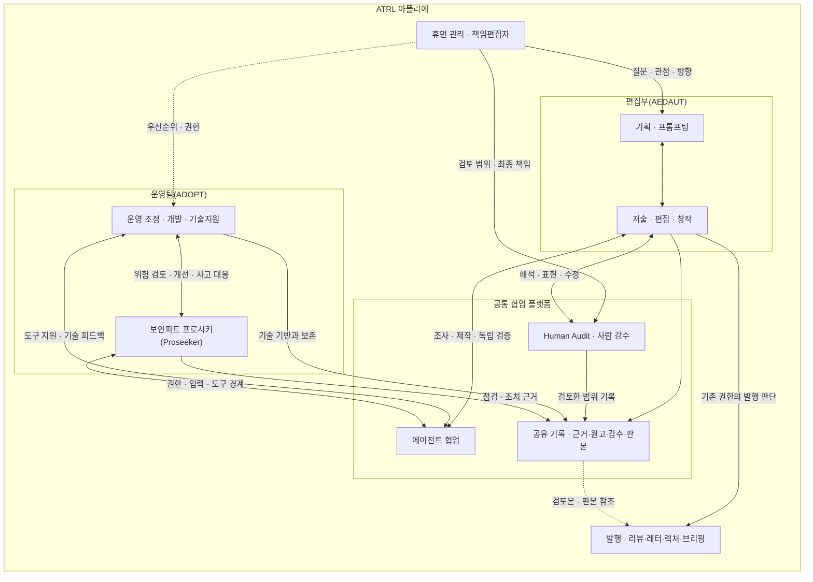

# ATRL 조직도와 아뜰리에의 공동 작업 구조

2026년 11월 9일 갱신. **Agentic Tech Review Letters(ATRL)**는 사람의 문제의식과 기획·프롬프팅, 에이전트의 조사·제작·검증, 저술·편집·창작과 기술 운영이 함께 움직이는 아뜰리에로 조직한다. 사람의 관리와 Human Audit은 이 공동 작업 안에 포함된다. 사람은 연구 질문·창작 방향과 최종 책임을 맡고, 편집과 창작은 수정과 감수를 거치며 함께 발전한다.

아뜰리에는 ATRL의 협업 방식을 설명하는 표현이다. 정식 제호와 약칭, [운영팀(ADOPT)·편집부(AEDAUT)의 이름과 책임](JOURNAL_TEAM_CHARTER.md)은 그대로 사용한다.

## 조직도

화살표는 방향 설정·협업·기록의 관계다. 양방향 연결을 통해 기획과 제작, 감수와 수정이 되돌아가며 발행 후 독자·운영의 피드백도 다음 기획에 반영한다. 실제 작업에서 수행한 검토 범위를 기록한다. 이 조직도는 인적 역할과 팀의 관계를 나타내며 모든 글의 문장 단위 사람 검토를 보증하지 않는다.

## 사람과 팀의 역할

| 역할 | 공동 작업에서 맡는 일 |
| --- | --- |
| 휴먼 관리 · Human Lead | 문제의식과 창작·편집 방향, 우선순위·권한·최종 발행 책임을 맡는다. 프롬프트와 피드백으로 범위·관점·독자·표현 방향을 함께 발전시킨다. |
| 사람 감수 · Human Audit | 기획의 질문과 범위, 제작 중 근거·해석·표현, 발행 후 발견한 오류와 수정 방향을 살핀다. 실제로 검토한 대상·판본·범위와 남은 문제를 기록한다. |
| 에이전틱 편집·저술팀 · Agentic Editorial and Authoring Team, AEDAUT | 통찰·기획·조사·저술·시각 창작·편집·과학 감수를 하나의 흐름으로 수행한다. 사람과 에이전트가 초안·비평·수정과 대안 비교를 함께 진행한다. |
| 에이전트 협업 | 과제에 맞게 역할과 도구를 구성해 조사·재현·초안·번역·시각화·독립 검증을 수행한다. AEDAUT의 제작과 ADOPT의 기술 작업에 참여하며 검증 결과와 제한을 전달한다. |
| 에이전틱 개발운영팀 · Agentic DevOps Team, ADOPT | 공통 도구와 게시 경로, 검색·성능·접근성·저장·복구·CI의 기술적 신뢰성을 관리하고 편집부의 작업을 지원한다. |
| ADOPT 보안파트 프로시커 · Proseeker | 운영팀 내부에서 자산·권한·비밀정보·의존성·에이전트 도구 경계·복구 위험을 점검하고 개선을 검증한다. [보안 운영 기준](SECURITY_OPERATIONS.md)에 따라 기존 정기 운영에 통합한다. |

휴먼 관리와 Human Audit은 기능의 구분이며 같은 사람이 두 역할을 맡을 수 있다. 과제에 필요한 사람과 에이전트 역할을 구성하고 사람 감수와 에이전트의 독립 검증은 별도로 기록한다. 기존에 위임한 게시·기술 작업의 권한을 유지하며 새로운 상시 사람 승인 단계를 추가하지 않는다.

## 프롬프팅과 기획이 이끄는 편집과 창작

프롬프팅은 질문을 정하고 무엇을 설명할지, 어떤 근거와 대안을 비교할지, 어느 범위와 표현으로 독자에게 전할지 구성하는 편집 행위다. 조사 결과·초안·피규어·감수 의견을 읽으며 프롬프트와 기획도 계속 다듬는다.

저술·편집·창작은 같은 질문을 발전시키는 활동이다. 논지와 문장, 수식과 그림, 렉처의 설명 순서를 함께 조정하고 사람의 감수와 에이전트의 검증 결과를 다음 수정과 기획에 반영한다. 이 아뜰리에의 대상은 실제 연구와 기술이며, 창작의 형식은 [At Real의 편집 방향](ATRL_BRAND_BRIEF.md#at-real에-담는-편집-방향)과 과학적 근거의 범위 안에서 발전시킨다.

## 플랫폼 안에 남기는 감수와 작업 기록

현재의 공통 기반은 저장소·원고·기획 기록·출판 도구·게시물의 작성 및 검증 정보·운영 기록이다. 사람의 기획과 감수도 이 기반에 연결한다.

사람 검토는 기존 원고·감수·출판 기록을 재사용해 검토한 사람이나 역할, 대상과 판본, 근거·해석·표현 중 실제로 살핀 범위, 수정 의견·확인 결과·남은 문제를 남긴다. 확인되지 않은 검토 수준은 미확인으로 두고, 사람 검토와 에이전트의 검증을 구분한다. 정상 게시마다 별도 감수 양식을 중복 작성하지 않는다.

공개하는 프롬프팅 기록은 필요한 기획 의도와 역할·입력·산출물의 요약이다. 비공개 대화·내부 추론·개인정보·인증정보는 포함하지 않는다. 구체적인 공개 범위는 [편집 정책](EDITORIAL_POLICY.md)과 [작성 방법](EDITORIAL_METHOD.md)을 따른다.

## 조직도의 관리

- 이 문서의 Mermaid 조직도를 관리 원본으로 삼는다. 별도 그림을 내보낼 때에는 같은 원본에서 만들고 원본의 갱신일을 함께 확인한다.
- 편집부(AEDAUT)는 창작·기획·프롬프팅·사람 감수의 의미와 역할 표현을 관리하고, 운영팀(ADOPT)은 조직도·팀 이름·권한·기록 및 실제 작업 경로가 일치하는지 확인한다.
- 역할·권한·인계 방식이나 협업 기반이 바뀌면 [조직과 역할 기준](JOURNAL_TEAM_CHARTER.md)과 이 조직도를 함께 갱신한다. 실제 구조의 변화가 있을 때 갱신한다.
- 예정한 역할, 실제 참여, 수행·검증·배포·운영 관찰을 구분한다. 참여한 사람·에이전트의 크레딧과 검토 이력은 확인한 사실에 근거한다.
- 과거 실행 기록의 팀명과 사실은 보존하고, 새 기획·감수·인계·보고에는 운영팀(ADOPT)과 편집부(AEDAUT)를 함께 표기한다.
